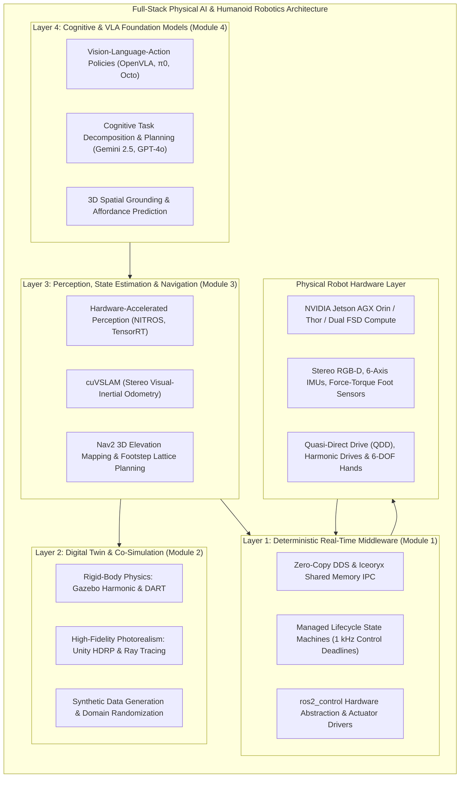

# Introduction to Physical AI & Humanoid Robotics

Welcome to the definitive engineering treatise on modern embodied artificial intelligence. We stand at the inflection point where AI breaks free from the disembodied confines of servers, LLM chat interfaces, and 2D vision models to inhabit the physical world. This discipline is **Physical AI**, and its most formidable manifestation is the **autonomous bipedal humanoid robot**.

Humanoid robots represent the apex of multi-disciplinary systems engineering: integrating high-bandwidth real-time control, nonlinear multi-body dynamics, computer vision, reinforcement learning, sim-to-real transfer, and multimodal foundation models into an unconstrained, high-degree-of-freedom embodied agent.

---

## 1. The Physical AI Paradigm & Moravec's Paradox

For decades, robotics and artificial intelligence evolved on divergent tracks. Classical AI excelled at symbolic reasoning, chess, and mathematical theorem proving—tasks requiring abstract computation. Conversely, tasks that a human infant masters effortlessly—walking across uneven terrain, recognizing objects amidst clutter, and dynamically adjusting finger compliance when grasping a fragile egg—proved extraordinarily difficult for automated systems. This asymmetry is known as **Moravec's Paradox**.

Physical AI resolves Moravec's Paradox by recognizing that intelligence cannot be divorced from its physical substrate:
1. **The Embodiment Hypothesis**: True spatial reasoning, intuitive physics, and semantic causal inference require an agent to interact dynamically with the physical environment, experiencing action-perception feedback loops.
2. **Contact-Rich Dynamics**: Unlike wheeled or fixed-base manipulators, humanoid robots are *underactuated* systems that rely on intermittent, non-smooth contact forces with the ground to maintain balance and generate forward momentum.
3. **Bandwidth Hierarchies**: Humanoid control requires managing multiple distinct temporal frequencies simultaneously:
   - **Hard Real-Time Motor Commutation**: 20 kHz (FOC current loops).
   - **Whole-Body Dynamics & QP Control**: 500 Hz – 1 kHz.
   - **Visual Odometry & Perception**: 30 Hz – 60 Hz.
   - **Continuous VLA Action Chunks**: 20 Hz – 50 Hz.
   - **High-Level Cognitive Task Planning**: 0.5 Hz – 2 Hz.

---

## 2. Global Industrial Benchmark: Frontier Humanoid Platforms

The current humanoid robotics landscape is characterized by intense convergence across high-torque actuation, edge GPU compute, and foundation models. The table below provides a rigorous technical comparison of the world's leading industrial and research platforms:

| Humanoid Platform | Total DOFs | Actuator Architecture | Compute Payload | Perception Stack | Battery & Mass | Locomotion / Control Paradigm |
| :--- | :--- | :--- | :--- | :--- | :--- | :--- |
| **Tesla Optimus Gen 2** | 28 body + 22 hands (11 per hand) | Custom integrated actuators (Rotary planetary + Linear screw actuators with load cells) | Dual Tesla FSD Computer (Custom Neural Processing Silicon) | 8 Autopilot cameras (multi-camera pure vision occupancy network) | 2.3 kWh pack (52V nominal), ~57 kg | End-to-End Neural Networks + Trajectory Optimization |
| **Boston Dynamics Atlas (Electric)** | ~28 body + 3-finger hands | Custom ultra-high-torque rotary actuators with 360° continuous joint rotations | High-performance x86 real-time industrial PC + GPU coprocessor | Depth cameras, Real-time multi-angle ToF, 6-axis IMUs | Modular quick-swap Li-ion pack, ~68 kg | Model Predictive Control (MPC) + Quadratic Programming Whole-Body Control (QP-WBC) + RL |
| **Figure 02** (Figure AI) | 28 body + 16 hands (6 DOFs per hand) | Custom high-torque electric actuators with integrated cabling through joints | Onboard 3x compute & inference payload (NVIDIA RTX / Orin grade) | 6 onboard RGB cameras, custom onboard microphones & speaker array | ~70 kg | OpenAI Vision-Language speech models + Whole-Body RL Locomotion |
| **Unitree G1 / H1** (Unitree Robotics) | 23–43 DOFs (depending on dexterous hand option) | High-speed Quasi-Direct Drive (QDD) actuators (M107 joint motors, 360 N·m peak) | Dual Intel Core i7 / NVIDIA Jetson Orin compute module | Livox Mid-360 LiDAR + Intel RealSense D435i depth cameras | 9000 mAh quick-release battery, ~35 kg (G1) / ~47 kg (H1) | Deep Reinforcement Learning (Isaac Gym Sim-to-Real) + MPC |
| **Agility Robotics Digit** | 20 DOFs + 4-DOF passive hands | Brushless DC motors with harmonic drives & fiberglass leaf springs (Series Elastic Actuators - SEA) | Multi-core real-time x86 controller | Multi-camera stereo rig, 4x Livox LiDAR sensors | 1.2 kWh Li-ion pack, ~48 kg | Classical Zero-Moment Point (ZMP) Preview Control + Hybrid Dynamical System Trajectory Optimization |
| **Sanctuary AI Phoenix** | 20 body + 40+ hands (high-fidelity dexterous hands) | Hydraulic-pneumatic hybrid actuators in upper body; electric lower chassis | Distributed edge computing nodes | Stereo cameras, high-density tactile arrays on each fingertip | Stationary / wheeled lower base, ~70 kg | Carbon AI Cognitive Architecture + Teleoperation Imitation Learning |

---

## 3. The Four-Module Curriculum Roadmap

This textbook is structured as a continuous engineering progression that builds a complete, production-grade humanoid software stack from the hardware abstraction layer up to multimodal cognitive reasoning:

### [Module 1: The Robotic Nervous System (ROS 2)](./module1-ros2/1-1-introduction)
- **Deterministic Middleware**: Data Distribution Service (DDS) wire protocol, RTPS discovery, QoS profiles.
- **Real-Time Architecture**: POSIX real-time scheduling (`SCHED_FIFO`), lockless ring buffers, memory pre-allocation.
- **High-Bandwidth Zero-Copy**: Eclipse Iceoryx shared-memory IPC for multi-gigabyte point clouds and uncompressed 4K video.
- **Node Lifecycle Management**: State machines for mission-critical actuator safety, watchdog monitors, and heartbeat diagnostics.

### [Module 2: The Digital Twin (Gazebo Harmonic & Unity)](./module2-digital-twin/2-1-introduction-to-digital-twins)
- **Multi-Body Dynamics**: Rigid body dynamics, Newton-Euler and Euler-Lagrange equations, Featherstone’s Articulated Body Algorithm (ABA).
- **Physics Co-Simulation**: Gazebo Harmonic, DART, Bullet, and ODE contact solvers, friction cone approximations.
- **High-Fidelity Photorealism**: Unity HDRP integration, ROS-TCP-Connector, coordinate transformation bridges.
- **Simulated Sensor Pipelines**: Realistic noise modeling for 6-axis IMUs, LiDAR beam divergence, and depth sensor occlusion.

### [Module 3: The AI-Robot Brain (NVIDIA Isaac Platform)](./module3-ai-robot-brain/3-1-introduction-to-isaac-platform)
- **Synthetic Data Generation (SDG)**: Isaac Sim Replicator, procedural scene composition, and domain randomization.
- **Hardware-Accelerated Perception**: Isaac ROS with NITROS (zero-copy GPU buffer exchange), TensorRT model compilation.
- **Spatial State Estimation**: cuVSLAM visual-inertial odometry tightly coupled with high-rate IMU filtering.
- **3D Locomotion & Navigation**: Nav2 for bipedal systems, 3D Elevation Mapping, Capture Point (CP) formulation, and dynamic footstep lattices.

### [Module 4: Vision-Language-Action (VLA) & Cognitive AI](./module4-vla/4-1-introduction-to-vla-systems)
- **Embodied Foundation Models**: Architecture and training of RT-1, RT-2, OpenVLA, Octo, and $\pi_0$ (Physical Intelligence).
- **Action Tokenization & Continuous Diffusion**: Discretized token bins vs. continuous score-based diffusion policies and Flow Matching.
- **Voice-to-Action Execution**: Streaming ASR (Whisper), semantic intent extraction, and hierarchical task decomposition with LLMs.
- **Affordance & Multimodal Grounding**: 3D bounding, 6-DOF FoundationPose, tactile feedback loops, and closed-loop error recovery.

---

## 4. Seminal Literature & Theoretical Foundations

Throughout this textbook, every algorithmic and mathematical formulation directly references foundational research papers that shaped modern humanoid engineering:

1. **Locomotion & ZMP Stability**:
   - Kajita, S., et al. (2003). *Biped walking pattern generation by using preview control of zero-moment point*. IEEE ICRA.
   - Pratt, J., et al. (2006). *Capture point: A step toward agile bipedal locomotion*. IEEE-RAS International Conference on Humanoid Robots.
2. **Whole-Body Control & Quadratic Programming**:
   - Kuindersma, S., et al. (2016). *Optimization-based locomotion planning, estimation, and control design for the Atlas humanoid robot*. Autonomous Robots.
   - Sentis, L., & Khatib, O. (2005). *Synthesis of whole-body behaviors through hierarchical control of behavioral primitives*. IJRR.
3. **Sim-to-Real Reinforcement Learning**:
   - Rudin, N., et al. (2022). *Learning to walk in minutes using massively parallel deep reinforcement learning*. Science Robotics.
   - Miki, T., et al. (2022). *Learning robust perceptive locomotion for quadrupedal robots in the wild*. Science Robotics.
4. **Vision-Language-Action & Foundation Policies**:
   - Brohan, A., et al. (Google DeepMind, 2023). *RT-2: Vision-Language-Action Models Transfer Web Knowledge to Robotic Control*. arXiv:2307.15818.
   - Black, K., et al. (Physical Intelligence, 2024). *$\pi_0$: A Vision-Language-Action Flow Model for Generalist Robot Manipulation*. Physical Intelligence Tech Report.

Let us begin by building the robust, low-latency foundation required for physical embodiment: **The Robotic Nervous System**.
