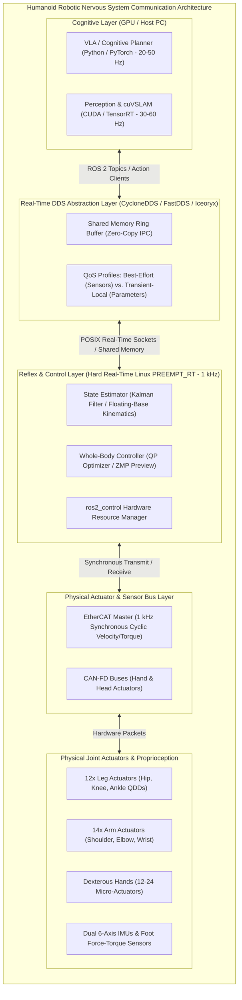
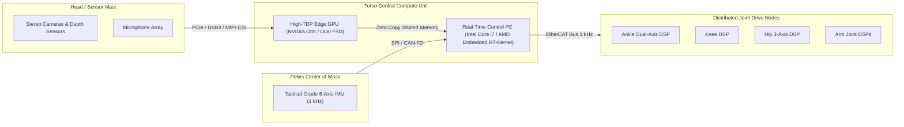

# Introduction to the Robotic Nervous System

The biological nervous system coordinates sensory perception, motor reflexes, proprioception, and conscious thought through an interconnected network of high-speed neural pathways. In a modern humanoid robot, **ROS 2 (Robot Operating System 2)** serves as this exact architectural backbone: a deterministic, distributed middleware connecting dozens of actuators, multi-modal perception sensors, real-time balance controllers, and high-level cognitive foundation models.



---

## 1. Why ROS 1 Failed for Humanoids and Why ROS 2 Succeeded

To understand ROS 2, one must analyze the architectural bottlenecks of ROS 1 that made it unsuitable for mission-critical bipedal humanoids:

| Feature / Metric | ROS 1 (Legacy) | ROS 2 (Modern Standard) | Humanoid Robotics Impact |
| :--- | :--- | :--- | :--- |
| **Central Coordinator** | Single `roscore` Master (Single point of failure) | Fully Decentralized Discovery (DDS RTPS Protocol) | No catastrophic total-system blackout if a single process crashes during bipedal balancing. |
| **Transport Layer** | Custom TCP/UDP (TCPROS / UDPROS) | OMG Data Distribution Service (DDS) Standard | Industrial-grade wire interoperability, vendor neutrality, and zero-copy shared memory. |
| **Real-Time Determinism** | Non-real-time; uncontrollable garbage collection & thread starvation | Designed for POSIX Real-Time (`PREEMPT_RT`, `SCHED_FIFO`) | Strict compliance with 1 kHz (1 ms) control deadlines required to prevent humanoid tip-over. |
| **Quality of Service (QoS)** | Best-effort or reliable only (hardcoded TCP socket behavior) | Granular QoS (History, Depth, Reliability, Durability, Liveliness, Deadline) | High-frequency IMU streams discard stale packets; mission-critical E-Stop messages are guaranteed. |
| **Lifecycle Management** | Unmanaged ad-hoc node startup; race conditions on initialization | Formal Managed Lifecycle State Machines (Unconfigured &rarr; Inactive &rarr; Active) | Actuator power stages are not energized until state estimators and sensors confirm readiness. |
| **Security Architecture** | Zero security; plaintext unauthenticated packet injection | SROS2 (DDS Security: PKI encryption, authentication, access control) | Critical protection against malicious joint command override on high-payload humanoids. |

---

## 2. Distributed Compute Topology on Frontier Humanoids

A modern humanoid robot is never a single monolithic computer. Rather, it is an asynchronous, heterogeneous compute cluster packaged within a biological envelope. Consider the distributed topology of systems like **Tesla Optimus**, **Boston Dynamics Atlas**, and **Figure 02**:



1. **High-Level Cognitive Compute (Torso / Backpack)**: Runs Ubuntu 22.04 / 24.04 with an NVIDIA GPU (e.g., Jetson AGX Orin or custom FSD silicon). Executes Vision-Language-Action foundation models, deep SLAM, semantic segmentation, and human-intent audio pipelines.
2. **Real-Time Locomotion PC**: Runs Linux patched with the `PREEMPT_RT` real-time kernel. Hosts the whole-body model predictive controller (MPC), Quadratic Programming (QP) solver, and footstep stabilizer at 1,000 Hz.
3. **Joint-Level Microcontrollers**: Embedded DSPs (Digital Signal Processors) directly mounted to joint stators (e.g., STM32H7 or TI C2000). Execute Field-Oriented Control (FOC) current commutation at 20 kHz to 40 kHz, communicating via EtherCAT or high-speed CAN-FD.

ROS 2 provides the unified, type-safe nervous system that stitches this heterogeneous multi-layer cluster into a single coherent entity.

---

## 3. High-Frequency Sensory Feedback & Jitter Constraints

In bipedal robotics, timing jitter is the primary cause of instability. When a 70 kg humanoid strikes the ground during a heel-strike transient:
- A delay of **2 milliseconds** in reading the 6-axis foot force-torque sensor can cause the ground reaction force estimator to diverge.
- The whole-body controller calculates joint torques based on stale center-of-mass positions.
- The foot bounces, contact is lost, and the biped loses dynamic stability (falls).

```mermaid
sequenceDiagram
    autonumber
    participant Sensor as Foot F/T Sensor & IMU
    participant RTKernel as Real-Time Thread (1 ms deadline)
    participant Solver as QP Whole-Body Controller
    participant Actuator as Knee/Ankle BLDC Motors

    rect rgb(240, 248, 255)
    Note over Sensor,Actuator: Cycle t (0.00 ms): Target Period = 1.000 ms
    Sensor->>RTKernel: Transmit Force-Torque & Orientation (SPI / EtherCAT)
    RTKernel->>Solver: Update Floating-Base State Matrix
    Solver->>Solver: Solve Constrained QP under Friction Cone (0.42 ms)
    Solver->>Actuator: Dispatch Desired Motor Current Commands
    Actuator-->>RTKernel: Return Measured Joint Velocities & Temperatures
    Note over RTKernel: Completed at 0.68 ms (Jitter: +0.02 ms) - SAFE
    end

    rect rgb(255, 240, 240)
    Note over Sensor,Actuator: Cycle t+1 (1.00 ms): OS Page Fault / Thread Preemption
    Sensor->>RTKernel: Sensor Packet Arrives
    Note over RTKernel: Non-RT Memory Allocation (malloc) causes Page Fault!
    RTKernel-->>RTKernel: Delayed execution... (1.45 ms elapsed)
    Solver->>Actuator: Late torque dispatch (Missed Deadline!)
    Note over Actuator: Motor executes stale command; Foot slips!
    end
```

To eliminate latency and jitter, ROS 2 is architected to allow:
- **Zero-allocation real-time loops**: Memory is pre-allocated on startup (`mlockall()`); no heap allocations occur during the active control phase.
- **Thread core pinning**: Pinning the high-frequency control executor to an isolated CPU core (`isolcpus`).
- **POSIX RT priority**: Running node threads under `SCHED_FIFO` with priority 98.

In the next chapter, we formalize the fundamental building blocks of this real-time system: **Nodes, Graphs, and Data Distribution Entities**.
