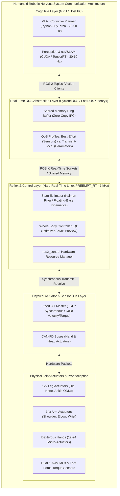
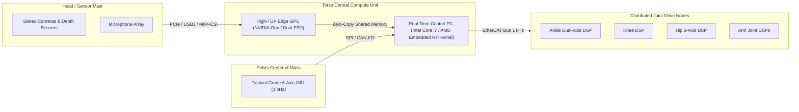
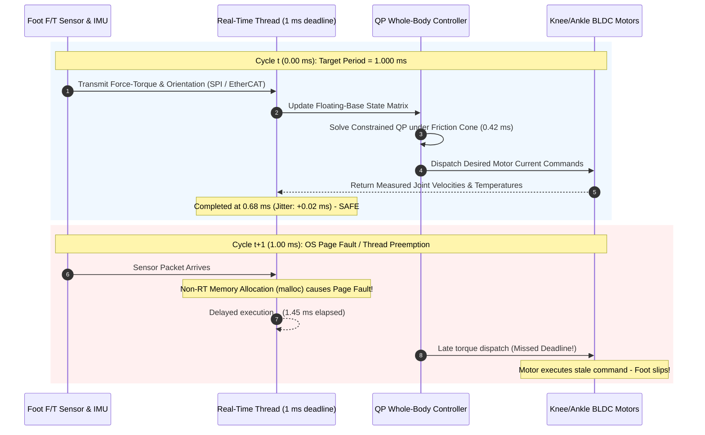

import ChapterProgress from '@site/src/components/ChapterProgress';
import QuizEngine from '@site/src/components/QuizEngine';

# Introduction to the Robotic Nervous System

The biological nervous system coordinates sensory perception, motor reflexes, proprioception, and conscious thought through an interconnected network of high-speed neural pathways. In a modern humanoid robot, **ROS 2 (Robot Operating System 2)** serves as this exact architectural backbone: a deterministic, distributed middleware connecting dozens of actuators, multi-modal perception sensors, real-time balance controllers, and high-level cognitive foundation models.



---

## 1. Why ROS 1 Failed for Humanoids and Why ROS 2 Succeeded

To understand ROS 2, one must analyze the architectural bottlenecks of ROS 1 that made it unsuitable for mission-critical bipedal humanoids:

| Feature / Metric | ROS 1 (Legacy) | ROS 2 (Modern Standard) | Humanoid Robotics Impact |
| :--- | :--- | :--- | :--- |
| **Central Coordinator** | Single `roscore` Master (Single point of failure) | Fully Decentralized Discovery (DDS RTPS Protocol) | No catastrophic total-system blackout if a single process crashes during bipedal balancing. |
| **Transport Layer** | Custom TCP/UDP (TCPROS / UDPROS) | OMG Data Distribution Service (DDS) Standard | Industrial-grade wire interoperability, vendor neutrality, and zero-copy shared memory. |
| **Real-Time Determinism** | Non-real-time; uncontrollable garbage collection & thread starvation | Designed for POSIX Real-Time (`PREEMPT_RT`, `SCHED_FIFO`) | Strict compliance with 1 kHz (1 ms) control deadlines required to prevent humanoid tip-over. |
| **Quality of Service (QoS)** | Best-effort or reliable only (hardcoded TCP socket behavior) | Granular QoS (History, Depth, Reliability, Durability, Liveliness, Deadline) | High-frequency IMU streams discard stale packets; mission-critical E-Stop messages are guaranteed. |
| **Lifecycle Management** | Unmanaged ad-hoc node startup; race conditions on initialization | Formal Managed Lifecycle State Machines (Unconfigured $\rightarrow$ Inactive $\rightarrow$ Active) | Actuator power stages are not energized until state estimators and sensors confirm readiness. |
| **Security Architecture** | Zero security; plaintext unauthenticated packet injection | SROS2 (DDS Security: PKI encryption, authentication, access control) | Critical protection against malicious joint command override on high-payload humanoids. |

---

## 2. Distributed Compute Topology of Frontier Humanoids

A modern humanoid robot is never a single monolithic computer. Rather, it is an asynchronous, heterogeneous compute cluster packaged within a biological envelope. Consider the distributed topology of systems like **Tesla Optimus**, **Boston Dynamics Atlas**, and **Figure 02**:



1. **High-Level Cognitive Compute (Torso / Backpack)**: Runs Ubuntu 22.04 / 24.04 with an NVIDIA GPU (e.g., Jetson AGX Orin or custom FSD silicon). Executes Vision-Language-Action foundation models, deep SLAM, semantic segmentation, and human-intent audio pipelines.
2. **Real-Time Locomotion PC**: Runs Linux patched with the `PREEMPT_RT` real-time kernel. Hosts the whole-body model predictive controller (MPC), Quadratic Programming (QP) solver, and footstep stabilizer at 1,000 Hz.
3. **Joint-Level Microcontrollers**: Embedded DSPs (Digital Signal Processors) directly mounted to joint stators (e.g., STM32H7 or TI C2000). Execute Field-Oriented Control (FOC) current commutation at 20 kHz to 40 kHz, communicating via EtherCAT or high-speed CAN-FD.

ROS 2 provides the unified, type-safe nervous system that stitches this heterogeneous multi-layer cluster into a single coherent entity.

---

## 3. Mathematical Formulation of Humanoid Telemetry & Communication Bandwidth

To guarantee deterministic real-time communication across the humanoid network fabric, the system architect must analytically size the maximum throughput and verify that queuing delays remain bounded below physical deadlines.

### Network Bandwidth Aggregation Model

The total aggregated bandwidth consumed across all active communication streams on the humanoid bus is formulated as:

$$
\text{BW}_{\text{total}} = \sum_{i=1}^N f_i \cdot S_i \cdot 8 \times 10^{-6} \quad [\text{Mbps}]
$$

where:
- $N$ is the total count of active telemetry streams,
- $f_i$ is the sampling frequency (Hz) of stream $i$,
- $S_i$ is the fully serialized payload size (bytes), incorporating Common Data Representation (CDR) alignment padding, RTPS submessage headers, and IP/UDP encapsulation headers.

### Queuing Delay and Network Utilization ($M/M/1$ Model)

Under an $M/M/1$ queue representation of the central switch buffer, the mean packet waiting time $W$ and utilization factor $\rho$ are:

$$
W = \frac{1}{\mu - \lambda}, \quad \rho = \frac{\lambda}{\mu} < 1
$$

where $\lambda = \sum_{i=1}^N f_i$ is the aggregate arrival rate (packets/sec) and $\mu$ is the service capacity of the network interface. When $\rho \ge 0.70$, queuing delay variance spikes exponentially, inducing timing jitter that breaches real-time control deadlines.

### Telemetry Stream Bandwidth Budget

| Data Stream | Frequency $f_i$ | Serialized Payload $S_i$ | Total Bandwidth |
| :--- | :---: | :---: | :---: |
| **Dual 6-Axis IMUs** (`/imu/data`) | $1000\text{ Hz}$ | $128\text{ bytes}$ | $1.024\text{ Mbps}$ |
| **32 Joint States** (`q, \dot{q}, \tau`) | $1000\text{ Hz}$ | $896\text{ bytes}$ | $7.168\text{ Mbps}$ |
| **Dual Foot 6-Axis F/T Sensors** | $1000\text{ Hz}$ | $96\text{ bytes}$ | $0.768\text{ Mbps}$ |
| **Dual Stereo 1080p Cameras (Raw)** | $60\text{ Hz}$ | $8.29 \times 10^6\text{ bytes}$ | $3981.31\text{ Mbps}$ |
| **Torso 3D LiDAR (100k points)** | $20\text{ Hz}$ | $3.20 \times 10^6\text{ bytes}$ | $512.00\text{ Mbps}$ |
| **Diagnostic Heartbeat & Health** | $10\text{ Hz}$ | $2048\text{ bytes}$ | $0.164\text{ Mbps}$ |

Notice that raw uncompressed vision cannot traverse standard Gigabit Ethernet; it necessitates onboard zero-copy GPU shared memory (e.g., Iceoryx / NVMM on NVIDIA Jetson).

---

## 4. Physical Bus Architecture & Transceiver IC Specifications

Humanoid robots employ distinct physical communication tiers depending on deterministic latency, bandwidth, and noise immunity requirements:

| Bus / Interface | Physical Standard | Max Bitrate | Deterministic Jitter | Physical Transceiver IC | Humanoid Subsystem |
| :--- | :--- | :--- | :--- | :--- | :--- |
| **Gigabit Ethernet** | 1000BASE-T (IEEE 802.3ab) | 1000 Mbps | &lt; 50 $\mu$s (PTP IEEE 1588) | TI DP83867CR / Realtek RTL8211F | Host GPU to Real-Time Controller |
| **Automotive Ethernet** | 100BASE-T1 (IEEE 802.3bw) | 100 Mbps | &lt; 10 $\mu$s | NXP TJA1101 / Marvell 88Q2112 | Torso to Limb Gateways |
| **EtherCAT** | 100BASE-TX (IEC 61158) | 100 Mbps | &lt; 1.0 $\mu$s (Distributed Clocks) | Microchip LAN9252 / Beckhoff ET1100 | Real-Time PC to Leg/Arm BLDC Drives |
| **CAN-FD** | ISO 11898-1:2015 | 8.0 Mbps | 5–20 $\mu$s | TI TCAN1042 / NXP TJA1044 | Hand Fingers & Tactile Sensors |
| **SPI** | Synchronous 4-Wire | 50.0 MHz | &lt; 100 ns | Direct Microcontroller GPIO / Level Shifter | IMU & Sole Load Cell Interfacing |

---

## 5. High-Frequency Sensory Feedback & Jitter Constraints

In bipedal robotics, timing jitter is the primary cause of instability. When a 70 kg humanoid strikes the ground during a heel-strike transient:
- A delay of **2 milliseconds** in reading the 6-axis foot force-torque sensor can cause the ground reaction force estimator to diverge.
- The whole-body controller calculates joint torques based on stale center-of-mass positions.
- The foot bounces, contact is lost, and the biped loses dynamic stability (falls).



To eliminate latency and jitter, ROS 2 is architected to allow:
- **Zero-allocation real-time loops**: Memory is pre-allocated on startup (`mlockall()`); no heap allocations occur during the active control phase.
- **Thread core pinning**: Pinning the high-frequency control executor to an isolated CPU core (`isolcpus`).
- **POSIX RT priority**: Running node threads under `SCHED_FIFO` with priority 98.

---

## 6. Middleware Benchmark: ROS 2 vs. OROCOS vs. YARP

In the history of robotics middleware, humanoids like Honda ASIMO, iCub, and HRP-4 originally explored specialized frameworks before the industry converged on ROS 2:

| Metric / Dimension | OROCOS RTT | YARP (Yet Another Robot Platform) | ROS 2 (Humble / Iron / Jazzy) |
| :--- | :--- | :--- | :--- |
| **Primary Focus** | Hard real-time component framework for manipulators | Multi-device humanoid research (iCub platform) | Full-stack distributed autonomous physical AI |
| **Underlying Wire Protocol** | CORBA / Custom IPC | Port-based TCP/UDP carrier connections | OMG standard DDS (RTPS wire spec) |
| **Ecosystem & Community** | Highly academic; limited tooling | Robotics lab specific; niche hardware support | Global industry standard with NVIDIA, Amazon, and Tesla adoption |
| **AI & Perception Bridges** | Difficult to interface with deep learning frameworks | Custom bindings for OpenCV/YOLO | Native zero-copy GPU memory exchange via NITROS |
| **Real-Time Determinism** | Native hard real-time C++ components | Soft real-time on standard Linux kernels | Hard real-time capable via POSIX `PREEMPT_RT` and `rclcpp` |

---

## 7. Runnable Code: Analytical Network Bandwidth Sizing

The following production script computes the aggregated DDS throughput, evaluates interface utilization, and warns when queuing jitter thresholds are exceeded:

```python
#!/usr/bin/env python3
"""
humanoid_bandwidth_budget.py: Analytical model for computing total DDS 
network throughput and buffer sizing for a 32-DOF humanoid robot.
"""
from dataclasses import dataclass
from typing import List

@dataclass
class TelemetryStream:
    name: str
    rate_hz: float
    payload_bytes: int
    rtps_overhead_bytes: int = 48  # RTPS message + submessage + IP/UDP headers

    @property
    def bandwidth_mbps(self) -> float:
        total_frame_bytes = self.payload_bytes + self.rtps_overhead_bytes
        return self.rate_hz * total_frame_bytes * 8.0 / 1e6

def calculate_system_load(streams: List[TelemetryStream], link_capacity_mbps: float) -> None:
    total_bw = sum(s.bandwidth_mbps for s in streams)
    utilization = (total_bw / link_capacity_mbps) * 100.0

    print(f"{'Stream Name':<35} | {'Rate (Hz)':<10} | {'Payload':<10} | {'Bandwidth (Mbps)':<15}")
    print("-" * 80)
    for s in streams:
        print(f"{s.name:<35} | {s.rate_hz:<10.1f} | {s.payload_bytes:<10} | {s.bandwidth_mbps:<15.4f}")
    print("-" * 80)
    print(f"Total Aggregated Bandwidth: {total_bw:.3f} Mbps on {link_capacity_mbps:.0f} Mbps link ({utilization:.2f}% utilization)")
    if utilization > 70.0:
        print("WARNING: Network load exceeds 70% threshold. Jitter-sensitive streams risk queuing delay spikes!")
    else:
        print("SUCCESS: Network bandwidth within deterministic boundaries.")

if __name__ == "__main__":
    humanoid_streams = [
        TelemetryStream("Pelvis & Torso Dual IMU (/imu/data)", 1000.0, 128),
        TelemetryStream("32-DOF Joint States (/joint_states)", 1000.0, 896),
        TelemetryStream("Dual Foot 6-Axis F/T (/feet/wrench)", 1000.0, 96),
        TelemetryStream("Head Stereo Depth (/camera/depth)", 30.0, 640 * 480 * 2),
        TelemetryStream("Torso 3D LiDAR (/lidar/points)", 20.0, 100000 * 32),
        TelemetryStream("Fleet Diagnostics Heartbeat (/diagnostics)", 10.0, 2048),
    ]
    calculate_system_load(humanoid_streams, link_capacity_mbps=1000.0)
```

---

## 8. Research Foundations & Seminal Literature

1. **Quigley, M., Conley, K., Gerkey, B., Faust, J., Foote, T., Leibs, J., Wheeler, R., & Ng, A. Y. (2009).** *ROS: an open-source Robot Operating System*. In IEEE ICRA Workshop on Open Source Software (Vol. 3, No. 3.2, p. 5).
2. **Macenski, S., Foote, T., Gerkey, B., Lalancette, C., & Woodall, W. (2022).** *Robot Operating System 2: Design, architecture, and uses in the wild*. Science Robotics, 7(66), eabm6074.
3. **Maruyama, Y., Kato, S., & Azumi, T. (2016).** *Exploring the performance of ROS2*. In Proceedings of the 13th International Conference on Embedded Software (EMSOFT) (pp. 1-10).
4. **Corsaro, A., Schmidt, D. C., & O'Ryan, C. (2012).** *The Data Distribution Service: The Architecture for the Internet of Real-Time Things*. IEEE Internet Computing, 16(2), 54-60.

---

<ChapterProgress chapterId="1-1-introduction" moduleId="module1" totalChapters={14} />

## Chapter Mastery Check

<QuizEngine
  quizId="quiz-1-1"
  title="Module 1.1 Mastery Check: The Robotic Nervous System"
  moduleId="module1"
  passThreshold={70}
  questions={[
    {
      id: "q1",
      question: "Why is a decentralized discovery architecture (DDS RTPS) essential for bipedal humanoid robots compared to the centralized roscore of ROS 1?",
      options: [
        "Decentralized discovery reduces the total memory usage on the GPU",
        "It eliminates a single point of failure where a crashed master crashes the entire robot balance loop",
        "It allows ROS 2 to run without an underlying operating system kernel",
        "It eliminates the need for physical Ethernet cables between computers"
      ],
      correctIndex: 1,
      explanation: "A centralized master (roscore) represents a single point of failure. If roscore crashes or pauses for garbage collection, all node-to-node routing stalls, leading to catastrophic loss of balance in bipedal humanoids."
    },
    {
      id: "q2",
      question: "According to M/M/1 queuing theory, what happens to network delay variance when switch buffer utilization rho exceeds 70%?",
      options: [
        "Network latency drops to zero due to buffer saturation",
        "Queuing delay variance grows exponentially, introducing non-deterministic jitter that violates 1 kHz control deadlines",
        "The Ethernet switch automatically doubles its clock frequency",
        "Packets are instantly rerouted over the CAN-FD bus without packet loss"
      ],
      correctIndex: 1,
      explanation: "In queuing theory, as utilization rho approaches 1, the mean queue length and waiting time variance scale as 1/(1 - rho). Operating above 70% utilization produces non-deterministic jitter spikes that cause late torque commands."
    },
    {
      id: "q3",
      question: "Which fieldbus is the industry standard for synchronizing joint BLDC motor drives with sub-microsecond jitter via Distributed Clocks (Sync0)?",
      options: [
        "Standard Wi-Fi 6 (802.11ax)",
        "USB 3.1 Gen 2",
        "EtherCAT (100BASE-TX / IEC 61158)",
        "I2C at 100 kHz"
      ],
      correctIndex: 2,
      explanation: "EtherCAT utilizes the Sync0 hardware distributed clock mechanism to synchronize multi-axis motor inverters across the robot with jitter below 1 microsecond, making it ideal for 1 kHz leg control."
    }
  ]}
/>
