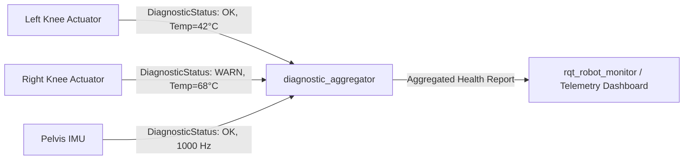

# Best Practices, Safety Watchdogs & Diagnostics

An autonomous humanoid robot weighing between 50 kg and 80 kg and capable of exerting over 300 N&middot;m of joint torque is a high-power industrial machine. A software crash, an unhandled exception, or an unchecked sensor disconnection can result in catastrophic mechanical failure or physical injury.

Building a production humanoid requires adhering to strict safety patterns: **Multi-Tier Emergency Stop (E-Stop) Hierarchies**, **Independent Safety Watchdogs**, **Standardized Diagnostics Aggregation**, and **DDS Security (SROS2)**.

```mermaid
flowchart TD
    subgraph MultiTierSafety["Multi-Tier Humanoid Safety Architecture"]
        PhysicalEStop["Tier 1: Physical / Wireless E-Stop<br/>(Hardware Contactor Breaks 48V High-Voltage Bus instantly)"]
        WatchdogNode["Tier 2: Real-Time Software Watchdog Node (1 kHz)<br/>(Monitors Heartbeats, IMU Jitter, Bus Timeouts)"]
        DiagnosticsNode["Tier 3: Diagnostics Aggregator Node<br/>(Monitors Inverter Temperatures, Battery State of Health)"]

        PhysicalEStop -->|De-energize Coils| MechanicalBrakes["Spring-Applied Mechanical Friction Brakes Clamp Joints"]
        
        WatchdogNode -->|Missed Heartbeat (>10 ms)| SoftStop["Controlled Soft-Stop: Ramp Torques to Zero & Crouch to Ground"]
        
        DiagnosticsNode -->|Over-temperature (>75°C)| ThermalDerating["Thermal Derating: Cap Peak Torques to 50%"]
    end
```

---

## 1. Naming & Topic Namespace Hierarchy

On a robot with hundreds of active communication topics, ad-hoc topic names like `/cmd_vel` or `/image` cause naming collisions and broken launch orchestrations. Professional humanoid stacks enforce strict hierarchical namespaces:

```text
/humanoid/
├── sensors/
│   ├── imu/
│   │   ├── pelvis/data_raw        [sensor_msgs/Imu]
│   │   └── head/data_raw          [sensor_msgs/Imu]
│   ├── cameras/
│   │   ├── stereo_left/image_raw  [sensor_msgs/Image - Zero Copy]
│   │   └── stereo_right/image_raw [sensor_msgs/Image - Zero Copy]
│   └── feet/
│       ├── left/wrench            [geometry_msgs/WrenchStamped]
│       └── right/wrench           [geometry_msgs/WrenchStamped]
├── control/
│   ├── joint_states               [sensor_msgs/JointState]
│   ├── forward_effort_controller/commands [std_msgs/Float64MultiArray]
│   └── state_estimator/odom       [nav_msgs/Odometry]
├── safety/
│   ├── heartbeat                  [std_msgs/Header]
│   ├── emergency_stop             [std_msgs/Bool]
│   └── diagnostics                [diagnostic_msgs/DiagnosticArray]
└── cognition/
    ├── vla/action_chunk           [humanoid_msgs/ActionChunk]
    └── speech/transcript          [std_msgs/String]
```

---

## 2. Diagnostics Aggregation Pipeline

The standard ROS 2 diagnostics pipeline utilizes `diagnostic_updater` inside every node to stream component health metrics to a centralized `/diagnostics` topic. A dedicated `diagnostic_aggregator` node groups these reports into logical subsystems:



---

## 3. Production C++20 Safety Watchdog Node

The following production node implements a real-time hardware watchdog that monitors the heartbeat of the primary locomotion controller. If a control packet is delayed by more than **10 milliseconds**, it instantly dispatches a hardware emergency stop:

```cpp
#include <chrono>
#include <memory>
#include "diagnostic_msgs/msg/diagnostic_array.hpp"
#include "rclcpp/rclcpp.hpp"
#include "std_msgs/msg/bool.hpp"
#include "std_msgs/msg/header.hpp"

using namespace std::chrono_literals;

class HumanoidSafetyWatchdog : public rclcpp::Node {
public:
  HumanoidSafetyWatchdog() : Node("humanoid_safety_watchdog") {
    // 1. Configure publishers and subscribers
    estop_pub_ = create_publisher<std_msgs::msg::Bool>("/humanoid/safety/emergency_stop", 10);
    diag_pub_ = create_publisher<diagnostic_msgs::msg::DiagnosticArray>("/diagnostics", 10);

    heartbeat_sub_ = create_subscription<std_msgs::msg::Header>(
      "/humanoid/control/heartbeat",
      rclcpp::QoS(1).best_effort(),
      std::bind(&HumanoidSafetyWatchdog::heartbeat_callback, this, std::placeholders::_1));

    // 2. High-frequency watchdog timer running at 500 Hz (every 2 ms)
    watchdog_timer_ = create_wall_timer(
      2ms, std::bind(&HumanoidSafetyWatchdog::watchdog_check, this));

    last_heartbeat_time_ = now();
    estop_triggered_ = false;

    RCLCPP_INFO(get_logger(), "Humanoid Safety Watchdog online. Timeout threshold: 10 ms.");
  }

private:
  void heartbeat_callback(const std_msgs::msg::Header::SharedPtr msg) {
    (void)msg;
    last_heartbeat_time_ = now();
  }

  void watchdog_check() {
    auto time_since_last_heartbeat = now() - last_heartbeat_time_;

    // If locomotion thread freezes or misses deadlines for > 10 ms
    if (time_since_last_heartbeat > rclcpp::Duration(10ms) && !estop_triggered_) {
      estop_triggered_ = true;
      RCLCPP_FATAL(
        get_logger(),
        "WATCHDOG TRIGGERED! Locomotion heartbeat lost for %.2f ms. Engaging E-Stop!",
        time_since_last_heartbeat.seconds() * 1000.0);

      // Immediately publish E-Stop to trigger mechanical brakes and zero motor currents
      std_msgs::msg::Bool estop_msg;
      estop_msg.data = true;
      estop_pub_->publish(estop_msg);

      publish_diagnostic(diagnostic_msgs::msg::DiagnosticStatus::ERROR, "Locomotion controller freeze");
    }
  }

  void publish_diagnostic(uint8_t level, const std::string & message) {
    diagnostic_msgs::msg::DiagnosticArray diag_array;
    diag_array.header.stamp = now();

    diagnostic_msgs::msg::DiagnosticStatus status;
    status.name = "Humanoid Safety Watchdog";
    status.hardware_id = "core_watchdog";
    status.level = level;
    status.message = message;

    diag_array.status.push_back(status);
    diag_pub_->publish(diag_array);
  }

  rclcpp::Time last_heartbeat_time_;
  bool estop_triggered_;
  rclcpp::Publisher<std_msgs::msg::Bool>::SharedPtr estop_pub_;
  rclcpp::Publisher<diagnostic_msgs::msg::DiagnosticArray>::SharedPtr diag_pub_;
  rclcpp::Subscription<std_msgs::msg::Header>::SharedPtr heartbeat_sub_;
  rclcpp::TimerBase::SharedPtr watchdog_timer_;
};

int main(int argc, char * argv[]) {
  rclcpp::init(argc, argv);
  rclcpp::spin(std::make_shared<HumanoidSafetyWatchdog>());
  rclcpp::shutdown();
  return 0;
}
```

---

## 4. Module 1 Summary & Engineering Checklist

You have now established the complete, deterministic nervous system for an autonomous humanoid robot:
- [x] **Decentralized DDS RTPS** configured without single points of failure.
- [x] **Managed Lifecycle State Machines** preventing unsafe premature actuator power.
- [x] **Zero-Copy Shared Memory IPC** enabling gigabyte-per-second sensor pipelines at sub-microsecond latencies.
- [x] **Reentrant Concurrency** eliminating deadlock risks in service calls.
- [x] **Preemptible Actions** providing graceful recovery during locomotion failures.
- [x] **Dynamic Parameter Descriptors** enforcing strict physical stability envelopes.
- [x] **Hard Real-Time Watchdogs** ensuring automated protection against controller freezes.

With the nervous system operational, we advance to **Module 2: Constructing the High-Fidelity Physics Digital Twin in Gazebo Harmonic & Unity**.
