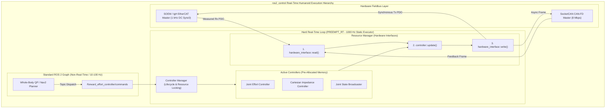

import ChapterProgress from '@site/src/components/ChapterProgress';
import QuizEngine from '@site/src/components/QuizEngine';

# ros2_control Hardware Abstraction & Real-Time Controllers

In high-degree-of-freedom humanoid robots, low-level control code cannot be tightly coupled to proprietary motor vendor SDKs. A change from an Elmo EtherCAT drive to a Maxon or custom CAN-FD drive must not force a rewrite of the balance stabilizer, the Whole-Body Controller (WBC), or the footstep planner.

The **`ros2_control`** framework establishes an industrial-grade hardware abstraction layer (HAL) and real-time execution container. It decouples high-level control algorithms from physical communication buses while guaranteeing deterministic, zero-allocation 1,000 Hz update cycles.



---

## 1. Component Types: SystemInterface, ActuatorInterface & SensorInterface

`ros2_control` organizes physical hardware into three polymorphic plugin abstractions implemented via `pluginlib`:

1. **`hardware_interface::SystemInterface`**:
   - Represents complex multi-DoF kinematic sub-assemblies (e.g., a 6-DoF leg or 7-DoF arm) sharing a synchronized communication bus.
   - Exports multiple joint command and state interfaces simultaneously within a unified read/write transaction.
2. **`hardware_interface::ActuatorInterface`**:
   - Models modular, single-DoF or modular multi-turn actuators (e.g., a brushless DC actuator module with integrated strain gauge and absolute encoder).
3. **`hardware_interface::SensorInterface`**:
   - Models pure feedback instruments without command capability (e.g., a 6-axis foot force-torque sensor or pelvis IMU).

---

## 2. Mathematical Formulation of Actuator Transmissions & Friction Compensation

In high-torque humanoid actuators (Quasi-Direct Drives or Planetary/Harmonic Drives), the relationship between raw motor rotor states ($\theta_m, \dot{\theta}_m, \tau_m$) and joint link states ($q, \dot{q}, \tau_j$) is governed by gear reduction ratio $N$ and mechanical transmission efficiency $\eta$:

### Transmission Kinematics & Torque Mapping

$$
q = \frac{1}{N} \theta_m, \quad \dot{q} = \frac{1}{N} \dot{\theta}_m, \quad \tau_j = N \cdot \eta \cdot \tau_m
$$

where $N = \frac{\omega_{\text{in}}}{\omega_{\text{out}}} \gg 1$ and $\eta \in [0.75, 0.95]$ represents gear mesh losses.

### Closed-Loop Effort Command with Feedforward & Friction Observer

In a 1 kHz joint torque control loop, the commanded motor effort $\tau_{\text{cmd}}[k]$ synthesizes proportional-derivative feedback, dynamic model feedforward $\tau_{\text{ff}}[k]$, and non-linear friction compensation $\hat{\tau}_{\text{friction}}$:

$$
\tau_{\text{cmd}}[k] = K_p (q_{\text{des}}[k] - q[k]) + K_d (\dot{q}_{\text{des}}[k] - \dot{q}[k]) + \tau_{\text{ff}}[k] + \hat{\tau}_{\text{friction}}(\dot{q}[k])
$$

where the Coulomb and viscous friction model is formulated as:

$$
\hat{\tau}_{\text{friction}}(\dot{q}) = \tau_c \operatorname{sgn}(\dot{q}) + \sigma_v \dot{q}
$$

with $\tau_c$ denoting the breakaway Coulomb friction threshold and $\sigma_v$ representing the viscous damping coefficient.

---

## 3. Hardware Controller Specifications & Fieldbus Synchronization

| Actuator Drive | Communication Protocol | Control Modes | Loop Frequency | Target Humanoid Joints |
| :--- | :--- | :--- | :--- | :--- |
| **Maxon EPOS4 70/15** | EtherCAT (CoE DS402) | Cyclic Synchronous Torque (CST) / Velocity (CSV) | 1000 Hz | High-payload Knee & Hip Pitch |
| **Elmo Gold Twitter** | EtherCAT (CoE DS402) | CST / Cyclic Synchronous Position (CSP) | 1000 Hz to 2000 Hz | Ankle Pitch/Roll, Hip Yaw/Roll |
| **TI Sitara AM64x (Custom)** | CAN-FD (ISO 11898-1) | Direct FOC Current / Impedance | 500 Hz to 1000 Hz | 7-DOF Dual Arms & Wrist Actuation |

---

## 4. Production C++20 `hardware_interface::SystemInterface` Plugin

The listing below illustrates a complete, production-grade `SystemInterface` plugin for a multi-axis humanoid leg, managing state and command interfaces across a 1 kHz fieldbus with safety torque clamping:

```cpp
// humanoid_hardware_interface.cpp: Production ros2_control SystemInterface plugin
#include <hardware_interface/system_interface.hpp>
#include <hardware_interface/types/hardware_interface_type_values.hpp>
#include <rclcpp/rclcpp.hpp>
#include <pluginlib/class_list_macros.hpp>
#include <vector>
#include <string>
#include <algorithm>

namespace humanoid_hardware {

class HumanoidJointSystem : public hardware_interface::SystemInterface {
public:
  hardware_interface::CallbackReturn on_init(const hardware_interface::HardwareInfo& info) override {
    if (hardware_interface::SystemInterface::on_init(info) != hardware_interface::CallbackReturn::SUCCESS) {
      return hardware_interface::CallbackReturn::ERROR;
    }
    hw_positions_.resize(info_.joints.size(), 0.0);
    hw_velocities_.resize(info_.joints.size(), 0.0);
    hw_efforts_.resize(info_.joints.size(), 0.0);
    hw_commands_effort_.resize(info_.joints.size(), 0.0);
    return hardware_interface::CallbackReturn::SUCCESS;
  }

  std::vector<hardware_interface::StateInterface> export_state_interfaces() override {
    std::vector<hardware_interface::StateInterface> state_interfaces;
    for (size_t i = 0; i < info_.joints.size(); ++i) {
      state_interfaces.emplace_back(info_.joints[i].name, hardware_interface::HW_IF_POSITION, &hw_positions_[i]);
      state_interfaces.emplace_back(info_.joints[i].name, hardware_interface::HW_IF_VELOCITY, &hw_velocities_[i]);
      state_interfaces.emplace_back(info_.joints[i].name, hardware_interface::HW_IF_EFFORT, &hw_efforts_[i]);
    }
    return state_interfaces;
  }

  std::vector<hardware_interface::CommandInterface> export_command_interfaces() override {
    std::vector<hardware_interface::CommandInterface> command_interfaces;
    for (size_t i = 0; i < info_.joints.size(); ++i) {
      command_interfaces.emplace_back(info_.joints[i].name, hardware_interface::HW_IF_EFFORT, &hw_commands_effort_[i]);
    }
    return command_interfaces;
  }

  hardware_interface::return_type read(const rclcpp::Time& /*time*/, const rclcpp::Duration& /*period*/) override {
    // Hard real-time 1 kHz loop: Ingest Rx PDO packet from EtherCAT bus
    // (In production, read directly from mapped SOEM/IgH memory buffer)
    return hardware_interface::return_type::OK;
  }

  hardware_interface::return_type write(const rclcpp::Time& /*time*/, const rclcpp::Duration& /*period*/) override {
    // Hard real-time 1 kHz loop: Enforce torque limits and dispatch Tx PDO
    const double MAX_TORQUE_LIMIT = 120.0; // N*m safety ceiling
    for (size_t i = 0; i < hw_commands_effort_.size(); ++i) {
      double clamped_tau = std::clamp(hw_commands_effort_[i], -MAX_TORQUE_LIMIT, MAX_TORQUE_LIMIT);
      // Write clamped_tau to physical fieldbus buffer
      (void)clamped_tau;
    }
    return hardware_interface::return_type::OK;
  }

private:
  std::vector<double> hw_positions_;
  std::vector<double> hw_velocities_;
  std::vector<double> hw_efforts_;
  std::vector<double> hw_commands_effort_;
};

} // namespace humanoid_hardware

PLUGINLIB_EXPORT_CLASS(humanoid_hardware::HumanoidJointSystem, hardware_interface::SystemInterface)
```

---

## 5. URDF / Xacro Hardware Tag Configuration

To bind the C++ plugin to the robot's kinematic model, the URDF defines `<ros2_control>` XML tags:

```xml
<?xml version="1.0"?>
<robot xmlns:xacro="http://www.ros.org/wiki/xacro">
  <ros2_control name="HumanoidLegSystem" type="system">
    <hardware>
      <plugin>humanoid_hardware/HumanoidJointSystem</plugin>
      <param name="ethercat_interface">eth0</param>
      <param name="cycle_time_us">1000</param>
    </hardware>
    <joint name="left_hip_pitch_joint">
      <command_interface name="effort">
        <param name="min">-150.0</param>
        <param name="max">150.0</param>
      </command_interface>
      <state_interface name="position"/>
      <state_interface name="velocity"/>
      <state_interface name="effort"/>
    </joint>
    <joint name="left_knee_pitch_joint">
      <command_interface name="effort">
        <param name="min">-250.0</param>
        <param name="max">250.0</param>
      </command_interface>
      <state_interface name="position"/>
      <state_interface name="velocity"/>
      <state_interface name="effort"/>
    </joint>
  </ros2_control>
</robot>
```

---

## 6. Research Foundations & Seminal Literature

1. **Stögl, D., Chitta, S., Maged, Z., Bálint-Benczédi, F., & Kay, B. (2021).** *ros2_control: A modern and flexible robot control framework*. Journal of Open Source Software (JOSS), 6(68), 3848.
2. **Chitta, S., Marder-Eppstein, E., Meeussen, W., Pradeep, V., Rodríguez, A., Saito, J., Wheeler, R., & Woodall, W. (2017).** *ros_control: A generic and simple control framework for ROS*. IEEE Robotics & Automation Magazine, 24(3), 35-41.
3. **Armstrong, B. (1988).** *Friction: Experimental analysis, modeling and compensation*. In IEEE International Conference on Robotics and Automation (ICRA) (pp. 1422-1427).

---

<ChapterProgress chapterId="1-11-ros2-control" moduleId="module1" totalChapters={14} />

## Chapter Mastery Check

<QuizEngine
  quizId="quiz-1-11"
  title="Module 1.11 Mastery Check: ros2_control Hardware Abstraction"
  moduleId="module1"
  passThreshold={70}
  questions={[
    {
      id: "q1",
      question: "Which ros2_control interface class must be implemented for a 6-DoF humanoid leg sharing an EtherCAT synchronous communication bus?",
      options: [
        "hardware_interface::SensorInterface",
        "hardware_interface::ActuatorInterface",
        "hardware_interface::SystemInterface",
        "hardware_interface::BroadcasterInterface"
      ],
      correctIndex: 2,
      explanation: "SystemInterface is designed for multi-DoF kinematic sub-assemblies (such as legs, arms, or whole robots) sharing common communication buses and synchronized read/write loops."
    },
    {
      id: "q2",
      question: "In real-time ros2_control loops, why is dynamic memory allocation (e.g. malloc, std::vector::push_back) strictly prohibited inside read() and write()?",
      options: [
        "It causes compilation errors under C++20",
        "Dynamic heap allocation triggers OS page faults and unbounded heap traversal latency, breaching the 1 ms control deadline",
        "EtherCAT cables only transmit static memory",
        "Controller Manager cannot serialize dynamic structs"
      ],
      correctIndex: 1,
      explanation: "Dynamic memory allocation invokes the OS kernel virtual memory manager, potentially triggering page faults and non-deterministic memory coalescing stalls that violate hard real-time guarantees."
    },
    {
      id: "q3",
      question: "What physical parameter converts motor rotor torque into joint link torque in a geared transmission?",
      options: [
        "Ambient temperature",
        "Gear reduction ratio N and transmission efficiency eta (tau_joint = N * eta * tau_motor)",
        "The baud rate of the CAN-FD bus",
        "The ROS 2 Domain ID"
      ],
      correctIndex: 1,
      explanation: "Torque is magnified by gear reduction ratio N scaled by transmission efficiency eta. Conversely, joint velocity is reduced by 1/N relative to rotor angular velocity."
    }
  ]}
/>
