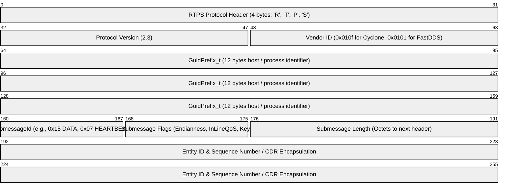
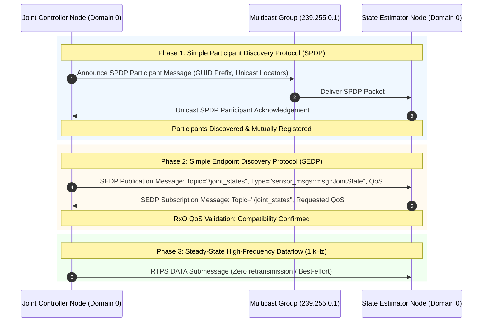

import ChapterProgress from '@site/src/components/ChapterProgress';
import QuizEngine from '@site/src/components/QuizEngine';

# DDS & RTPS Protocol Deep Dive: Wire-Level Anatomy & Determinism

The deterministic behavior of a humanoid robot relies entirely on the byte-level execution of the **OMG Real-Time Publish-Subscribe (RTPS)** wire protocol. While ROS 2 user code operates on high-level C++ structs or Python objects, the network interface controller (NIC) processes binary RTPS submessages encapsulated inside UDP/IP datagrams.

Understanding submessage headers, Globablly Unique Identifiers (GUIDs), Participant and Endpoint Discovery state machines, and reliability retransmission windows is essential for diagnosing bus congestion, packet drops, and non-deterministic timing jitter.



---

## 1. RTPS Wire-Level Header & Entity GUID Anatomy

Every RTPS packet begins with a 20-byte fixed header:
- **`Header.protocol`** (4 octets): ASCII characters `'R'`, `'T'`, `'P'`, `'S'`.
- **`Header.version`** (2 octets): Major and minor protocol revisions (typically `2.3` or `2.4`).
- **`Header.vendorId`** (2 octets): OMG-assigned vendor identifier (e.g., `0x0101` for eProsima, `0x0102` for RTI, `0x0110` for Eclipse CycloneDDS).
- **`Header.guidPrefix`** (12 octets): Unique host-and-process identifier computed from host IP, process ID, and steady clock entropy.

### GUID Composition

Every participant, reader, and writer in the humanoid graph is identified by a 16-byte Globally Unique Identifier (GUID):

$$
\text{GUID} = \left[ \text{GuidPrefix}_t \; (12\text{ bytes}) \;\parallel\; \text{EntityId}_t \; (4\text{ bytes}) \right]
$$

where `EntityId_t` identifies the specific entity. Built-in discovery entities possess reserved hardware IDs:
- `0x000100c2`: Built-in Participant Discovery Reader
- `0x000100c3`: Built-in Participant Discovery Writer
- `0x000200c7`: Built-in Subscription Discovery Reader
- `0x000200c2`: Built-in Publication Discovery Writer

---

## 2. Participant & Endpoint Discovery Protocols (PDP & EDP)

Before two nodes can exchange torque commands or IMU frames, they execute two nested state machines:



### Multicast Storms & Unicast Discovery Servers

In a standard distributed DDS network, discovery packets scale quadratically with participant count $P$ and endpoint count $E$:

$$
M_{\text{traffic}} = \mathcal{O}(P^2 + P \cdot E)
$$

On a humanoid robot with 40 microcontrollers and computing boards, broadcasting unmanaged discovery announcements triggers multicast saturation. Production humanoids deploy **FastDDS Discovery Servers** or Cyclone unicast peer lists, transforming discovery from $\mathcal{O}(P^2)$ broadcast into deterministic $\mathcal{O}(P)$ directed unicast transactions.

---

## 3. The RTPS Reliability Protocol: Sequence Number Windows & Retransmissions

When a topic is configured with `Reliability = RELIABLE`, the DataWriter and DataReader maintain synchronized sequence number sliding windows.

### Retransmission Latency Bound

If an RTPS packet is lost on the physical bus, the maximum time required to detect the loss and complete a retransmission is:

$$
T_{\text{resend\_max}} = T_{\text{heartbeat\_period}} + \text{RTT}_{\text{network}} + T_{\text{acknack\_response}}
$$

where $T_{\text{heartbeat\_period}}$ is the interval between periodic status checks, $\text{RTT}_{\text{network}}$ is the network round-trip time, and $T_{\text{acknack\_response}}$ is the reader's processing latency.

### Sequence Window Sliding Function

The DataWriter maintains unacknowledged samples within a strictly bounded window $W_{\text{window\_size}}$:

$$
\Delta S = S_{\text{max\_available}} - S_{\text{min\_unacknowledged}} \le W_{\text{window\_size}}
$$

If $\Delta S$ exceeds $W_{\text{window\_size}}$ under `History = KEEP_LAST(N)`, older unacknowledged packets are dropped or writer execution blocks, which will cause late control updates in real-time loops.

---

## 4. Physical Network Hardware & Timestamping Specifications

| Network Element | Model / Spec | Purpose in DDS Determinism | Failure Mode if Unconfigured |
| :--- | :--- | :--- | :--- |
| **Industrial Managed Switch** | Cisco IE-3300 / Moxa EDS-G508E | Hardware IGMP Snooping, QoS 802.1p priority tagging | Multicast saturation disables high-frequency joint control |
| **NIC Hardware Timestamping** | Intel I210 / I225-IT (IEEE 1588) | Captures hardware packet arrival times directly in PHY | Software jitter prevents sub-microsecond PTP clock synchronization |
| **Unicast Discovery Server** | FastDDS Discovery Server on Port 11811 | Eliminates multicast broadcasts over Wi-Fi / 5G links | Discovery failure if server crashes or IP changes |

---

## 5. Production XML Configuration: Low-Latency CycloneDDS Profile

Below is a production `cyclonedds.xml` configuration tuned for 1 kHz humanoid balance loops, enabling shared memory, pinning network interfaces, and configuring unicast discovery peers:

```xml
<?xml version="1.0" encoding="UTF-8" ?>
<!-- cyclonedds.xml: Low-latency deterministic profile for 1 kHz humanoid control -->
<CycloneDDS xmlns="https://cdds.io/config" 
            xmlns:xsi="http://www.w3.org/2001/XMLSchema-instance" 
            xsi:schemaLocation="https://cdds.io/config https://raw.githubusercontent.com/eclipse-cyclonedds/cyclonedds/master/etc/cyclonedds.xsd">
  <Domain id="any">
    <General>
      <NetworkInterfaceAddress>eth0</NetworkInterfaceAddress>
      <AllowMulticast>true</AllowMulticast>
      <MaxMessageSize>65536B</MaxMessageSize>
    </General>
    <Internal>
      <Watermarks>
        <WhcHigh>500kB</WhcHigh>
      </Watermarks>
    </Internal>
    <SharedMemory>
      <Enable>true</Enable>
      <LogLevel>warn</LogLevel>
    </SharedMemory>
    <Discovery>
      <ParticipantIndex>auto</ParticipantIndex>
      <MaxAutoParticipantIndex>30</MaxAutoParticipantIndex>
      <Peers>
        <Peer Address="192.168.1.10"/>
        <Peer Address="192.168.1.11"/>
      </Peers>
    </Discovery>
  </Domain>
</CycloneDDS>
```

To activate this configuration, export the environment variable:
```bash
export CYCLONEDDS_URI=file:///etc/ros/cyclonedds.xml
export RMW_IMPLEMENTATION=rmw_cyclonedds_cpp
```

---

## 6. Research Foundations & Seminal Literature

1. **Object Management Group (OMG). (2019).** *The Real-time Publish-Subscribe Protocol (RTPS) DDS Interoperability Wire Protocol Specification, Version 2.3*. OMG Document formal/19-04-03.
2. **Kronauer, T., Pohlmann, M., Matthes, J., & Staschulat, J. (2021).** *Latency Analysis of DDS Implementations for Autonomous Systems*. In 2021 IEEE International Conference on Embedded Software and Systems (ICESS) (pp. 1-8).
3. **Maruyama, Y., Kato, S., & Azumi, T. (2016).** *Exploring the performance of ROS2*. In Proceedings of the 13th International Conference on Embedded Software (EMSOFT) (pp. 1-10).

---

<ChapterProgress chapterId="1-12-dds-internals" moduleId="module1" totalChapters={14} />

## Chapter Mastery Check

<QuizEngine
  quizId="quiz-1-12"
  title="Module 1.12 Mastery Check: DDS & RTPS Protocol Deep Dive"
  moduleId="module1"
  passThreshold={70}
  questions={[
    {
      id: "q1",
      question: "In the RTPS wire protocol, how long is the GuidPrefix_t field that uniquely identifies the participant host process?",
      options: [
        "4 bytes",
        "8 bytes",
        "12 bytes",
        "16 bytes"
      ],
      correctIndex: 2,
      explanation: "GuidPrefix_t is exactly 12 bytes (96 bits) long. Combined with the 4-byte EntityId_t, it forms the full 16-byte (128-bit) GUID identifying every DDS reader, writer, and participant."
    },
    {
      id: "q2",
      question: "Why does unmanaged Simple Participant Discovery Protocol (SPDP) cause multicast storms in large humanoid robot networks?",
      options: [
        "Multicast packets are encrypted with AES-256",
        "Every participant periodically broadcasts SPDP packets to all other participants, causing network discovery traffic to scale quadratically as O(P^2 + P*E)",
        "DDS discovery disables the Linux firewall",
        "Microcontrollers cannot read UDP packets"
      ],
      correctIndex: 1,
      explanation: "Without a discovery server, every node sends periodic discovery broadcasts across the multicast group. In dense networks, this O(P^2) flood saturates embedded transceivers and switches."
    },
    {
      id: "q3",
      question: "What submessage does a reliable RTPS DataWriter transmit to inform DataReaders of its current sequence number range?",
      options: [
        "DATA_FRAG",
        "HEARTBEAT",
        "ACKNACK",
        "INFO_SRC"
      ],
      correctIndex: 1,
      explanation: "The DataWriter periodically sends a HEARTBEAT submessage announcing its first and last available sequence numbers. If a DataReader detects a gap in sequence numbers, it responds with an ACKNACK requesting missing frames."
    }
  ]}
/>
