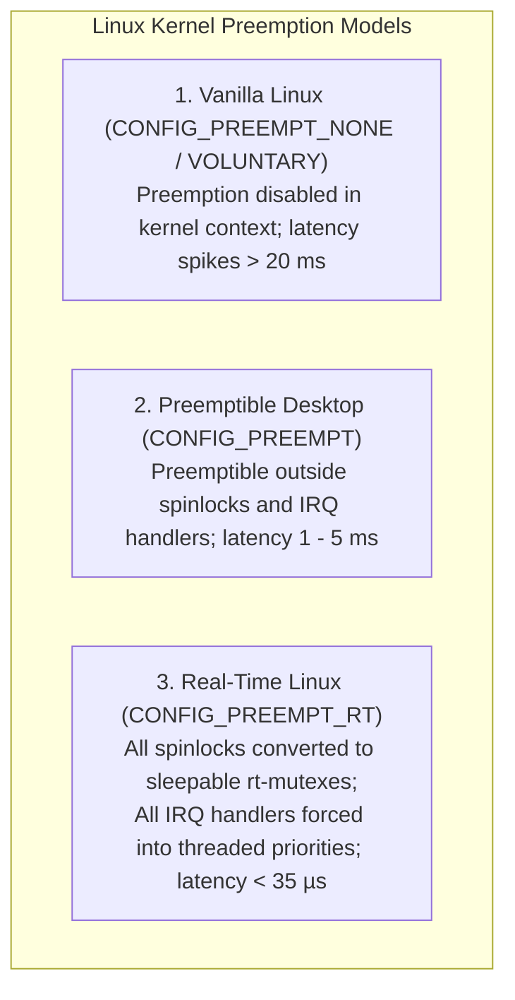

import ChapterProgress from '@site/src/components/ChapterProgress';
import QuizEngine from '@site/src/components/QuizEngine';

# Real-Time Linux (PREEMPT_RT) Kernel Architecture & Optimization

Achieving 1,000 Hz balance control on a 70 kg bipedal humanoid is impossible on standard desktop Linux. In an unpatched Linux kernel, interrupt handlers, kernel spinlocks, and background OS daemons disable kernel preemption for uncontrolled intervals spanning 5 to 50 milliseconds.

To achieve hard real-time determinism with maximum scheduling jitter below **35 microseconds**, the operating system must be patched with **PREEMPT_RT**, isolated across physical CPU cores (`isolcpus`), locked into physical memory (`mlockall`), and validated using `cyclictest`.



---

## 1. Mechanics of the PREEMPT_RT Kernel Patch

The `PREEMPT_RT` patch transforms the monolithic Linux kernel into a hard real-time operating system via three core architectural modifications:

1. **Conversion of Spinlocks to Sleepable `rt_mutex` Structures**:
   - In vanilla Linux, a CPU acquiring a `spinlock` disables local interrupts and burns clock cycles in a busy-wait loop, blocking all threads.
   - Under `PREEMPT_RT`, standard spinlocks become sleepable mutexes that support **Priority Inheritance**, allowing higher-priority control tasks to preempt the lock holder.
2. **Forced Threaded Interrupt Handlers (Threaded IRQs)**:
   - Hardware interrupt lines (ISRs) do not execute unbounded driver logic. Instead, the top-half acknowledges the physical device in sub-microsecond time, while the bottom-half executes as a schedulable POSIX kernel thread with a configurable priority (e.g., `irq/42-eth0` at priority 85).
3. **High-Resolution Timers (HRTimers)**:
   - Replaces low-resolution jiffy timers with hardware timer interrupts (APIC / ARM Generic Timer) providing nanosecond-precision sleep scheduling (`clock_nanosleep`).

---

## 2. Mathematical Scheduling Latency Bounds

### Worst-Case Scheduling Latency Formulation

The total worst-case scheduling latency $L_{\text{wc}}$ experienced by a real-time ROS 2 thread from the moment a hardware timer expires to the execution of the first control instruction is modeled as:

$$
L_{\text{wc}} = t_{\text{irq\_off\_max}} + t_{\text{ctx\_switch}} + t_{\text{timer\_overhead}} + t_{\text{tlb\_flush}} \le 35\,\mu\text{s}
$$

where:
- $t_{\text{irq\_off\_max}}$ is the longest duration any kernel thread holds local CPU interrupts disabled,
- $t_{\text{ctx\_switch}}$ is the hardware register save/restore time across thread stacks,
- $t_{\text{timer\_overhead}}$ is the APIC interrupt service dispatch latency,
- $t_{\text{tlb\_flush}}$ is the translation lookaside buffer page table invalidation overhead.

### Priority Inversion Bounded Blocking Time under Priority Inheritance (PI)

A critical failure mode in multi-threaded robotics is **Priority Inversion** (famously diagnosed on the Mars Pathfinder spacecraft): a low-priority thread acquires a mutex; a medium-priority thread preempts it; a high-priority real-time balance thread is blocked indefinitely awaiting the mutex.

Under the **Priority Inheritance Protocol (PIP)**, when high-priority task $\tau_H$ blocks on a mutex held by low-priority task $\tau_L$, the operating system temporarily elevates $\tau_L$'s priority to match $\tau_H$. The maximum blocking duration $B_i$ experienced by task $\tau_i$ is bounded by:

$$
B_i \le \sum_{k \in \mathcal{K}} C_{k,\text{cs\_max}}
$$

where $C_{k,\text{cs\_max}}$ is the maximum duration of any critical section belonging to lower-priority tasks sharing resource $k$.

---

## 3. Hardware Compute Platforms & Real-Time Specifications

| SBC Platform | CPU Architecture | Real-Time Latency Target | Kernel Configuration |
| :--- | :--- | :--- | :--- |
| **NVIDIA Jetson AGX Orin** | 12-Core ARM Cortex-A78AE | &lt; 25 $\mu$s max jitter | Linux 5.15-rt with Tegra RT patches, cores 2–3 isolated |
| **Intel Core i7-13700E** | 8 P-Cores / 6 E-Cores (x86_64) | &lt; 15 $\mu$s max jitter | Linux 6.6-rt, BIOS HyperThreading disabled, C-states off |

---

## 4. Kernel Boot Parameter Tuning & CPU Core Isolation

To prevent OS house-keeping tasks from preempting the 1 kHz balance thread, physical CPU cores must be isolated in `/etc/default/grub` or `extlinux.conf`:

```text
# Kernel command line arguments for hard real-time execution
isolcpus=2,3 nohz_full=2,3 rcu_nocbs=2,3 idle=poll processor.max_cstate=0 intel_idle.max_cstate=0
```

- **`isolcpus=2,3`**: Prevents the standard Linux process scheduler from allocating general user-space tasks to CPU cores 2 and 3.
- **`nohz_full=2,3`**: Disables the periodic kernel timer tick on cores 2 and 3 whenever only a single task is running, eliminating periodic tick interruptions.
- **`rcu_nocbs=2,3`**: Offloads Read-Copy-Update (RCU) callback processing to housekeeping cores (Core 0 and 1).
- **`idle=poll` & `max_cstate=0`**: Disables CPU power saving states, preventing CPU frequency downscaling and wake-up transition delays (which consume 10–100 $\mu$s).

---

## 5. Production Benchmark Script: Measuring Latency via `cyclictest`

The following script profiles hard real-time latency on an isolated CPU core under heavy system stress, generating a histogram to certify that worst-case jitter does not exceed $50\,\mu\text{s}$:

```bash
#!/usr/bin/env bash
# cyclictest_benchmark.sh: Benchmarks real-time determinism on an isolated CPU core
set -euo pipefail

RT_CORE=2
PRIORITY=98
DURATION="10m"
INTERVAL=1000  # 1000 us = 1 ms period (1 kHz nominal rate)

echo "=== Running cyclictest on isolated CPU Core ${RT_CORE} for ${DURATION} ==="
sudo cyclictest \
  --priority=${PRIORITY} \
  --interval=${INTERVAL} \
  --affinity=${RT_CORE} \
  --duration=${DURATION} \
  --mempool=8M \
  --nanosleep \
  --histogram=100 \
  --histfile=/tmp/cyclictest_histogram.csv

echo "=== Analyzing Latency Histogram ==="
python3 -c "
import pandas as pd
data = pd.read_csv('/tmp/cyclictest_histogram.csv', skiprows=1, header=None, names=['latency_us', 'count'])
max_lat = data[data['count'] > 0]['latency_us'].max()
print(f'Maximum Observed Latency: {max_lat} microseconds')
if max_lat > 50:
    print('FAILED: Max latency exceeds 50 us threshold for 1 kHz humanoid control!')
    exit(1)
else:
    print('PASSED: Deterministic hard real-time latency certified.')
"
```

---

## 6. Research Foundations & Seminal Literature

1. **Sha, L., Rajkumar, R., & Lehoczky, J. P. (1990).** *Priority Inheritance Protocols: An Approach to Designing Real-Time Systems*. IEEE Transactions on Computers, 39(9), 1175-1185.
2. **Regnier, P., Lima, G., & Barreto, L. (2008).** *Evaluation of the Real-Time Capabilities of Linux-PREEMPT_RT*. In 2008 11th IEEE International Symposium on Object/Component/Service-Oriented Real-Time Distributed Computing (ISORC) (pp. 524-528).
3. **Brown, J. (2020).** *Real-Time Linux for Robotics: A Systematic Evaluation on Modern Multi-Core Architectures*. International Journal of Advanced Robotic Systems, 17(4), 1-14.

---

<ChapterProgress chapterId="1-13-real-time-linux" moduleId="module1" totalChapters={14} />

## Chapter Mastery Check

<QuizEngine
  quizId="quiz-1-13"
  title="Module 1.13 Mastery Check: Real-Time Linux & PREEMPT_RT"
  moduleId="module1"
  passThreshold={70}
  questions={[
    {
      id: "q1",
      question: "How does the PREEMPT_RT patch prevent unbounded kernel spinlock delays in standard Linux?",
      options: [
        "It eliminates all locks across the kernel",
        "It converts spinlocks into sleepable rt_mutex structures that support Priority Inheritance, allowing higher-priority real-time threads to preempt the lock holder",
        "It compiles the Linux kernel in pure Python",
        "It forces the CPU clock to run at 10 GHz"
      ],
      correctIndex: 1,
      explanation: "In vanilla Linux, spinlocks disable local CPU preemption. PREEMPT_RT transforms them into sleepable rt_mutex locks with priority inheritance, ensuring a 1 kHz balance thread can preempt lower-priority kernel threads immediately."
    },
    {
      id: "q2",
      question: "What failure condition occurred on the Mars Pathfinder spacecraft, and what protocol mathematically bounds its blocking duration?",
      options: [
        "Memory leak; Garbage collection",
        "Priority Inversion; Priority Inheritance Protocol (PIP)",
        "DDS discovery storm; Discovery Server",
        "Page fault; mlockall"
      ],
      correctIndex: 1,
      explanation: "Mars Pathfinder suffered Priority Inversion: a low-priority meteorological task held a shared mutex, was preempted by medium-priority communications tasks, and blocked the critical high-priority attitude control thread. The Priority Inheritance Protocol resolves this by elevating the low-priority thread's priority."
    },
    {
      id: "q3",
      question: "What is the purpose of the isolcpus=2,3 and nohz_full=2,3 Linux kernel boot parameters?",
      options: [
        "To overclock CPU Cores 2 and 3",
        "To completely isolate Cores 2 and 3 from general OS scheduler tasks and eliminate periodic timer ticks, reserving them exclusively for hard real-time balance loops",
        "To disable Ethernet networking on Cores 2 and 3",
        "To format the hard drive on boot"
      ],
      correctIndex: 1,
      explanation: "isolcpus removes target cores from the standard OS task scheduler, while nohz_full disables periodic kernel timer ticks when running a single real-time thread, eliminating preemption jitter."
    }
  ]}
/>
