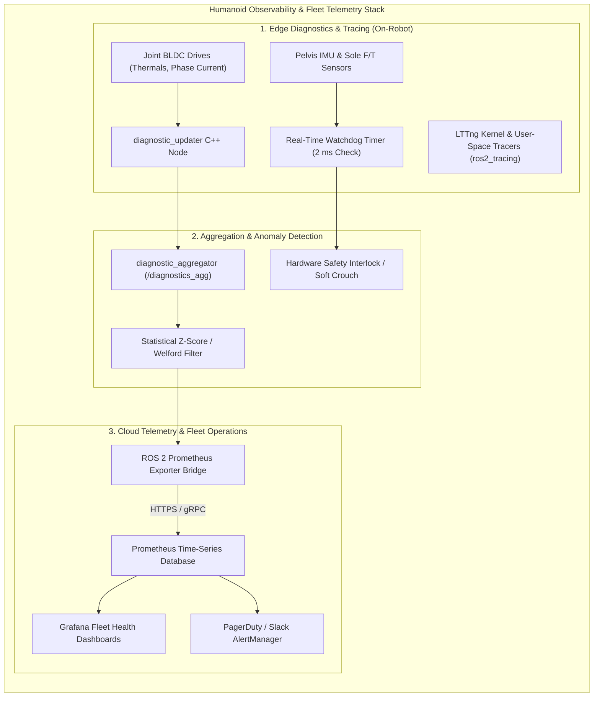

import ChapterProgress from '@site/src/components/ChapterProgress';
import QuizEngine from '@site/src/components/QuizEngine';

# Observability, Telemetry & Fleet Health Monitoring

Deploying a commercial fleet of autonomous humanoids into production environments demands unprecedented observability. Operating at peak mechanical limits, actuator phase currents exceed 40 Amperes, stator winding temperatures approach insulation breakdown limits ($100^\circ\text{C}$), and battery cells experience dynamic load transients.

An autonomous humanoid must possess comprehensive observability across all architectural tiers: from **deterministic kernel tracing via LTTng** to **subsystem diagnostics via `diagnostic_updater`**, statistical anomaly detection, and cloud-scale fleet monitoring using **Prometheus and Grafana**.



---

## 1. Subsystem Diagnostics: `diagnostic_updater` & `diagnostic_aggregator`

ROS 2 standardizes robotic health reporting through the `diagnostic_updater` library (REP-107). Every hardware driver registers diagnostic callbacks that populate key-value telemetry pairs and assert one of four operational levels:
- `DiagnosticStatus::OK` (0): Normal operation within nominal parameters.
- `DiagnosticStatus::WARN` (1): Marginal operation (e.g., stator temperature exceeding $75^\circ\text{C}$; thermal derating activated).
- `DiagnosticStatus::ERROR` (2): Unrecoverable hardware fault (e.g., encoder index loss or over-current trip; motor power cut).
- `DiagnosticStatus::STALE` (3): Sensor communications halted; watchdog timeout.

The centralized `diagnostic_aggregator` node groups hundreds of individual status topics into a structured, queryable hierarchy (`/diagnostics_agg`) categorized by robot subsystem (Legs, Arms, Power, Sensors).

---

## 2. Mathematical Statistical Anomaly Detection

To detect motor bearing degradation or thermal anomalies before catastrophic failure occurs, the diagnostic observer executes dynamic statistical filtering.

### Exponential Moving Average (EMA) for Thermal Tracking

To filter out short-duration sensor measurement noise while capturing continuous thermal heating trends in joint stators:

$$
S_t = \alpha Y_t + (1 - \alpha) S_{t-1}, \quad \alpha = \frac{2}{N + 1}
$$

where $Y_t$ is the instantaneous temperature reading, $S_t$ is the smoothed state, and $N$ represents the smoothing window length.

### Dynamic Z-Score Anomaly Detector (Welford's Online Algorithm)

For non-stationary motor phase currents $I_t$, an anomaly is flagged if the instantaneous deviation from the running mean $\mu_t$ normalized by standard deviation $\sigma_t$ exceeds threshold $\gamma_{\text{threshold}}$:

$$
Z_t = \frac{\vert I_t - \mu_t \vert}{\sigma_t} > \gamma_{\text{threshold}}
$$

where running sample statistics are updated in constant time $\mathcal{O}(1)$ without buffering past history via **Welford's algorithm**:

$$
M_{2, t} = M_{2, t-1} + (I_t - \mu_{t-1})(I_t - \mu_t), \quad \sigma_t = \sqrt{\frac{M_{2, t}}{t}}
$$

---

## 3. Physical Diagnostic Hardware Sensors & Tripping Thresholds

| Diagnostic Hardware | Sensor / Interface | Monitored Metric | Safety Intervention Threshold |
| :--- | :--- | :--- | :--- |
| **PT1000 RTD Stator Thermistor** | SPI / ADC on Joint DSP | BLDC Motor Winding Temperature | Warn at $75^\circ\text{C}$; Emergency Shutdown at $95^\circ\text{C}$ |
| **Allegro ACS724 Current Hall-Sensor** | Analog Voltage to DSP | Inverter Phase Current ($I_u, I_v, I_w$) | Immediate overcurrent trip at $I > 45\text{ A}$ |
| **TI BQ40Z50 Smart Battery Fuel Gauge** | SMBus / I2C (100 kHz) | State of Health (SoH), Cell Balancing Voltage | Thermal runaway warning if cell delta &gt; 50 mV |

---

## 4. Deterministic Profiling with LTTng & `ros2_tracing`

Standard software profiling tools (such as `gprof` or `valgrind`) inject substantial runtime overhead, destroying deterministic real-time scheduling. 

**`ros2_tracing`** integrates the Linux Trace Toolkit: next generation (**LTTng**), utilizing zero-allocation tracepoints in the kernel and user-space:
- Tracepoints record exact nanosecond timestamps when callbacks are queued, when executors wake up, and when messages cross the RMW layer.
- Tracepoint execution consumes **under 150 nanoseconds**, enabling continuous production tracing during dynamic 1 kHz walking.
- Trace captures are post-processed with `tracetools_analysis` to compute true end-to-end processing pipeline latency.

---

## 5. Production C++20 `diagnostic_updater` Node

The following production node monitors joint stator temperatures, integrates `diagnostic_updater`, and asserts automatic safety warnings:

```cpp
// humanoid_diagnostic_updater_node.cpp
#include <rclcpp/rclcpp.hpp>
#include <diagnostic_updater/diagnostic_updater.hpp>
#include <sensor_msgs/msg/temperature.hpp>
#include <chrono>

class HumanoidThermalMonitor : public rclcpp::Node {
public:
  HumanoidThermalMonitor() : Node("humanoid_thermal_monitor"), updater_(this) {
    updater_.setHardwareID("humanoid_leg_actuators");
    updater_.add("Knee BLDC Thermal Status", this, &HumanoidThermalMonitor::check_knee_temperature);

    timer_ = this->create_wall_timer(
      std::chrono::milliseconds(500),
      std::bind(&HumanoidThermalMonitor::periodic_update, this)
    );
    RCLCPP_INFO(this->get_logger(), "HumanoidThermalMonitor online with diagnostic_updater.");
  }

private:
  void check_knee_temperature(diagnostic_updater::DiagnosticStatusWrapper& stat) {
    double current_temp = read_hardware_thermistor();
    stat.add("Knee Temperature (C)", current_temp);

    if (current_temp > 95.0) {
      stat.summary(diagnostic_msgs::msg::DiagnosticStatus::ERROR, "Critical Over-Temperature! Cut Motor Current!");
    } else if (current_temp > 75.0) {
      stat.summary(diagnostic_msgs::msg::DiagnosticStatus::WARN, "Elevated Temperature: Engaging Thermal Derating.");
    } else {
      stat.summary(diagnostic_msgs::msg::DiagnosticStatus::OK, "Operating within safe thermal limits.");
    }
  }

  double read_hardware_thermistor() {
    // In production: Read PT1000 SPI ADC register from joint DSP
    return 68.5;
  }

  void periodic_update() {
    updater_.force_update();
  }

  diagnostic_updater::Updater updater_;
  rclcpp::TimerBase::SharedPtr timer_;
};

int main(int argc, char** argv) {
  rclcpp::init(argc, argv);
  rclcpp::spin(std::make_shared<HumanoidThermalMonitor>());
  rclcpp::shutdown();
  return 0;
}
```

---

## 6. Research Foundations & Seminal Literature

1. **Bédard, C., L'Heureux, P. Y., & Dagenais, M. R. (2020).** *ros2_tracing: Multipurpose Low-Overhead Tracing for ROS 2*. In IEEE International Conference on Robotics and Automation (ICRA) Workshop on Software Quality.
2. **Brossard, M., Barrau, A., & Bonnabel, S. (2020).** *AI-IMU Dead-Reckoning: Failure Detection and Isolation in Robotics*. IEEE Transactions on Intelligent Vehicles, 5(4), 585-595.
3. **Open Robotics. (2010).** *REP-107: Diagnostic System for Robots*. ROS Enhancement Proposals.

---

<ChapterProgress chapterId="1-14-ros2-diagnostics-and-monitoring" moduleId="module1" totalChapters={14} />

## Chapter Mastery Check

<QuizEngine
  quizId="quiz-1-14"
  title="Module 1.14 Mastery Check: Observability, Telemetry & Fleet Health Monitoring"
  moduleId="module1"
  passThreshold={70}
  questions={[
    {
      id: "q1",
      question: "Why is LTTng (Linux Trace Toolkit next generation) used for real-time profiling rather than traditional profilers like Valgrind or gprof?",
      options: [
        "Valgrind only runs on macOS",
        "LTTng tracepoints execute in under 150 nanoseconds with zero dynamic memory allocation, allowing non-intrusive tracing of 1 kHz real-time loops without causing deadline misses",
        "LTTng automatically fixes software bugs in ROS 2",
        "LTTng replaces the PREEMPT_RT kernel patch"
      ],
      correctIndex: 1,
      explanation: "Traditional profilers like Valgrind emulate CPU execution, slowing execution by 10x to 50x. LTTng tracepoints write directly to pre-allocated lockless ring buffers in sub-microsecond time without affecting real-time determinism."
    },
    {
      id: "q2",
      question: "In Welford's online algorithm for computing running mean and variance, what is the computational time and memory complexity per sample?",
      options: [
        "Time O(1), Memory O(1)",
        "Time O(N), Memory O(N)",
        "Time O(N^2), Memory O(1)",
        "Time O(log N), Memory O(N)"
      ],
      correctIndex: 0,
      explanation: "Welford's algorithm updates running mean and squared differences iteratively using only constant memory O(1) and constant time O(1) without requiring historical sample buffers."
    },
    {
      id: "q3",
      question: "According to standard diagnostic status conventions, what operational action should be triggered when a joint stator temperature enters DiagnosticStatus::WARN (exceeding 75 degrees Celsius)?",
      options: [
        "Instantly cut high-voltage power to the entire robot",
        "Engage thermal derating to cap maximum commanded joint torque while maintaining walking stability",
        "Reboot the Linux operating system",
        "Format the solid-state drive"
      ],
      correctIndex: 1,
      explanation: "A WARN state indicates degraded but non-fatal conditions. Cutting power causes the humanoid to fall; instead, the whole-body controller engages thermal derating, scaling back peak joint torques to allow coils to cool."
    }
  ]}
/>
