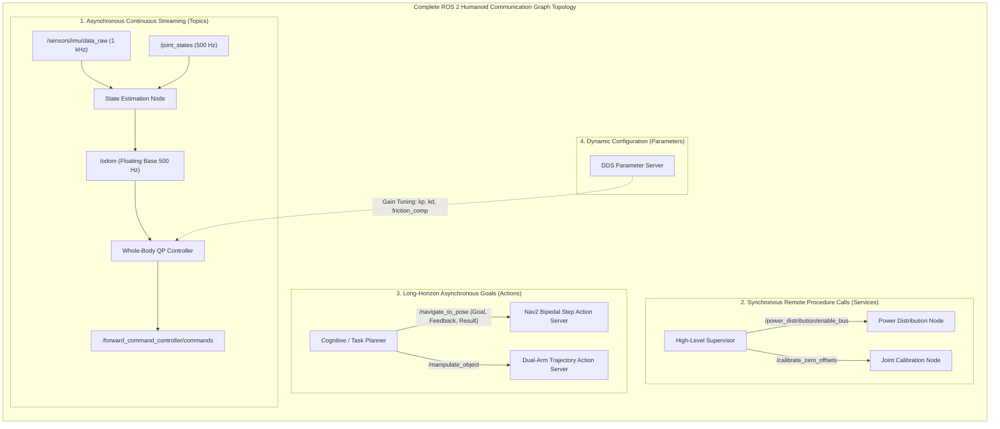
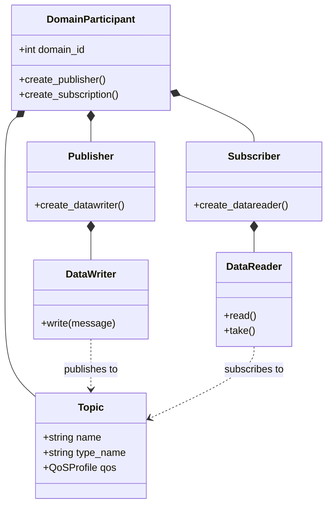

import ChapterProgress from '@site/src/components/ChapterProgress';
import QuizEngine from '@site/src/components/QuizEngine';

# Core Concepts & Communication Primitives

To construct a robust software architecture for a humanoid robot with dozens of actuated joints, multiple stereo camera streams, and distributed sensory feedback, one must master the fundamental abstractions of ROS 2. 

ROS 2 organizes complex robotics systems as a **computational graph** composed of independent, loosely coupled software processes communicating via formal, standardized message types over the Object Management Group (OMG) Data Distribution Service (DDS) standard.



---

## 1. The Four Primary Communication Primitives

A humanoid robotics engineer must select the correct communication primitive based on temporal constraints, determinism, and data volume:

| Primitive | Dataflow Pattern | Synchronization | Latency / Bandwidth Profile | Humanoid Robotics Application |
| :--- | :--- | :--- | :--- | :--- |
| **Topics** | Publish / Subscribe (Many-to-Many) | Asynchronous (Decoupled in time & space) | Minimal overhead; supports zero-copy shared memory (&lt;50 $\mu$s) | Streaming 1 kHz IMU readings, 500 Hz joint states, 60 Hz point clouds, motor torque commands. |
| **Services** | Request / Response (Client $\rightarrow$ Server) | Synchronous (Client blocks or awaits `Future`) | Low-to-moderate latency (~1–5 ms) | Triggering sensor calibration routines, engaging relay switches, resetting odometry coordinate frames. |
| **Actions** | Goal / Feedback / Result (Client $\rightarrow$ Server) | Asynchronous with continuous status streaming; fully preemptible | Complex multi-topic state machine | Traversing to a room waypoint, executing a 10-second dual-arm door opening sequence, dynamic pick-and-place. |
| **Parameters** | Key-Value Configuration Store | Synchronous read/write with parameter change events | Low-frequency reconfiguration | Adjusting joint impedance gains ($K_p, K_d$), enabling active balance compensation, toggling vision filters. |

---

## 2. Under the Hood: OMG DDS & The RTPS Wire Protocol

Unlike ROS 1, which implemented custom TCP/UDP socket stacks, ROS 2 sits directly atop commercial-grade **DDS (Data Distribution Service)** implementations:
- **Eclipse CycloneDDS**: Renowned for low-latency, deterministic memory usage, and native integration with the Eclipse Iceoryx zero-copy shared memory framework.
- **eProsima FastDDS**: Highly flexible, feature-rich default DDS implementation in standard ROS 2 desktop distributions.
- **RTI Connext DDS**: High-reliability, aerospace/automotive certified DDS implementation used in commercial safety-critical deployments.



### The RTPS Wire Protocol (OMG RTPS v2.3)

The **Real-Time Publish-Subscribe (RTPS)** wire protocol guarantees interoperability between different vendors and platforms:
1. **Participant Discovery Protocol (PDP)**: Periodically broadcasts announcements across UDP multicast (or dedicated Discovery Server unicast) to announce the presence of nodes within a given `ROS_DOMAIN_ID`.
2. **Endpoint Discovery Protocol (EDP)**: Exchanges topic names, data types, and QoS policies. Communication is established *only* when the DataWriter and DataReader QoS parameters are mutually compatible.

---

## 3. Mathematical Model of Publish-Subscribe Dataflow & Discovery Scaling

### Wire Payload Sizing

Consider a humanoid with $N = 32$ actuated joints. The joint state message publishes the joint configuration vector $\mathbf{q} \in \mathbb{R}^N$, generalized velocities $\dot{\mathbf{q}} \in \mathbb{R}^N$, and measured joint efforts $\boldsymbol{\tau} \in \mathbb{R}^N$ at frequency $f_s = 500\text{ Hz}$.

The continuous payload size per frame is given by:

$$
S_{\text{payload}} = \text{sizeof}(\text{Header}) + 3 \cdot \left( N \cdot \text{sizeof}(\text{float64}) \right) + \sum_{j=1}^N \text{sizeof}(\text{string}_j)
$$

For $N = 32$, $S_{\text{payload}} \approx 848\text{ bytes}$. At $500\text{ Hz}$, the continuous throughput is:

$$
\text{Throughput} = 848\text{ bytes} \times 500\text{ Hz} \approx 424\text{ kB/s} \quad (3.39\text{ Mbps})
$$

### Transport Jitter Variance & Acceleration Amplification

While this throughput is easily accommodated by standard Gigabit Ethernet or CAN-FD, the transport timing jitter $\sigma_{\Delta t}$ must satisfy:

$$
\sigma_{\Delta t}^2 = \frac{1}{K}\sum_{k=1}^K \left( t_k - t_{k-1} - \Delta t_{\text{nominal}} \right)^2 \le \sigma_{\text{threshold}}^2 \quad (\sigma_{\text{threshold}} \le 50\,\mu\text{s})
$$

If timing jitter exceeds this threshold, numerical differentiation of positions $\mathbf{q}$ to compute joint accelerations $\ddot{\mathbf{q}}$ amplifies noise quadratically:

$$
\ddot{\mathbf{q}}_k \approx \frac{\mathbf{q}_k - 2\mathbf{q}_{k-1} + \mathbf{q}_{k-2}}{\Delta t^2}
$$

leading to severe actuator chatter, torque saturation, and mechanical damage to gearboxes.

### RTPS Multicast Reliability & Packet Loss Probability

When transmitting UDP packets over a lossy physical wireless or bus link with individual packet drop probability $p_{\text{loss}}$, the probability of total transmission failure after $M$ retransmission attempts across a burst of $K$ packets is:

$$
P(\text{failure}) = 1 - \left(1 - p_{\text{loss}}^M\right)^K
$$

In hard real-time balance loops, retransmissions are prohibited because late data is useless data. The system must configure **Best-Effort** reliability with bounded queue depth.

### Discovery Overhead Scaling in Fully Connected Mesh

In an unmanaged multi-node DDS network, discovery packets scale quadratically with the number of DomainParticipants $P$ and endpoints $E$:

$$
N_{\text{packets}} = \mathcal{O}(P^2 + P \cdot E)
$$

For a 40-node humanoid system with 150 topics, this produces a "multicast storm" during system bring-up, saturating low-bandwidth microcontroller gateways unless centralized Discovery Servers are deployed.

---

## 4. The Complete Quality of Service (QoS) Contract Matrix

ROS 2 replaces ROS 1's rigid TCP/UDP sockets with a 22-dimensional QoS policy contract. Communication between a publisher and subscription occurs **only if the offered QoS matches or is stronger than the requested QoS**:

| QoS Policy | Permitted Settings | Compatibility Rule | Humanoid Best Practice |
| :--- | :--- | :--- | :--- |
| **Reliability** | `RELIABLE`, `BEST_EFFORT` | Offered $\ge$ Requested (`RELIABLE` satisfies `BEST_EFFORT`) | Use `BEST_EFFORT` for 1 kHz IMU/joint streams; `RELIABLE` for joint trajectory goals and parameters. |
| **Durability** | `TRANSIENT_LOCAL`, `VOLATILE` | Offered $\ge$ Requested (`TRANSIENT_LOCAL` satisfies `VOLATILE`) | Use `TRANSIENT_LOCAL` for robot kinematics descriptions (`/robot_description`) so late-joining nodes receive data immediately. |
| **History & Depth** | `KEEP_LAST(N)`, `KEEP_ALL` | Independent per endpoint | Set `KEEP_LAST(1)` for high-frequency control loops to guarantee processing the freshest state without stale queue latency. |
| **Deadline** | Duration ($\Delta t_{\text{deadline}}$) | Offered $\le$ Requested | Set to $1.5 \times \Delta t_{\text{period}}$ (e.g. 1.5 ms for 1 kHz) to automatically detect sensor hardware dropouts. |
| **Liveliness** | `AUTOMATIC`, `MANUAL_BY_TOPIC` | Offered $\ge$ Requested | Use `AUTOMATIC` with lease duration to detect crashed high-level planner processes. |

---

## 5. Physical Network Hardware & Deterministic Switching

| Component | Specification | Function in ROS 2 Pipeline | Failure Mode if Misconfigured |
| :--- | :--- | :--- | :--- |
| **Managed Ethernet Switch** | Moxa EDS-G508E / Cisco IE-3300 | Wire-speed layer 2 forwarding with IGMP Snooping v2/v3 | Flooding multicast discovery packets across all ports, choking microcontrollers |
| **Physical NIC** | Intel I225-IT / Marvell AQC113 | Hardware PTP (IEEE 1588) timestamping, 4x TX/RX queues | Software timestamp jitter in kernel `sk_buff` allocation (&gt;200 $\mu$s) |
| **DDS Discovery Server** | FastDDS Discovery Server / CycloneDDS Unicast | Centralized GUID directory replacing multicast broadcasts | Single point of discovery if primary daemon process crashes |

---

## 6. Runnable Code: Production Deterministic QoS Configuration

The following modern C++20 node configures deterministic QoS profiles for both 1 kHz sensor telemetry and mission-critical parameter distribution:

```cpp
// complete_qos_configuration.cpp
#include <rclcpp/rclcpp.hpp>
#include <sensor_msgs/msg/imu.hpp>
#include <rcl_interfaces/msg/parameter_event.hpp>
#include <chrono>

using namespace std::chrono_literals;

class HumanoidSensorPublisher : public rclcpp::Node {
public:
  HumanoidSensorPublisher() : Node("humanoid_sensor_publisher") {
    // 1. High-Frequency Real-Time Sensor Stream (Best-Effort, Volatile, Small Depth)
    rclcpp::QoS sensor_qos(rclcpp::KeepLast(5));
    sensor_qos.reliability(RMW_QOS_POLICY_RELIABILITY_BEST_EFFORT);
    sensor_qos.durability(RMW_QOS_POLICY_DURABILITY_VOLATILE);
    sensor_qos.liveliness(RMW_QOS_POLICY_LIVELINESS_AUTOMATIC);
    sensor_qos.deadline(1500us);  // 1 kHz nominal rate with 500 us slack

    imu_pub_ = this->create_publisher<sensor_msgs::msg::Imu>("/sensors/imu/pelvis", sensor_qos);

    // 2. Mission-Critical Parameter Latching (Reliable, Transient-Local)
    rclcpp::QoS param_qos(rclcpp::KeepLast(1));
    param_qos.reliability(RMW_QOS_POLICY_RELIABILITY_RELIABLE);
    param_qos.durability(RMW_QOS_POLICY_DURABILITY_TRANSIENT_LOCAL);

    timer_ = this->create_wall_timer(1ms, [this]() {
      auto msg = sensor_msgs::msg::Imu();
      msg.header.stamp = this->now();
      msg.header.frame_id = "pelvis_imu_link";
      msg.linear_acceleration.z = 9.80665;
      imu_pub_->publish(msg);
    });
    RCLCPP_INFO(this->get_logger(), "Initialized deterministic sensor QoS publishers at 1 kHz.");
  }

private:
  rclcpp::Publisher<sensor_msgs::msg::Imu>::SharedPtr imu_pub_;
  rclcpp::TimerBase::SharedPtr timer_;
};

int main(int argc, char** argv) {
  rclcpp::init(argc, argv);
  auto node = std::make_shared<HumanoidSensorPublisher>();
  rclcpp::spin(node);
  rclcpp::shutdown();
  return 0;
}
```

---

## 7. Research Foundations & Seminal Literature

1. **Object Management Group (OMG). (2015).** *Data Distribution Service (DDS) Specification, Version 1.4*. Formal Standard formal/15-04-10.
2. **Object Management Group (OMG). (2019).** *The Real-time Publish-Subscribe Protocol (RTPS) DDS Interoperability Wire Protocol Specification, Version 2.3*. OMG Document formal/19-04-03.
3. **Corsaro, A., Schmidt, D. C., & O'Ryan, C. (2012).** *The Data Distribution Service: The Architecture for the Internet of Real-Time Things*. IEEE Internet Computing, 16(2), 54-60.
4. **Maruyama, Y., Kato, S., & Azumi, T. (2016).** *Exploring the performance of ROS2*. In Proceedings of the 13th International Conference on Embedded Software (EMSOFT) (pp. 1-10).

---

<ChapterProgress chapterId="1-2-ros2-core-concepts" moduleId="module1" totalChapters={14} />

## Chapter Mastery Check

<QuizEngine
  quizId="quiz-1-2"
  title="Module 1.2 Mastery Check: Core Concepts & Communication Primitives"
  moduleId="module1"
  passThreshold={70}
  questions={[
    {
      id: "q1",
      question: "Why does numerical differentiation of joint positions amplify noise quadratically when transport jitter variance is unconstrained?",
      options: [
        "Position sensors lose power when jitter exceeds 10 ms",
        "The finite difference formula divides position error by dt squared, magnifying timing fluctuations into massive acceleration spikes",
        "The DDS middleware drops the floating-point mantissa",
        "C++ compilers reject non-deterministic loop timings"
      ],
      correctIndex: 1,
      explanation: "Computing acceleration requires double differentiation: ddq = (q_k - 2*q_{k-1} + q_{k-2}) / (dt^2). Because the denominator is dt^2, variations in dt induce severe high-frequency torque chatter."
    },
    {
      id: "q2",
      question: "A publisher offers Reliability = BEST_EFFORT. A newly launched subscriber requests Reliability = RELIABLE. What communication behavior occurs?",
      options: [
        "The publisher automatically upgrades to RELIABLE",
        "The subscriber downgrades to BEST_EFFORT automatically",
        "No connection is established because Requested QoS is stronger than Offered QoS (QoS Incompatibility)",
        "The DDS middleware throws a fatal kernel panic"
      ],
      correctIndex: 2,
      explanation: "DDS Request vs. Offered (RxO) rules dictate that Offered must be greater than or equal to Requested. A subscriber demanding RELIABLE will not accept a BEST_EFFORT publisher, resulting in silent connection rejection."
    },
    {
      id: "q3",
      question: "In dense robot networks with dozens of nodes, why is a FastDDS Discovery Server preferred over standard multicast PDP discovery?",
      options: [
        "Multicast discovery uses too much disk storage",
        "Standard multicast discovery scales as O(P^2 + P*E), creating multicast storms that saturate low-power microcontroller buses",
        "Discovery servers encrypt all ROS 2 topics with RSA-4096",
        "Multicast packets cannot traverse Linux network namespaces"
      ],
      correctIndex: 1,
      explanation: "Fully mesh-connected multicast discovery scales quadratically with participant and endpoint counts. A centralized Discovery Server converts discovery to O(P) unicast traffic, preventing bus saturation."
    }
  ]}
/>
