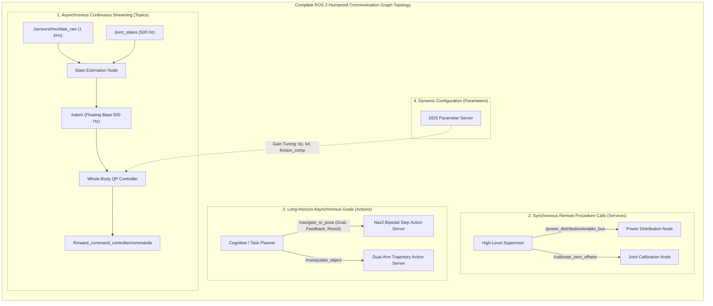
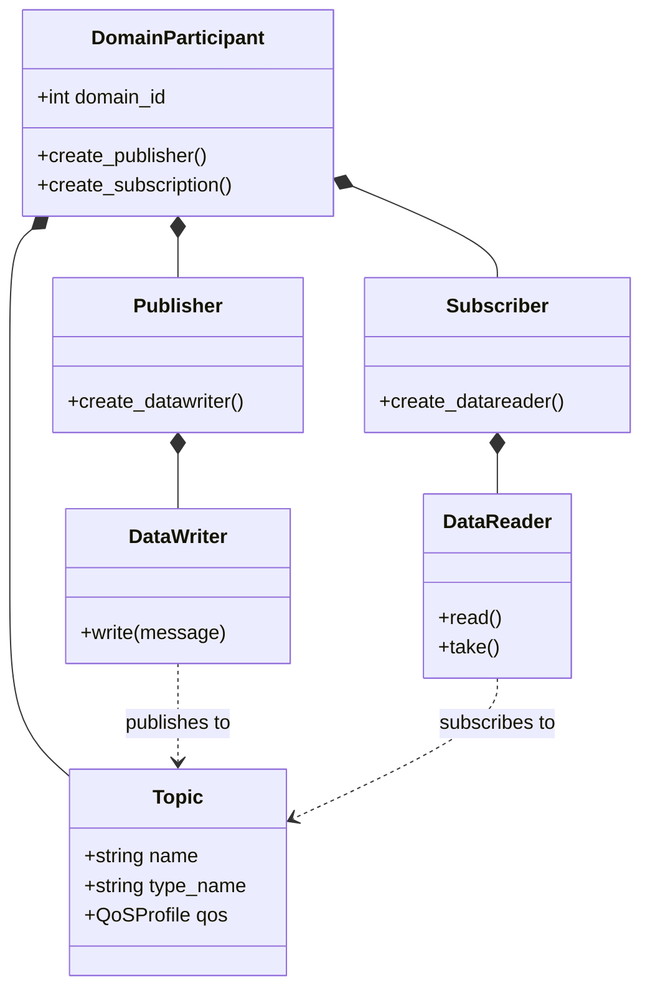

# Core Concepts & Communication Primitives

To construct a robust software architecture for a humanoid robot with dozens of actuated joints, multiple stereo camera streams, and distributed sensory feedback, one must master the fundamental abstractions of ROS 2. 

ROS 2 organizes complex robotics systems as a **computational graph** composed of independent, loosely coupled software processes communicating via formal, standardized message types over the Object Management Group (OMG) Data Distribution Service (DDS) standard.



---

## 1. The Four Primary Communication Primitives

A humanoid robotics engineer must select the correct communication primitive based on temporal constraints, determinism, and data volume:

| Primitive | Dataflow Pattern | Synchronization | Latency / Bandwidth Profile | Humanoid Robotics Application |
| :--- | :--- | :--- | :--- | :--- |
| **Topics** | Publish / Subscribe (Many-to-Many) | Asynchronous (Decoupled in time & space) | Minimal overhead; supports zero-copy shared memory (&lt;50 &micro;s) | Streaming 1 kHz IMU readings, 500 Hz joint states, 60 Hz point clouds, motor torque commands. |
| **Services** | Request / Response (Client &rarr; Server) | Synchronous (Client blocks or awaits `Future`) | Low-to-moderate latency (~1–5 ms) | Triggering sensor calibration routines, engaging relay switches, resetting odometry coordinate frames. |
| **Actions** | Goal / Feedback / Result (Client &rarr; Server) | Asynchronous with continuous status streaming; fully preemptible | Complex multi-topic state machine | Traversing to a room waypoint, executing a 10-second dual-arm door opening sequence, dynamic pick-and-place. |
| **Parameters** | Key-Value Configuration Store | Synchronous read/write with parameter change events | Low-frequency reconfiguration | Adjusting joint impedance gains ($K_p, K_d$), enabling active balance compensation, toggling vision filters. |

---

## 2. Under the Hood: The DDS Layer & Wire Protocol

Unlike ROS 1, which implemented proprietary TCP/UDP sockets, ROS 2 sits directly atop commercial-grade **DDS (Data Distribution Service)** implementations:
- **Eclipse CycloneDDS**: Renowned for low-latency, deterministic memory usage, and native integration with the Eclipse Iceoryx zero-copy shared memory framework.
- **eProsima FastDDS**: Highly flexible, feature-rich, default DDS implementation in standard ROS 2 desktop distributions.
- **RTI Connext DDS**: High-reliability, aerospace/automotive certified DDS implementation used in commercial safety-critical deployments.



### The RTPS Wire Protocol
The **Real-Time Publish-Subscribe (RTPS)** wire protocol guarantees interoperability between different vendors and platforms:
1. **Participant Discovery Protocol (PDP)**: Periodically broadcasts announcements across UDP multicast (or dedicated Discovery Server unicast) to announce the presence of nodes within a given `ROS_DOMAIN_ID`.
2. **Endpoint Discovery Protocol (EDP)**: Exchanges topic names, data types, and QoS policies. Communication is established *only* when the DataWriter and DataReader QoS parameters are mutually compatible.

---

## 3. Mathematical Model of Publish-Subscribe Dataflow

Consider a humanoid with **N = 32 actuated joints**. The joint state message publishes the joint configuration vector `q`, generalized velocities `dq/dt`, and measured joint efforts `tau` at frequency `fs = 500 Hz`.

The continuous payload size per frame is given by:

```text
S_payload = sizeof(Header) + 3 * (N * sizeof(float64)) + (N * sizeof(string))
```

For `N = 32`, `S_payload` is approximately **848 bytes**. At 500 Hz, the continuous throughput is:

```text
Throughput = 848 bytes * 500 Hz ≈ 424 kB/s
```

While this bandwidth is easily accommodated by standard Gigabit Ethernet or CAN-FD, the **transport jitter** `sigma_dt` must satisfy:

```text
sigma_dt = sqrt( (1/K) * sum((t_k - t_{k-1} - dt_nominal)^2) ) < 0.05 ms (50 microseconds)
```

If `sigma_dt` exceeds this bound, numerical differentiation of positions `q` to compute joint accelerations `ddq` amplifies noise:

```text
ddq_k ≈ (q_k - 2*q_{k-1} + q_{k-2}) / (dt^2)
```

leading to severe actuator chatter, torque saturation, and mechanical damage.

---

## 4. Introspection & Diagnostics Tools

ROS 2 provides an industrial suite of command-line and graphical tools for inspecting the live nervous system:

```bash
# 1. Inspect all active participants and topics in the domain
ros2 node list
ros2 topic list -t

# 2. Check the real-time publishing rate and jitter of high-speed sensors
ros2 topic hz /sensors/imu/data_raw
ros2 topic bw /sensors/imu/data_raw

# 3. Interrogate the complete type definition and QoS compatibility
ros2 topic info /sensors/imu/data_raw --verbose

# 4. View the live computation graph visually
rqt_graph
```

In the next chapter, we configure a deterministic build workspace and CMake pipeline engineered for high-performance humanoid packages.
