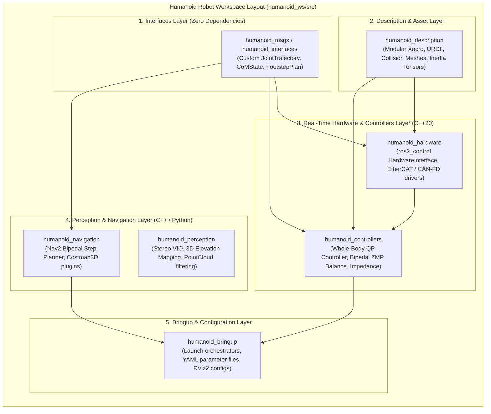
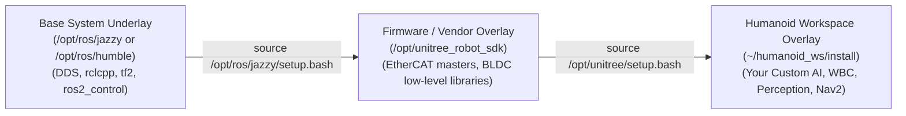

# Workspace Architecture & Build Orchestration

Developing software for an autonomous humanoid robot requires organizing hundreds of interdependent source files—ranging from real-time motor drivers and whole-body inverse dynamics solvers to perception models and custom teleoperation interfaces. 

A professional humanoid robotics repository must adhere to rigorous architectural standards, modular build isolation, and deterministic deployment practices using the **Colcon** build orchestration system.



---

## 1. Directory Anatomy of a Production Humanoid Workspace

A clean ROS 2 workspace separates source code from build artifacts, installation targets, and runtime telemetry:

```text
humanoid_ws/
├── src/                               # Version-controlled source code packages
│   ├── core/                          # Low-level infrastructure and hardware drivers
│   │   ├── humanoid_interfaces/       # Custom .msg, .srv, and .action definitions
│   │   └── humanoid_hardware/         # ros2_control HardwareInterface plugins
│   ├── kinematics_dynamics/           # Whole-body control and model solvers
│   │   ├── humanoid_description/      # URDF / Xacro kinematic meshes and limits
│   │   └── humanoid_controllers/      # QP and ZMP bipedal balance controllers
│   ├── perception/                    # Vision and state estimation
│   │   └── humanoid_perception/       # Sensor drivers, filters, and VSLAM nodes
│   └── bringup/                       # Launch scripts and parameter configs
│       └── humanoid_bringup/          # Top-level launch files and safety orchestrators
├── build/                             # Intermediate compiler artifacts (CMake object files)
├── install/                           # Deployed binaries, libraries, setup scripts
└── log/                               # Structured colcon build and test logs
```

---

## 2. Underlays vs. Overlays: Clean Compute Isolation

On frontier humanoid robots (e.g., Unitree H1 or Figure 02), the onboard operating system maintains a strict separation between **Underlay** dependencies and **Overlay** development code:



When building or executing, variables such as `AMENT_PREFIX_PATH`, `CMAKE_PREFIX_PATH`, and `LD_LIBRARY_PATH` are prepended hierarchically, ensuring that the custom application layer can override default packages without altering core system libraries.

---

## 3. High-Performance C++20 `CMakeLists.txt` for Humanoid Nodes

Real-time humanoid controllers cannot afford performance regressions from suboptimal compiler flags. The template below illustrates an industrial `CMakeLists.txt` configured for hard real-time execution:

```cmake
cmake_minimum_required(VERSION 3.20)
project(humanoid_controllers LANGUAGES CXX)

# Enforce modern C++20 standard
set(CMAKE_CXX_STANDARD 20)
set(CMAKE_CXX_STANDARD_REQUIRED ON)
set(CMAKE_EXPORT_COMPILE_COMMANDS ON)

# Aggressive compiler optimizations for real-time math
if(CMAKE_COMPILER_IS_GNUCXX OR CMAKE_CXX_COMPILER_ID MATCHES "Clang")
  add_compile_options(
    -O3                    # Maximum optimization
    -march=native          # Utilize host CPU vector extensions (AVX-512 / NEON)
    -Wall -Wextra -Wpedantic
    -Werror=return-type
    -pipe
  )
endif()

# Core ROS 2 dependencies
find_package(ament_cmake REQUIRED)
find_package(rclcpp REQUIRED)
find_package(rclcpp_lifecycle REQUIRED)
find_package(controller_interface REQUIRED)
find_package(hardware_interface REQUIRED)
find_package(pluginlib REQUIRED)
find_package(humanoid_interfaces REQUIRED)
find_package(Eigen3 REQUIRED)

# Include directories
include_directories(include)

# Build Whole-Body Controller Shared Library (Plugin for ros2_control)
add_library(humanoid_wbc_controller SHARED
  src/whole_body_controller.cpp
  src/qp_solver_interface.cpp
)

target_include_directories(humanoid_wbc_controller PUBLIC
  $<BUILD_INTERFACE:${CMAKE_CURRENT_SOURCE_DIR}/include>
  $<INSTALL_INTERFACE:include>
  ${EIGEN3_INCLUDE_DIRS}
)

ament_target_dependencies(humanoid_wbc_controller
  rclcpp
  rclcpp_lifecycle
  controller_interface
  hardware_interface
  pluginlib
  humanoid_interfaces
)

# Export plugin description for controller_manager dynamic loading
pluginlib_export_plugin_description_file(controller_interface humanoid_controllers.xml)

# Install rules
install(TARGETS humanoid_wbc_controller
  ARCHIVE DESTINATION lib
  LIBRARY DESTINATION lib
  RUNTIME DESTINATION bin
)

install(DIRECTORY include/ DESTINATION include)

ament_package()
```

---

## 4. Colcon Build Flags & Deterministic Orchestration

When compiling on edge compute hardware (e.g., an 8-core NVIDIA Jetson Orin with thermal throttling limits), building naively can exhaust RAM and trigger out-of-memory (OOM) kernel kills. Professional roboticists use tuned build invocations:

```bash
# 1. Standard build with symlink installation (avoids recompiling Python/launch files)
colcon build --symlink-install --cmake-args -DCMAKE_BUILD_TYPE=Release

# 2. Constrained parallel compilation to avoid thermal and RAM exhaustion on edge hardware
colcon build \
  --symlink-install \
  --parallel-workers 4 \
  --cmake-args -DCMAKE_BUILD_TYPE=Release -DCMAKE_EXPORT_COMPILE_COMMANDS=ON

# 3. Target single package with dependency resolution
colcon build --packages-up-to humanoid_controllers --symlink-install

# 4. Source the built overlay workspace
source install/setup.bash
```

In the next chapter, we dive deep into the execution entity itself: **Constructing Real-Time Nodes and Managed Lifecycle State Machines**.
