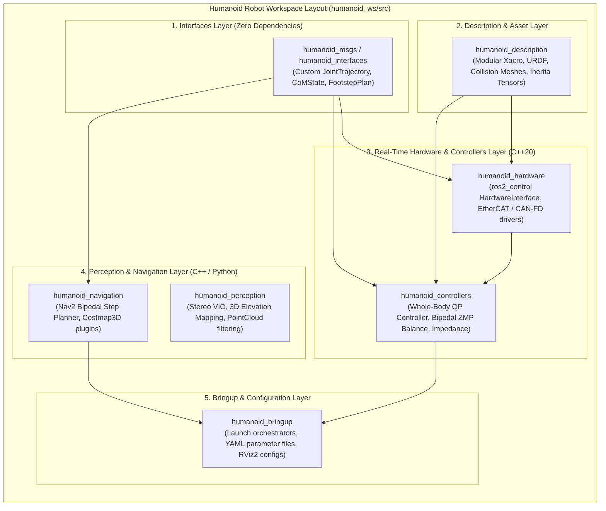
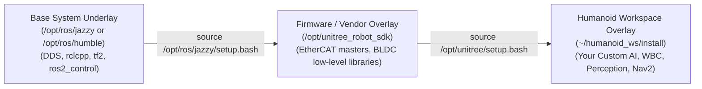

import ChapterProgress from '@site/src/components/ChapterProgress';
import QuizEngine from '@site/src/components/QuizEngine';

# Workspace Architecture & Build Orchestration

Developing software for an autonomous humanoid robot requires organizing hundreds of interdependent source files—ranging from real-time motor drivers and whole-body inverse dynamics solvers to perception models and custom teleoperation interfaces. 

A professional humanoid robotics repository must adhere to rigorous architectural standards, modular build isolation, and deterministic deployment practices using the **Colcon** build orchestration system.



---

## 1. Directory Anatomy of a Production Humanoid Workspace

A clean ROS 2 workspace separates source code from build artifacts, installation targets, and runtime telemetry:

```text
humanoid_ws/
├── src/                               # Version-controlled source code packages
│   ├── core/                          # Low-level infrastructure and hardware drivers
│   │   ├── humanoid_interfaces/       # Custom .msg, .srv, and .action definitions
│   │   └── humanoid_hardware/         # ros2_control HardwareInterface plugins
│   ├── kinematics_dynamics/           # Whole-body control and model solvers
│   │   ├── humanoid_description/      # URDF / Xacro kinematic meshes and limits
│   │   └── humanoid_controllers/      # QP and ZMP bipedal balance controllers
│   ├── perception/                    # Vision and state estimation
│   │   └── humanoid_perception/       # Sensor drivers, filters, and VSLAM nodes
│   └── bringup/                       # Launch scripts and parameter configs
│       └── humanoid_bringup/          # Top-level launch files and safety orchestrators
├── build/                             # Intermediate compiler artifacts (CMake object files)
├── install/                           # Deployed binaries, libraries, setup scripts
└── log/                               # Structured colcon build and test logs
```

---

## 2. Mathematical Build Graph Scheduling (Colcon DAG Resolution)

Colcon models workspace packages as vertices $V$ in a Directed Acyclic Graph (DAG) $G = (V, E)$, where a directed edge $(u, v) \in E$ indicates that package $v$ depends directly on package $u$ (declared in `package.xml` via `<depend>`, `<build_depend>`, or `<exec_depend>`).

### Topological Sorting via Kahn's Algorithm

To guarantee deadlock-free parallel compilation, Colcon evaluates $G$ using Kahn's topological sorting algorithm:

$$
\text{Time Complexity} = \mathcal{O}(|V| + |E|)
$$

If a cycle exists ($\exists$ a path from $v$ back to $v$), Kahn's algorithm terminates with unvisited nodes, immediately aborting the build before partial compilation corrupts binary libraries.

### Critical Path Build Duration

Given $P$ parallel compilation workers, the theoretical lower bound on total build time $T_{\text{build}}$ is bounded by the longest dependency path in the DAG:

$$
T_{\text{build}} \ge \max_{p \in \mathcal{P}_{\text{DAG}}} \sum_{v \in p} \tau_{\text{compile}}(v)
$$

where $\mathcal{P}_{\text{DAG}}$ represents the set of all topological paths from root interface packages to leaf bringup packages, and $\tau_{\text{compile}}(v)$ is the individual compile duration of package $v$. Interfaces must minimize transitive dependencies to keep the critical path compact.

---

## 3. Hardware Compute Specs for Development vs. Cross-Compilation

| Machine Role | Processor Architecture | RAM / Storage | Toolchain Target | Optimization Flags |
| :--- | :--- | :--- | :--- | :--- |
| **Developer Workstation** | AMD Ryzen 9 7950X (16C/32T) | 64 GB DDR5 / 2 TB NVMe PCIe 4.0 | Host compilation (`x86_64-linux-gnu`) | `-j32 -O3 -march=native` |
| **Cross-Build Target** | Jetson AGX Orin (12C Cortex-A78AE) | 64 GB LPDDR5 (2048-bit UMA) | Target cross-toolchain (`aarch64-linux-gnu`) | `-march=armv8.2-a+crypto -mcpu=cortex-a78ae` |
| **On-Robot SBC** | Intel Core i7-13700E (14C/20T) | 32 GB DDR5 SODIMM / 512 GB M.2 NVMe | Native Real-Time execution | `-O3 -fno-omit-frame-pointer` |

---

## 4. Underlays vs. Overlays: Clean Compute Isolation

On frontier humanoid robots (e.g., Unitree H1 or Figure 02), the onboard operating system maintains a strict separation between **Underlay** dependencies and **Overlay** development code:



When building or executing, variables such as `AMENT_PREFIX_PATH`, `CMAKE_PREFIX_PATH`, and `LD_LIBRARY_PATH` are prepended hierarchically, ensuring that the custom application layer can override default packages without altering core system libraries.

---

## 5. High-Performance C++20 `CMakeLists.txt` for Humanoid Nodes

Real-time humanoid controllers cannot afford performance regressions from suboptimal compiler flags. The template below illustrates an industrial `CMakeLists.txt` configured for hard real-time execution:

```cmake
cmake_minimum_required(VERSION 3.20)
project(humanoid_controllers LANGUAGES CXX)

# Enforce modern C++20 standard
set(CMAKE_CXX_STANDARD 20)
set(CMAKE_CXX_STANDARD_REQUIRED ON)
set(CMAKE_EXPORT_COMPILE_COMMANDS ON)

# Aggressive compiler optimizations for real-time math
if(CMAKE_COMPILER_IS_GNUCXX OR CMAKE_CXX_COMPILER_ID MATCHES "Clang")
  add_compile_options(
    -O3                    # Maximum optimization
    -march=native          # Utilize host CPU vector extensions (AVX-512 / NEON)
    -Wall -Wextra -Wpedantic
    -Werror=return-type
    -pipe
  )
endif()

# Core ROS 2 dependencies
find_package(ament_cmake REQUIRED)
find_package(rclcpp REQUIRED)
find_package(rclcpp_lifecycle REQUIRED)
find_package(controller_interface REQUIRED)
find_package(hardware_interface REQUIRED)
find_package(pluginlib REQUIRED)
find_package(humanoid_interfaces REQUIRED)
find_package(Eigen3 REQUIRED)

# Include directories
include_directories(include)

# Build Whole-Body Controller Shared Library (Plugin for ros2_control)
add_library(humanoid_wbc_controller SHARED
  src/whole_body_controller.cpp
  src/qp_solver_interface.cpp
)

target_include_directories(humanoid_wbc_controller PUBLIC
  $<BUILD_INTERFACE:${CMAKE_CURRENT_SOURCE_DIR}/include>
  $<INSTALL_INTERFACE:include>
  ${EIGEN3_INCLUDE_DIRS}
)

ament_target_dependencies(humanoid_wbc_controller
  rclcpp
  rclcpp_lifecycle
  controller_interface
  hardware_interface
  pluginlib
  humanoid_interfaces
)

# Export plugin description for controller_manager dynamic loading
pluginlib_export_plugin_description_file(controller_interface humanoid_controllers.xml)

# Install rules
install(TARGETS humanoid_wbc_controller
  ARCHIVE DESTINATION lib
  LIBRARY DESTINATION lib
  RUNTIME DESTINATION bin
)

install(DIRECTORY include/ DESTINATION include)

ament_package()
```

---

## 6. Hermetic Multi-Stage Docker Build for ARM64 Cross-Compilation

To eliminate environment drift between developer x86_64 workstations and onboard ARM64 Jetson targets, multi-stage Docker builds provide bit-for-bit reproducibility:

```dockerfile
# syntax=docker/dockerfile:1.4
# Multi-stage production container for ARM64 cross-compilation
FROM --platform=$BUILDPLATFORM ubuntu:22.04 AS builder

ARG TARGETARCH=arm64
ENV DEBIAN_FRONTEND=noninteractive

RUN apt-get update && apt-get install -y \
    build-essential cmake git gcc-aarch64-linux-gnu g++-aarch64-linux-gnu \
    python3-colcon-common-extensions python3-rosdep python3-vcstool curl gnupg \
    && rm -rf /var/lib/apt/lists/*

WORKDIR /humanoid_ws
COPY src /humanoid_ws/src

# Cross-compile workspace with custom toolchain file
RUN colcon build \
    --merge-install \
    --cmake-args \
    -DCMAKE_TOOLCHAIN_FILE=/humanoid_ws/src/cmake/aarch64_toolchain.cmake \
    -DCMAKE_BUILD_TYPE=Release \
    --parallel-workers $(nproc)

FROM --platform=linux/arm64 ubuntu:22.04 AS runtime
ENV LD_LIBRARY_PATH=/opt/ros/humble/lib:/humanoid_ws/install/lib
COPY --from=builder /humanoid_ws/install /humanoid_ws/install
ENTRYPOINT ["/humanoid_ws/install/setup.sh"]
```

---

## 7. Research Foundations & Seminal Standards

1. **Open Robotics. (2020).** *REP-2000: ROS 2 Releases and Target Platforms*. ROS Enhancement Proposals.
2. **Open Robotics. (2018).** *Colcon: Collective Construction Meta Build Tool Architecture RFC*.
3. **Kahn, A. B. (1962).** *Topological sorting of large networks*. Communications of the ACM, 5(11), 558-562.

---

<ChapterProgress chapterId="1-3-ros2-workspace" moduleId="module1" totalChapters={14} />

## Chapter Mastery Check

<QuizEngine
  quizId="quiz-1-3"
  title="Module 1.3 Mastery Check: Workspace Architecture & Build Orchestration"
  moduleId="module1"
  passThreshold={70}
  questions={[
    {
      id: "q1",
      question: "In Colcon's build DAG, what is the computational complexity of Kahn's topological sort for detecting cyclic dependency deadlocks?",
      options: [
        "O(1)",
        "O(|V| + |E|)",
        "O(|V|^3)",
        "O(2^|V|)"
      ],
      correctIndex: 1,
      explanation: "Kahn's algorithm resolves in-degree counts across vertices and edges in linear time O(|V| + |E|), efficiently certifying whether a dependency cycle exists before build execution starts."
    },
    {
      id: "q2",
      question: "Why should interface packages (custom msgs/srvs) maintain zero dependencies on controller or perception packages?",
      options: [
        "CMake does not allow C++ packages to depend on messages",
        "They form the base root of the build DAG; adding upward dependencies causes cyclic dependency deadlocks and invalidates topological sorting",
        "Interfaces cannot be compiled with GCC",
        "Message generators require pure Python 2.7"
      ],
      correctIndex: 1,
      explanation: "Interfaces define pure data contracts. If an interface package depends on high-level logic, it creates circular build dependencies where the controller needs the interface, but the interface needs the controller."
    },
    {
      id: "q3",
      question: "When building on an edge compute board like NVIDIA Jetson with limited RAM, why is --parallel-workers restricted to a small integer (e.g. 4)?",
      options: [
        "ARM64 processors can only execute 4 threads",
        "Parallel C++ template expansions (Eigen, MoveIt) can consume 2-4 GB of RAM per core, triggering Linux OOM killer crashes if all cores build simultaneously",
        "Colcon licenses allow a maximum of 4 threads",
        "EtherCAT drivers stop working during compilation"
      ],
      correctIndex: 1,
      explanation: "Modern C++ template instantiations in robotics packages consume significant memory during compilation. Unrestricted parallel builds on shared-memory edge targets quickly exhaust RAM and trigger kernel OOM kills."
    }
  ]}
/>
