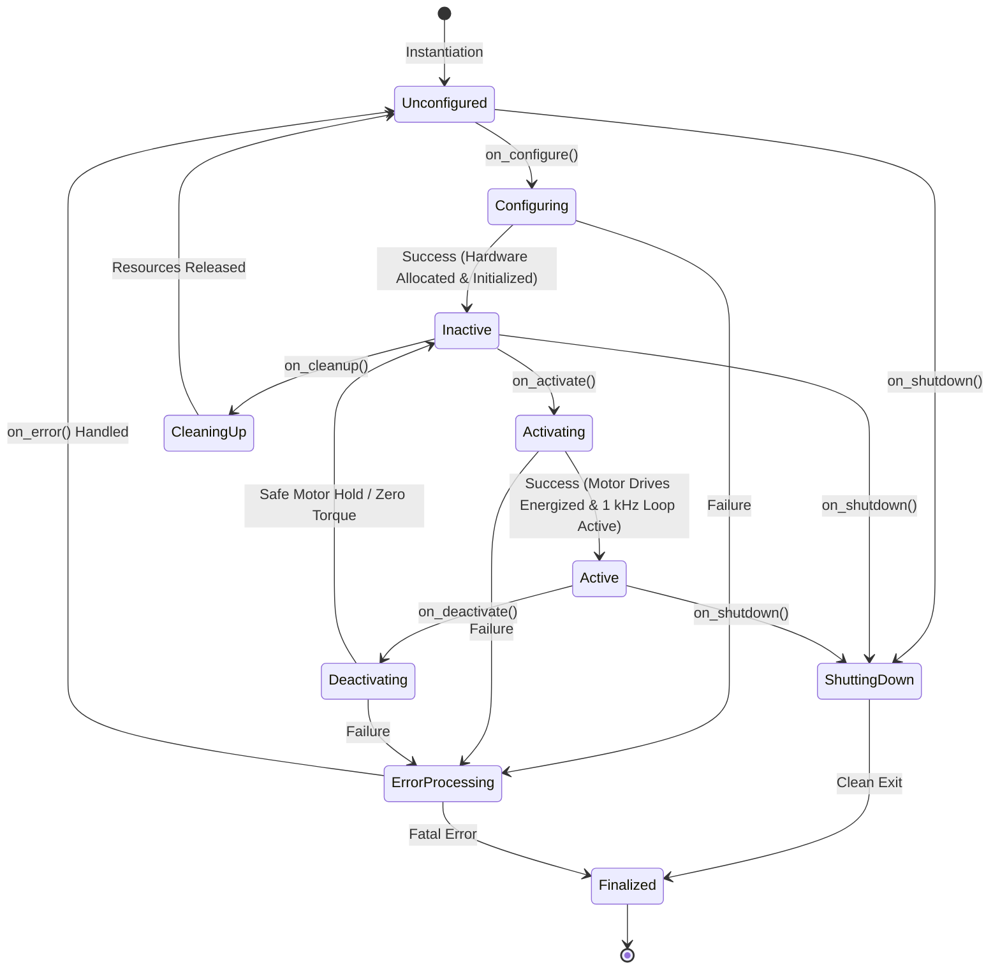
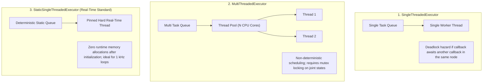

import ChapterProgress from '@site/src/components/ChapterProgress';
import QuizEngine from '@site/src/components/QuizEngine';

# Nodes, Executors & Lifecycle State Machines

In ROS 2, a **Node** is not merely a script that runs in the background. It is a managed participant in the distributed robotic graph responsible for executing deterministic algorithms, handling timer callbacks, managing subscriptions, and asserting hardware safety.

On high-degree-of-freedom humanoid robots, unmanaged nodes that start up unpredictably can cause catastrophic joint snaps or sensor initialization race conditions. To guarantee deterministic execution, industrial humanoid architectures rely on **Managed Lifecycle Nodes** and **Real-Time Executors**.



---

## 1. The ROS 2 Executor Model

Every ROS 2 node relies on an **Executor** to dispatch callbacks from timers, topic subscriptions, service requests, and action servers. Choosing the wrong executor model will cause thread starvation and missed real-time deadlines:



### Callback Groups: Preventing Deadlocks

When a node must subscribe to a 500 Hz sensor stream while simultaneously calling a service or running a timer, callbacks must be assigned to explicit **Callback Groups**:
- **`MutuallyExclusive`**: Callbacks within this group will never execute in parallel. This protects shared data structures without manual mutex locking.
- **`Reentrant`**: Callbacks can execute concurrently across threads in a `MultiThreadedExecutor`.

---

## 2. Mathematical Scheduling Theory: Response-Time Analysis

To mathematically prove that a set of periodic and event-driven callbacks will never miss their hard real-time deadlines $D_i \le T_i$, roboticists apply **Worst-Case Response Time (WCRT)** analysis.

### Response-Time Analysis under Fixed-Priority Scheduling (Joseph & Pandya Recurrence)

Under fixed-priority preemptive scheduling, the worst-case response time $R_i$ of callback $i$ is calculated iteratively via:

$$
R_i^{(k+1)} = C_i + \sum_{j \in \text{hp}(i)} \left\lceil \frac{R_i^{(k)}}{T_j} \right\rceil C_j
$$

where:
- $C_i$ is the worst-case execution time (WCET) of callback $i$,
- $T_j$ is the recurrence period of higher-priority callback $j$,
- $\text{hp}(i)$ represents the set of all callbacks with higher priority than $i$,
- The iteration starts at $R_i^{(0)} = C_i$ and terminates when $R_i^{(k+1)} = R_i^{(k)}$. The system is certified schedulable if and only if $\forall i, R_i \le D_i$.

### Hardware Processor Execution & Cache Latency Penalty

Context switches and thread preemption invalidate hardware CPU caches. The true execution time including memory hierarchy penalties is modeled as:

$$
T_{\text{exec}} = N_{\text{inst}} \cdot \text{CPI}_{\text{base}} + \left( M_{\text{L1}} \cdot \tau_{\text{L1\_penalty}} + M_{\text{L2}} \cdot \tau_{\text{L2\_penalty}} + M_{\text{LLC}} \cdot \tau_{\text{DRAM\_lat}} \right)
$$

| CPU Architecture Dimension | Value / Characteristic | Impact on 1 kHz Real-Time Callback Executor |
| :--- | :--- | :--- |
| **Cache Line Size** | 64 Bytes | False sharing occurs if multiple threads update adjacent joint state floats on the same line |
| **L1 Data Cache Latency** | 4–5 clock cycles (~1.0 ns) | Ideal location for pre-allocated joint command buffers |
| **L3 Shared Cache Latency** | 40–60 clock cycles (~15 ns) | Context switches flushing L1/L2 force costly L3/DRAM reload |
| **DRAM Memory Access** | 60–80 ns (DDR5) | Dynamic heap allocation (`malloc`) causes page table traversal and unmodeled jitter |

---

## 3. Managed Lifecycle Nodes: The Safety Imperative

In a bipedal humanoid, energizing motors (applying 48V–100V bus power to 30+ high-torque brushless DC motors) while the IMU or joint encoders are still calibrating will cause violent instability and mechanical destruction.

Managed Lifecycle Nodes (`rclcpp_lifecycle`) introduce deterministic state machines where code transitions through discrete operational phases:

1. **`on_configure()`**: 
   - Parse parameters (PID gains, motor gear ratios).
   - Allocate all memory buffers and vector arrays.
   - Establish hardware communication buses (EtherCAT / CAN-FD).
   - Actuators remain **unpowered** (PWM disabled).
2. **`on_activate()`**:
   - Verify all encoders are reporting valid absolute positions.
   - Assert safety interlocks and start high-frequency 1 kHz publishers.
   - Transition actuators to active closed-loop torque control.
3. **`on_deactivate()`**:
   - Ramp joint torques smoothly to zero or engage mechanical brakes.
   - Stop publishing control efforts.
4. **`on_cleanup()`**:
   - Free memory, close device file descriptors, and disconnect from hardware.

---

## 4. Production C++20 Real-Time Pinned Node Implementation

Below is a production C++20 implementation pinning an isolated control node to CPU Core 2 using a zero-allocation `StaticSingleThreadedExecutor`:

```cpp
// realtime_isolated_node.cpp
#include <rclcpp/rclcpp.hpp>
#include <sensor_msgs/msg/joint_state.hpp>
#include <pthread.h>
#include <sched.h>
#include <vector>

class RealTimeBalanceNode : public rclcpp::Node {
public:
  RealTimeBalanceNode() : Node("realtime_balance_node") {
    cb_group_rt_ = this->create_callback_group(rclcpp::CallbackGroupType::MutuallyExclusive);
    rclcpp::SubscriptionOptions sub_opts;
    sub_opts.callback_group = cb_group_rt_;

    sub_ = this->create_subscription<sensor_msgs::msg::JointState>(
      "/joint_states", rclcpp::SensorDataQoS(),
      std::bind(&RealTimeBalanceNode::joint_callback, this, std::placeholders::_1),
      sub_opts
    );
    RCLCPP_INFO(this->get_logger(), "RealTimeBalanceNode initialized with MutuallyExclusive callback group.");
  }

private:
  void joint_callback(const sensor_msgs::msg::JointState::SharedPtr msg) {
    // 1 kHz execution loop: No heap allocations, static buffers only
    static double joint_torques[32];
    for (size_t i = 0; i < msg->position.size() && i < 32; ++i) {
      // Proportional-Derivative joint compliance
      joint_torques[i] = -150.0 * msg->position[i] - 10.0 * msg->velocity[i];
    }
  }

  rclcpp::CallbackGroup::SharedPtr cb_group_rt_;
  rclcpp::Subscription<sensor_msgs::msg::JointState>::SharedPtr sub_;
};

int main(int argc, char** argv) {
  rclcpp::init(argc, argv);
  auto node = std::make_shared<RealTimeBalanceNode>();

  // Pin current process thread to CPU Core 2
  cpu_set_t cpuset;
  CPU_ZERO(&cpuset);
  CPU_SET(2, &cpuset);
  pthread_setaffinity_np(pthread_self(), sizeof(cpu_set_t), &cpuset);

  // StaticSingleThreadedExecutor guarantees zero dynamic allocations after initialization
  rclcpp::executors::StaticSingleThreadedExecutor executor;
  executor.add_node(node);
  executor.spin();

  rclcpp::shutdown();
  return 0;
}
```

---

## 5. Research Foundations & Seminal Literature

1. **Casini, D., Blaß, T., Inam, R., & Brand, M. (2019).** *Response-Time Analysis of ROS 2 Processing Chains under Reservation-Based Scheduling*. In 31st Euromicro Conference on Real-Time Systems (ECRTS 2019).
2. **Blaß, T., Casini, D., Brand, M., & Inam, R. (2021).** *A ROS 2 Response-Time Analysis and Its Implications for Architecture Design*. IEEE Transactions on Computer-Aided Design of Integrated Circuits and Systems, 41(11), 3845-3856.
3. **Joseph, M., & Pandya, P. (1986).** *Finding response times in a real-time system*. The Computer Journal, 29(5), 390-395.

---

<ChapterProgress chapterId="1-4-nodes" moduleId="module1" totalChapters={14} />

## Chapter Mastery Check

<QuizEngine
  quizId="quiz-1-4"
  title="Module 1.4 Mastery Check: Nodes, Executors & Lifecycle State Machines"
  moduleId="module1"
  passThreshold={70}
  questions={[
    {
      id: "q1",
      question: "Why is StaticSingleThreadedExecutor preferred over MultiThreadedExecutor for 1 kHz humanoid locomotion loops?",
      options: [
        "MultiThreadedExecutor cannot compile with GCC",
        "StaticSingleThreadedExecutor pre-allocates internal data structures during initialization, guaranteeing zero runtime dynamic allocations and deterministic scheduling",
        "SingleThreadedExecutor runs 10x faster by bypassing the Linux kernel",
        "It automatically calculates the robot center of mass"
      ],
      correctIndex: 1,
      explanation: "StaticSingleThreadedExecutor scans entities once at startup and pre-allocates all execution structures. This eliminates malloc/free calls inside the active spin loop, preventing page faults and non-deterministic latency spikes."
    },
    {
      id: "q2",
      question: "In the Managed Lifecycle state machine, what operations must be strictly confined to on_configure() rather than on_activate()?",
      options: [
        "Energizing motor bus relays and enabling PWM current gates",
        "Allocating memory buffers, parsing parameters, and establishing bus handles without energizing high-power actuators",
        "Executing the bipedal walking gait",
        "Shutting down the operating system"
      ],
      correctIndex: 1,
      explanation: "on_configure() allocates all memory and opens device handles while keeping actuators unpowered. High-power motor PWM and active torque loops are reserved for on_activate() once all sensors are confirmed healthy."
    },
    {
      id: "q3",
      question: "In Worst-Case Response Time (WCRT) recurrence analysis, when is a task set considered certifiably schedulable?",
      options: [
        "When all callbacks execute on CPU Core 0",
        "When the recurrence relation converges to R_i <= D_i for every task i",
        "When memory utilization exceeds 90%",
        "When all topics use Best-Effort QoS"
      ],
      correctIndex: 1,
      explanation: "A task set is schedulable under fixed-priority scheduling if and only if every task's worst-case response time R_i (including interference from higher-priority tasks) is less than or equal to its deadline D_i."
    }
  ]}
/>
