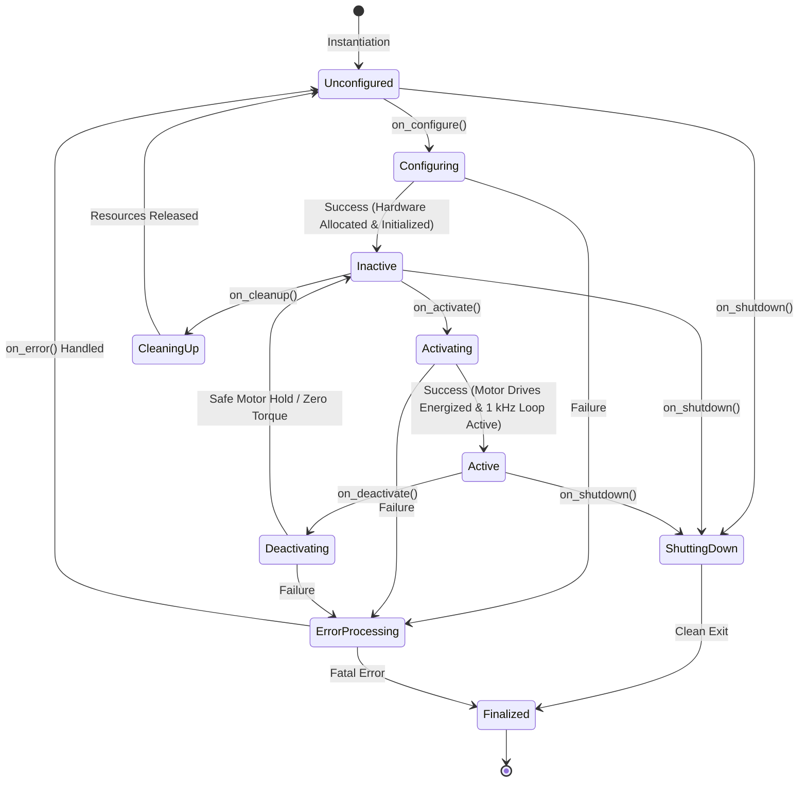
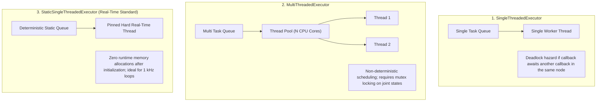

# Nodes, Executors & Lifecycle State Machines

In ROS 2, a **Node** is not merely a script that runs in the background. It is a managed participant in the distributed robotic graph responsible for executing deterministic algorithms, handling timer callbacks, managing subscriptions, and asserting hardware safety.

On high-degree-of-freedom humanoid robots, unmanaged nodes that start up unpredictably can cause catastrophic joint violent snaps or sensor initialization race conditions. To guarantee deterministic execution, industrial humanoid architectures rely on **Managed Lifecycle Nodes** and **Real-Time Executors**.



---

## 1. The ROS 2 Executor Model

Every ROS 2 node relies on an **Executor** to dispatch callbacks from timers, topic subscriptions, service requests, and action servers. Choosing the wrong executor model will cause thread starvation and missed real-time deadlines:



### Callback Groups: Preventing Deadlocks
When a node must subscribe to a 500 Hz sensor stream while simultaneously calling a service or running a timer, callbacks must be assigned to explicit **Callback Groups**:
- **`MutuallyExclusive`**: Callbacks within this group will never execute in parallel. This protects shared data structures without manual mutex locking.
- **`Reentrant`**: Callbacks can execute concurrently across threads in a `MultiThreadedExecutor`.

---

## 2. Managed Lifecycle Nodes: The Safety Imperative

In a bipedal humanoid, energizing motors (applying 48V–100V bus power to 30+ high-torque brushless DC motors) while the IMU or joint encoders are still calibrating will cause violent instability and mechanical destruction.

Managed Lifecycle Nodes (`rclcpp_lifecycle`) introduce deterministic state machines where code transitions through discrete operational phases:

1. **`on_configure()`**: 
   - Parse parameters (PID gains, motor gear ratios).
   - Allocate all memory buffers and vector arrays.
   - Establish hardware communication buses (EtherCAT / CAN-FD).
   - Actuators remain **unpowered** (PWM disabled).
2. **`on_activate()`**:
   - Verify all encoders are reporting valid absolute positions.
   - Assert safety interlocks and start high-frequency 1 kHz publishers.
   - Transition actuators to active closed-loop torque control.
3. **`on_deactivate()`**:
   - Ramp joint torques smoothly to zero or engage mechanical brakes.
   - Stop publishing control efforts.
4. **`on_cleanup()`**:
   - Free memory, close device file descriptors, and disconnect from hardware.

---

## 3. Production C++20 Lifecycle Node Implementation

Below is a production-grade C++20 implementation of a real-time humanoid ankle actuator node with lifecycle management and callback group isolation:

```cpp
#include <chrono>
#include <memory>
#include <string>
#include <vector>

#include "rclcpp/rclcpp.hpp"
#include "rclcpp_lifecycle/lifecycle_node.hpp"
#include "sensor_msgs/msg/joint_state.hpp"
#include "std_msgs/msg/float64_multi_array.hpp"

using CallbackReturn = rclcpp_lifecycle::node_interfaces::LifecycleNodeInterface::CallbackReturn;
using namespace std::chrono_literals;

class HumanoidAnkleActuatorNode : public rclcpp_lifecycle::LifecycleNode {
public:
  explicit HumanoidAnkleActuatorNode(const rclcpp::NodeOptions & options = rclcpp::NodeOptions())
  : LifecycleNode("humanoid_ankle_actuator", options),
    loop_rate_hz_(1000.0) {}

  // 1. Configuration Callback: Allocate memory and connect to bus
  CallbackReturn on_configure(const rclcpp_lifecycle::State & /*previous_state*/) override {
    RCLCPP_INFO(get_logger(), "Configuring Ankle Actuator Node: Initializing EtherCAT bus...");

    // Pre-allocate joint state arrays to guarantee zero runtime heap allocation
    joint_positions_.resize(2, 0.0); // Ankle Pitch & Roll
    joint_torques_.resize(2, 0.0);

    // Create real-time lifecycle publisher
    joint_state_pub_ = create_publisher<sensor_msgs::msg::JointState>(
      "/humanoid/ankle/joint_states", 10);

    // Create MutuallyExclusive callback group for real-time timer
    timer_cb_group_ = create_callback_group(rclcpp::CallbackGroupType::MutuallyExclusive);

    RCLCPP_INFO(get_logger(), "Configuration successful. Hardware in standby.");
    return CallbackReturn::SUCCESS;
  }

  // 2. Activation Callback: Enable high-voltage drive stages
  CallbackReturn on_activate(const rclcpp_lifecycle::State & state) override {
    RCLCPP_INFO(get_logger(), "Activating Ankle Actuator: Powering motor coils...");
    joint_state_pub_->on_activate();

    // Start 1 kHz (1 ms) control loop timer
    auto timer_period = std::chrono::duration<double>(1.0 / loop_rate_hz_);
    control_timer_ = create_wall_timer(
      timer_period,
      std::bind(&HumanoidAnkleActuatorNode::control_loop_callback, this),
      timer_cb_group_);

    return LifecycleNode::on_activate(state);
  }

  // 3. Deactivation Callback: Safe shutdown / engage brakes
  CallbackReturn on_deactivate(const rclcpp_lifecycle::State & state) override {
    RCLCPP_WARN(get_logger(), "Deactivating Ankle Actuator: Zeroing torques & engaging brakes.");
    control_timer_->cancel();
    joint_state_pub_->on_deactivate();
    return LifecycleNode::on_deactivate(state);
  }

  // 4. Cleanup Callback: Release communication handles
  CallbackReturn on_cleanup(const rclcpp_lifecycle::State & /*previous_state*/) override {
    RCLCPP_INFO(get_logger(), "Cleaning up Ankle Actuator resources...");
    joint_state_pub_.reset();
    control_timer_.reset();
    return CallbackReturn::SUCCESS;
  }

  // 5. Shutdown Callback: Emergency stop pathway
  CallbackReturn on_shutdown(const rclcpp_lifecycle::State & /*previous_state*/) override {
    RCLCPP_ERROR(get_logger(), "Emergency Shutdown triggered on Ankle Actuator!");
    return CallbackReturn::SUCCESS;
  }

private:
  void control_loop_callback() {
    // Hard Real-Time 1 kHz execution body
    sensor_msgs::msg::JointState msg;
    msg.header.stamp = now();
    msg.name = {"ankle_pitch_joint", "ankle_roll_joint"};
    msg.position = joint_positions_;
    msg.effort = joint_torques_;

    // Non-blocking real-time publish
    joint_state_pub_->publish(msg);
  }

  double loop_rate_hz_;
  std::vector<double> joint_positions_;
  std::vector<double> joint_torques_;

  rclcpp::CallbackGroup::SharedPtr timer_cb_group_;
  rclcpp::TimerBase::SharedPtr control_timer_;
  std::shared_ptr<rclcpp_lifecycle::LifecyclePublisher<sensor_msgs::msg::JointState>> joint_state_pub_;
};

int main(int argc, char * argv[]) {
  rclcpp::init(argc, argv);
  auto node = std::make_shared<HumanoidAnkleActuatorNode>();

  // Use StaticSingleThreadedExecutor for deterministic memory profiles
  rclcpp::executors::StaticSingleThreadedExecutor executor;
  executor.add_node(node->get_node_base_interface());
  executor.spin();

  rclcpp::shutdown();
  return 0;
}
```

In the next chapter, we dive into continuous data transmission: **Topics, Quality of Service (QoS) Profiles, and Zero-Copy Shared Memory IPC**.
