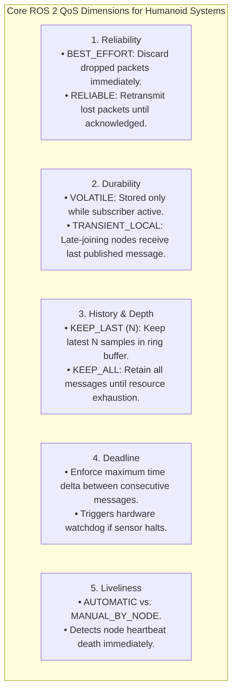

# Topics, QoS Policies & Zero-Copy Shared Memory

A bipedal humanoid generates an immense sensory throughput: dual 4K stereo cameras streaming at 60 Hz produce over 1.5 GB/s of raw uncompressed visual data; 32 joint encoders stream at 500 Hz; dual tactical-grade 6-axis IMUs publish at 1,000 Hz; and foot contact sensors stream reaction forces at 1 kHz.

Transporting these multi-rate, high-bandwidth streams across the robotic nervous system without dropped packets, CPU thrashing, or latency spikes requires mastering **ROS 2 Topics**, **Quality of Service (QoS) Profiles**, and **Zero-Copy Shared Memory IPC (Eclipse Iceoryx)**.

```mermaid
flowchart TD
    subgraph TraditionalIPC["Traditional Socket-Based Transport (3-4 Memory Copies)"]
        Publisher1["Publisher Process (User Space)"] -->|Copy 1: Serialize to buffer| UserBuf1["User Memory Buffer"]
        UserBuf1 -->|Copy 2: Syscall write()| Kernel1["Kernel Socket Buffer"]
        Kernel1 -->|Network Stack / Loopback| Kernel2["Receiving Kernel Buffer"]
        Kernel2 -->|Copy 3: Syscall read()| UserBuf2["Subscriber User Buffer"]
        UserBuf2 -->|Copy 4: Deserialize| Subscriber1["Subscriber Process"]
    end

    subgraph ZeroCopyIPC["Zero-Copy Shared Memory IPC (Eclipse Iceoryx)"]
        Publisher2["Publisher: loan_message()"] --> ShmPool["Shared Memory Chunk Pool (/dev/shm)"]
        ShmPool -->|Pointer Swap (Zero CPU Memory Copy)| Subscriber2["Subscriber: take_loaned_message()"]
        NoteZero["Latency: < 15 microseconds regardless of payload size (4K RGB or 100k LiDAR PointCloud)"]
    end
```

---

## 1. Quality of Service (QoS) Policies: The Determinism Rules

In ROS 1, all communication defaulted to TCP streams. In ROS 2, every Publisher and Subscriber specifies a fine-grained **QoS Profile**. If the QoS policies of the publisher and subscriber are incompatible, **no connection will be established**, and the subscriber will receive zero messages without generating a runtime error.



### The QoS Compatibility Matrix
DDS enforces the **"Request vs. Offered" (RxO)** contract rule: A subscriber's requested QoS cannot be stricter than what the publisher offers:

| Publisher Offers | Subscriber Requests | Compatible? | Behavioral Result |
| :--- | :--- | :--- | :--- |
| `RELIABLE` | `BEST_EFFORT` | **YES** | Messages delivered without retransmission overhead. |
| `BEST_EFFORT` | `RELIABLE` | **NO (Silent Failure)** | **Zero messages received.** Connection rejected by DDS. |
| `TRANSIENT_LOCAL` | `VOLATILE` | **YES** | Subscriber only processes new live messages. |
| `VOLATILE` | `TRANSIENT_LOCAL` | **NO (Silent Failure)** | Connection rejected; subscriber cannot receive cached state. |

### Standard Humanoid QoS Profiles:
1. **Sensory Streams (IMU, Encoders, LiDAR)**:
   - Reliability: `BEST_EFFORT` (Stale sensor readings are dangerous; never retransmit past timestamps).
   - History: `KEEP_LAST`, Depth: `1` to `5`.
   - Durability: `VOLATILE`.
2. **Kinematic Descriptions & Coordinate Transforms (`/tf_static`)**:
   - Reliability: `RELIABLE`.
   - Durability: `TRANSIENT_LOCAL` (Allows late-joining nodes to immediately acquire robot kinematic links).
   - History: `KEEP_LAST`, Depth: `1`.
3. **Emergency Stop & Safety Heartbeats**:
   - Reliability: `RELIABLE`.
   - Deadline: `std::chrono::milliseconds(10)` (Trigger fallback brakes if deadline missed).

---

## 2. Zero-Copy Shared Memory Architecture (Eclipse Iceoryx)

When transferring a single 4K stereo camera frame (3840 &times; 2160 &times; 3 bytes &approx; 24.8 MB) at 60 Hz:
- Traditional socket serialisation requires moving **1.49 GB per second** through the CPU cache, causing severe cache eviction and starving the 1 kHz balance control thread.
- **Zero-Copy Shared Memory (Eclipse Iceoryx)** allocates a fixed chunk pool inside POSIX shared memory (`/dev/shm`).

### The Loaned Message Workflow:
1. The Publisher requests a pointer to an unallocated chunk directly from the shared memory pool:
   ```cpp
   auto loaned_msg = publisher->borrow_loaned_message();
   ```
2. The camera driver writes raw sensor pixels directly into `loaned_msg.get()` via DMA (Direct Memory Access).
3. The Publisher dispatches the message. Rather than copying bytes, DDS merely transmits a **64-bit memory address pointer** to the subscriber.
4. The Subscriber processes the memory block in place, releasing the reference counter when finished.
5. CPU consumption drops from **35% of an 8-core CPU** to **&lt; 0.5%**, and latency drops to sub-microsecond levels.

---

## 3. Production C++20 Zero-Copy Sensor Publisher & Subscriber

```cpp
#include <chrono>
#include <memory>
#include "rclcpp/rclcpp.hpp"
#include "sensor_msgs/msg/imu.hpp"

using namespace std::chrono_literals;

class HighRateImuPublisher : public rclcpp::Node {
public:
  HighRateImuPublisher() : Node("high_rate_imu_publisher") {
    // 1. Configure strict Real-Time Sensor QoS
    rclcpp::QoS sensor_qos(rclcpp::KeepLast(1));
    sensor_qos.best_effort();  // Drop dropped packets; never block for retransmits
    sensor_qos.durability_volatile();

    // 2. Create publisher with loaned message capability
    imu_pub_ = create_publisher<sensor_msgs::msg::Imu>("/sensors/imu/data_raw", sensor_qos);

    // 3. Start 1,000 Hz timer (1 ms interval)
    timer_ = create_wall_timer(1ms, std::bind(&HighRateImuPublisher::publish_imu, this));
  }

private:
  void publish_imu() {
    // Check if underlying middleware supports loaned zero-copy memory
    if (imu_pub_->can_loan_messages()) {
      auto loaned_msg = imu_pub_->borrow_loaned_message();

      // Populate directly in shared memory chunk
      loaned_msg.get().header.stamp = now();
      loaned_msg.get().header.frame_id = "imu_link";
      loaned_msg.get().linear_acceleration.z = 9.80665; // Nominal gravity

      // Zero-copy pointer dispatch
      imu_pub_->publish(std::move(loaned_msg));
    } else {
      // Fallback for non-zero-copy transports
      auto msg = std::make_unique<sensor_msgs::msg::Imu>();
      msg->header.stamp = now();
      msg->header.frame_id = "imu_link";
      msg->linear_acceleration.z = 9.80665;
      imu_pub_->publish(std::move(msg));
    }
  }

  rclcpp::Publisher<sensor_msgs::msg::Imu>::SharedPtr imu_pub_;
  rclcpp::TimerBase::SharedPtr timer_;
};

int main(int argc, char * argv[]) {
  rclcpp::init(argc, argv);
  rclcpp::spin(std::make_shared<HighRateImuPublisher>());
  rclcpp::shutdown();
  return 0;
}
```

---

## 5. Eclipse Iceoryx Shared Memory Architecture

On a humanoid with stereo 4K RGB-D cameras (generating ~1.2 GB/s of raw uncompressed visual telemetry), standard network socket serialization causes severe CPU bottlenecks:

```mermaid
flowchart LR
    subgraph TraditionalIPC["Traditional Sockets (Serialization Bottleneck)"]
        direction TB
        Pub1["Publisher Node"] -->|1. Serialize to CDR (CPU Copy)| Kernel1["OS Network Stack"]
        Kernel1 -->|2. UDP Socket Buffer Copy| Kernel2["Loopback / Socket"]
        Kernel2 -->|3. Deserialize from CDR (CPU Copy)| Sub1["Subscriber Node"]
    end

    subgraph IceoryxIPC["Eclipse Iceoryx Shared Memory (True Zero-Copy)"]
        direction TB
        Pub2["Publisher Node (Loaned Message)"]
        MemPool["Shared Memory Segment /dev/shm (Pre-allocated Chunks)"]
        Sub2["Subscriber Node"]

        Pub2 -->|Direct Memory Write| MemPool
        MemPool -->|Pointer Handoff via Unix Domain Socket (0 CPU Copies)| Sub2
    end
```

By decoupling payload transfers into fixed-size shared memory memory pools (`RouDi` daemon), Iceoryx maintains a constant **sub-microsecond transmission latency** regardless of whether a message is an 8-byte encoder position or an 800 MB lidar point cloud.

In the next chapter, we analyze discrete request-response primitives: **Services, Thread Starvation, and Reentrant Concurrency**.
