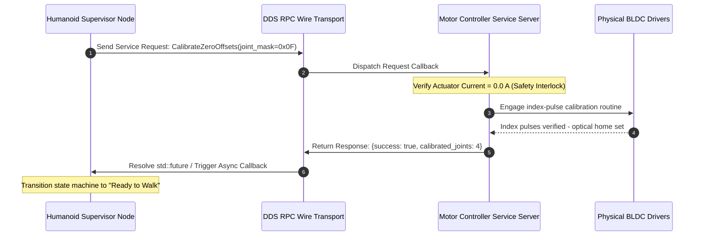

import ChapterProgress from '@site/src/components/ChapterProgress';
import QuizEngine from '@site/src/components/QuizEngine';

# Synchronous Services & Concurrency Deadlocks

While continuous data flows over Topics, discrete state transitions—such as zeroing motor encoder offsets, engaging mechanical holding brakes, or querying battery cell voltages—require a direct, synchronous Remote Procedure Call (RPC). In ROS 2, this is governed by **Services**.

However, in multi-threaded robotics software, naive service invocations represent the single most common cause of **deadlocks and thread starvation**. Understanding executor callback scheduling, Petri net reachability proofs, and non-blocking asynchronous promises is mandatory for humanoid systems engineering.



---

## 1. The Anatomy of a ROS 2 Service

A service consists of a strictly paired Request and Response data structure defined in a `.srv` file:

```text
# Example: humanoid_interfaces/srv/CalibrateJoints.srv
uint32 joint_mask          # Bitmask selecting target joint actuators
float64 max_torque_limit   # Maximum torque allowed during index search
---
bool success               # Calibration outcome
string message             # Status or error diagnostic string
float64[] homed_positions  # Recorded absolute zero angles (rad)
```

### When to Use Services vs. Topics:
- **USE SERVICES FOR**: Atomic, one-off, discrete commands where the caller *must* know the success/failure outcome before proceeding (e.g., `SetSafetyMode`, `ResetOdometry`, `ZeroForceTorqueSensors`).
- **NEVER USE SERVICES FOR**: Continuous high-frequency commands (e.g., streaming 500 Hz joint position targets). Services generate substantial header overhead, lack zero-copy optimizations, and create brittle synchronization dependencies.

---

## 2. Mathematical Modeling of Retry Dynamics & Exponential Backoff

When multiple nodes query a shared service simultaneously (e.g., joint controllers requesting calibration parameters at startup), simultaneous retries induce contention collisions.

To guarantee bounded network recovery, retry delays must follow **Exponential Backoff with Full Decorrelated Jitter**:

$$
T_{\text{retry}}(k) = \mathcal{U}\left(0, \min(T_{\text{max}}, T_{\text{base}} \cdot 2^k)\right)
$$

where:
- $k$ is the zero-based retry counter,
- $T_{\text{base}}$ is the initial base backoff window (e.g., $5\text{ ms}$),
- $T_{\text{max}}$ is the saturation ceiling (e.g., $200\text{ ms}$),
- $\mathcal{U}(a, b)$ is a uniform continuous random distribution over $[a, b]$.

This stochastic decorrelation prevents synchronized lock-step retry bursts from flooding the underlying DDS RPC channel.

---

## 3. Concurrency Deadlock Analysis via Petri Nets

Deadlocks in ROS 2 executors arise when cyclic resource waiting occurs under the classic **Coffman conditions** (Mutual Exclusion, Hold and Wait, No Preemption, Circular Wait).

### Petri Net Conservation & Liveness Condition

Let a robotic concurrency model be represented by a Petri Net with places $P$, transitions $T$, and token marking $M$. A system is certified deadlock-free (possessing liveness level $L_4$) if and only if:

$$
\forall t \in T, \; \exists M' \text{ reachable from } M \text{ such that } M' \xrightarrow{t}
$$

and the weighted token conservation invariant holds:

$$
\sum_{p \in P} w(p) \cdot M(p) = \text{const}
$$

In a `SingleThreadedExecutor`, nesting a blocking `future.get()` call inside a callback locks the single execution token $M(p_{\text{thread}}) = 0$, violating liveness and halting the graph permanently.

---

## 4. Hardware Actuator Bus Service Latencies & Failure Modes

| Actuator Bus Device | Control Signal | Response Time | Hardware Failure Mode on Timeout |
| :--- | :--- | :--- | :--- |
| **Power Distribution Relays** | High-Current Solid-State MOSFET Relay | 1.5–5.0 ms | Incomplete contact engagement; inductive arc during 48V motor bus energization |
| **Optical Encoder Index Search** | Digital Home Capture Pin | 50–500 ms | Joint runs into mechanical hard-stop if index pulse is not captured |
| **Motor Holding Brakes** | 24V Solenoid Spring Brake | 15–30 ms | Mechanical brake shoe drag if joint commanded to move prior to release confirmation |

---

## 5. Production C++20 Non-Blocking Asynchronous Service Client

To guarantee deterministic progress without deadlocks, services must be called asynchronously with strict deadline timeouts:

```cpp
// async_service_client_with_timeout.cpp
#include <rclcpp/rclcpp.hpp>
#include <example_interfaces/srv/set_bool.hpp>
#include <chrono>

using namespace std::chrono_literals;

class SafeServiceCaller : public rclcpp::Node {
public:
  SafeServiceCaller() : Node("safe_service_caller") {
    client_ = this->create_client<example_interfaces::srv::SetBool>("/power_stage/enable");
  }

  void execute_safe_call() {
    while (!client_->wait_for_service(1s)) {
      if (!rclcpp::ok()) return;
      RCLCPP_INFO(this->get_logger(), "Awaiting service availability...");
    }

    auto request = std::make_shared<example_interfaces::srv::SetBool::Request>();
    request->data = true;

    auto future = client_->async_send_request(request);
    // Asynchronous deadline wait without blocking the executor thread
    if (future.wait_for(200ms) == std::future_status::ready) {
      auto response = future.get();
      RCLCPP_INFO(this->get_logger(), "Service Success: %s", response->message.c_str());
    } else {
      RCLCPP_ERROR(this->get_logger(), "Service deadline violated! Triggering safety abort.");
    }
  }

private:
  rclcpp::Client<example_interfaces::srv::SetBool>::SharedPtr client_;
};

int main(int argc, char** argv) {
  rclcpp::init(argc, argv);
  auto node = std::make_shared<SafeServiceCaller>();
  node->execute_safe_call();
  rclcpp::shutdown();
  return 0;
}
```

---

## 6. Research Foundations & Seminal Literature

1. **Pardo-Castellote, G. (2001).** *OMG Data-Distribution Service: Architectural Overview*. In 23rd International Conference on Distributed Computing Systems Workshops.
2. **Coffman, E. G., Elphick, M., & Shoshani, A. (1971).** *System Deadlocks*. ACM Computing Surveys (CSUR), 3(2), 67-78.
3. **Murata, T. (1989).** *Petri nets: Properties, analysis and applications*. Proceedings of the IEEE, 77(4), 541-580.

---

<ChapterProgress chapterId="1-6-services" moduleId="module1" totalChapters={14} />

## Chapter Mastery Check

<QuizEngine
  quizId="quiz-1-6"
  title="Module 1.6 Mastery Check: Synchronous Services & Concurrency Deadlocks"
  moduleId="module1"
  passThreshold={70}
  questions={[
    {
      id: "q1",
      question: "Why does invoking future.get() inside a timer callback on a SingleThreadedExecutor cause an unrecoverable deadlock?",
      options: [
        "The compiler optimizes out the future variable",
        "The single worker thread is blocked waiting for the response, preventing the executor from ever dispatching the incoming response callback",
        "Services only function over Wi-Fi connections",
        "POSIX kernels terminate processes that block for more than 1 ms"
      ],
      correctIndex: 1,
      explanation: "A SingleThreadedExecutor has exactly one thread. If that thread blocks inside a callback waiting for an RPC reply, it cannot process the incoming network response, resulting in a permanent circular deadlock."
    },
    {
      id: "q2",
      question: "In Exponential Backoff with Full Jitter, why is a random uniform draw U(0, min(T_max, T_base * 2^k)) added to retry intervals?",
      options: [
        "To satisfy cryptographic randomness standards",
        "To decorrelate simultaneous retries across distributed nodes and prevent destructive synchronized retry storms",
        "To decrease the CPU clock temperature",
        "Because DDS RTPS requires random sequence numbers"
      ],
      correctIndex: 1,
      explanation: "Without jitter, nodes that fail simultaneously retry at identical time steps, re-colliding repeatedly. Uniform full jitter decorrelates retry attempts across the network."
    },
    {
      id: "q3",
      question: "Why should services never be used for continuous 500 Hz joint torque command streaming?",
      options: [
        "C++ does not support high-frequency functions",
        "Services enforce synchronous request-response semantics and generate significant protocol header overhead, lacking zero-copy shared memory pipelines",
        "Torque cannot be expressed as a 64-bit float",
        "Services require human keyboard confirmation"
      ],
      correctIndex: 1,
      explanation: "Services involve round-trip RPC handshakes with state tracking. For continuous 500 Hz streams, topics with best-effort QoS and zero-copy shared memory are required to avoid latency bottlenecks."
    }
  ]}
/>
