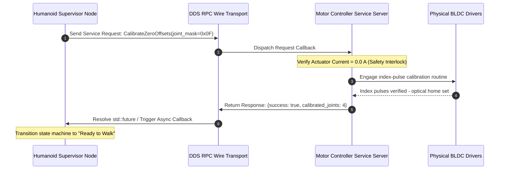
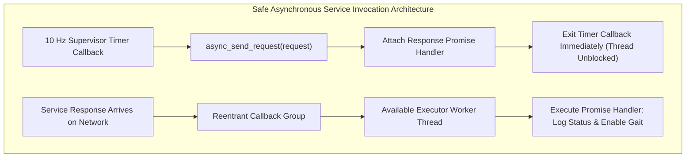

# Synchronous Services & Concurrency Deadlocks

While continuous data flows over Topics, discrete state transitions—such as zeroing motor encoder offsets, engaging mechanical holding brakes, or querying battery cell voltages—require a direct, synchronous Remote Procedure Call (RPC). In ROS 2, this is governed by **Services**.

However, in multi-threaded robotics software, naive service invocations represent the single most common cause of **deadlocks and thread starvation**. Understanding executor callback scheduling and non-blocking asynchronous promises is mandatory for humanoid systems engineering.



---

## 1. The Anatomy of a ROS 2 Service

A service consists of a strictly paired Request and Response data structure defined in a `.srv` file:

```text
# Example: humanoid_interfaces/srv/CalibrateJoints.srv
uint32 joint_mask          # Bitmask selecting target joint actuators
float64 max_torque_limit   # Maximum torque allowed during index search
---
bool success               # Calibration outcome
string message             # Status or error diagnostic string
float64[] homed_positions  # Recorded absolute zero angles (rad)
```

### When to Use Services vs. Topics:
- **USE SERVICES FOR**: Atomic, one-off, discrete commands where the caller *must* know the success/failure outcome before proceeding (e.g., `SetSafetyMode`, `ResetOdometry`, `ZeroForceTorqueSensors`).
- **NEVER USE SERVICES FOR**: Continuous high-frequency commands (e.g., streaming 500 Hz joint position targets). Services generate substantial header overhead, lack zero-copy optimizations, and create brittle synchronization dependencies.

---

## 2. The Deadlock Hazard: Blocking in Single-Threaded Executors

Consider a common anti-pattern: A supervisor node has a 10 Hz timer that evaluates robot stability. Inside the timer callback, the developer makes a synchronous service call:

```cpp
// ANTI-PATTERN: GUARANTEED DEADLOCK IN SingleThreadedExecutor!
void timer_callback() {
  auto request = std::make_shared<CalibrateJoints::Request>();
  // Blocking wait for future inside the executor thread
  auto result_future = client_->async_send_request(request);
  auto response = result_future.get(); // BLOCKS THREAD!
}
```

### Why This Deadlocks:
1. The `SingleThreadedExecutor` is actively running `timer_callback()`.
2. The thread blocks waiting for `result_future.get()`.
3. The service response arrives from the network and is placed on the executor queue.
4. But the executor cannot dispatch the response callback because the single worker thread is permanently blocked inside `timer_callback()`!
5. **Result**: The entire node freezes permanently, watchdog timers expire, and the humanoid crashes to the floor.

---

## 3. The Professional Solution: Reentrant Groups & Async Futures

To safely invoke services without deadlocks, you must apply two architectural patterns:
1. **Assign the Service Client to a `Reentrant` Callback Group**.
2. **Handle responses asynchronously using non-blocking lambdas (`std::future::then`) or spin the client within a dedicated `MultiThreadedExecutor`**.



---

## 4. Production C++20 Non-Blocking Service Implementation

Below is a robust implementation of a humanoid power management service client that executes asynchronously with safety timeouts:

```cpp
#include <chrono>
#include <memory>
#include "rclcpp/rclcpp.hpp"
#include "std_srvs/srv/set_bool.hpp"

using namespace std::chrono_literals;

class SafePowerSupervisor : public rclcpp::Node {
public:
  SafePowerSupervisor() : Node("safe_power_supervisor") {
    // 1. Create a Reentrant callback group to allow concurrent callback dispatch
    client_cb_group_ = create_callback_group(rclcpp::CallbackGroupType::Reentrant);

    // 2. Initialize the service client within the reentrant group
    power_client_ = create_client<std_srvs::srv::SetBool>(
      "/hardware/power_distribution/enable_high_voltage",
      rmw_qos_profile_services_default,
      client_cb_group_);

    // 3. Initiate non-blocking asynchronous request
    call_power_service_async(true);
  }

  void call_power_service_async(bool enable_power) {
    if (!power_client_->wait_for_service(2s)) {
      RCLCPP_ERROR(get_logger(), "Power distribution service unavailable! Aborting.");
      return;
    }

    auto request = std::make_shared<std_srvs::srv::SetBool::Request>();
    request->data = enable_power;

    RCLCPP_INFO(get_logger(), "Dispatching asynchronous power request...");

    // Non-blocking call returning a shared_future
    auto future_result = power_client_->async_send_request(
      request,
      [this](rclcpp::Client<std_srvs::srv::SetBool>::SharedFuture future) {
        // Callback invoked when response arrives without blocking the executor
        try {
          auto response = future.get();
          if (response->success) {
            RCLCPP_INFO(get_logger(), "High voltage bus enabled: %s", response->message.c_str());
          } else {
            RCLCPP_ERROR(get_logger(), "Power bus rejected enable: %s", response->message.c_str());
          }
        } catch (const std::exception & e) {
          RCLCPP_FATAL(get_logger(), "Service call failed with exception: %s", e.what());
        }
      });
  }

private:
  rclcpp::CallbackGroup::SharedPtr client_cb_group_;
  rclcpp::Client<std_srvs::srv::SetBool>::SharedPtr power_client_;
};

int main(int argc, char * argv[]) {
  rclcpp::init(argc, argv);
  auto node = std::make_shared<SafePowerSupervisor>();

  // Must use MultiThreadedExecutor with Reentrant Callback Groups
  rclcpp::executors::MultiThreadedExecutor executor(
    rclcpp::ExecutorOptions(), 4 /* 4 worker threads */);
  executor.add_node(node);
  executor.spin();

  rclcpp::shutdown();
  return 0;
}
```

In the next chapter, we transition from short-lived RPCs to long-horizon, preemptible tasks: **ROS 2 Actions for Humanoid Locomotion and Manipulation**.
