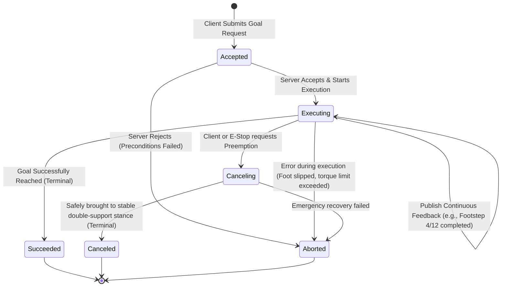

import ChapterProgress from '@site/src/components/ChapterProgress';
import QuizEngine from '@site/src/components/QuizEngine';

# Actions & Preemptible Long-Horizon Behaviors

Bipedal walking, traversing stairs, or picking up a heavy box are multi-second, long-horizon tasks. Using a synchronous Service for these behaviors is dangerous: the client cannot observe intermediate progress, cannot stream corrective feedback, and most critically, **cannot cancel or preempt the behavior** if the environment dynamically changes.

In ROS 2, long-horizon tasks are governed by **Actions**. Actions integrate three distinct communication channels: a Goal service, a Feedback topic, and a Result service, orchestrated by a formal, preemptible finite state machine.



---

## 1. The Tripartite Structure of an Action

An action is defined in an `.action` file containing three explicit sections:

```text
# Example: humanoid_interfaces/action/ExecuteFootstepPlan.action

# 1. GOAL (Sent by Client to initiate behavior)
geometry_msgs/PoseStamped[] footsteps   # Target foot placement sequence in World frame
float64 step_frequency_hz               # Commanded stepping cadence
float64 swing_height_meters             # Foot clearance height
---
# 2. RESULT (Sent by Server when goal reaches terminal state)
bool plan_completed                     # True if full sequence executed
uint32 completed_steps                  # Total steps successfully taken
string failure_diagnostic               # Error message if aborted
---
# 3. FEEDBACK (Streamed continuously during execution)
uint32 current_step_index               # Step currently being executed
float64 phase_percentage                # Progress within current swing phase [0.0 - 1.0]
geometry_msgs/Point measured_com        # Live Center of Mass position
float64 zmp_error_distance              # Deviation between desired and measured ZMP
```

---

## 2. Mathematical State Machine Reachability & Feedback Decimation

### Finite State Machine (FSM) Reachability Matrix

The standard ROS 2 Action state machine (REP-141) defines $n = 7$ states: *Accepted*, *Executing*, *Canceling*, *Succeeded*, *Aborted*, *Canceled*, and *Rejected*.

Let $\mathbf{A} \in \{0, 1\}^{n \times n}$ denote the directed state transition adjacency matrix, where $A_{ij} = 1$ if and only if a direct valid transition exists from state $i$ to state $j$.

The complete multi-step reachability matrix $\mathbf{M}_{\text{reach}}$ across all path lengths is computed as:

$$
\mathbf{M}_{\text{reach}} = \sum_{k=1}^{n-1} \mathbf{A}^k
$$

Evaluating $(\mathbf{M}_{\text{reach}})_{ij} > 0$ verifies that terminal states (*Succeeded*, *Aborted*, *Canceled*) cannot transition back to active states (*Executing*), preventing cyclic state corruption.

### Feedback Frequency Decimation Filter

A whole-body locomotion controller typically operates at $f_{\text{inner\_loop}} = 1000\text{ Hz}$. Streaming action feedback at 1 kHz over the network generates unnecessary serialization overhead. The action server applies a decimation integer $K_{\text{decimation}}$:

$$
f_{\text{feedback}} = \frac{f_{\text{inner\_loop}}}{K_{\text{decimation}}}, \quad K_{\text{decimation}} = \left\lfloor \frac{T_{\text{desired\_fb}}}{T_{\text{loop}}} \right\rfloor
$$

For $T_{\text{desired\_fb}} = 50\text{ ms}$ (20 Hz telemetry) and $T_{\text{loop}} = 1\text{ ms}$, $K_{\text{decimation}} = 50$, streaming vital ZMP metrics to cognitive task planners without degrading control loop determinism.

---

## 3. Subsystem Hardware Dynamics during Preemption

| Actuator / Subsystem | Behavior during Action Preemption | Mechanical Time Constant | Safety Hazard if Cancel Fails |
| :--- | :--- | :--- | :--- |
| **Leg Ankle/Knee Actuators** | Decelerate swing leg; transition to double-support stance | 80–120 ms | High-impact ground collision; knee hyperextension |
| **Gripper / Finger Drive** | Lock current finger positions via backdrivable holding torque | 30–50 ms | Dropping heavy grasped payload |
| **Torso Pitch / Yaw** | Slew to vertical center-of-mass equilibrium | 150–250 ms | Loss of Zero-Moment Point (ZMP) stability |

---

## 4. Production Python Action Server with Graceful Cancellation

Below is an executable Python action server implementation illustrating non-blocking execution, live feedback streaming, and dynamic preemption:

```python
#!/usr/bin/env python3
"""
footstep_action_server.py: Production ROS 2 Action Server for bipedal footstep execution.
"""
import time
import rclpy
from rclpy.action import ActionServer, CancelResponse, GoalResponse
from rclpy.node import Node
from rclpy.callback_groups import ReentrantCallbackGroup
from example_interfaces.action import Fibonacci  # Standard action stand-in

class FootstepActionServer(Node):
    def __init__(self):
        super().__init__('footstep_action_server')
        self._action_server = ActionServer(
            self,
            Fibonacci,
            'execute_footsteps',
            execute_callback=self.execute_callback,
            goal_callback=self.goal_callback,
            cancel_callback=self.cancel_callback,
            callback_group=ReentrantCallbackGroup()
        )
        self.get_logger().info("Footstep Action Server online with preemption support.")

    def goal_callback(self, goal_request):
        self.get_logger().info("Received goal request for footstep execution.")
        return GoalResponse.ACCEPT

    def cancel_callback(self, goal_handle):
        self.get_logger().warn("Preemption requested! Safely aborting step sequence.")
        return CancelResponse.ACCEPT

    async def execute_callback(self, goal_handle):
        self.get_logger().info("Executing bipedal stepping trajectory...")
        feedback_msg = Fibonacci.Feedback()
        feedback_msg.sequence = [0, 1]

        for step in range(1, 10):
            if goal_handle.is_cancel_requested:
                goal_handle.canceled()
                self.get_logger().info("Goal successfully transitioned to CANCELED.")
                result = Fibonacci.Result()
                result.sequence = feedback_msg.sequence
                return result

            # Simulate step duration (500 ms swing phase)
            time.sleep(0.5)
            feedback_msg.sequence.append(feedback_msg.sequence[-1] + feedback_msg.sequence[-2])
            goal_handle.publish_feedback(feedback_msg)
            self.get_logger().info(f"Stepped: {step}/10 complete.")

        goal_handle.succeed()
        result = Fibonacci.Result()
        result.sequence = feedback_msg.sequence
        return result

def main(args=None):
    rclpy.init(args=args)
    node = FootstepActionServer()
    rclpy.spin(node)
    rclpy.shutdown()

if __name__ == '__main__':
    main()
```

---

## 5. Research Foundations & Seminal Literature

1. **Open Robotics. (2014).** *REP-141: ROS Actions Specification*. ROS Enhancement Proposals.
2. **Sentis, L., Park, J., & Khatib, O. (2010).** *Compliant Control of Multicontact and Biped Humanoid Robots*. IEEE Transactions on Robotics, 26(3), 483-496.
3. **Kajita, S., Kanehiro, F., Kaneko, K., Fujiwara, K., Harada, K., Yokoi, K., & Hirukawa, H. (2003).** *Biped walking pattern generation by using preview control of zero-moment point*. In IEEE International Conference on Robotics and Automation (ICRA) (Vol. 2, pp. 1620-1626).

---

<ChapterProgress chapterId="1-7-actions" moduleId="module1" totalChapters={14} />

## Chapter Mastery Check

<QuizEngine
  quizId="quiz-1-7"
  title="Module 1.7 Mastery Check: Actions & Preemptible Long-Horizon Behaviors"
  moduleId="module1"
  passThreshold={70}
  questions={[
    {
      id: "q1",
      question: "Why are Actions required for humanoid footstep navigation rather than synchronous Services?",
      options: [
        "Actions run faster than Services in C++",
        "Services cannot provide live feedback during execution and cannot be asynchronously preempted when dynamic obstacles emerge",
        "Actions do not require an underlying DDS middleware",
        "Services can only transmit integer values"
      ],
      correctIndex: 1,
      explanation: "A footstep sequence lasts multiple seconds. If an obstacle suddenly blocks the path, an Action allows the supervisor to send a cancellation request so the robot brings its feet into a stable stance instead of blindly stepping forward."
    },
    {
      id: "q2",
      question: "When a cancellation request is accepted by an Action Server executing a bipedal step, why should the server NOT immediately cut motor power?",
      options: [
        "Cutting motor power instantly causes the robot to collapse, losing ZMP balance; the server must dynamically transition to a stable double-support stance first",
        "Motor cut-off destroys the Linux kernel filesystem",
        "DDS does not allow motor deactivation",
        "The ROS 2 action client will hang permanently"
      ],
      correctIndex: 0,
      explanation: "Humanoids are dynamically unstable. Cutting motor power mid-swing drops the robot to the floor. The action server must execute a graceful decelerating recovery trajectory into double-support contact before reporting CANCELED."
    },
    {
      id: "q3",
      question: "What is the purpose of feedback decimation when an inner control loop operates at 1000 Hz?",
      options: [
        "To increase the speed of the motor drives",
        "To reduce network and serialization overhead by downsampling telemetry to a manageable frequency (e.g. 20 Hz) for high-level planners",
        "To eliminate the need for floating-point mathematics",
        "To satisfy Ethernet hardware MTU requirements"
      ],
      correctIndex: 1,
      explanation: "Inner torque loops run at 1 kHz, but cognitive task planners only need progress updates at 10-20 Hz. Decimation avoids choking the network with redundant high-frequency feedback."
    }
  ]}
/>
