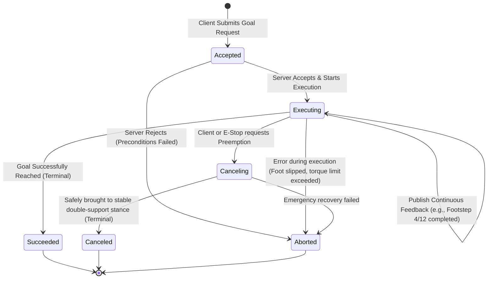

# Actions & Preemptible Long-Horizon Behaviors

Bipedal walking, traversing stairs, or picking up a heavy box are multi-second, long-horizon tasks. Using a synchronous Service for these behaviors is dangerous: the client cannot observe intermediate progress, cannot stream corrective feedback, and most critically, **cannot cancel or preempt the behavior** if the environment dynamically changes.

In ROS 2, long-horizon tasks are governed by **Actions**. Actions integrate three distinct communication channels: a Goal service, a Feedback topic, and a Result service, orchestrated by a formal, preemptible finite state machine.



---

## 1. The Tripartite Structure of an Action

An action is defined in an `.action` file containing three explicit sections:

```text
# Example: humanoid_interfaces/action/ExecuteFootstepPlan.action

# 1. GOAL (Sent by Client to initiate behavior)
geometry_msgs/PoseStamped[] footsteps   # Target foot placement sequence in World frame
float64 step_frequency_hz               # Commanded stepping cadence
float64 swing_height_meters             # Foot clearance height
---
# 2. RESULT (Sent by Server when goal reaches terminal state)
bool plan_completed                     # True if full sequence executed
uint32 completed_steps                  # Total steps successfully taken
string failure_diagnostic               # Error message if aborted
---
# 3. FEEDBACK (Streamed continuously during execution)
uint32 current_step_index               # Step currently being executed
float64 phase_percentage                # Progress within current swing phase [0.0 - 1.0]
geometry_msgs/Point measured_com        # Live Center of Mass position
float64 zmp_error_distance              # Deviation between desired and measured ZMP
```

---

## 2. Preemption & Cancellation: The Safety Shield

In humanoid robotics, **preemption** is the difference between safe recovery and catastrophic mechanical destruction. Consider a scenario where a humanoid receives a goal to walk 10 meters forward:
1. At meter 4, an unforeseen human walks directly into the robot's planned trajectory.
2. The vision system detects the obstacle and immediately calls `goal_handle->async_cancel_goal()`.
3. The Action Server intercepts the cancellation request. It does **not** instantly cut motor power (which would cause the robot to collapse); instead, it modifies the active step trajectory to place both feet firmly on the ground into a stable **double-support stance**.
4. Once static equilibrium is achieved, the server transitions the state machine to `STATUS_CANCELED` and returns the final result.

---

## 3. Production C++20 Bipedal Step Action Server

Below is an industrial implementation of a ROS 2 Action Server managing a bipedal stepping trajectory with live feedback streaming and graceful cancellation:

```cpp
#include <chrono>
#include <memory>
#include <thread>

#include "rclcpp/rclcpp.hpp"
#include "rclcpp_action/rclcpp_action.hpp"
#include "humanoid_interfaces/action/execute_footstep_plan.hpp"

using ExecuteFootstepPlan = humanoid_interfaces::action::ExecuteFootstepPlan;
using GoalHandleFootsteps = rclcpp_action::ServerGoalHandle<ExecuteFootstepPlan>;

class FootstepActionServer : public rclcpp::Node {
public:
  FootstepActionServer() : Node("footstep_action_server") {
    using namespace std::placeholders;

    // Instantiate Action Server with Goal, Cancel, and Accepted callbacks
    action_server_ = rclcpp_action::create_server<ExecuteFootstepPlan>(
      this,
      "/locomotion/execute_footsteps",
      std::bind(&FootstepActionServer::handle_goal, this, _1, _2),
      std::bind(&FootstepActionServer::handle_cancel, this, _1),
      std::bind(&FootstepActionServer::handle_accepted, this, _1));

    RCLCPP_INFO(get_logger(), "Footstep Action Server online and ready.");
  }

private:
  // 1. Goal validation callback: verify feasibility before accepting
  rclcpp_action::GoalResponse handle_goal(
    const rclcpp_action::GoalUUID & /*uuid*/,
    std::shared_ptr<const ExecuteFootstepPlan::Goal> goal)
  {
    RCLCPP_INFO(get_logger(), "Received request with %zu footsteps.", goal->footsteps.size());
    if (goal->footsteps.empty() || goal->swing_height_meters <= 0.01) {
      RCLCPP_WARN(get_logger(), "Rejected: Empty plan or invalid swing height.");
      return rclcpp_action::GoalResponse::REJECT;
    }
    return rclcpp_action::GoalResponse::ACCEPT_AND_EXECUTE;
  }

  // 2. Cancellation request callback: allow graceful preemption
  rclcpp_action::CancelResponse handle_cancel(
    const std::shared_ptr<GoalHandleFootsteps> /*goal_handle*/)
  {
    RCLCPP_WARN(get_logger(), "Cancellation requested! Transitioning to double-support stance.");
    return rclcpp_action::CancelResponse::ACCEPT;
  }

  // 3. Execution kickoff: spawn asynchronous worker thread
  void handle_accepted(const std::shared_ptr<GoalHandleFootsteps> goal_handle) {
    std::thread{std::bind(&FootstepActionServer::execute_stepping_loop, this, goal_handle)}.detach();
  }

  // 4. Execution loop: dispatch step trajectory and publish live feedback
  void execute_stepping_loop(const std::shared_ptr<GoalHandleFootsteps> goal_handle) {
    const auto goal = goal_handle->get_goal();
    auto feedback = std::make_shared<ExecuteFootstepPlan::Feedback>();
    auto result = std::make_shared<ExecuteFootstepPlan::Result>();

    rclcpp::Rate loop_rate(50); // 50 Hz feedback updates
    uint32_t step_idx = 0;

    for (const auto & step : goal->footsteps) {
      // Check if client requested cancellation
      if (goal_handle->is_canceling()) {
        result->plan_completed = false;
        result->completed_steps = step_idx;
        result->failure_diagnostic = "Preempted: Graceful stop engaged.";
        goal_handle->canceled(result);
        RCLCPP_INFO(get_logger(), "Goal successfully canceled in stable double support.");
        return;
      }

      // Execute step phase [0.0 -> 1.0]
      for (double phase = 0.0; phase <= 1.0; phase += 0.02) {
        if (!rclcpp::ok()) return;

        feedback->current_step_index = step_idx;
        feedback->phase_percentage = phase;
        feedback->zmp_error_distance = 0.012; // Simulated live ZMP error (m)
        goal_handle->publish_feedback(feedback);

        loop_rate.sleep();
      }
      step_idx++;
    }

    // Goal finished successfully
    if (rclcpp::ok()) {
      result->plan_completed = true;
      result->completed_steps = step_idx;
      goal_handle->succeed(result);
      RCLCPP_INFO(get_logger(), "All %u footsteps completed successfully.", step_idx);
    }
  }

  rclcpp_action::Server<ExecuteFootstepPlan>::SharedPtr action_server_;
};

int main(int argc, char * argv[]) {
  rclcpp::init(argc, argv);
  rclcpp::spin(std::make_shared<FootstepActionServer>());
  rclcpp::shutdown();
  return 0;
}
```

In the next chapter, we explore configuration management: **Distributed Parameters, Parameter Descriptors, and Dynamic Gain Reconfiguration**.
