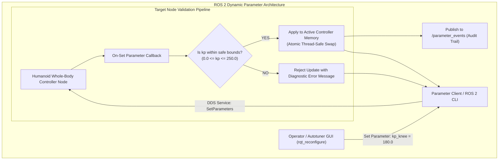

# Parameters, Descriptors & Dynamic Gain Tuning

On a humanoid robot, control parameters cannot remain static. When transitioning from walking on compliant turf to rigid polished concrete, when carrying a 5 kg payload, or when switching from high-stiffness position control to soft collaborative impedance manipulation, the joint gains ($K_p, K_d, K_i$) and virtual inertia must be dynamically reconfigured at runtime.

In ROS 2, **Parameters** are individual, typed configuration values hosted by nodes and accessible across the DDS network. Crucially, ROS 2 introduces **Parameter Descriptors** and **On-Set Validation Callbacks** to ensure that erroneous or out-of-range tuning values are strictly rejected before they reach motor drivers.



---

## 1. Parameter Descriptors & Safety Constraints

In safety-critical humanoid robotics, defining an untyped, unbounded parameter is unacceptable. If an engineer accidentally sends `kp = -50.0` or sets a joint velocity limit to `100 rad/s`, positive feedback loops will instantly destroy the actuator gearbox.

ROS 2 provides `rcl_interfaces::msg::ParameterDescriptor` to specify:
- **`description`**: Human-readable documentation of the parameter's physical purpose.
- **`read_only`**: Locks the parameter at node initialization to prevent runtime alteration.
- **`floating_point_range`**: Sets minimum, maximum, and step quantization bounds enforced by the middleware.

```cpp
rcl_interfaces::msg::ParameterDescriptor kp_desc;
kp_desc.description = "Proportional stiffness gain for the knee pitch joint (N*m/rad)";
kp_desc.read_only = false;

rcl_interfaces::msg::FloatingPointRange range;
range.from_value = 0.0;
range.to_value = 350.0;     // Hardware maximum torque safety limit
range.step = 0.5;
kp_desc.floating_point_range.push_back(range);

this->declare_parameter("knee_kp", 120.0, kp_desc);
```

---

## 2. Dynamic Reconfiguration via On-Set Callbacks

Nodes can register an **`add_on_set_parameters_callback`** to inspect incoming parameter updates before they take effect. The callback returns a `SetParametersResult`:
- `successful = true`: The parameter is accepted and committed to node memory.
- `successful = false`: The parameter is rejected, and an explanatory reason string is returned to the client.

---

## 3. Production C++20 Dynamic Impedance Tuning Node

The following production node manages impedance parameters ($K_p, K_d$) for a humanoid limb, verifying physical stability criteria before updating the live control loop:

```cpp
#include <memory>
#include <string>
#include <vector>

#include "rcl_interfaces/msg/set_parameters_result.hpp"
#include "rclcpp/rclcpp.hpp"

class HumanoidImpedanceTuner : public rclcpp::Node {
public:
  HumanoidImpedanceTuner() : Node("humanoid_impedance_tuner") {
    // 1. Declare parameters with strict descriptors
    rcl_interfaces::msg::ParameterDescriptor stiffness_desc;
    stiffness_desc.description = "Virtual Cartesian stiffness Kp (N/m)";
    declare_parameter("cartesian_kp", 200.0, stiffness_desc);

    rcl_interfaces::msg::ParameterDescriptor damping_desc;
    damping_desc.description = "Virtual Cartesian damping Kd (N*s/m)";
    declare_parameter("cartesian_kd", 20.0, damping_desc);

    // 2. Register atomic on-set parameter validation callback
    param_callback_handle_ = add_on_set_parameters_callback(
      std::bind(&HumanoidImpedanceTuner::validate_parameters, this, std::placeholders::_1));

    RCLCPP_INFO(get_logger(), "Impedance Tuner initialized. Kp=200.0, Kd=20.0");
  }

private:
  rcl_interfaces::msg::SetParametersResult validate_parameters(
    const std::vector<rclcpp::Parameter> & parameters)
  {
    rcl_interfaces::msg::SetParametersResult result;
    result.successful = true;

    double temp_kp = get_parameter("cartesian_kp").as_double();
    double temp_kd = get_parameter("cartesian_kd").as_double();

    for (const auto & param : parameters) {
      if (param.get_name() == "cartesian_kp") {
        if (param.as_double() < 0.0 || param.as_double() > 1000.0) {
          result.successful = false;
          result.reason = "Stiffness Kp must be within [0.0, 1000.0] N/m to prevent instability.";
          return result;
        }
        temp_kp = param.as_double();
      }

      if (param.get_name() == "cartesian_kd") {
        if (param.as_double() <= 0.0 || param.as_double() > 100.0) {
          result.successful = false;
          result.reason = "Damping Kd must be strictly positive and <= 100.0 N*s/m.";
          return result;
        }
        temp_kd = param.as_double();
      }
    }

    // Physical stability check: Ensure system remains over-damped or critically damped
    // Damping ratio zeta = Kd / (2 * sqrt(M * Kp)). For virtual mass M = 5.0 kg:
    double virtual_mass = 5.0;
    double critical_damping = 2.0 * std::sqrt(virtual_mass * temp_kp);
    if (temp_kd < 0.2 * critical_damping) {
      result.successful = false;
      result.reason = "Parameter combination rejected: System is severely under-damped and will oscillate violently!";
      return result;
    }

    RCLCPP_INFO(get_logger(), "Parameters validated & applied: Kp=%.1f, Kd=%.1f", temp_kp, temp_kd);
    return result;
  }

  OnSetParametersCallbackHandle::SharedPtr param_callback_handle_;
};

int main(int argc, char * argv[]) {
  rclcpp::init(argc, argv);
  rclcpp::spin(std::make_shared<HumanoidImpedanceTuner>());
  rclcpp::shutdown();
  return 0;
}
```

In the next chapter, we compare language ecosystems: **`rclcpp` vs. `rclpy` in Hybrid Humanoid Compute Pipelines**.
