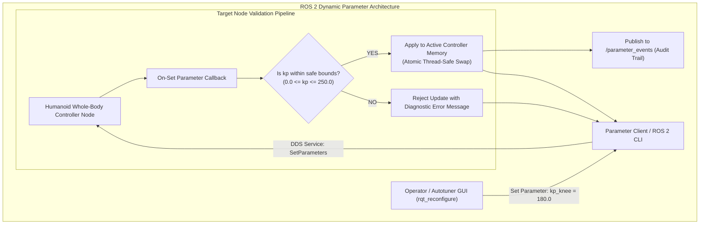

import ChapterProgress from '@site/src/components/ChapterProgress';
import QuizEngine from '@site/src/components/QuizEngine';

# Parameters, Descriptors & Dynamic Gain Tuning

On a humanoid robot, control parameters cannot remain static. When transitioning from walking on compliant turf to rigid polished concrete, carrying a 5 kg payload, or switching from high-stiffness position control to soft collaborative impedance manipulation, the joint gains ($K_p, K_d, K_i$) and virtual inertia must be dynamically reconfigured at runtime.

In ROS 2, **Parameters** are individual, typed configuration values hosted by nodes and accessible across the DDS network. Crucially, ROS 2 introduces **Parameter Descriptors** and **On-Set Validation Callbacks** to ensure that erroneous or out-of-range tuning values are strictly rejected before they reach motor drivers.



---

## 1. Mathematical Discretization of Dynamic PID Controllers (Tustin Transform)

When PID parameters ($K_p, K_i, K_d$) are dynamically updated via ROS 2 parameters, the continuous s-domain controller must be mapped to discrete z-domain difference equations implemented on joint DSPs.

Applying the **Bilinear Tustin Transform** with sampling period $T_s = 0.001\text{ s}$ (1 kHz):

$$
s \leftarrow \frac{2}{T_s} \frac{z - 1}{z + 1}
$$

The discrete control effort $u[k]$ with filtered derivative action ($\tau_f$ filter time constant) is computed as:

$$
u[k] = u[k-1] + K_p (e[k] - e[k-1]) + K_i \frac{T_s}{2} (e[k] + e[k-1]) + \frac{2 K_d}{2 \tau_f + T_s} (e[k] - e[k-1]) - \frac{T_s - 2 \tau_f}{2 \tau_f + T_s} u_d[k-1]
$$

### Dynamic Gain Scheduling as a Function of Contact State

During bipedal locomotion, joint stiffness must adapt between contact phases (e.g., stiff in stance phase to support body mass, compliant in swing phase for foot clearance). The parameter manager interpolates gains continuously:

$$
K(t) = (1 - \alpha(t)) K_{\text{stance}} + \alpha(t) K_{\text{flight}}, \quad \alpha(t) \in [0, 1]
$$

where $\alpha(t)$ is derived from the foot force-torque contact probability state machine.

---

## 2. Parameter Descriptors & Safety Constraints

In safety-critical humanoid robotics, defining an untyped, unbounded parameter is unacceptable. If an operator accidentally sends $K_p = -50.0$ or sets a joint velocity limit to $100\text{ rad/s}$, positive feedback loops will instantly destroy the actuator gearbox.

ROS 2 provides `rcl_interfaces::msg::ParameterDescriptor` to specify:
- **`description`**: Human-readable documentation of the parameter's physical purpose.
- **`read_only`**: Locks the parameter at node initialization to prevent runtime alteration.
- **`floating_point_range`**: Sets minimum, maximum, and step quantization bounds enforced by the middleware.

```cpp
rcl_interfaces::msg::ParameterDescriptor kp_desc;
kp_desc.description = "Proportional stiffness gain for the knee pitch joint (N*m/rad)";
kp_desc.read_only = false;

rcl_interfaces::msg::FloatingPointRange range;
range.from_value = 0.0;
range.to_value = 350.0;     // Hardware maximum torque safety limit
range.step = 0.5;
kp_desc.floating_point_range.push_back(range);

this->declare_parameter("knee_kp", 120.0, kp_desc);
```

---

## 3. Physical Storage Architecture on Actuator Drives

| Actuator Storage Medium | Access Speed | Endurance Cycles | Safe Parameter Usage |
| :--- | :--- | :--- | :--- |
| **SRAM (Microcontroller Core)** | &lt; 5 ns (1 cycle) | Infinite | Active run-time PID coefficients updated at 1 kHz |
| **Ferroelectric RAM (FRAM)** | 50–150 ns | $10^{14}$ cycles | Fast non-volatile logging of calibrated zero offsets |
| **Flash / EEPROM** | 5–20 ms write | $10^5$ cycles | Factory calibration parameters loaded strictly at boot |

---

## 4. Production C++20 Dynamic Parameter Validation Node

The following production node enforces strict range validation and thread-safe gain updates using `add_on_set_parameters_callback`:

```cpp
// dynamic_pid_parameter_node.cpp
#include <rclcpp/rclcpp.hpp>
#include <rcl_interfaces/msg/set_parameters_result.hpp>
#include <vector>

class DynamicJointController : public rclcpp::Node {
public:
  DynamicJointController() : Node("dynamic_joint_controller") {
    rcl_interfaces::msg::ParameterDescriptor kp_desc;
    kp_desc.description = "Proportional stiffness gain (N*m/rad)";
    rcl_interfaces::msg::FloatingPointRange range;
    range.from_value = 0.0;
    range.to_value = 500.0;
    range.step = 0.5;
    kp_desc.floating_point_range.push_back(range);

    this->declare_parameter("kp_joint", 120.0, kp_desc);

    param_callback_handle_ = this->add_on_set_parameters_callback(
      std::bind(&DynamicJointController::validate_parameters, this, std::placeholders::_1)
    );
    RCLCPP_INFO(this->get_logger(), "DynamicJointController initialized with safety validation.");
  }

private:
  rcl_interfaces::msg::SetParametersResult validate_parameters(const std::vector<rclcpp::Parameter>& params) {
    rcl_interfaces::msg::SetParametersResult result;
    result.successful = true;

    for (const auto& param : params) {
      if (param.get_name() == "kp_joint") {
        double val = param.as_double();
        if (val < 0.0 || val > 500.0) {
          result.successful = false;
          result.reason = "kp_joint exceeds hardware safety limits [0, 500]";
          RCLCPP_ERROR(this->get_logger(), "%s", result.reason.c_str());
          return result;
        }
        current_kp_ = val;
        RCLCPP_INFO(this->get_logger(), "Updated kp_joint safely to: %.2f", current_kp_);
      }
    }
    return result;
  }

  double current_kp_ = 120.0;
  OnSetParametersCallbackHandle::SharedPtr param_callback_handle_;
};

int main(int argc, char** argv) {
  rclcpp::init(argc, argv);
  rclcpp::spin(std::make_shared<DynamicJointController>());
  rclcpp::shutdown();
  return 0;
}
```

---

## 5. Research Foundations & Seminal Literature

1. **Ang, K. H., Chong, G., & Li, Y. (2005).** *PID control system analysis, design, and technology*. IEEE Transactions on Control Systems Technology, 13(4), 559-576.
2. **Åström, K. J., & Hägglund, T. (2006).** *Advanced PID Control*. ISA - The Instrumentation, Systems, and Automation Society.
3. **Franklin, G. F., Powell, J. D., & Workman, M. L. (1998).** *Digital Control of Dynamic Systems* (3rd ed.). Addison-Wesley.

---

<ChapterProgress chapterId="1-8-parameters" moduleId="module1" totalChapters={14} />

## Chapter Mastery Check

<QuizEngine
  quizId="quiz-1-8"
  title="Module 1.8 Mastery Check: Parameters, Descriptors & Dynamic Gain Tuning"
  moduleId="module1"
  passThreshold={70}
  questions={[
    {
      id: "q1",
      question: "Why should parameter validation callbacks (add_on_set_parameters_callback) be used instead of blind parameter assignment?",
      options: [
        "To prevent malicious or invalid values (e.g. negative gains or extreme limits) from propagating into physical motor drives and causing mechanical damage",
        "Because ROS 2 will not compile without them",
        "To convert floating point numbers to integers",
        "To save power on battery nodes"
      ],
      correctIndex: 0,
      explanation: "A negative stiffness gain (Kp < 0) creates positive feedback, driving motors instantly to maximum velocity against mechanical hard stops. Parameter validation guarantees out-of-range commands are rejected atomically."
    },
    {
      id: "q2",
      question: "Why is high-frequency parameter re-tuning (e.g. at 1 kHz) dangerous to write to microcontroller Flash/EEPROM memory?",
      options: [
        "EEPROM has limited write endurance (approx. 100,000 cycles), which continuous 1 kHz writes would destroy in under 2 minutes",
        "Flash memory chips draw 500 Watts during write cycles",
        "Microcontrollers cannot read Flash while executing code",
        "EEPROM can only store string values"
      ],
      correctIndex: 0,
      explanation: "Flash and EEPROM wear out after 10^4 to 10^5 write cycles and possess high write latencies (5-20 ms). Active 1 kHz gains must be updated strictly in SRAM or high-endurance FRAM."
    },
    {
      id: "q3",
      question: "In the Bilinear Tustin Transform for discrete PID controllers, what does parameter Ts represent?",
      options: [
        "Total simulation duration",
        "Discrete sampling period (e.g. 0.001 s for a 1 kHz loop)",
        "Motor thermal shutdown threshold",
        "Network packet round-trip time"
      ],
      correctIndex: 1,
      explanation: "Ts is the discrete sampling interval (1/fs). In digital control, substituting s with (2/Ts)*(z - 1)/(z + 1) maps the continuous transfer function to discrete difference equations executed at period Ts."
    }
  ]}
/>
