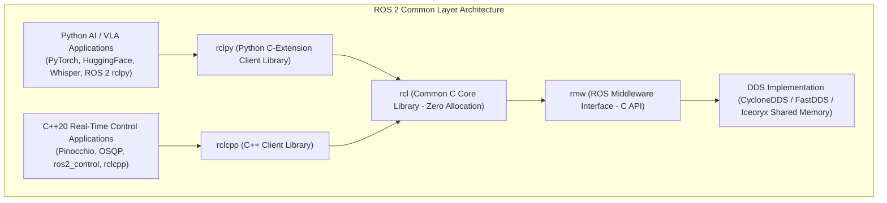
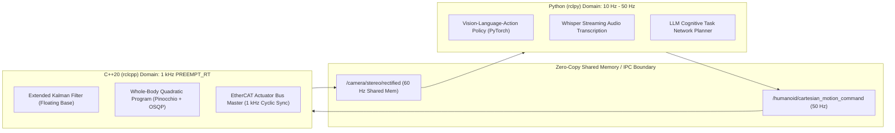

# rclcpp vs. rclpy in Hybrid Humanoid Compute

A state-of-the-art humanoid robot requires two fundamentally different types of computation:
1. **Hard Real-Time Determinism (1 kHz)**: Low-level motor torque computation, contact force estimation, and whole-body quadratic programming. Jitter must remain below 50 microseconds.
2. **AI & Cognitive Workloads (10 Hz – 50 Hz)**: Multimodal transformer inference, audio transcription, point cloud segmentation, and large language model task decomposition.

To balance developer velocity with deterministic safety, modern humanoid architectures deploy a **hybrid compute topology**, pairing C++20 (`rclcpp`) for the motor reflexes and Python (`rclpy`) for the cognitive brain.

---

## 1. Architectural Deep Dive: The Common `rcl` Core

Many developers assume Python nodes in ROS 2 are slow because they reimplement the networking stack in pure Python. In reality, both `rclcpp` and `rclpy` are thin language wrappers around a shared, high-performance C library: **`rcl` (ROS Client Library)**.

- **`rmw` (ROS Middleware)**: Defines the C interface for DataWriters, DataReaders, and QoS management.
- **`rcl`**: Implements clock synchronization, lifecycle state management, and parameter stores in pure, portable, zero-allocation C99.
- **`rclcpp`**: Exposes idiomatic C++20 concepts: RAII, smart pointers, templates, and `std::chrono` literals.
- **`rclpy`**: Exposes Pythonic classes using CPython C-extensions (`_rclpy.cpython-...so`), releasing the Global Interpreter Lock (GIL) during underlying DDS I/O operations.

---

## 2. The Real-Time Benchmark: Why Python Cannot Run 1 kHz Locomotion

The table below contrasts the runtime characteristics of C++20 vs. Python 3.12 under heavy humanoid sensor load:

| Metric / Dimension | C++20 (`rclcpp`) with `PREEMPT_RT` | Python 3.12 (`rclpy`) | Impact on Humanoid Robotics |
| :--- | :--- | :--- | :--- |
| **Garbage Collection (GC)** | Deterministic manual RAII (`std::unique_ptr`); zero runtime heap allocation in loop | Stop-The-World generational garbage collector | Python GC pauses (10 ms – 50 ms) will cause the bipedal balance loop to miss 10–50 consecutive deadlines, guaranteeing a fall. |
| **Thread Scheduling** | Real-time POSIX threads (`pthread_create` with `SCHED_FIFO`) | CPython Global Interpreter Lock (GIL) serializes bytecode execution | In Python, multi-threaded nodes cannot utilize multiple physical CPU cores for compute-heavy parallel math without multiprocessing. |
| **Memory Allocation** | Can lock all virtual address pages into physical RAM (`mlockall`) | Dynamic heap allocations on every variable assignment | Page faults in Linux trigger disk swaps, inducing catastrophic 5 ms to 20 ms stalls. |
| **Zero-Copy IPC** | Direct shared memory pointer swaps via Iceoryx | Shared memory supported via PyCapsules, but array slicing often copies | High-resolution vision payloads incur CPU copy penalties in Python unless using specialized buffer protocols. |

---

## 3. The Professional Division of Labor

1. **Python (`rclpy`) Responsibility**:
   - Model inference with PyTorch, ONNX Runtime, and TensorRT Python APIs.
   - Dialogue management and natural language understanding.
   - Mission executive state machines (`py_trees` behavior trees).
2. **C++20 (`rclcpp`) Responsibility**:
   - Hard real-time sensor device drivers (IMUs, force-torque, motor encoders).
   - Whole-body dynamics computations (Articulated Body Algorithm, spatial accelerations).
   - High-rate closed-loop joint trajectory execution and safety watchdog circuits.

In the next chapter, we synthesize these tools into production-ready deployment: **Best Practices, Watchdog Safety Interlocks, and Diagnostic Pipelines**.
