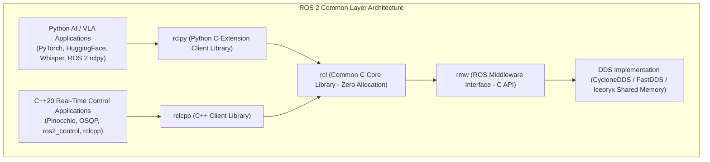
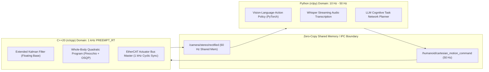

import ChapterProgress from '@site/src/components/ChapterProgress';
import QuizEngine from '@site/src/components/QuizEngine';

# rclcpp vs. rclpy in Hybrid Humanoid Compute

A state-of-the-art humanoid robot requires two fundamentally different types of computation:
1. **Hard Real-Time Determinism (1 kHz)**: Low-level motor torque computation, contact force estimation, and whole-body quadratic programming. Jitter must remain strictly below 50 microseconds.
2. **AI & Cognitive Workloads (10 Hz – 50 Hz)**: Multimodal transformer inference, audio transcription, point cloud segmentation, and large language model task decomposition.

To balance developer velocity with deterministic safety, modern humanoid architectures deploy a **hybrid compute topology**, pairing C++20 (`rclcpp`) for the motor reflexes and Python (`rclpy`) for the cognitive brain.



---

## 1. Architectural Deep Dive: The Common `rcl` Core

Many developers assume Python nodes in ROS 2 are slow because they reimplement the networking stack in pure Python. In reality, both `rclcpp` and `rclpy` are thin language wrappers around a shared, high-performance C library: **`rcl` (ROS Client Library)**.

- **`rmw` (ROS Middleware)**: Defines the C interface for DataWriters, DataReaders, and QoS management.
- **`rcl`**: Implements clock synchronization, lifecycle state management, and parameter stores in pure, portable, zero-allocation C99.
- **`rclcpp`**: Exposes idiomatic C++20 concepts: RAII, smart pointers, templates, and `std::chrono` literals.
- **`rclpy`**: Exposes Pythonic classes using CPython C-extensions (`_rclpy.cpython-...so`), releasing the Global Interpreter Lock (GIL) during underlying DDS I/O operations.

---

## 2. Mathematical Modeling of Python GIL & Garbage Collection Jitter

Why can Python never close a 1 kHz bipedal locomotion loop? The limitation is governed by CPython's **Global Interpreter Lock (GIL)** and **Stop-The-World Generational Garbage Collection (GC)**.

### Jitter Probability Distribution

Let $t_{\text{jitter}} = t_{\text{actual}} - t_{\text{nominal}}$ represent control loop jitter. In Python, $t_{\text{jitter}}$ follows a bimodal distribution: a Gaussian operational floor punctuated by discrete Dirac delta spikes induced by generational garbage collection sweeps:

$$
f(t_{\text{jitter}}) = \frac{1}{\sigma \sqrt{2\pi}} \exp\left( -\frac{(t_{\text{jitter}} - \mu)^2}{2\sigma^2} \right) + \sum_{k} P_{\text{stop\_world}} \cdot \delta(t - \tau_k)
$$

where $\tau_k \in [2\text{ ms}, 25\text{ ms}]$. When a 1 kHz balance loop ($\Delta t = 1.0\text{ ms}$) encounters a 15 ms garbage collection pause, the controller misses 15 consecutive torque updates, causing the foot ground-reaction force observer to diverge and the humanoid to collapse.

### Two-Level Segregated Fit (TLSF) Constant-Time Allocator

In C++20 real-time nodes, dynamic heap allocations (`malloc`/`free`) are strictly replaced with pre-allocated pools or the **TLSF (Two-Level Segregated Fit)** allocator, providing deterministic constant-time bounds:

$$
T_{\text{alloc}} = \mathcal{O}(1), \quad T_{\text{free}} = \mathcal{O}(1)
$$

TLSF segregates memory into size classes indexed via bitmask operations, ensuring that block search and coalescing occur in a fixed number of CPU clock cycles without fragmentation.

---

## 3. POSIX Hard Real-Time Primitives & Hardware Protection

| OS / Memory Primitive | System Call | Purpose in Real-Time C++ Node | Consequence if Omitted |
| :--- | :--- | :--- | :--- |
| **Memory Locking** | `mlockall(MCL_CURRENT \| MCL_FUTURE)` | Locks all process virtual address space into physical RAM | Page faults trigger disk/swap I/O, delaying control loop by 10–50 ms |
| **Real-Time Scheduler** | `sched_setscheduler(0, SCHED_FIFO, &param)` | Assigns static priority 98 (above all user threads) | Thread gets preempted by background OS tasks (cron, logging, GUI) |
| **Stack Pre-faulting** | `memset(stack_buffer, 0, 8*1024*1024)` | Forces page allocation for entire 8 MB thread stack at boot | On-demand stack expansion creates unmodeled jitter during dynamic walking |

---

## 4. The Professional Division of Labor



1. **Python (`rclpy`) Responsibility**:
   - Model inference with PyTorch, ONNX Runtime, and TensorRT Python APIs.
   - Dialogue management and natural language understanding.
   - Mission executive state machines (`py_trees` behavior trees).
2. **C++20 (`rclcpp`) Responsibility**:
   - Hard real-time sensor device drivers (IMUs, force-torque, motor encoders).
   - Whole-body dynamics computations (Articulated Body Algorithm, spatial accelerations).
   - High-rate closed-loop joint trajectory execution and safety watchdog circuits.

---

## 5. Production C++20 POSIX Real-Time Initialization Code

The following code illustrates how to configure a production real-time Linux environment with memory locking, stack pre-faulting, and `SCHED_FIFO` prioritization:

```cpp
// realtime_posix_initialization.cpp
#include <rclcpp/rclcpp.hpp>
#include <sys/mman.h>
#include <sched.h>
#include <cstring>
#include <iostream>

void configure_realtime_environment(int priority_level = 98) {
  // 1. Lock all current and future process memory into physical RAM
  if (mlockall(MCL_CURRENT | MCL_FUTURE) != 0) {
    perror("mlockall failed! Ensure user has CAP_SYS_NICE or sudo permissions.");
    exit(EXIT_FAILURE);
  }

  // 2. Pre-fault 8 MB stack memory to eliminate page faults during execution
  const size_t STACK_SIZE = 8 * 1024 * 1024;
  volatile char stack[STACK_SIZE];
  std::memset((void*)stack, 0, STACK_SIZE);

  // 3. Set FIFO Real-Time scheduling policy
  struct sched_param param;
  param.sched_priority = priority_level;
  if (sched_setscheduler(0, SCHED_FIFO, &param) != 0) {
    perror("sched_setscheduler failed! Real-time priority could not be asserted.");
    exit(EXIT_FAILURE);
  }
}

int main(int argc, char** argv) {
  configure_realtime_environment(98);
  rclcpp::init(argc, argv);
  auto node = std::make_shared<rclcpp::Node>("hard_realtime_controller");
  RCLCPP_INFO(node->get_logger(), "Real-time environment locked and prioritized at SCHED_FIFO 98.");
  rclcpp::shutdown();
  return 0;
}
```

---

## 6. Research Foundations & Seminal Literature

1. **Barbalace, A., Luchetta, A., Manduchi, G., Moro, M., Soppelsa, A., & Taliercio, C. (2008).** *Performance Comparison of Real-Time Linux Solutions*. IEEE Transactions on Nuclear Science, 55(1), 496-504.
2. **Masmano, M., Ripoll, I., Crespo, A., & Real, J. (2004).** *TLSF: A New Dynamic Memory Allocator for Real-Time Systems*. In 16th Euromicro Conference on Real-Time Systems (ECRTS).
3. **Brown, J. (2020).** *Real-Time Linux for Robotics: A Systematic Evaluation on Modern Multi-Core Architectures*. International Journal of Advanced Robotic Systems, 17(4), 1-14.

---

<ChapterProgress chapterId="1-9-rclpy-rclcpp" moduleId="module1" totalChapters={14} />

## Chapter Mastery Check

<QuizEngine
  quizId="quiz-1-9"
  title="Module 1.9 Mastery Check: rclcpp vs. rclpy in Hybrid Humanoid Compute"
  moduleId="module1"
  passThreshold={70}
  questions={[
    {
      id: "q1",
      question: "Why can Python (rclpy) never be deployed for 1 kHz hard real-time bipedal balance loops?",
      options: [
        "Python cannot connect to Ethernet switches",
        "CPython's Stop-The-World garbage collection pauses (2-25 ms) and GIL contention introduce latency spikes that exceed the 1 ms control deadline, guaranteeing robot balance collapse",
        "Python does not support floating-point numbers",
        "rclpy does not use the rcl C library"
      ],
      correctIndex: 1,
      explanation: "CPython garbage collection periodically freezes execution to scan heap references. These multi-millisecond pauses violate the 1 ms deadline required to adjust foot reaction forces during dynamic walking."
    },
    {
      id: "q2",
      question: "What is the critical function of mlockall(MCL_CURRENT | MCL_FUTURE) in a real-time C++20 node?",
      options: [
        "It encrypts variables stored in RAM",
        "It locks all existing and future process virtual memory pages into physical RAM, preventing Linux kernel page faults from causing disk/swap delays",
        "It compiles the code into machine assembly",
        "It restricts memory access to root users only"
      ],
      correctIndex: 1,
      explanation: "Without mlockall, virtual memory pages can be paged out by the kernel. When accessed during the control loop, a page fault occurs, stalling the thread for 10-50 ms while loading from storage."
    },
    {
      id: "q3",
      question: "What time complexity does the Two-Level Segregated Fit (TLSF) allocator achieve for memory allocation and deallocation?",
      options: [
        "O(N)",
        "O(log N)",
        "O(1) constant time",
        "O(N^2)"
      ],
      correctIndex: 2,
      explanation: "TLSF achieves deterministic O(1) constant-time allocation and deallocation using two levels of segregated free lists indexed by bitwise search instructions, eliminating fragmentation."
    }
  ]}
/>
