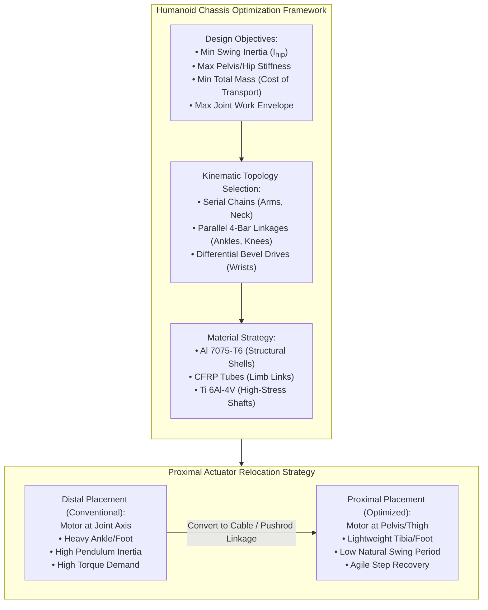
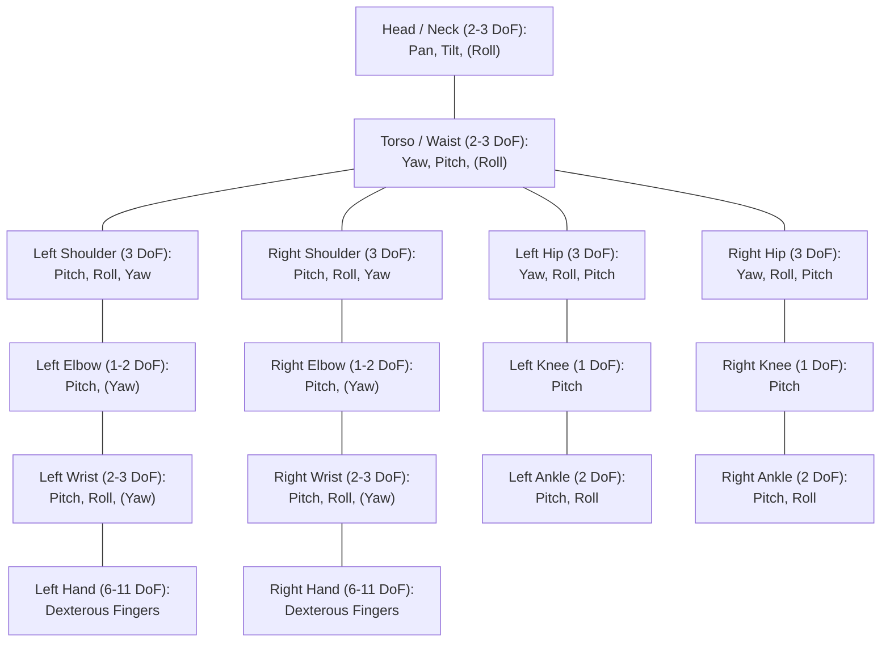

import ChapterProgress from '@site/src/components/ChapterProgress';
import QuizEngine from '@site/src/components/QuizEngine';

# Humanoid Mechanical Architecture & Structural Optimization

The physical embodiment of a humanoid robot governs its dynamic capabilities, energy efficiency, structural durability, and payload capacity. While high-level planning algorithms and neural foundation policies generate trajectory setpoints, the robot's physical chassis must transmit ground reaction wrenches, absorb non-smooth impacts during foot strikes, and reject unmodeled external perturbations. Designing a humanoid chassis is a rigorous multi-objective optimization problem at the intersection of rigid body kinematics, structural mechanics, elastodynamics, and material science.

A fundamental design challenge in bipedal robotics is the trade-off between **anthropomorphic fidelity** (mimicking biological human skeletal proportions and kinematic ranges of motion) and **functional mechatronic optimization** (maximizing actuator thermal headroom, lowering distal limb inertia, and simplifying manufacturing). Every gram added to a robot's ankle or foot exponentially amplifies the mechanical work required during leg swing, demanding larger motors, heavier gearboxes, and bulkier battery systems.



---

## 1. Anthropomorphic Fidelity vs. Functional Optimization

Humanoid robotics balances two conflicting mechanical philosophies:

1. **Strict Anthropomorphism**:
   - Replicates human skeletal dimensions, joint pivot locations, and mass distribution based on biomechanical datasets (e.g., Dempster's body segment parameters).
   - *Advantages*: Enables seamless operation in human-built environments (stairs, door handles, vehicle cockpits) and provides natural human-robot interaction profiles.
   - *Disadvantages*: Biological muscles act as high-force, distributed linear actuators wrapped seamlessly around bone structures. Standard electromagnetic brushless motors and planetary/harmonic gearboxes are cylindrical and bulky, creating severe mechanical packaging clashes when forced into human dimensional envelopes.

2. **Functional Optimization**:
   - Adapts kinematic topologies and link geometry to exploit the physical strengths of electromagnetic powertrains.
   - Features include bird-like knee reversals (avian bipedalism as in Agility Digit), 4-bar parallel pushrod linkages for ankle roll/pitch, and proximal clustering of actuators in the pelvis.
   - *Metric*: **Dimensionless Cost of Transport (CoT)**:
     $$
     \text{CoT} = \frac{E}{m \cdot g \cdot d} = \frac{P_{\text{avg}}}{m \cdot g \cdot v_{\text{avg}}}
     $$
     where $E$ is electrical energy consumed, $m$ is total robot mass, $g = 9.81\,\text{m/s}^2$, and $d$ is distance traveled at forward velocity $v_{\text{avg}}$. Biological humans walk with a net $\text{CoT} \approx 0.20\text{--}0.25$. Early humanoid robots operated at $\text{CoT} > 1.5\text{--}3.0$, while modern optimized humanoids (such as Unitree G1 and Agility Digit) achieve $\text{CoT} \approx 0.40\text{--}0.70$.

---

## 2. Degree-of-Freedom (DOF) Allocation Across Body Segments

Allocating degrees of freedom requires striking a balance between task dexterity and system mass, wiring complexity, and failure modes. A minimal functional humanoid requires 20–24 DOFs, whereas a redundant dexterous humanoid incorporates 30–44+ DOFs.



### Body Segment DOF Breakdown

| Subsystem | Kinematic Joints | DOF Count | Primary Function & Dynamic Torque Demand |
|:---|:---|:---|:---|
| **Pelvis & Hip** | Hip Yaw ($q_{hy}$), Hip Roll ($q_{hr}$), Hip Pitch ($q_{hp}$) | 3 per leg (6 total) | Lateral push recovery, swing phase initiation, steering. Peak torque: $150\text{--}300\,\text{N}\cdot\text{m}$. |
| **Knee** | Knee Pitch ($q_{kp}$) | 1 per leg (2 total) | Shock absorption, stance phase weight support, crouching. Peak torque: $180\text{--}350\,\text{N}\cdot\text{m}$. |
| **Ankle** | Ankle Pitch ($q_{ap}$), Ankle Roll ($q_{ar}$) | 2 per leg (4 total) | Ground contact alignment, push-off propulsion, balance via ankle strategy. Peak torque: $80\text{--}180\,\text{N}\cdot\text{m}$. |
| **Waist / Spine** | Torso Yaw ($q_{wy}$), Torso Pitch ($q_{wp}$), Torso Roll ($q_{wr}$) | 2 to 3 total | Angular momentum compensation, extending reachable workspace for arms. Peak torque: $100\text{--}200\,\text{N}\cdot\text{m}$. |
| **Arm & Shoulder**| Shoulder Pitch ($q_{sp}$), Roll ($q_{sr}$), Yaw ($q_{sy}$) | 3 per arm (6 total) | Manipulator positioning, walking arm swing balance. Peak torque: $30\text{--}80\,\text{N}\cdot\text{m}$. |
| **Elbow & Forearm**| Elbow Pitch ($q_{ep}$), Forearm Pronation/Supination ($q_{ey}$) | 1 to 2 per arm (2–4 total) | Payload lifting, workspace depth control. Peak torque: $20\text{--}50\,\text{N}\cdot\text{m}$. |
| **Wrist & Hand** | Wrist Pitch ($q_{wp}$), Roll ($q_{wr}$), Yaw ($q_{wy}$); Finger DOFs | 2–3 wrist + 5–11 hand (14–28 total) | Tool manipulation, contact grasping. Wrist torque: $5\text{--}15\,\text{N}\cdot\text{m}$; finger force: $10\text{--}35\,\text{N}$. |
| **Head & Neck** | Neck Pitch, Yaw, Roll | 2 to 3 total | Sensor orientation, active visual tracking. Peak torque: $3\text{--}8\,\text{N}\cdot\text{m}$. |

---

## 3. Kinematic Topology: Serial Chains vs. Parallel Linkages

The mechanical arrangement connecting consecutive joints determines joint stiffness, transmission backlash, and mass distribution.

### Serial Kinematic Chains
In a serial chain, each actuator is mounted directly on the predecessor link, driving the successor link around a single revolute axis.
- **Advantages**: Simple kinematics, decoupled forward and inverse kinematics closed-form solutions, expansive range of motion (often exceeding $150^\circ$).
- **Disadvantages**: The motor driving the distal link (e.g., knee or ankle) must be carried as dead weight by all proximal motors (hip roll and pitch). This compounds inertial loading down the chain.

### Parallel Four-Bar and Pushrod Linkages
In a parallel linkage mechanism, two linear or rotary actuators mounted proximally on a single rigid body drive a distal link via rigid pushrods or closed 4-bar kinematic loops.
- **Advantages**:
  1. Actuators can be co-located at the proximal joint (e.g., mounting ankle actuators high in the thigh or pelvis and actuating the ankle via pushrods).
  2. Load sharing: Both actuators work in unison to produce pitch (symmetric push/pull) and roll (differential push/pull).
  3. High structural rigidity and elevated mechanical advantage near singular configurations.
- **Disadvantages**: Complex non-linear forward kinematics requiring iterative Newton-Raphson numerical solvers, reduced angular range of motion (typically $\pm 35^\circ$ to $\pm 45^\circ$).

```
Parallel Ankle Pushrod Mechanism:
            [ Motor A ]          [ Motor B ]
                 \                    /
              Pushrod A            Pushrod B
                   \                /
                    \              /
                 [ 2-DoF Universal Joint ]
                         [ Foot ]
  Pitch Torque: Tau_pitch = r_arm * (F_A + F_B)
  Roll Torque:  Tau_roll  = w_arm * (F_A - F_B)
```

---

## 4. Center of Mass Optimization & Limb Inertia Dynamics

A humanoid leg acts during swing phase as a compound physical pendulum pivoted at the hip. Minimizing the swing leg's rotational inertia around the hip axis drastically cuts down swing phase kinetic energy and joint torque requirements.

### Rotational Inertia Around Hip Pivot Axis
By the **Parallel Axis Theorem** (Steiner's Theorem), the total effective moment of inertia $I_{\text{hip}}$ of a leg composed of $N$ discrete rigid links (thigh, knee drive, tibia, ankle drive, foot) is:

$$
I_{\text{hip}} = \sum_{i=1}^{N} \left( I_{\text{cm}, i} + m_i \cdot d_i^2 \right)
$$

where:
- $m_i$ is the mass of link $i$.
- $I_{\text{cm}, i}$ is the link's intrinsic moment of inertia about its own center of mass around the pitch axis.
- $d_i$ is the Euclidean distance from the hip pitch pivot axis to the center of mass of link $i$.

Because the distance $d_i$ is squared, adding mass to the foot ($d_{\text{foot}} \approx 0.85\text{--}0.95\,\text{m}$) increases hip torque requirements approximately **16 times more** than adding identical mass to the upper thigh ($d_{\text{thigh}} \approx 0.20\text{--}0.25\,\text{m}$)!

### Natural Swing Frequency & Pendulum Mechanics
The natural undamped frequency $\omega_n$ of the swinging leg modeled as a distributed physical pendulum is:

$$
\omega_n = \sqrt{\frac{m_{\text{leg}} \cdot g \cdot d_{\text{leg,cm}}}{I_{\text{hip}}}}
$$

When mass is concentrated near the hip ($d_{\text{leg,cm}}$ small and $I_{\text{hip}}$ minimized), the robot can achieve high swing step frequencies ($> 3\text{--}4\,\text{Hz}$) with minimal active actuator torque, drastically improving dynamic push recovery.

### Center of Mass (CoM) Propagation
The global 3D Center of Mass $\mathbf{r}_{\text{com}} \in \mathbb{R}^3$ of the entire multi-body humanoid across $N_b$ rigid bodies is:

$$
\mathbf{r}_{\text{com}} = \frac{1}{M_{\text{total}}} \sum_{i=1}^{N_b} m_i \cdot \mathbf{r}_i(q)
$$

where $M_{\text{total}} = \sum_{i=1}^{N_b} m_i$, and $\mathbf{r}_i(q)$ is the world position vector of link $i$'s center of mass, parameterized by generalized joint coordinates $q \in \mathbb{R}^n$.

The 3D spatial inertia tensor of the complete robot reflected at the whole-body CoM is:

$$
\mathbf{I}_{\text{total}} = \sum_{i=1}^{N_b} \left( \mathbf{R}_i(q) \mathbf{I}_{i} \mathbf{R}_i(q)^T + m_i \left( (\mathbf{p}_i^T \mathbf{p}_i) \mathbf{I}_{3\times 3} - \mathbf{p}_i \mathbf{p}_i^T \right) \right)
$$

where $\mathbf{p}_i = \mathbf{r}_i(q) - \mathbf{r}_{\text{com}}$ and $\mathbf{R}_i(q)$ is the link rotation matrix relative to the inertial frame.

---

## 5. Structural Materials & Topology Optimization

The dynamic stress environment of a 50–80 kg humanoid walking, jumping, and absorbing ground impacts requires materials combining high specific strength ($\sigma_y / \rho$) and specific modulus ($E / \rho$).

```mermaid
quadrantChart
    title Structural Material Selection Matrix for Humanoids
    x-axis Low Specific Modulus --> High Specific Modulus (Stiffness / Density)
    y-axis Low Yield Strength --> High Yield Strength (Toughness)
    quadrant-1 High-Performance Aero-Alloys (Titanium)
    quadrant-2 Composite Shells (CFRP)
    quadrant-3 Engineering Thermoplastics (Nylon, PEEK)
    quadrant-4 Structural Aluminum (7075-T6)
    "Al 7075-T6": [0.65, 0.72]
    "CFRP Quasi-Isotropic": [0.88, 0.85]
    "Ti 6Al-4V Grade 5": [0.55, 0.95]
    "Steel 4340 Q&T": [0.35, 0.92]
    "Nylon PA12 SLS": [0.15, 0.30]
    "Carbon PEEK 3D": [0.42, 0.60]
```

### Material Property Comparison

| Material | Density $\rho$ ($\text{g/cm}^3$) | Tensile Yield $\sigma_y$ ($\text{MPa}$) | Elastic Modulus $E$ ($\text{GPa}$) | Specific Strength ($\text{kN}\cdot\text{m/kg}$) | Best Application in Humanoids |
|:---|:---|:---|:---|:---|:---|
| **Aluminum 7075-T6** | 2.81 | 503 | 71.7 | 179 | CNC-machined structural chassis, gearbox housings, hip frames. |
| **Aluminum 6061-T6** | 2.70 | 276 | 68.9 | 102 | Non-critical structural brackets, mounting plates, cover shells. |
| **Titanium 6Al-4V (Grade 5)** | 4.43 | 880 | 113.8 | 199 | High-shock knee pivot shafts, foot load-cell flexures, planetary carrier pins. |
| **Carbon Fiber (CFRP Uni/Woven)** | 1.55 | 600–1200 | 130–230 | 387–774 | Hollow structural limb tubes (thigh/shank), torso spine trusses. |
| **4340 Alloy Steel (Heat-treated)** | 7.85 | 1100 | 205 | 140 | Gearbox cycloidal pins, high-torque splines, harmonic flexspline cups. |
| **PA12 Nylon (SLS 3D Print)** | 1.01 | 48 | 1.7 | 47.5 | Complex cable management ducts, cosmetic outer fairings, sensor shrouds. |

### Topology Optimization in Finite Element Analysis (FEA)
Modern humanoid links are designed using SIMP (Solid Isotropic Material with Penalization) topology optimization:

$$
\min_{\rho_e} c(\boldsymbol{\rho}) = \mathbf{U}^T \mathbf{K}(\boldsymbol{\rho}) \mathbf{U} = \sum_{e=1}^{N_e} \rho_e^p \mathbf{u}_e^T \mathbf{k}_0 \mathbf{u}_e
$$

$$
\text{subject to} \quad \frac{V(\boldsymbol{\rho})}{V_0} \le f_v, \quad 0 < \rho_{\min} \le \rho_e \le 1
$$

where $\rho_e$ is element relative density, $p \approx 3$ is penalization power, $\mathbf{K}$ is global stiffness matrix, and $f_v$ is target volume fraction (often 0.30 to 0.40). This yields biomimetic bone-like trabecular internal webbing that resists multi-axial torsional and bending moments with minimal mass.

---

## 6. Teardown Analysis: Tesla Optimus Gen 2, Unitree G1, Agility Digit

The commercial humanoid landscape exhibits distinct architectural strategies:

```mermaid
flowchart LR
    subgraph Optimus["Tesla Optimus Gen 2"]
        direction TB
        O1["Actuation: 28 Custom Actuators<br/>(14 Rotary Harmonic + 14 Linear Roller Screws)"]
        O2["Torso: 2.3 kWh Structural Battery Pack Chassis"]
        O3["Hands: 11-DoF Cable-Driven Actuation with Tactile Sensor Pads"]
    end

    subgraph G1["Unitree G1"]
        direction TB
        G1_1["Actuation: 23-43 DoF Low-Cost QDD Actuators<br/>(Peak torque 120 N&middot;m, hollow shaft)"]
        G1_2["Mass: Ultra-lightweight 35 kg total"]
        G1_3["Kinematics: Internal wiring routing through hollow joint pivots"]
    end

    subgraph Digit["Agility Robotics Digit"]
        direction TB
        D1["Kinematics: Non-anthropomorphic 4-Bar Avian Legs<br/>(Backward-facing knee linkages)"]
        D2["Compliance: Planar Fiberglass Leaf Springs in Shin/Heel"]
        D3["Mission: Industrial Box Handling & Logistics Envelopes"]
    end

    Optimus ~~~ G1 ~~~ Digit
```



### Architectural Breakdown Comparison

| Design Feature | Tesla Optimus Gen 2 (2024) | Unitree G1 (2024) | Agility Robotics Digit (v3) |
|:---|:---|:---|:---|
| **Total Mass** | $\approx 57\,\text{kg}$ (reduced from 73 kg Gen 1) | $\approx 35\,\text{kg}$ | $\approx 48\,\text{kg}$ |
| **Height** | $173\,\text{cm}$ | $127\,\text{cm}$ | $158\,\text{cm}$ |
| **Total DOFs** | 28 body + 22 hands = 50 DOFs | 23 body (standard) up to 43 DOFs | 30 DOFs (including 4-DoF arms and feet) |
| **Leg Actuator Topology** | Linear planetary roller screws (knees/ankles) + Rotary drives | Concentric Quasi-Direct Drive (QDD) planetary gearboxes | Parallel 4-bar linkages driven by brushless motors with belt reductions |
| **Inherent Compliance** | Sensor-based admittance control + structural load cells | High backdrivability quasi-direct drive impedance control | Physical fiberglass leaf springs incorporated directly into lower legs |
| **Battery Architecture** | 2.3 kWh, 52V integrated structural pack forming torso chassis | 900 Wh quick-swap rear torso cartridge | 1.2 kWh top-loading industrial hot-swappable module |
| **Hands / End-Effectors** | 11-DoF dexterous hand, tendon-driven, integrated finger tactile array | 3-finger underactuated force-controlled gripper or 7-DoF hand | Non-anthropomorphic ball/paddle foot & payload clamp fingers |

---

## 7. Mathematical Formulation: Multi-Body CoM & Inertia Tensor

Let the robot consist of $N$ rigid bodies. Each link $i$ has mass $m_i$, a reference frame origin $\mathbf{o}_i$, a center of mass position vector relative to $\mathbf{o}_i$ denoted by $\mathbf{c}_i$, and an inertia matrix expressed in link $i$'s frame $\mathbf{I}_{i, \text{link}} \in \mathbb{R}^{3\times 3}$:

$$
\mathbf{I}_{i, \text{link}} = \begin{bmatrix} I_{xx} & I_{xy} & I_{xz} \\ I_{xy} & I_{yy} & I_{yz} \\ I_{xz} & I_{yz} & I_{zz} \end{bmatrix}_i
$$

Given the generalized joint angles $\mathbf{q} \in \mathbb{R}^n$, forward kinematics yields the homogeneous transformation matrix from link $i$ to the world frame:

$$
\mathbf{T}_i^0(\mathbf{q}) = \begin{bmatrix} \mathbf{R}_i^0(\mathbf{q}) & \mathbf{p}_i^0(\mathbf{q}) \\ \mathbf{0}_{1\times 3} & 1 \end{bmatrix} \in \text{SE}(3)
$$

The center of mass of link $i$ in world coordinates is:

$$
\mathbf{r}_{i, \text{world}} = \mathbf{p}_i^0 + \mathbf{R}_i^0 \mathbf{c}_i
$$

The whole-body center of mass $\mathbf{r}_{\text{com}} \in \mathbb{R}^3$ is:

$$
\mathbf{r}_{\text{com}} = \frac{\sum_{i=1}^N m_i \mathbf{r}_{i, \text{world}}}{\sum_{i=1}^N m_i}
$$

The rotational inertia of link $i$ transformed to world orientation is:

$$
\mathbf{I}_{i, \text{world}} = \mathbf{R}_i^0 \mathbf{I}_{i, \text{link}} (\mathbf{R}_i^0)^T
$$

Using the parallel axis theorem in 3D, link $i$'s inertia projected to the whole-body CoM $\mathbf{r}_{\text{com}}$ is:

$$
\mathbf{I}_{i, \text{com}} = \mathbf{I}_{i, \text{world}} + m_i \left( \|\boldsymbol{\delta}_i\|^2 \mathbf{I}_{3\times 3} - \boldsymbol{\delta}_i \boldsymbol{\delta}_i^T \right)
$$

where $\boldsymbol{\delta}_i = \mathbf{r}_{i, \text{world}} - \mathbf{r}_{\text{com}}$. The total whole-body spatial rotational inertia is:

$$
\mathbf{I}_{\text{total}}(\mathbf{q}) = \sum_{i=1}^N \mathbf{I}_{i, \text{com}}
$$

---

## 8. Complete Implementation: Kinematic Mass Property & Swing Inertia Analyzer

The following production-grade Python tool computes the multi-body forward kinematics, center of mass propagation, and effective swinging limb inertia about the hip pitch axis for a humanoid bipedal leg.

```python
"""
humanoid_mass_property_analyzer.py
Production-grade multi-body mass property, Center of Mass (CoM),
and swing limb inertia analyzer for bipedal humanoid mechanical architectures.
"""

from dataclasses import dataclass
from typing import List, Tuple
import numpy as np


@dataclass
class RigidLinkSegment:
    """Represents a discrete rigid mechanical link in a robot limb."""
    name: str
    mass_kg: float
    com_offset_local: np.ndarray  # [x, y, z] in local frame (meters)
    inertia_tensor_local: np.ndarray  # 3x3 inertia matrix (kg*m^2)
    joint_axis: np.ndarray  # Unit axis of rotation [x, y, z]
    parent_to_joint_vector: np.ndarray  # Offset from parent frame to this joint


class HumanoidLimbMassAnalyzer:
    """
    Computes kinematics, total mass properties, and swing-phase
    rotational inertia for a humanoid serial kinematic chain.
    """

    def __init__(self, links: List[RigidLinkSegment]):
        self.links = links
        self.total_mass = sum(link.mass_kg for link in self.links)
        if self.total_mass <= 0.0:
            raise ValueError("Total limb mass must be strictly positive.")

    @staticmethod
    def _rodrigues_rotation(axis: np.ndarray, angle_rad: float) -> np.ndarray:
        """Computes 3x3 rotation matrix via Rodrigues' rotation formula."""
        norm = np.linalg.norm(axis)
        if norm < 1e-9:
            return np.eye(3)
        k = axis / norm
        K = np.array([
            [0.0, -k[2], k[1]],
            [k[2], 0.0, -k[0]],
            [-k[1], k[0], 0.0]
        ])
        return np.eye(3) + np.sin(angle_rad) * K + (1.0 - np.cos(angle_rad)) * (K @ K)

    def forward_kinematics_and_com(self, joint_angles_rad: np.ndarray) -> Tuple[np.ndarray, np.ndarray, List[np.ndarray]]:
        """
        Computes forward kinematics, overall CoM, and individual link CoMs.

        Returns:
            Tuple of:
              - total_com_world: np.ndarray (3,)
              - total_inertia_tensor: np.ndarray (3, 3) relative to total CoM
              - link_com_positions_world: List of np.ndarray (3,)
        """
        if len(joint_angles_rad) != len(self.links):
            raise ValueError(f"Expected {len(self.links)} joint angles, got {len(joint_angles_rad)}")

        R_current = np.eye(3)
        p_current = np.zeros(3)

        link_com_positions = []
        link_rotations = []

        # Forward kinematics loop
        for i, link in enumerate(self.links):
            # Translate to joint position
            p_joint = p_current + R_current @ link.parent_to_joint_vector
            # Rotate by joint angle around local joint axis
            R_joint = self._rodrigues_rotation(link.joint_axis, joint_angles_rad[i])
            R_current = R_current @ R_joint
            p_current = p_joint

            # Compute link CoM in world coordinates
            p_com = p_current + R_current @ link.com_offset_local
            link_com_positions.append(p_com)
            link_rotations.append(R_current)

        # Whole-limb Center of Mass
        weighted_com_sum = np.zeros(3)
        for i, link in enumerate(self.links):
            weighted_com_sum += link.mass_kg * link_com_positions[i]
        total_com_world = weighted_com_sum / self.total_mass

        # Parallel Axis Theorem for spatial 3x3 inertia tensor at limb CoM
        total_inertia = np.zeros((3, 3))
        for i, link in enumerate(self.links):
            R_i = link_rotations[i]
            I_world = R_i @ link.inertia_tensor_local @ R_i.T
            delta = link_com_positions[i] - total_com_world
            delta_sq = np.dot(delta, delta)
            # Parallel axis offset matrix: m * (||d||^2 * I_3 - d * d^T)
            I_offset = link.mass_kg * (delta_sq * np.eye(3) - np.outer(delta, delta))
            total_inertia += (I_world + I_offset)

        return total_com_world, total_inertia, link_com_positions

    def compute_swing_inertia_about_hip(self, joint_angles_rad: np.ndarray, hip_axis: np.ndarray) -> float:
        """
        Calculates effective scalar rotational inertia of the entire swinging
        leg about the hip pitch axis (parallel axis theorem from hip origin [0,0,0]).
        """
        norm_axis = hip_axis / np.linalg.norm(hip_axis)
        _, _, link_com_positions = self.forward_kinematics_and_com(joint_angles_rad)

        total_hip_rotational_inertia = 0.0
        R_current = np.eye(3)
        p_current = np.zeros(3)

        for i, link in enumerate(self.links):
            p_joint = p_current + R_current @ link.parent_to_joint_vector
            R_joint = self._rodrigues_rotation(link.joint_axis, joint_angles_rad[i])
            R_current = R_current @ R_joint
            p_current = p_joint

            # Inertia in world frame
            I_world = R_current @ link.inertia_tensor_local @ R_current.T
            # Inertia component along hip rotation axis
            I_axis_cm = float(norm_axis.T @ I_world @ norm_axis)

            # Perpendicular distance from hip axis (passing through origin [0,0,0]) to link CoM
            # Vector from origin to CoM
            r_com = link_com_positions[i]
            # Projection along axis: (r_com . axis) * axis
            r_proj = np.dot(r_com, norm_axis) * norm_axis
            # Perpendicular vector
            r_perp = r_com - r_proj
            d_sq = float(np.dot(r_perp, r_perp))

            total_hip_rotational_inertia += I_axis_cm + link.mass_kg * d_sq

        return total_hip_rotational_inertia


# Demonstration: Humanoid Leg with Distal vs. Proximal Actuator Relocation
if __name__ == "__main__":
    print("=== Humanoid Leg Mass & Swing Inertia Evaluation ===")

    # Configuration A: Conventional design (motor at knee joint)
    links_conventional = [
        RigidLinkSegment(
            name="hip_thigh",
            mass_kg=4.2,
            com_offset_local=np.array([0.0, 0.0, -0.18]),
            inertia_tensor_local=np.diag([0.045, 0.042, 0.008]),
            joint_axis=np.array([0.0, 1.0, 0.0]),  # Hip pitch
            parent_to_joint_vector=np.array([0.0, 0.0, 0.0])
        ),
        RigidLinkSegment(
            name="knee_motor_and_shank",
            mass_kg=3.8,  # Heavy shank due to knee actuator mounted directly on knee pivot
            com_offset_local=np.array([0.0, 0.0, -0.15]),
            inertia_tensor_local=np.diag([0.038, 0.035, 0.006]),
            joint_axis=np.array([0.0, 1.0, 0.0]),  # Knee pitch
            parent_to_joint_vector=np.array([0.0, 0.0, -0.42])
        ),
        RigidLinkSegment(
            name="ankle_foot",
            mass_kg=1.6,
            com_offset_local=np.array([0.04, 0.0, -0.04]),
            inertia_tensor_local=np.diag([0.004, 0.006, 0.003]),
            joint_axis=np.array([0.0, 1.0, 0.0]),  # Ankle pitch
            parent_to_joint_vector=np.array([0.0, 0.0, -0.40])
        )
    ]

    # Configuration B: Optimized design (Knee motor relocated proximally to thigh via 4-bar linkage)
    links_optimized = [
        RigidLinkSegment(
            name="hip_thigh_with_knee_drive",
            mass_kg=5.8,  # Thigh is heavier (+1.6 kg), but mass is close to hip pivot!
            com_offset_local=np.array([0.0, 0.0, -0.12]),
            inertia_tensor_local=np.diag([0.052, 0.048, 0.010]),
            joint_axis=np.array([0.0, 1.0, 0.0]),
            parent_to_joint_vector=np.array([0.0, 0.0, 0.0])
        ),
        RigidLinkSegment(
            name="carbon_fiber_shank",
            mass_kg=2.2,  # Shank is much lighter (-1.6 kg)
            com_offset_local=np.array([0.0, 0.0, -0.18]),
            inertia_tensor_local=np.diag([0.018, 0.016, 0.003]),
            joint_axis=np.array([0.0, 1.0, 0.0]),
            parent_to_joint_vector=np.array([0.0, 0.0, -0.42])
        ),
        RigidLinkSegment(
            name="lightweight_ankle_foot",
            mass_kg=1.6,
            com_offset_local=np.array([0.04, 0.0, -0.04]),
            inertia_tensor_local=np.diag([0.004, 0.006, 0.003]),
            joint_axis=np.array([0.0, 1.0, 0.0]),
            parent_to_joint_vector=np.array([0.0, 0.0, -0.40])
        )
    ]

    analyzer_conv = HumanoidLimbMassAnalyzer(links_conventional)
    analyzer_opt = HumanoidLimbMassAnalyzer(links_optimized)

    test_angles = np.array([np.radians(20.0), np.radians(-35.0), np.radians(15.0)])
    pitch_axis = np.array([0.0, 1.0, 0.0])

    com_conv, _, _ = analyzer_conv.forward_kinematics_and_com(test_angles)
    com_opt, _, _ = analyzer_opt.forward_kinematics_and_com(test_angles)

    I_hip_conv = analyzer_conv.compute_swing_inertia_about_hip(test_angles, pitch_axis)
    I_hip_opt = analyzer_opt.compute_swing_inertia_about_hip(test_angles, pitch_axis)

    inertia_reduction_pct = (1.0 - (I_hip_opt / I_hip_conv)) * 100.0

    print(f"Total Leg Mass: Conventional = {analyzer_conv.total_mass:.2f} kg, Optimized = {analyzer_opt.total_mass:.2f} kg")
    print(f"Conventional CoM: {com_conv.round(3)} m | Swing Inertia I_hip: {I_hip_conv:.4f} kg*m^2")
    print(f"Optimized CoM:    {com_opt.round(3)} m | Swing Inertia I_hip: {I_hip_opt:.4f} kg*m^2")
    print(f"Swing Inertia Reduction: {inertia_reduction_pct:.2f}% (Achieved with IDENTICAL total leg mass!)")
```

---

## 9. Hands-On Lab Project: Limb Topology Optimization & Inertia Reduction

### Objective
Modify the `humanoid_mass_property_analyzer.py` tool to model a parallel pushrod-driven ankle mechanism that relocates the ankle pitch and roll motors into the proximal tibia housing.

### Deliverables & Verification
1. Relocate $0.8\,\text{kg}$ of actuator mass from the foot/ankle assembly ($d = 0.85\,\text{m}$) into the upper tibia link ($d = 0.46\,\text{m}$).
2. Execute the simulation across a complete walking gait swing trajectory with hip pitch cycling between $-15^\circ$ and $+30^\circ$ and knee pitch flexing to $-60^\circ$.
3. Compute the instantaneous torque requirement $\tau_{\text{hip}}(t) = I_{\text{hip}}(t) \ddot{q}_{\text{hip}}(t) + \tau_{\text{grav}}(t)$ for a $0.35\,\text{s}$ swing phase.
4. Verify that the peak actuator torque demand at the hip is reduced by $\ge 22\%$.

---

## 10. Seminal Literature & Academic References

1. **Wisse, M., Schwab, A. L., & van der Kooij, H. (2007).** *Passive dynamic walking with torso: Extension to two dimensions*. In IEEE International Conference on Robotics and Automation (ICRA) (pp. 4166–4171).
   - *Annotation*: Demonstrates the profound energetic impact of mass distribution and passive mechanical stabilization in bipeds without active high-bandwidth control.
2. **Tsagarakis, N. G., Morfey, S., Cerda, G. M., Zhibin, L., & Caldwell, D. G. (2017).** *Compliant humanoid robot COMAN: Allocating joint compliance and mechanical design*. IEEE Robotics & Automation Magazine, 24(1), 36–47.
   - *Annotation*: Documents the structural design, variable stiffness actuation, and titanium-aluminum composite frame architecture of the COMAN athletic humanoid.
3. **Nelson, G., Saunders, A., & Playter, R. (2019).** *The PETMAN and Atlas humanoid robots: Mechanical design for dynamic locomotion*. In Springer Tracts in Advanced Robotics (STAR) (Vol. 132, pp. 211–235).
   - *Annotation*: Explains high-pressure hydraulic routing, titanium structural manifolds, and dynamic impact absorption strategies in Boston Dynamics' bipedal platforms.
4. **Tesla AI Day (2022, 2023).** *Optimus Humanoid Architecture and Structural Actuation Brief*.
   - *Annotation*: Discloses engineering details of custom rotary and linear planetary roller-screw actuators, 2.3 kWh integrated structural battery pack chassis, and 11-DoF tactile hand designs.

---

<ChapterProgress chapterId="10-1-humanoid-mechanical-design" moduleId="module10" totalChapters={8} />

## Chapter Mastery Check

<QuizEngine
  quizId="quiz-10-1"
  title="Module 10.1 Mastery Check: Humanoid Mechanical Design"
  moduleId="module10"
  passThreshold={70}
  questions={[
    {
      id: "q1",
      question: "According to the Parallel Axis Theorem, how does adding a 1 kg point mass to a humanoid robot's foot (at distance d = 0.9 m from the hip) compare to adding the same 1 kg mass to the upper thigh (at d = 0.22 m) in terms of hip swing inertia contribution?",
      options: [
        "Both contribute identically because mass is conserved.",
        "The foot mass increases rotational inertia about the hip by approximately 16 times more than the thigh mass (proportional to d^2).",
        "The thigh mass has a higher impact because it is closer to the pelvic center of mass.",
        "The difference depends strictly on the motor's electrical gear ratio."
      ],
      correctIndex: 1,
      explanation: "By the Parallel Axis Theorem (I = I_cm + m * d^2), the reflected inertia scales with the square of distance d. Thus (0.9 / 0.22)^2 ≈ (4.09)^2 ≈ 16.7 times greater inertia."
    },
    {
      id: "q2",
      question: "What is the primary mechanical advantage of utilizing a closed parallel 4-bar pushrod linkage for a humanoid ankle compared to a direct serial drive?",
      options: [
        "It eliminates the need for mathematical inverse kinematics.",
        "It allows heavy pitch and roll motors to be co-located proximally in the tibia or thigh, drastically reducing distal swinging inertia while sharing load across both actuators.",
        "It increases the ankle angular range of motion beyond 180 degrees.",
        "It allows using brushed DC motors without gearboxes."
      ],
      correctIndex: 1,
      explanation: "Parallel pushrods enable co-locating both actuators proximally (near the knee or hip), which significantly lowers the distal link mass and swing inertia while allowing both motors to act in tandem for high-torque pitch/roll motions."
    },
    {
      id: "q3",
      question: "Why is Aluminum 7075-T6 preferred over Aluminum 6061-T6 for primary humanoid structural chassis components such as pelvis brackets and gearbox housings?",
      options: [
        "7075-T6 has a significantly higher yield strength (~503 MPa vs ~276 MPa), offering superior specific strength under dynamic shock loads.",
        "7075-T6 is significantly lighter, with half the density of 6061-T6.",
        "7075-T6 has zero electrical conductivity, preventing ESD.",
        "7075-T6 can be easily welded with standard MIG welders without heat treatment."
      ],
      correctIndex: 0,
      explanation: "Aluminum 7075-T6 possesses nearly double the yield strength (503 MPa vs 276 MPa) of 6061-T6 while maintaining approximately the same density (2.81 g/cm^3), yielding an exceptional specific strength for shock-loaded robotic chassis."
    }
  ]}
/>
