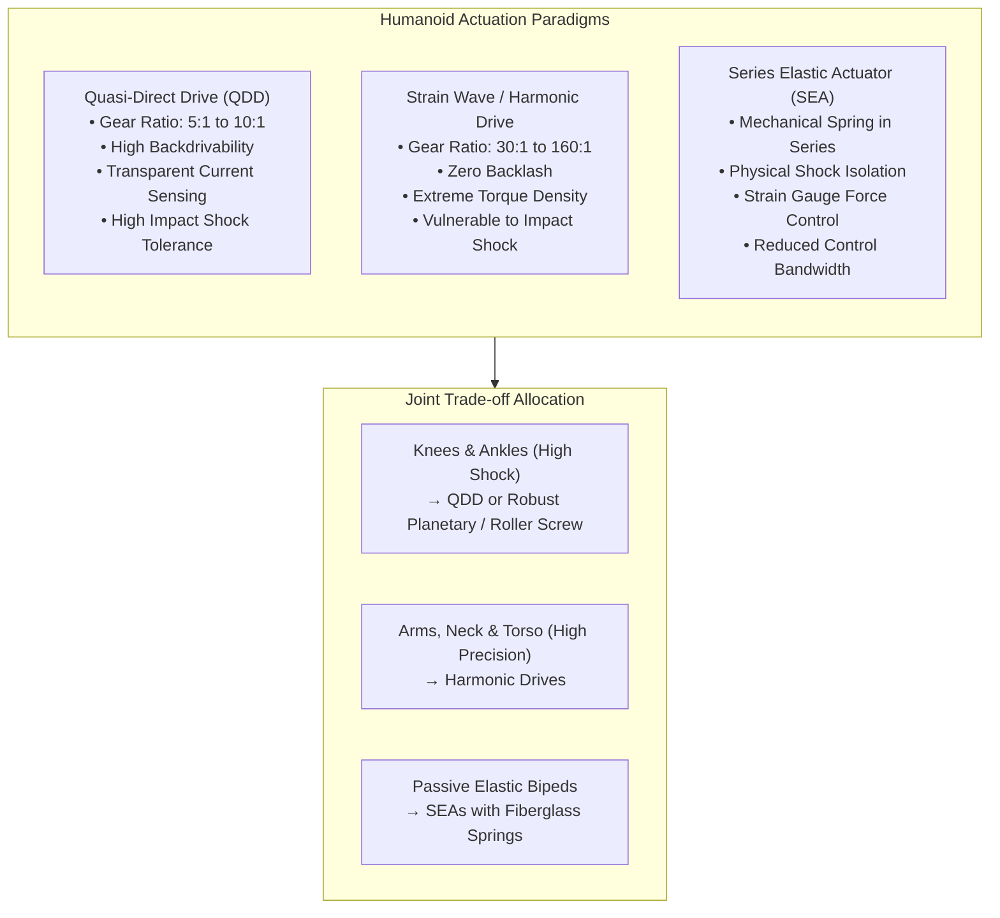
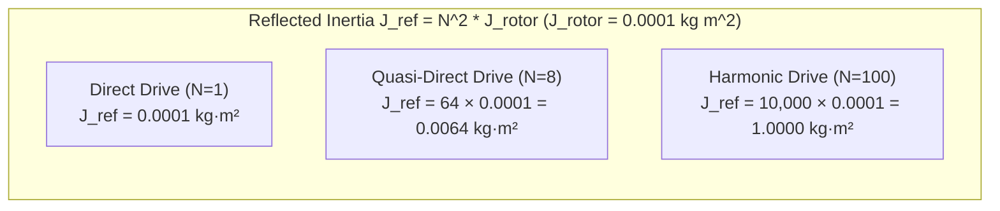
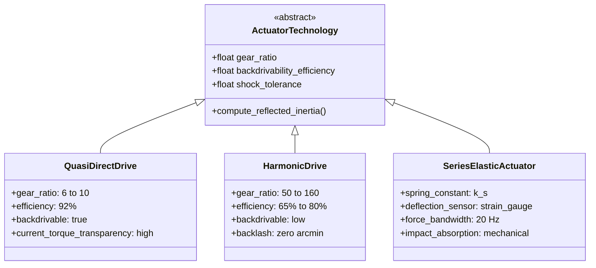

import ChapterProgress from '@site/src/components/ChapterProgress';
import QuizEngine from '@site/src/components/QuizEngine';

# Actuator Technologies: Quasi-Direct Drive, Harmonic Drives & SEAs

Actuation represents the core bottleneck in humanoid robotics. A physical humanoid must exert high torques at low angular velocities during quiet stance, deliver explosive peak power during dynamic jumping or stumbling recovery, and survive repeated, non-smooth ground collision shocks without mechanical failure. The selection of an actuator technology dictates a robot's force bandwidth, impact tolerance, backdrivability, positioning accuracy, and thermal endurance.

The contemporary landscape of humanoid actuation is dominated by three distinct paradigms: **Quasi-Direct Drive (QDD)** systems that favor transparency and impact resistance, **Strain Wave / Harmonic Drive** systems that maximize torque density and zero-backlash precision, and **Series Elastic Actuators (SEAs)** that decouple rotor inertia through physical mechanical compliance.



---

## 1. Electric Motor Fundamentals: BLDC & PMSM

Modern humanoid actuators almost universally utilize **Brushless DC (BLDC)** or **Permanent Magnet Synchronous Motors (PMSM)** featuring high-grade Neodymium-Iron-Boron (NdFeB N52) rare-earth permanent magnets.

```
       Inrunner Topology                     Outrunner Topology
    (High speed, low inertia)             (High torque, pancake format)
     ┌───────────────────────┐             ┌───────────────────────┐
     │  Stator Windings (OD) │             │  Rotor Magnets (OD)   │
     │   ┌───────────────┐   │             │   ┌───────────────┐   │
     │   │ Rotor Magnets │   │             │   │Stator Windings│   │
     │   │     (Shaft)   │   │             │   │    (Core)     │   │
     │   └───────────────┘   │             │   └───────────────┘   │
     └───────────────────────┘             └───────────────────────┘
```

- **Inrunner Motors**: Rotor with permanent magnets is inside; stator coils are on the outer circumference. Characterized by low rotor inertia $J_{\text{rotor}}$ and excellent heat conduction from the stator directly into the outer housing.
- **Outrunner ("Pancake") Motors**: Rotor with magnets spins on the outside of stationary central stator teeth. Because electromagnetic torque scales with the square of the airgap radius ($r_{\text{gap}}^2$), large-diameter pancake outrunners generate exceptionally high torque per unit mass ($> 5\text{--}8\,\text{N}\cdot\text{m/kg}$ continuous un-geared).

### Core Electro-Mechanical Equations
For a 3-phase PMSM under Field-Oriented Control (FOC):

1. **Electromagnetic Torque**:
   $$
   \tau_{\text{em}} = \frac{3}{2} p \, \lambda_m \, i_q = K_t \, I_{\text{RMS}}
   $$
   where $p$ is the number of magnetic pole pairs, $\lambda_m$ is the permanent magnet flux linkage ($\text{Wb}$), $i_q$ is the quadrature torque-producing current, and $K_t$ is the motor torque constant ($\text{N}\cdot\text{m/A}$).

2. **Back-Electromotive Force (Back-EMF)**:
   $$
   V_{\text{bemf}} = K_e \, \omega_{\text{mech}}
   $$
   In metric SI units, the torque constant and back-EMF constant are physically equivalent: $K_t = K_e$ ($\text{N}\cdot\text{m/A} \equiv \text{V}/(\text{rad/s})$).

3. **Terminal Voltage Balance**:
   $$
   V_{\text{bus}} \ge I_q R_{\text{phase}} + K_e \omega_{\text{mech}}
   $$
   As joint speed $\omega_{\text{mech}}$ rises, back-EMF opposes the applied bus voltage, creating a hard physical ceiling on motor angular velocity unless flux-weakening control is applied.

---

## 2. Reflected Inertia and Gearbox Dynamics

A mechanical transmission with reduction ratio $N = \omega_{\text{input}} / \omega_{\text{output}} > 1$ amplifies motor torque by $N$ (scaled by mechanical efficiency $\eta$), but also scales reflected inertia quadratically:

$$
\tau_{\text{joint}} = \eta \cdot N \cdot \tau_{\text{motor}}
$$

### Reflected Rotor Inertia
The effective rotational inertia reflected at the joint output shaft $J_{\text{joint}}$ is:

$$
J_{\text{joint}} = J_{\text{load}} + J_{\text{gearbox}} + N^2 \cdot J_{\text{rotor}}
$$

Because reflected rotor inertia scales with $N^2$, high gear ratios create immense apparent mass during sudden accelerations or external impacts:



### Impact Force and Foot-Strike Collision
When a swinging humanoid foot strikes rigid concrete at impact velocity $v_{\text{strike}}$, the peak impulse wrench $F_{\text{peak}}$ transmitted through the transmission before the digital control loop can react is governed by the structural stiffness $k_{\text{contact}}$ and the reflected mechanical inertia $J_{\text{joint}}$:

$$
F_{\text{peak}} \approx v_{\text{strike}} \cdot \sqrt{m_{\text{apparent}} \cdot k_{\text{contact}}}
$$

where $m_{\text{apparent}} \approx \frac{N^2 \cdot J_{\text{rotor}}}{L_{\text{limb}}^2}$. In a high-ratio system ($N = 100$), the apparent inertia is over **150 times higher** than in a QDD system ($N = 8$), resulting in severe impact forces that can shear gear teeth and shatter encoder bearings.

---

## 3. Comparative Actuation Paradigms



### 1. Quasi-Direct Drive (QDD)
- **Architecture**: A large-diameter outrunner motor paired with a low-ratio ($N = 6:1\text{ to }10:1$) single-stage planetary gearset.
- **Backdrivability**: Over $90\%$ backdrivability efficiency. External forces applied at the joint spin the motor backwards freely.
- **Torque Transparency**: Joint output torque is directly proportional to motor quadrature current: $\tau_{\text{joint}} \approx \eta N K_t I_q$. External joint torque can be estimated cleanly without joint torque sensors.
- **Pioneering Examples**: MIT Cheetah 3, Unitree Aliengo / B2 / H1 / G1.

### 2. Strain Wave / Harmonic Drives
- **Architecture**: Three core components: an elliptical **Wave Generator** bearing, a flexible cup-shaped steel **Flexspline** with external teeth, and a rigid ring **Circular Spline** with internal teeth.
- **Zero Backlash**: Elastic deformation of the flexspline ensures continuous tooth preloading, eliminating angular backlash ($< 0.1\,\text{arcmin}$).
- **Torque Density**: Transmits up to $300\text{--}500\,\text{N}\cdot\text{m/kg}$ in compact coaxial packages.
- **Weaknesses**: Friction losses drop efficiency to $65\text{--}78\%$; flexspline fatigue life is finite; flexspline teeth are susceptible to catastrophic brittle shear under sudden shock impacts ($> 300\%\,\tau_{\text{rated}}$).

### 3. Series Elastic Actuators (SEAs)
- **Architecture**: Incorporates a physical compliance element (titanium torsion bar or composite leaf spring) placed in series between the gearbox output and the load.
- **Force Dynamics**:
  $$
  F_{\text{SEA}} = k_s \left( \frac{x_{\text{motor}}}{N} - x_{\text{joint}} \right)
  $$
- **Advantages**: Mechanical low-pass filtering shields the gearbox from high-frequency impact shocks. Deflection of the spring $\Delta \theta = \theta_{\text{gear}} - \theta_{\text{joint}}$ measured by dual absolute encoders provides zero-drift joint torque sensing: $\tau = k_s \cdot \Delta \theta$.
- **Disadvantages**: The physical spring introduces a low resonant pole, reducing closed-loop force control bandwidth to $< 15\text{--}30\,\text{Hz}$ (compared to $> 150\,\text{Hz}$ for rigid QDD drives).

---

## 4. Actuator Selection Matrix Across Humanoid Joints

| Joint Group | Dominant Dynamics | Recommended Actuator Type | Typical Gear Ratio | Continuous Torque | Peak Torque | Rationale |
|:---|:---|:---|:---|:---|:---|:---|
| **Hip Yaw / Roll** | High positioning accuracy, moderate shock | Harmonic Drive or Dual-Stage Planetary | $50:1\text{--}80:1$ | $60\text{--}90\,\text{N}\cdot\text{m}$ | $180\text{--}240\,\text{N}\cdot\text{m}$ | Compact coaxial packaging in pelvis; low impact hazard. |
| **Hip Pitch** | High dynamic swing acceleration, walking propulsion | Quasi-Direct Drive (QDD) or Planetary | $8:1\text{--}20:1$ | $80\text{--}120\,\text{N}\cdot\text{m}$ | $250\text{--}360\,\text{N}\cdot\text{m}$ | Requires low reflected inertia for rapid forward leg swing. |
| **Knee Pitch** | Extreme shock loading, crouching torque | High-Power Planetary or Inverted Roller Screw | $15:1\text{--}30:1$ | $100\text{--}150\,\text{N}\cdot\text{m}$ | $300\text{--}450\,\text{N}\cdot\text{m}$ | High impact survival during heel strike; large continuous torque. |
| **Ankle Pitch / Roll**| Ground contact alignment, high shock, constrained space | Parallel 4-Bar Pushrod QDD or Inverted Roller Screw | $10:1\text{--}25:1$ | $50\text{--}80\,\text{N}\cdot\text{m}$ | $150\text{--}220\,\text{N}\cdot\text{m}$ | Transparent impedance control for terrain conformity. |
| **Shoulder & Elbow** | High precision, payload holding, low shock | Harmonic Drive | $50:1\text{--}100:1$ | $25\text{--}45\,\text{N}\cdot\text{m}$ | $75\text{--}120\,\text{N}\cdot\text{m}$ | Zero backlash ensures stable object manipulation. |
| **Wrist Pitch / Roll / Yaw** | Fine manipulation, minimal payload mass | Mini Harmonic Drive or Cycloidal | $30:1\text{--}80:1$ | $5\text{--}12\,\text{N}\cdot\text{m}$ | $15\text{--}35\,\text{N}\cdot\text{m}$ | Strict mass envelope ($< 350\,\text{g}$ per actuator). |

---

## 5. Electro-Thermal Sizing & Duty Cycle Analysis

Electric motors are thermally constrained systems. Overheating breaks down winding insulation (Class H insulation limits copper to $180^\circ\text{C}$) and demagnetizes NdFeB magnets (Curie point temperature degradation begins at $120\text{--}150^\circ\text{C}$).

### Root-Mean-Square (RMS) Torque
For a periodic bipedal walking gait of duration $T_{\text{cycle}}$, the thermal heating of the motor winding is determined not by peak torque, but by the **RMS Torque** $\tau_{\text{RMS}}$:

$$
\tau_{\text{RMS}} = \sqrt{\frac{1}{T_{\text{cycle}}} \int_{0}^{T_{\text{cycle}}} \tau(t)^2 \, dt}
$$

The selected motor must satisfy:

$$
\tau_{\text{RMS}} \le \tau_{\text{continuous, rated}}
$$

and the maximum instantaneous trajectory torque must satisfy:

$$
\max_{t} |\tau(t)| \le \tau_{\text{peak, rated}} \quad (\text{typically allowed for } t \le 1.0\text{--}2.0\,\text{s})
$$

### Thermal Dissipation Model
Winding copper losses ($I^2 R$) generate heat flux $P_{\text{loss}}$:

$$
P_{\text{loss}}(t) = 3 \cdot I_{\text{phase, RMS}}^2 \cdot R_{\text{phase}}(T) = \frac{3}{2} \cdot \left(\frac{\tau(t)}{K_t}\right)^2 \cdot R_0 \left( 1 + \alpha_{\text{cu}} (T_{\text{wind}} - 20^\circ\text{C}) \right)
$$

where $\alpha_{\text{cu}} = 0.00393\,^\circ\text{C}^{-1}$ is the temperature coefficient of copper resistance.

Using a two-node lumped thermal network (Winding $\to$ Stator Housing $\to$ Ambient):

$$
C_{\text{wind}} \frac{d T_{\text{wind}}}{dt} = P_{\text{loss}} - \frac{T_{\text{wind}} - T_{\text{case}}}{R_{\theta, \text{wc}}}
$$

$$
C_{\text{case}} \frac{d T_{\text{case}}}{dt} = \frac{T_{\text{wind}} - T_{\text{case}}}{R_{\theta, \text{wc}}} - \frac{T_{\text{case}} - T_{\text{ambient}}}{R_{\theta, \text{ca}}}
$$

where $R_{\theta}$ are thermal resistances ($^\circ\text{C/W}$) and $C_{\theta}$ are thermal heat capacities ($\text{J/}^\circ\text{C}$).

---

## 6. Complete Implementation: Actuator Sizing & Thermal Trajectory Tool

The following Python tool ingests walking joint torque and speed trajectories, evaluates actuator feasibility against torque-speed envelopes, and models winding temperature rise across repetitive gait cycles.

```python
"""
actuator_sizing_and_thermal_tool.py
Evaluates actuator feasibility, reflected inertia, copper losses,
and multi-node thermal temperature rise for humanoid joint trajectories.
"""

from dataclasses import dataclass
from typing import List, Tuple
import numpy as np


@dataclass
class ActuatorSpecs:
    """Detailed electro-mechanical and thermal specification of a robotic actuator."""
    model_name: str
    gear_ratio: float
    rotor_inertia_kgm2: float
    motor_kt_nm_per_a: float  # Torque constant at motor shaft
    phase_resistance_ohm: float  # Winding resistance at 20 deg C
    gearbox_efficiency: float
    max_peak_torque_nm: float  # Joint output peak torque
    continuous_torque_nm: float  # Joint output continuous rated torque
    max_joint_speed_rad_s: float
    bus_voltage_v: float
    thermal_res_wind_to_case: float  # deg C / W
    thermal_res_case_to_amb: float  # deg C / W
    thermal_cap_wind_j_per_c: float  # J / deg C
    thermal_cap_case_j_per_c: float  # J / deg C


class ActuatorThermalSimulator:
    """Simulates dynamic electrical, mechanical, and thermal performance."""

    def __init__(self, specs: ActuatorSpecs):
        self.specs = specs
        # Reflected rotor inertia at joint output
        self.reflected_rotor_inertia = (specs.gear_ratio ** 2) * specs.rotor_inertia_kgm2

    def evaluate_trajectory(
        self,
        time_s: np.ndarray,
        torque_nm: np.ndarray,
        velocity_rad_s: np.ndarray,
        ambient_temp_c: float = 25.0
    ) -> dict:
        """
        Runs sizing verification and dynamic 2-node thermal simulation.
        """
        dt = np.mean(np.diff(time_s))
        n_steps = len(time_s)

        # 1. Kinematic and Dynamic Limit Checks
        peak_torque = float(np.max(np.abs(torque_nm)))
        peak_velocity = float(np.max(np.abs(velocity_rad_s)))
        rms_torque = float(np.sqrt(np.mean(torque_nm ** 2)))

        is_torque_within_peak = peak_torque <= self.specs.max_peak_torque_nm
        is_torque_within_rms = rms_torque <= self.specs.continuous_torque_nm
        is_speed_within_limits = peak_velocity <= self.specs.max_joint_speed_rad_s

        # 2. Dynamic Electrical Power Losses
        # Motor shaft torque = joint torque / (ratio * efficiency)
        torque_motor = np.abs(torque_nm) / (self.specs.gear_ratio * self.specs.gearbox_efficiency)
        iq_current = torque_motor / self.specs.motor_kt_nm_per_a

        # 3. Two-Node Thermal Differential Evolution
        t_wind = np.zeros(n_steps)
        t_case = np.zeros(n_steps)
        power_loss = np.zeros(n_steps)

        current_tw = ambient_temp_c
        current_tc = ambient_temp_c

        alpha_copper = 0.00393  # Copper temp coefficient

        for i in range(n_steps):
            # Copper resistance corrected for temperature
            r_temp = self.specs.phase_resistance_ohm * (1.0 + alpha_copper * (current_tw - 20.0))
            # 3-phase copper losses: 1.5 * iq^2 * R
            p_loss = 1.5 * (iq_current[i] ** 2) * r_temp
            power_loss[i] = p_loss

            # Heat transfer rates
            q_wind_to_case = (current_tw - current_tc) / self.specs.thermal_res_wind_to_case
            q_case_to_amb = (current_tc - ambient_temp_c) / self.specs.thermal_res_case_to_amb

            # Euler integration of thermal nodes
            d_tw = (p_loss - q_wind_to_case) / self.specs.thermal_cap_wind_j_per_c
            d_tc = (q_wind_to_case - q_case_to_amb) / self.specs.thermal_cap_case_j_per_c

            current_tw += d_tw * dt
            current_tc += d_tc * dt

            t_wind[i] = current_tw
            t_case[i] = current_tc

        return {
            "peak_torque_nm": peak_torque,
            "rms_torque_nm": rms_torque,
            "reflected_inertia_kgm2": self.reflected_rotor_inertia,
            "feasible_peak_torque": is_torque_within_peak,
            "feasible_rms_torque": is_torque_within_rms,
            "feasible_velocity": is_speed_within_limits,
            "max_winding_temp_c": float(np.max(t_wind)),
            "final_winding_temp_c": float(t_wind[-1]),
            "mean_copper_loss_w": float(np.mean(power_loss)),
            "thermal_headroom_c": float(155.0 - np.max(t_wind))  # Class F insulation 155 C limit
        }


# Demonstration: Sizing a Knee Actuator for Bipedal Squat / Walking Cycles
if __name__ == "__main__":
    print("=== Humanoid Knee Actuator Sizing & Thermal Validation ===")

    # Define candidate: High-Torque QDD Planetary Actuator
    knee_candidate = ActuatorSpecs(
        model_name="QDD-Knee-9015",
        gear_ratio=9.0,  # 9:1 single-stage planetary
        rotor_inertia_kgm2=1.4e-4,
        motor_kt_nm_per_a=0.18,
        phase_resistance_ohm=0.12,
        gearbox_efficiency=0.93,
        max_peak_torque_nm=240.0,
        continuous_torque_nm=85.0,
        max_joint_speed_rad_s=18.0,
        bus_voltage_v=48.0,
        thermal_res_wind_to_case=0.85,
        thermal_res_case_to_amb=1.20,
        thermal_cap_wind_j_per_c=120.0,
        thermal_cap_case_j_per_c=450.0
    )

    # Synthesize 120-second repeated bipedal walking trajectory (1.0 Hz cadence)
    duration_sec = 120.0
    dt_sec = 0.005  # 200 Hz trajectory setpoints
    t_arr = np.arange(0.0, duration_sec, dt_sec)

    # Dynamic knee torque profile: stance loading + swing swing acceleration
    # Peak stance torque ~ 140 N*m, swing torque ~ 25 N*m
    torque_profile = 60.0 * np.sin(2.0 * np.pi * 1.0 * t_arr) + \
                     45.0 * np.sin(4.0 * np.pi * 1.0 * t_arr) + \
                     20.0 * np.random.normal(0, 0.05, len(t_arr))
    # Knee angular velocity profile (max ~ 8 rad/s)
    velocity_profile = 6.5 * np.cos(2.0 * np.pi * 1.0 * t_arr)

    simulator = ActuatorThermalSimulator(knee_candidate)
    results = simulator.evaluate_trajectory(t_arr, torque_profile, velocity_profile, ambient_temp_c=28.0)

    print(f"Actuator: {knee_candidate.model_name} (Ratio {knee_candidate.gear_ratio}:1)")
    print(f"Reflected Rotor Inertia: {results['reflected_inertia_kgm2']:.5f} kg*m^2")
    print(f"Peak Trajectory Torque:  {results['peak_torque_nm']:.2f} N*m (Limit: {knee_candidate.max_peak_torque_nm} N*m) -> Feasible: {results['feasible_peak_torque']}")
    print(f"RMS Trajectory Torque:   {results['rms_torque_nm']:.2f} N*m (Continuous: {knee_candidate.continuous_torque_nm} N*m) -> Feasible: {results['feasible_rms_torque']}")
    print(f"Mean Copper Losses:      {results['mean_copper_loss_w']:.2f} Watts")
    print(f"Peak Winding Temp:       {results['max_winding_temp_c']:.2f} deg C")
    print(f"Thermal Headroom:        {results['thermal_headroom_c']:.2f} deg C (Relative to 155 deg C Class F)")
```

---

## 7. Hands-On Lab Project: Impact Stress & Reflected Inertia Comparison

### Objective
Configure a numerical experiment comparing the reflected inertia and simulated foot-strike shock forces between a $9:1$ QDD knee drive and a $100:1$ Harmonic Drive knee joint during a $0.8\,\text{m/s}$ ground collision.

### Deliverables & Verification
1. Given motor rotor inertia $J_{\text{rotor}} = 1.6 \times 10^{-4}\,\text{kg}\cdot\text{m}^2$:
   - Calculate reflected inertia $J_{\text{ref, QDD}} = 9^2 \times 1.6 \times 10^{-4} = 0.01296\,\text{kg}\cdot\text{m}^2$.
   - Calculate reflected inertia $J_{\text{ref, Harmonic}} = 100^2 \times 1.6 \times 10^{-4} = 1.600\,\text{kg}\cdot\text{m}^2$.
2. Model ground contact stiffness $k_{\text{contact}} = 80,000\,\text{N/m}$ and leg effective length $L = 0.85\,\text{m}$.
3. Show that the initial passive impact force $F_{\text{peak}} = v \sqrt{\frac{J_{\text{ref}}}{L^2} k_{\text{contact}}}$ of the Harmonic Drive is over **11 times higher** than that of the QDD system, demonstrating why unprotected harmonic drives fail under shock impacts.

---

## 8. Seminal Literature & Academic References

1. **Seok, S., Wang, A., Chuah, M. Y., Otten, D., Lang, J., & Kim, S. (2015).** *Design principles for energy-efficient legged locomotion and actuation*. IEEE/ASME Transactions on Mechatronics, 20(3), 1114–1125.
   - *Annotation*: The foundational paper establishing Quasi-Direct Drive (QDD) actuators, high-torque outrunner motors, low gear ratios, and torque transparency on the MIT Cheetah.
2. **Pratt, G. A., & Williamson, M. M. (1995).** *Series elastic actuators*. In IEEE/RSJ International Conference on Intelligent Robots and Systems (IROS) (Vol. 1, pp. 399–406).
   - *Annotation*: The seminal work introducing Series Elastic Actuators, physical spring compliance, and force-controlled robotic actuation.
3. **Wensing, P. M., Wang, A., Seok, S., Otten, D., Lang, J., & Kim, S. (2017).** *Proprioceptive actuation for dynamic legged robots*. IEEE Transactions on Robotics, 33(3), 509–522.
   - *Annotation*: Formulates high-frequency force transparency, impact mitigation, and sensorless current-based ground reaction torque estimation.
4. **Radford, N. A., et al. (2015).** *Valkyrie: NASA's electric humanoid robot*. Journal of Field Robotics, 32(3), 397–419.
   - *Annotation*: Details the engineering implementation of rotary and linear series elastic actuators (SEAs) across all major joints of a 130 kg humanoid robot.

---

<ChapterProgress chapterId="10-2-actuator-technologies" moduleId="module10" totalChapters={8} />

## Chapter Mastery Check

<QuizEngine
  quizId="quiz-10-2"
  title="Module 10.2 Mastery Check: Actuator Technologies"
  moduleId="module10"
  passThreshold={70}
  questions={[
    {
      id: "q1",
      question: "If a motor has a rotor inertia of 0.0002 kg*m^2 and is paired with a 100:1 harmonic drive, what is the reflected rotor inertia experienced at the joint output shaft?",
      options: [
        "0.02 kg*m^2 (scales linearly with N)",
        "2.0 kg*m^2 (scales quadratically with N^2)",
        "0.0002 kg*m^2 (independent of transmission ratio)",
        "0.000002 kg*m^2 (divided by N^2)"
      ],
      correctIndex: 1,
      explanation: "Reflected inertia scales with the square of the reduction ratio: J_ref = N^2 * J_rotor = (100)^2 * 0.0002 = 10,000 * 0.0002 = 2.0 kg*m^2."
    },
    {
      id: "q2",
      question: "Why are Quasi-Direct Drive (QDD) actuators preferred over high-ratio Harmonic Drives for the knees and ankles of dynamic running/jumping humanoids?",
      options: [
        "QDD actuators have lower manufacturing cost and zero rotor inertia.",
        "QDD's low gear ratio (6:1 to 10:1) dramatically lowers reflected inertia, providing high backdrivability to absorb ground impact shocks and permitting accurate current-based torque estimation.",
        "QDD actuators require no electrical current to hold static payload.",
        "QDD actuators have zero backlash while harmonic drives have high backlash."
      ],
      correctIndex: 1,
      explanation: "QDD systems maintain low reflected inertia (N^2), allowing mechanical impacts to backdrive the motor harmlessly while enabling high-fidelity proprioceptive torque sensing directly from motor phase current."
    },
    {
      id: "q3",
      question: "During a walking trajectory, why must motor selection be evaluated using the Root-Mean-Square (RMS) torque rather than the average torque?",
      options: [
        "Because mechanical gear wear depends on RMS torque.",
        "Because resistive copper losses (I^2 * R heating) scale quadratically with current and torque, making RMS torque the true thermodynamic metric for continuous winding heating.",
        "Because digital encoders cannot measure average current.",
        "Because back-EMF voltage is proportional to RMS torque."
      ],
      correctIndex: 1,
      explanation: "Copper power dissipation P_loss = 1.5 * I_q^2 * R is proportional to the square of current (and hence torque squared). Thus, thermal heating over time is governed strictly by RMS torque."
    }
  ]}
/>
