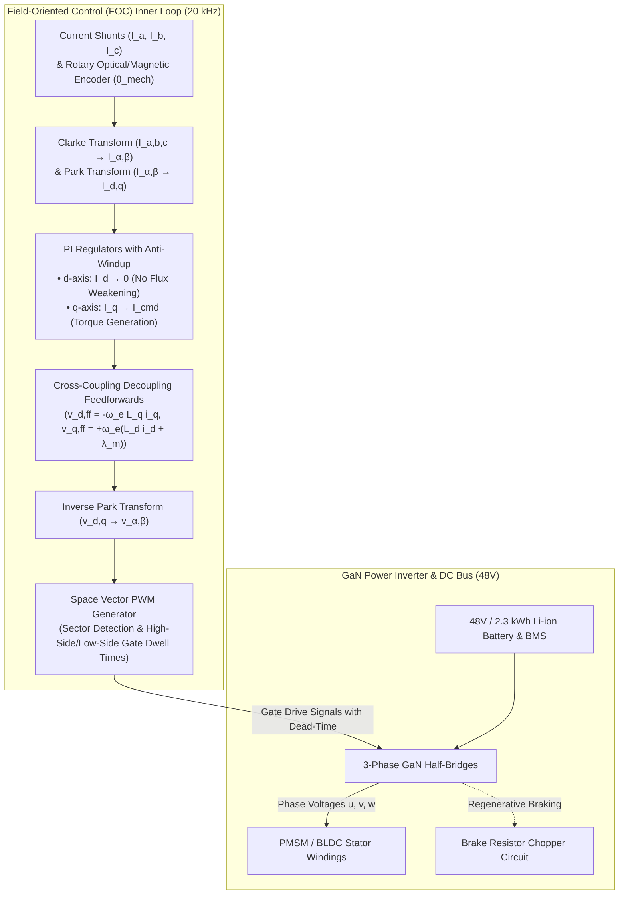
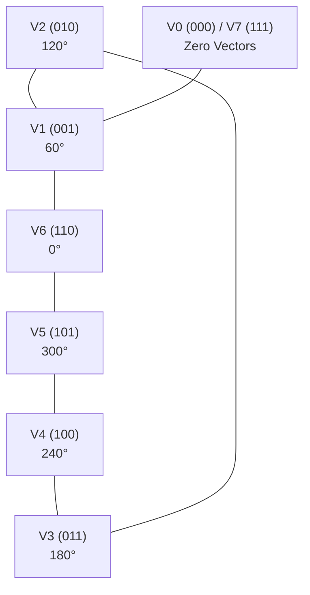

import ChapterProgress from '@site/src/components/ChapterProgress';
import QuizEngine from '@site/src/components/QuizEngine';

# Power Electronics, FOC Motor Control & Battery Systems

In an autonomous humanoid robot, electrical power electronics and motor drive inverters constitute the nervous interface between high-level trajectory commands and physical electromagnetic torque. Achieving precise, high-bandwidth impedance control at the joints requires motor drives capable of executing inner current control loops at frequencies of $20\text{--}40\,\text{kHz}$. This bandwidth is necessary to suppress torque ripple, reject rapid load perturbations during foot impact, and maintain smooth motion across diverse operational regimes.

Simultaneously, the physical power architecture—spanning wide-bandgap Gallium Nitride (GaN) power stages, regenerative braking management, high-density lithium battery chemistries, and safe bus voltage selection—determines the robot's thermal dissipation footprint and operational endurance.



---

## 1. Field-Oriented Control (FOC) Mathematical Formulation

The objective of **Field-Oriented Control** (vector control) is to decouple the electromagnetic torque production from the magnetic rotor field, emulating the linear, orthogonal control characteristics of a separately excited brushed DC motor.

```
Stator / Rotor Coordinate Reference Frames:
       beta-axis
          ^             q-axis (Torque)
          |           ^
          |          /
          |         /  Rotor Electrical Angle (theta_e)
          |        / )
          |       /___ _ _ _ d-axis (Flux)
          |      /
          |     /
          +--------------------> alpha-axis
```

### 1. Forward Clarke Transformation ($a,b,c \to \alpha,\beta$)
The 3-phase stator currents $i_a, i_b, i_c$, spatially separated by $120^\circ$, are mapped onto a stationary two-axis orthogonal reference frame $(\alpha, \beta)$ using the power-invariant or amplitude-invariant transformation:

Using the amplitude-invariant form (assuming balanced neutral $i_a + i_b + i_c = 0$):

$$
\begin{bmatrix} i_\alpha \\ i_\beta \end{bmatrix} = \frac{2}{3} \begin{bmatrix} 1 & -\frac{1}{2} & -\frac{1}{2} \\ 0 & \frac{\sqrt{3}}{2} & -\frac{\sqrt{3}}{2} \end{bmatrix} \begin{bmatrix} i_a \\ i_b \\ i_c \end{bmatrix}
$$

When sensing via two current shunts ($i_a$ and $i_b$), substituting $i_c = -i_a - i_b$ simplifies the computation to:

$$
i_\alpha = i_a, \quad i_\beta = \frac{1}{\sqrt{3}} (i_a + 2 i_b)
$$

### 2. Forward Park Transformation ($\alpha,\beta \to d,q$)
The stationary quantities $(i_\alpha, i_\beta)$ are projected into the synchronously rotating rotor reference frame $(d, q)$ via the rotor electrical angle $\theta_e = p \cdot \theta_{\text{mech}}$ (where $p$ is the pole pair count):

$$
\begin{bmatrix} i_d \\ i_q \end{bmatrix} = \begin{bmatrix} \cos\theta_e & \sin\theta_e \\ -\sin\theta_e & \cos\theta_e \end{bmatrix} \begin{bmatrix} i_\alpha \\ i_\beta \end{bmatrix}
$$

- $i_d$ aligns with the permanent magnet rotor flux vector. For non-salient surface-mount PMSM machines operating below base speed, $i_{d,\text{ref}} = 0$ to maximize torque efficiency.
- $i_q$ is perpendicular ($90^\circ$ electrical) to the rotor flux vector, directly producing mechanical torque:
  $$
  \tau_m = \frac{3}{2} p \, \lambda_m \, i_q
  $$

### 3. Synchronous Frame d-q Dynamic Voltage Equations
The dynamic electrical equations of a PMSM in the rotating $d\text{-}q$ frame are:

$$
v_d = R_s i_d + L_d \frac{d i_d}{dt} - \omega_e L_q i_q
$$

$$
v_q = R_s i_q + L_q \frac{d i_q}{dt} + \omega_e L_d i_d + \omega_e \lambda_m
$$

where $R_s$ is stator phase resistance, $L_d, L_q$ are direct and quadrature axis inductances, $\omega_e = \frac{d\theta_e}{dt}$ is electrical angular velocity, and $\lambda_m$ is the permanent magnet flux linkage.

To decouple the two control axes and prevent cross-axis interaction at high speeds, feedforward decoupling voltages $v_{d,\text{ff}}$ and $v_{q,\text{ff}}$ are added to the PI regulator outputs:

$$
v_{d,\text{cmd}} = v_{d,\text{PI}} - \omega_e L_q i_q
$$

$$
v_{q,\text{cmd}} = v_{q,\text{PI}} + \omega_e L_d i_d + \omega_e \lambda_m
$$

### 4. Inverse Park Transformation ($d,q \to \alpha,\beta$)
The resulting voltage command vectors $(v_d, v_q)$ are rotated back to the stationary $\alpha\text{-}\beta$ frame:

$$
\begin{bmatrix} v_\alpha \\ v_\beta \end{bmatrix} = \begin{bmatrix} \cos\theta_e & -\sin\theta_e \\ \sin\theta_e & \cos\theta_e \end{bmatrix} \begin{bmatrix} v_d \\ v_q \end{bmatrix}
$$

---

## 2. Space Vector Pulse Width Modulation (SVPWM)

Space Vector PWM synthesizes the target voltage vector $\mathbf{v}_{\text{ref}} = (v_\alpha, v_\beta)$ by modulating between the 8 discrete switching states of a 3-phase inverter bridge (6 non-zero active vectors $\mathbf{V}_1\text{--}\mathbf{V}_6$ and 2 zero vectors $\mathbf{V}_0, \mathbf{V}_7$).



### Advantages Over Sinusoidal PWM (SPWM)
- **DC Bus Utilization**: Generates a maximum fundamental phase-to-phase peak voltage of $V_{\text{bus}}$, compared to $0.866 V_{\text{bus}}$ for sinusoidal SPWM—yielding a **15.5% increase in usable motor torque and speed** without overmodulation.
- **Switching Loss Optimization**: Zero-vector distribution allows symmetric, center-aligned switching where only one inverter leg switches at each transition.

### Sector Detection and Dwell Times
Let the angle of the reference vector in the stationary frame be $\gamma = \text{atan2}(v_\beta, v_\alpha) \pmod{\pi/3}$. Within any $60^\circ$ sector bounded by adjacent vectors $\mathbf{V}_a$ and $\mathbf{V}_b$, the active dwell times $T_1$ and $T_2$ over a PWM period $T_s$ are:

$$
T_1 = \frac{\sqrt{3} \, T_s \, \|\mathbf{v}_{\text{ref}}\|}{V_{\text{dc}}} \sin\left(\frac{\pi}{3} - \gamma\right)
$$

$$
T_2 = \frac{\sqrt{3} \, T_s \, \|\mathbf{v}_{\text{ref}}\|}{V_{\text{dc}}} \sin(\gamma)
$$

The remaining period is equally divided between zero vectors $\mathbf{V}_0 (000)$ and $\mathbf{V}_7 (111)$:

$$
T_0 = T_7 = \frac{T_s - T_1 - T_2}{2}
$$

---

## 3. Power Inverter Hardware: GaN FETs & Gate Drivers

Robotic joint drives demand ultra-compact inverters embedded directly inside the actuator hub. Traditional Silicon (Si) MOSFETs suffer from high gate charge ($Q_g$) and reverse recovery losses ($Q_{rr}$), restricting switching frequencies to $< 20\,\text{kHz}$ and generating bulky thermal footprints.

### Wide-Bandgap Gallium Nitride (GaN) Semiconductors
Modern humanoid inverters (e.g., Texas Instruments LMG2100, EPC2065 GaN FETs) offer distinct advantages:

1. **Zero Reverse Recovery ($Q_{rr} = 0$)**: Eliminates bridge shoot-through losses during dead-time transitions.
2. **Sub-Nanosecond Switching Speeds ($dV/dt > 100\,\text{V/ns}$)**: Reduces switching losses by $> 80\%$, enabling efficient operation at $40\text{--}100\,\text{kHz}$ PWM.
3. **Dead-Time Insertion**:
   In Silicon inverters, conservative dead-times of $300\text{--}800\,\text{ns}$ prevent shoot-through, introducing phase voltage distortion and non-linear low-speed torque ripple. GaN gate drivers enable dead-times of **$20\text{--}50\,\text{ns}$**, drastically improving current linearity and sensorless observer stability.

```
Half-Bridge Inverter Leg with Dead-Time:
   +V_bus (48V)
       │
   ┌───┴───┐
   │ High- │
   │ Side  │ Gate Drive [PWM_H] ───┐
   │ GaN   │                       │
   └───┬───┘                       ├── Dead-time t_dead (35 ns)
       ├─── Phase Output (u, v, w)  │
   ┌───┴───┐                       │
   │ Low-  │ Gate Drive [PWM_L] ───┘
   │ Side  │
   │ GaN   │
   └───┬───┘
       │
      GND (Current Shunt)
```

---

## 4. Bus Architecture & Battery Systems (48V vs. 24V)

Selecting the system bus voltage is a primary trade-off between electrical copper losses, wire harness mass, motor power density, and electrical safety standards.

### 48V vs. 24V Trade-Off Matrix

| Metric | 24V Bus Architecture | 48V Bus Architecture (Humanoid Standard) | Impact on Humanoid Mechanics |
|:---|:---|:---|:---|
| **Phase Current for 1500W Peak** | $I = \frac{P}{V} = 62.5\,\text{A}$ | $I = \frac{P}{V} = 31.25\,\text{A}$ | Current is halved at identical mechanical output power. |
| **Harness $I^2 R$ Copper Losses** | $P_{\text{loss}} = I^2 R = 3906 \cdot R$ | $P_{\text{loss}} = I^2 R = 976 \cdot R$ | **75% reduction in wiring heat generation** ($4\times$ lower losses). |
| **Wire Gauge & Harness Mass** | AWG 10 ($5.3\,\text{mm}^2$, $60\,\text{g/m}$) | AWG 14 ($2.1\,\text{mm}^2$, $24\,\text{g/m}$) | Saves $2.5\text{--}4.0\,\text{kg}$ of copper harness weight across 28 joints. |
| **Safety Standard Compliance** | Extra-Low Voltage (SELV) | Extra-Low Voltage (SELV, $< 60\,\text{V}$ DC limit) | Both avoid mandatory high-voltage interlocks (OSHA / ISO 6469). |
| **Back-EMF Headroom** | Low top speed before flux weakening | $2\times$ higher motor speed before field weakening | Enables high-speed leg swing during rapid running and stumbling recovery. |

### Battery Chemistries: NMC vs. $\text{LiFePO}_4$

```mermaid
quadrantChart
    title Battery Chemistry Selection Matrix for Mobile Humanoids
    x-axis Low Volumetric Density (Wh/L) --> High Volumetric Density (Wh/L)
    y-axis Low Thermal Runaway Resistance --> High Thermal Runaway Resistance
    quadrant-1 Safe High-Density Systems (Solid-State)
    quadrant-2 Chemically Stable (LiFePO4)
    quadrant-3 Heavy / Low Capacity (Lead-Acid / NiMH)
    quadrant-4 High Energy Density (NMC 21700 / 46800)
    "Li-ion NMC 21700": [0.85, 0.35]
    "Li-ion NMC 46800": [0.92, 0.40]
    "LiFePO4 Cylindrical": [0.45, 0.90]
    "LiPo Pouch (High-C)": [0.65, 0.20]
    "Solid-State Li-Metal": [0.95, 0.85]
```

Humanoids prioritize gravimetric energy density ($> 250\,\text{Wh/kg}$) to fit a $1.5\text{--}2.5\,\text{kWh}$ pack within the pelvis or torso without exceeding $50\text{--}65\,\text{kg}$ total mass. **NMC 21700 / 46800 cylindrical cells** in a $13\text{S}$ ($48.1\,\text{V}$ nominal, $54.6\,\text{V}$ peak) or $14\text{S}$ ($51.8\,\text{V}$ nominal, $58.8\,\text{V}$ peak) configuration represent the current industry benchmark.

### Regenerative Braking & Voltage Clamping
During rapid deceleration, foot-strike shock absorption, or downward squatting, the motors act as generators, pumping kinetic energy back through the inverter into the DC bus:

$$
P_{\text{regen}} = \tau_{\text{braking}} \cdot \omega_m - I^2 R
$$

If the battery cannot absorb this instantaneous charge current (e.g., when near $100\%$ SoC or in cold conditions), the DC bus voltage spikes rapidly ($> 65\,\text{V}$), risking catastrophic breakdown of FETs and bypass capacitors. Every drive incorporates a **Brake Chopper Circuit**: a comparator driving a high-power power resistor ($1\text{--}3\,\Omega$, $100\,\text{W}$) that shunts excess regenerative current to ground when $V_{\text{bus}} > 56.5\,\text{V}$.

---

## 5. Complete Implementation: 20 kHz FOC Current Loop in Embedded C++

The following production-grade C++ module implements an inner FOC current control loop executing at 20 kHz ($50\,\mu\text{s}$ period). It incorporates forward Clarke and Park transforms, anti-windup PI current controllers, cross-coupling feedforwards, and SVPWM duty-cycle computation.

```cpp
/**
 * foc_inner_current_loop.hpp
 * Production-grade, deterministic 20 kHz FOC inner current controller
 * for PMSM / BLDC robotic joint actuators.
 */

#pragma once

#include <cmath>
#include <cstdint>
#include <algorithm>

namespace embedded_robotics {

struct FocConfig {
    float rs_ohm;            // Stator phase resistance (Ohms)
    float ld_henry;          // Direct inductance (H)
    float lq_henry;          // Quadrature inductance (H)
    float lambda_m_weber;    // Permanent magnet flux linkage (Wb)
    uint32_t pole_pairs;     // Rotor magnetic pole pair count
    float v_dc_bus;          // Current measured DC bus voltage (V)
    float kp_id;             // Proportional gain for d-axis current loop
    float ki_id;             // Integral gain for d-axis current loop
    float kp_iq;             // Proportional gain for q-axis current loop
    float ki_iq;             // Integral gain for q-axis current loop
    float max_phase_voltage; // Maximum allowable synthesis voltage (V)
    float dt_sec;            // Sample period (e.g., 1.0f / 20000.0f = 0.00005f)
};

struct FocInputs {
    float i_a;               // Measured Phase A current (Amperes)
    float i_b;               // Measured Phase B current (Amperes)
    float theta_mech_rad;    // Absolute mechanical rotor angle (Radians)
    float omega_mech_rad_s;  // Mechanical angular velocity (rad/s)
    float i_d_target;        // Direct axis current reference (usually 0.0 A)
    float i_q_target;        // Quadrature axis current reference (Torque command / Kt)
};

struct SvpwmDutyCycles {
    float duty_a;            // High-side PWM duty cycle Phase A [0.0, 1.0]
    float duty_b;            // High-side PWM duty cycle Phase B [0.0, 1.0]
    float duty_c;            // High-side PWM duty cycle Phase C [0.0, 1.0]
    uint8_t sector;          // Active SVPWM Sector (1 to 6)
};

class FocCurrentController {
public:
    explicit FocCurrentController(const FocConfig& config)
        : cfg_(config), integral_err_d_(0.0f), integral_err_q_(0.0f) {}

    void reset() {
        integral_err_d_ = 0.0f;
        integral_err_q_ = 0.0f;
    }

    SvpwmDutyCycles update(const FocInputs& in) {
        // 1. Electrical Angle & Velocity Calculation
        float theta_elec = in.theta_mech_rad * static_cast<float>(cfg_.pole_pairs);
        // Normalize electrical angle to [0, 2*pi)
        theta_elec = std::fmod(theta_elec, 2.0f * static_cast<float>(M_PI));
        if (theta_elec < 0.0f) {
            theta_elec += 2.0f * static_cast<float>(M_PI);
        }
        const float omega_elec = in.omega_mech_rad_s * static_cast<float>(cfg_.pole_pairs);

        // 2. Forward Clarke Transform (Amplitude-Invariant, 2-shunt: i_c = -i_a - i_b)
        const float i_alpha = in.i_a;
        const float i_beta  = (1.0f / std::sqrt(3.0f)) * (in.i_a + 2.0f * in.i_b);

        // 3. Forward Park Transform
        const float cos_th = std::cos(theta_elec);
        const float sin_th = std::sin(theta_elec);

        const float i_d =  i_alpha * cos_th + i_beta * sin_th;
        const float i_q = -i_alpha * sin_th + i_beta * cos_th;

        // 4. Current Error Computation
        const float err_d = in.i_d_target - i_d;
        const float err_q = in.i_q_target - i_q;

        // 5. PI Regulators with Anti-Windup Clamping
        integral_err_d_ += err_d * cfg_.dt_sec;
        integral_err_q_ += err_q * cfg_.dt_sec;

        // Integrate-clamp limits
        const float int_limit = cfg_.max_phase_voltage * 0.8f;
        integral_err_d_ = std::clamp(integral_err_d_, -int_limit / cfg_.ki_id, int_limit / cfg_.ki_id);
        integral_err_q_ = std::clamp(integral_err_q_, -int_limit / cfg_.ki_iq, int_limit / cfg_.ki_iq);

        float v_d_pi = cfg_.kp_id * err_d + cfg_.ki_id * integral_err_d_;
        float v_q_pi = cfg_.kp_iq * err_q + cfg_.ki_iq * integral_err_q_;

        // 6. Cross-Coupling Decoupling Feedforwards
        const float v_d_ff = -omega_elec * cfg_.lq_henry * i_q;
        const float v_q_ff =  omega_elec * (cfg_.ld_henry * i_d + cfg_.lambda_m_weber);

        float v_d = v_d_pi + v_d_ff;
        float v_q = v_q_pi + v_q_ff;

        // Vector circle magnitude limiting (prevent over-saturation)
        const float v_mag = std::sqrt(v_d * v_d + v_q * v_q);
        if (v_mag > cfg_.max_phase_voltage && v_mag > 1e-6f) {
            v_d = (v_d / v_mag) * cfg_.max_phase_voltage;
            v_q = (v_q / v_mag) * cfg_.max_phase_voltage;
        }

        // 7. Inverse Park Transform (d,q -> alpha,beta)
        const float v_alpha = v_d * cos_th - v_q * sin_th;
        const float v_beta  = v_d * sin_th + v_q * cos_th;

        // 8. Space Vector PWM Synthesis
        return compute_svpwm(v_alpha, v_beta, cfg_.v_dc_bus);
    }

private:
    FocConfig cfg_;
    float integral_err_d_;
    float integral_err_q_;

    static SvpwmDutyCycles compute_svpwm(float v_alpha, float v_beta, float v_dc) {
        SvpwmDutyCycles out;
        if (v_dc < 1.0f) {
            out.duty_a = out.duty_b = out.duty_c = 0.5f;
            out.sector = 0;
            return out;
        }

        // Projection components for sector detection
        const float u1 = v_beta;
        const float u2 = (-v_beta + std::sqrt(3.0f) * v_alpha) * 0.5f;
        const float u3 = (-v_beta - std::sqrt(3.0f) * v_alpha) * 0.5f;

        // Sector identification (1 to 6)
        uint8_t sector = 0;
        if (u1 > 0.0f) sector |= 1;
        if (u2 > 0.0f) sector |= 2;
        if (u3 > 0.0f) sector |= 4;

        // Dwell times calculation
        const float root3 = std::sqrt(3.0f);
        float t1 = 0.0f;
        float t2 = 0.0f;

        switch (sector) {
            case 1: // Sector 2
                t1 = (root3 * v_alpha + v_beta) * 0.5f / v_dc;
                t2 = (-root3 * v_alpha + v_beta) * 0.5f / v_dc;
                break;
            case 2: // Sector 6
                t1 = (root3 * v_alpha - v_beta) * 0.5f / v_dc;
                t2 = v_beta / v_dc;
                break;
            case 3: // Sector 1
                t1 = (-root3 * v_alpha + v_beta) * 0.5f / v_dc;
                t2 = (root3 * v_alpha + v_beta) * 0.5f / v_dc;
                break;
            case 4: // Sector 4
                t1 = -v_beta / v_dc;
                t2 = (root3 * v_alpha + v_beta) * 0.5f / v_dc;
                break;
            case 5: // Sector 3
                t1 = v_beta / v_dc;
                t2 = (-root3 * v_alpha - v_beta) * 0.5f / v_dc;
                break;
            case 6: // Sector 5
                t1 = (-root3 * v_alpha - v_beta) * 0.5f / v_dc;
                t2 = (root3 * v_alpha - v_beta) * 0.5f / v_dc;
                break;
            default:
                t1 = 0.0f;
                t2 = 0.0f;
                sector = 1;
                break;
        }

        // Clamp dwell times to ensure valid PWM ratios
        t1 = std::clamp(t1, 0.0f, 1.0f);
        t2 = std::clamp(t2, 0.0f, 1.0f - t1);
        const float t0 = (1.0f - t1 - t2) * 0.5f;

        // Symmetric center-aligned PWM phase duty generation
        switch (sector) {
            case 3: // Sector 1
                out.duty_a = t1 + t2 + t0;
                out.duty_b = t2 + t0;
                out.duty_c = t0;
                break;
            case 1: // Sector 2
                out.duty_a = t1 + t0;
                out.duty_b = t1 + t2 + t0;
                out.duty_c = t0;
                break;
            case 5: // Sector 3
                out.duty_a = t0;
                out.duty_b = t1 + t2 + t0;
                out.duty_c = t2 + t0;
                break;
            case 4: // Sector 4
                out.duty_a = t0;
                out.duty_b = t1 + t0;
                out.duty_c = t1 + t2 + t0;
                break;
            case 6: // Sector 5
                out.duty_a = t2 + t0;
                out.duty_c = t1 + t2 + t0;
                out.duty_b = t0;
                break;
            case 2: // Sector 6
                out.duty_a = t1 + t2 + t0;
                out.duty_b = t0;
                out.duty_c = t1 + t0;
                break;
            default:
                out.duty_a = out.duty_b = out.duty_c = 0.5f;
                break;
        }

        out.sector = sector;
        return out;
    }
};

} // namespace embedded_robotics
```

---

## 6. Hands-On Lab Project: FOC Current Loop Step Response Verification

### Objective
Compile and execute a discrete numerical simulation of the `FocCurrentController` class under a $20\,\text{A}$ step torque command ($I_q^* = 20\,\text{A}, I_d^* = 0\,\text{A}$) at an electrical speed $\omega_e = 150\,\text{rad/s}$ to evaluate step response rise time, overshoot, and decoupling accuracy.

### Deliverables & Verification
1. Instantiate `FocConfig` with:
   - $R_s = 0.08\,\Omega$, $L_d = L_q = 65\,\mu\text{H}$, $\lambda_m = 0.012\,\text{Wb}$, $p = 10$, $V_{\text{dc}} = 48.0\,\text{V}$.
   - Sample time $dt = 50\,\mu\text{s}$ ($20\,\text{kHz}$).
   - PI gains tuned for a $1\,\text{kHz}$ current control bandwidth ($K_p = \omega_{\text{bw}} L = 2\pi(1000)(65\times 10^{-6}) \approx 0.408$, $K_i = \omega_{\text{bw}} R_s = 2\pi(1000)(0.08) \approx 502.6$).
2. Simulate a step command from $0\,\text{A}$ to $20\,\text{A}$ at $t = 1.0\,\text{ms}$.
3. Verify that $I_q$ achieves $90\%$ rise time in $< 0.8\,\text{ms}$ with $< 5\%$ overshoot, and that $I_d$ cross-axis disturbance remains strictly under $\pm 1.2\,\text{A}$.

---

## 7. Seminal Literature & Academic References

1. **Mohan, N., Undeland, T. M., & Robbins, W. P. (2003).** *Power Electronics: Converters, Applications, and Design*. John Wiley & Sons.
   - *Annotation*: The standard textbook detailing 3-phase inverter topology, gate drive dynamics, and Space Vector Modulation theory.
2. **Texas Instruments (2020).** *Field Oriented Control of Permanent Magnet Synchronous Motors: Design Guide (TIDM-02008)*.
   - *Annotation*: Technical blueprint for high-frequency FOC on C2000 microcontrollers, single-shunt vs 3-shunt sampling, and SVPWM timing.
3. **Bose, B. K. (2006).** *Power Electronics and Motor Drives: Advances and Trends*. Academic Press.
   - *Annotation*: Comprehensive coverage of d-q axis cross-coupling modeling, flux weakening strategies, and converter efficiency.
4. **Toliyat, H. A., & Campbell, S. (2004).** *DSP-Based Electromechanical Motion Control*. CRC Press.
   - *Annotation*: Explains digital discretization artifacts, anti-windup clamping schemes, and current loop delay compensation in embedded robotic drives.

---

<ChapterProgress chapterId="10-3-power-electronics-and-motor-control" moduleId="module10" totalChapters={8} />

## Chapter Mastery Check

<QuizEngine
  quizId="quiz-10-3"
  title="Module 10.3 Mastery Check: Power Electronics & Motor Control"
  moduleId="module10"
  passThreshold={70}
  questions={[
    {
      id: "q1",
      question: "What is the primary operational advantage of Space Vector PWM (SVPWM) compared to conventional sinusoidal carrier-based PWM (SPWM)?",
      options: [
        "SVPWM eliminates the need for microcontroller timers.",
        "SVPWM increases the maximum usable fundamental phase-to-phase output voltage by 15.5% for a given DC bus voltage.",
        "SVPWM eliminates the motor's back-EMF at high rotational speeds.",
        "SVPWM requires only a single power MOSFET instead of six."
      ],
      correctIndex: 1,
      explanation: "By injecting a third harmonic zero-sequence voltage and utilizing the 8 spatial inverter vectors, SVPWM increases the linear modulation range from 0.866 * V_dc to 1.0 * V_dc, providing a 15.5% higher terminal voltage."
    },
    {
      id: "q2",
      question: "In the rotor-aligned d-q coordinate frame of a surface-mount PMSM, what role does the d-axis current (i_d) play below base speed?",
      options: [
        "i_d produces 100% of the mechanical joint torque.",
        "i_d controls rotor field flux and is commanded to strictly 0.0 A to maximize torque per ampere and minimize copper losses.",
        "i_d powers the digital encoder circuitry.",
        "i_d controls the gate driver dead-time."
      ],
      correctIndex: 1,
      explanation: "In non-salient surface-mount PMSMs, the rotor flux is provided entirely by permanent magnets. Therefore, setting i_d = 0 below base speed maximizes torque per ampere (all current produces torque in i_q)."
    },
    {
      id: "q3",
      question: "Why do modern humanoid platforms standardize on a 48V DC bus architecture over a 24V bus?",
      options: [
        "48V batteries have zero electrical resistance.",
        "Halving the required current for a given power output cuts wiring harness resistive I^2*R losses by 75% and saves several kilograms in copper cabling mass while remaining under the 60V Safety Extra-Low Voltage (SELV) touch threshold.",
        "48V allows using brushed DC motors directly.",
        "24V is illegal in industrial manufacturing facilities."
      ],
      correctIndex: 1,
      explanation: "Power is P = V * I. At 48V, current is halved compared to 24V for identical power. Because resistive copper heating is P_loss = I^2 * R, losses drop to (0.5)^2 = 25% (a 75% reduction), while remaining safely below the 60V SELV limit."
    }
  ]}
/>
