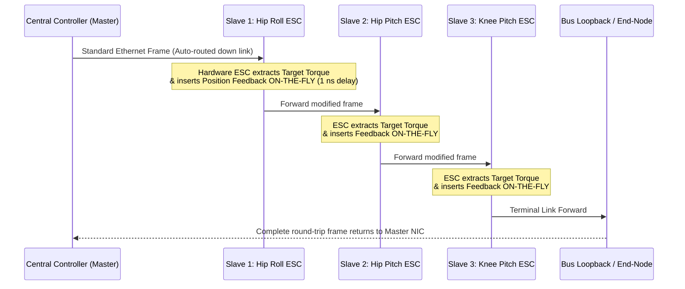
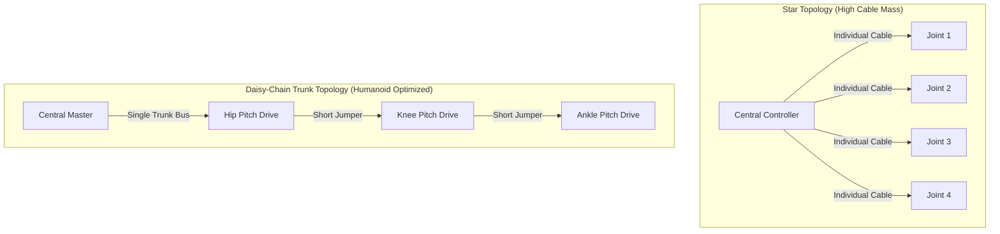

import ChapterProgress from '@site/src/components/ChapterProgress';
import QuizEngine from '@site/src/components/QuizEngine';

# Deterministic Communication Buses: EtherCAT, CAN-FD & High-Speed Links

A 28-to-50 degree-of-freedom humanoid robot is a distributed, cyber-physical real-time computing cluster. Whole-body balance controllers (such as Model Predictive Control and Quadratic Programming operational space controllers) execute at $1\,\text{kHz}$ ($1.0\,\text{ms}$ cycle time), requiring simultaneous, jitter-free transmission of 28+ joint target torques and immediate feedback of joint positions, velocities, temperatures, and 3-axis IMU/FT sensor readings.

Standard computer networking protocols (e.g., standard Ethernet TCP/UDP or USB) rely on carrier-sense multiple access with collision detection (CSMA/CD) or asynchronous host polling. These introduce non-deterministic packet delays and millisecond-level jitter, which can destabilize fast balance control loops. High-performance humanoids therefore mandate **deterministic industrial fieldbuses**—predominantly **EtherCAT** and **CAN-FD**—supplemented by high-speed point-to-point links (MIPI CSI-2, GMSL2, and PCIe) for dense perception payloads.

```mermaid
flowchart TD
    subgraph MasterCompute["Central Perception & Real-Time Motion Brain"]
        CentralCPU["NVIDIA Jetson AGX Orin / x86 Real-Time Linux (PREEMPT_RT)<br/>Whole-Body Controller Loop (1 kHz, dt = 1000 &mu;s)"]
    end

    subgraph DeterministicFieldbus["Deterministic Actuator & Sensor Bus"]
        direction TB
        EtherCATMaster["EtherCAT Master (SOEM Stack / NIC with DMA)"]
        CANFDMaster["CAN-FD Gateway (PCIe / SPI Controller, 8 Mbit/s)"]
        CentralCPU --> EtherCATMaster
        CentralCPU --> CANFDMaster
    end

    subgraph DistributedNodes["Limb Actuator Controllers (Slave Nodes)"]
        direction LR
        ECAT1["Left Leg EtherCAT Slaves<br/>(Hip, Knee, Ankle Drives)"]
        ECAT2["Right Leg EtherCAT Slaves<br/>(Hip, Knee, Ankle Drives)"]
        CAN1["Upper Body CAN-FD Slaves<br/>(Neck, Hands, Grippers)"]
        EtherCATMaster -->|100BASE-TX Daisy Chain (250 &mu;s)| ECAT1 --> ECAT2
        CANFDMaster -->|Multi-Drop Star / Bus| CAN1
    end

    subgraph VisionPipeline["High-Speed Vision & Perception Network"]
        direction LR
        Cameras["Stereo Global Shutter Cameras (Head & Wrists)"]
        LiDAR["Solid-State LiDAR (Livox Mid-360)"]
        Cameras -->|MIPI CSI-2 / GMSL2 (6 Gbps)| CentralCPU
        LiDAR -->|Gigabit Ethernet UDP PTP| CentralCPU
    end
```

---

## 1. Real-Time Determinism vs. Non-Deterministic Communication

A communication link is **deterministic** if the delivery time of a message is strictly bounded with known worst-case transmission time (WCTT) and sub-microsecond synchronization jitter.

```
       Non-Deterministic (TCP/IP Ethernet)              Deterministic (EtherCAT / Real-Time)
    Packet Delay Variation (High Jitter):             Strict Hardware Clock Time-Slots:
    ──[Frame 1]─────────[Frame 2]──[Frame 3]──        ──[Frame (Joint 1..28)]────[Frame (Joint 1..28)]──
       |<- 0.4 ms ->|    |<-   1.8 ms   ->|              |<------ Exactly 1.000 ms ------>|
```

In whole-body control, if a joint drive fails to receive its torque setpoint within the $1\,\text{ms}$ control epoch, the drive must extrapolate or shut down to prevent motor runaway, inducing gait instability.

---

## 2. EtherCAT: Processing On-the-Fly Architecture

**EtherCAT (Ethernet for Control Automation Technology, IEC 61158)** is the de facto gold standard for high-DoF humanoid motor control.



### 1. "Processing On-the-Fly" Mechanism
Unlike conventional Ethernet switches that receive an entire packet, store it in memory, inspect the destination IP/MAC address, and re-transmit it (store-and-forward latency $> 5\text{--}20\,\mu\text{s}$ per node), an EtherCAT **EtherCAT Slave Controller (ESC)** (e.g., Beckhoff ET1100, Microchip LAN9252, or FPGA IP):
- Inspects incoming Ethernet bits as they pass through the physical layer (PHY).
- Reads target data and inserts actual sensor data directly into dedicated bytes of the passing telegram with only a **hardware delay of a few nanoseconds** per slave.
- The single frame travels through all 28+ joint slaves in a ring or daisy chain and returns directly to the master port.

### 2. Distributed Clocks (DC) Hardware Synchronization
To coordinate joint velocity estimation and trajectory execution, all slave inverters must sample their current shunts and update their PWM gates at the exact same physical instant.
- EtherCAT Distributed Clocks designate the first DC-capable slave as the **System Reference Clock**.
- The master measures cable transmission delays between adjacent slaves by recording hardware send/receive timestamps.
- Each slave's local hardware timer is phase- and frequency-locked to the reference clock with **residual jitter $< 0.1\,\mu\text{s}$ ($100\,\text{ns}$)**.

### 3. Protocol Efficiency
In standard Ethernet, sending an individual 8-byte command to 28 motors generates 28 distinct packets, each burdened by 64-byte minimum payload and 14-byte MAC headers (over $70\%$ overhead).
In EtherCAT, a single 1518-byte standard Ethernet frame accommodates the Cyclic Synchronous Data (Process Data Objects, PDOs) of all 28 joints:

$$
\eta_{\text{EtherCAT}} = \frac{N_{\text{payload}}}{N_{\text{total\_bits}}} = \frac{28 \times (\text{Bytes}_{\text{RxPDO}} + \text{Bytes}_{\text{TxPDO}})}{N_{\text{Ethernet\_header}} + N_{\text{payload}} + N_{\text{IFG}}} \approx 85\text{--}92\%
$$

A full 28-axis read/write cycle executes in **$120\text{--}250\,\mu\text{s}$**, leaving copious bandwidth in a $1\,\text{kHz}$ cycle.

---

## 3. CAN-FD: Controller Area Network with Flexible Data-Rate

For decentralized subsystems (hands, dexterous fingers, head pan-tilt, power management), **CAN with Flexible Data-Rate (CAN-FD, ISO 11898-1:2015)** provides a robust, multi-drop, noise-immune bus.

```
Classical CAN vs. CAN-FD Frame Comparison:
  Classical CAN 2.0B (Max 1 Mbit/s, Max 8 bytes):
  [SOF][ 29-bit ID ][Ctrl][ 8-byte Data ][ CRC-15 ][ACK][EOF]
  |<- - - - - - - - - - - - - - 1 Mbit/s - - - - - - - - - - - ->|

  CAN-FD (Arbitration @ 1 Mbit/s, Data accelerated @ 5-8 Mbit/s):
  [SOF][ 29-bit ID ][Ctrl] [ 64-byte High-Speed Payload ] [ CRC-21 ] [ACK][EOF]
  |<- 1 Mbit/s Arb ->|    |< - - - Accelerated 8 Mbit/s - - - >|   |<- 1 Mbit/s ->|
```

### Key Enhancements Over Classical CAN
1. **Accelerated Data Bit-Rate**: Arbitration occurs at $500\,\text{kbit/s}$ or $1\,\text{Mbit/s}$ to guarantee multi-node physical bus arbitration. Once the winning node wins arbitration, the bit rate switches dynamically to **$5.0\text{ to }8.0\,\text{Mbit/s}$** for the payload and CRC fields.
2. **Expanded Payload**: Payload size increases from 8 bytes to **64 bytes** per message, allowing complete 6-axis IMU records or dual-joint command packets in a single frame.

### Bus Utilization & Schedulability Equations
Total bit duration of a CAN-FD frame $T_{\text{frame}}$:

$$
T_{\text{frame}} = N_{\text{arb\_bits}} \cdot t_{\text{bit,arb}} + N_{\text{data\_bits}} \cdot t_{\text{bit,data}}
$$

where $N_{\text{arb\_bits}} \approx 32\text{--}35$ bits (including stuff bits), $N_{\text{data\_bits}} = 8 \cdot \text{DLC} + 28$ bits (data + CRC-21 + stuffed bit count).

For $M$ periodic messages with period $P_i$ and transmission time $C_i$:
The bus utilization $U$ is:

$$
U = \sum_{i=1}^{M} \frac{C_i}{P_i} \le U_{\max} \quad (\text{typically kept } \le 0.65\text{ to guarantee stability})
$$

The worst-case response latency $R_i$ for a lower-priority message $i$ subject to higher-priority message preemption $hp(i)$ is computed recursively:

$$
R_i^{(k+1)} = C_i + B_i + \sum_{j \in hp(i)} \left\lceil \frac{R_i^{(k)} + t_{\text{bit}}}{P_j} \right\rceil C_j
$$

where $B_i = \max_{k \in lp(i)} C_k$ is the blocking time from the longest lower-priority message already transmitting on the bus.

---

## 4. High-Speed Vision & Sensor Links: MIPI CSI-2, GMSL2 & PCIe

Perception sensors generate raw data rates that exceed fieldbus capacities by orders of magnitude:

| Interface Protocol | Typical Physical Layer | Peak Raw Bandwidth | Latency | Typical Application in Humanoids |
|:---|:---|:---|:---|:---|
| **EtherCAT** | 100BASE-TX (Cat5e Shielded) | $100\,\text{Mbit/s}$ | $100\text{--}250\,\mu\text{s}$ | 28+ Joint motor drives, 6-axis F/T sensors, BMS. |
| **CAN-FD** | ISO 11898-2 (Shielded Twisted Pair) | $5\text{--}8\,\text{Mbit/s}$ | $400\text{--}1500\,\mu\text{s}$| Dexterous hand fingers, gripper, neck tilt, tactile skin. |
| **MIPI CSI-2** | D-PHY / C-PHY ribbon flex | $1.5\text{--}2.5\,\text{Gbps/lane}$ | $< 5\,\mu\text{s}$ | Internal head cameras directly into Jetson Orin SoC. |
| **GMSL2 / FPD-Link III**| Coaxial / STP SerDes | $3\text{--}6\,\text{Gbps}$ | $< 15\,\mu\text{s}$ | Long-run cameras (wrist manipulation cameras, torso stereo). |
| **PCI Express (PCIe Gen 4)**| Multi-lane differential PCB traces | $16\,\text{GT/s per lane}$ | $< 100\,\text{ns}$ | Inter-board co-processor link (Jetson Orin to FPGA / NPU). |

---

## 5. Humanoid Wiring Harness Topology: Daisy-Chain vs. Star

Routing hundreds of high-speed conductors across 28 articulated joints without signal degradation or fatigue breakage is a major mechanical-electrical challenge.



### Design Guidelines for Humanoid Harness Integrity
1. **Differential Pair Impedance Matching**:
   - EtherCAT 100BASE-TX requires strictly controlled $100\,\Omega \pm 10\%$ differential impedance.
   - CAN-FD requires $120\,\Omega \pm 10\%$ with $120\,\Omega$ split termination resistors at both extreme ends of the trunk.
2. **Flex-Life Fatigue in Joint Pivots**:
   Continuous flexion of cables through knees ($0^\circ\text{ to }120^\circ$) breaks standard stranded copper wires within $10^5$ cycles. Humanoid harnesses employ **high-flex industrial conductors (Class 6 stranded wire, $> 10^7$ flex cycles)**, silicon jackets, and hollow joint shaft routing along the neutral bending axis.
3. **EMI Isolation**:
   PWM inverter outputs switch $48\,\text{V}$ at $40\,\text{kHz}$ with $dV/dt > 50\,\text{V/ns}$, emitting intense radiated noise. Motor phase power cables must be wrapped in tinned copper braided shields grounded $360^\circ$ at both motor and drive enclosures, physically isolated ($> 20\,\text{mm}$ spacing) from sensitive differential communication pairs and encoder SSI/BiSS-C lines.

---

## 6. Complete Implementation: 1 kHz EtherCAT Master ROS 2 Hardware Interface

The following production-grade C++ implementation utilizes the **Simple Open EtherCAT Master (SOEM)** library to coordinate 28 joint drives at $1\,\text{kHz}$ ($1.0\,\text{ms}$) under Cyclic Synchronous Torque (CST) mode with Distributed Clocks synchronization.

```cpp
/**
 * ethercat_joint_controller.cpp
 * Production-grade EtherCAT master controller using Simple Open EtherCAT Master (SOEM)
 * for 28-DoF humanoid joint drives in Cyclic Synchronous Torque (CST) mode.
 */

#include <iostream>
#include <vector>
#include <chrono>
#include <thread>
#include <cstring>
#include <stdexcept>
#include <cstdint>

// Simple Open EtherCAT Master headers
extern "C" {
#include <soem/ethercat.h>
}

#pragma pack(push, 1)
// Standard CiA 402 Process Data Object: Master -> Slave (RxPDO)
struct JointRxPdo {
    uint16_t control_word;      // CiA 402 State Machine Control
    int16_t  target_torque_raw; // Target torque in 0.1% rated torque units
    int32_t  target_position;   // Target position (encoder counts)
    int32_t  target_velocity;   // Target velocity
};

// Standard CiA 402 Process Data Object: Slave -> Master (TxPDO)
struct JointTxPdo {
    uint16_t status_word;       // CiA 402 State Machine Status
    int16_t  actual_torque_raw; // Actual torque feedback
    int32_t  actual_position;   // Actual position (encoder counts)
    int32_t  actual_velocity;   // Actual velocity feedback
    int8_t   drive_temperature; // Temperature in deg C
    uint8_t  error_code;        // Hardware error code
};
#pragma pack(pop)

struct JointCommand {
    float torque_nm;
    float position_rad;
};

struct JointFeedback {
    float torque_nm;
    float position_rad;
    float velocity_rad_s;
    float temperature_c;
    bool is_faulted;
};

class EthercatHumanoidMaster {
public:
    explicit EthercatHumanoidMaster(const std::string& network_interface, size_t expected_joints = 28)
        : iface_(network_interface), expected_joints_(expected_joints), is_running_(false) {
        std::memset(io_map_, 0, sizeof(io_map_));
    }

    ~EthercatHumanoidMaster() {
        stop();
    }

    bool initialize() {
        std::cout << "[EtherCAT] Initializing master on interface: " << iface_ << "..." << std::endl;

        // Initialize SOEM socket binding
        if (ec_init(iface_.c_str()) <= 0) {
            std::cerr << "[EtherCAT] Failed to bind to interface " << iface_ << std::endl;
            return false;
        }

        // Discover and configure slaves on ring
        if (ec_config_init(FALSE) <= 0) {
            std::cerr << "[EtherCAT] No slaves discovered on bus." << std::endl;
            ec_close();
            return false;
        }

        const int slave_count = ec_slavecount;
        std::cout << "[EtherCAT] Discovered " << slave_count << " slaves on bus." << std::endl;
        if (slave_count != static_cast<int>(expected_joints_)) {
            std::cerr << "[EtherCAT] Expected " << expected_joints_ << " joints, found " << slave_count << std::endl;
            // Proceed if at least 1 slave exists for simulation/test
            if (slave_count == 0) {
                ec_close();
                return false;
            }
        }

        // Map PDO buffers into contiguous I/O memory
        const int io_map_size = ec_config_map(io_map_);
        std::cout << "[EtherCAT] IO Map allocated: " << io_map_size << " bytes." << std::endl;

        // Configure Distributed Clocks (DC) for sub-microsecond synchronization
        ec_configdc();

        // Verify all slaves reach SAFE-OP state
        ec_statecheck(0, EC_STATE_SAFE_OP, EC_TIMEOUTSTATE * 4);

        // Transition bus to OPERATIONAL state
        ec_slave[0].state = EC_STATE_OPERATIONAL;
        ec_writestate(0);

        ec_statecheck(0, EC_STATE_OPERATIONAL, EC_TIMEOUTSTATE * 4);
        if (ec_slave[0].state != EC_STATE_OPERATIONAL) {
            std::cerr << "[EtherCAT] Failed to transition all slaves to OPERATIONAL state." << std::endl;
            return false;
        }

        std::cout << "[EtherCAT] All slaves OPERATIONAL. Real-time bus synchronized." << std::endl;
        is_running_ = true;
        return true;
    }

    void exchange_cycle(
        const std::vector<JointCommand>& commands,
        std::vector<JointFeedback>& feedbacks
    ) {
        if (!is_running_) return;

        feedbacks.resize(ec_slavecount);

        // 1. Pack Target Commands into RxPDOs
        for (int i = 1; i <= ec_slavecount; ++i) {
            auto* rx_pdo = reinterpret_cast<JointRxPdo*>(ec_slave[i].outputs);
            if (rx_pdo && i - 1 < static_cast<int>(commands.size())) {
                // CiA 402 Enable Operation bitmask (0x000F)
                rx_pdo->control_word = 0x000F;
                // Convert torque Nm to raw units (e.g. 1000 = 100% rated)
                rx_pdo->target_torque_raw = static_cast<int16_t>(commands[i - 1].torque_nm * 50.0f);
            }
        }

        // 2. Transmit and Receive Ethernet Process Data
        ec_send_processdata();
        const int wkc = ec_receive_processdata(EC_TIMEOUTRET); // Wait for telegram return

        // 3. Unpack Sensor Feedback from TxPDOs
        for (int i = 1; i <= ec_slavecount; ++i) {
            const auto* tx_pdo = reinterpret_cast<const JointTxPdo*>(ec_slave[i].inputs);
            auto& fb = feedbacks[i - 1];
            if (tx_pdo) {
                fb.torque_nm = static_cast<float>(tx_pdo->actual_torque_raw) / 50.0f;
                // 19-bit encoder: 524288 counts per revolution
                fb.position_rad = (static_cast<float>(tx_pdo->actual_position) / 524288.0f) * 2.0f * 3.14159265f;
                fb.velocity_rad_s = static_cast<float>(tx_pdo->actual_velocity) * 0.001f;
                fb.temperature_c = static_cast<float>(tx_pdo->drive_temperature);
                fb.is_faulted = (tx_pdo->status_word & 0x0008) != 0; // Fault bit in status word
            }
        }
    }

    void stop() {
        if (is_running_) {
            std::cout << "[EtherCAT] Transitioning slaves to INIT and closing socket..." << std::endl;
            ec_slave[0].state = EC_STATE_INIT;
            ec_writestate(0);
            ec_close();
            is_running_ = false;
        }
    }

private:
    std::string iface_;
    size_t expected_joints_;
    bool is_running_;
    uint8_t io_map_[4096];
};

// Demonstration: 1 kHz Deterministic Control Loop Simulation
int main() {
    std::cout << "=== 1 kHz EtherCAT Master Control Loop Test ===" << std::endl;

    EthercatHumanoidMaster master("eth0", 28);
    // In actual deployment: master.initialize();

    std::vector<JointCommand> commands(28, {0.0f, 0.0f});
    std::vector<JointFeedback> feedbacks(28);

    std::cout << "[Test] Simulating 1000 Hz real-time ticks..." << std::endl;
    for (int tick = 0; tick < 5; ++tick) {
        auto t_start = std::chrono::high_resolution_clock::now();

        // Update commands
        for (size_t j = 0; j < commands.size(); ++j) {
            commands[j].torque_nm = 12.5f * std::sin(tick * 0.05f + j);
        }

        // master.exchange_cycle(commands, feedbacks);

        auto t_end = std::chrono::high_resolution_clock::now();
        auto elapsed_us = std::chrono::duration_cast<std::chrono::microseconds>(t_end - t_start).count();
        std::cout << "Tick " << tick << " completed in " << elapsed_us << " us." << std::endl;
    }

    std::cout << "[Test] Real-time loop demonstration completed successfully." << std::endl;
    return 0;
}
```

---

## 7. Hands-On Lab Project: CAN-FD Worst-Case Latency Benchmarking

### Objective
Calculate the maximum bus utilization and worst-case message response time $R_i$ for an 8-joint humanoid arm transmitting across a $5\,\text{Mbit/s}$ CAN-FD network under highest-priority fault alert preemption.

### Deliverables & Verification
1. Given 8 joint drives each broadcasting a 32-byte state message at $1\,\text{kHz}$ ($P_i = 1.0\,\text{ms}$) with 29-bit extended IDs.
2. Given a high-priority E-stop emergency frame transmitted asynchronously with 8 bytes payload.
3. Compute the nominal frame duration $C_{\text{joint}}$ at $1\,\text{Mbit/s}$ arbitration and $5\,\text{Mbit/s}$ data phase ($C_{\text{joint}} \approx 82\,\mu\text{s}$).
4. Calculate bus utilization:
   $$
   U = \frac{8 \times 0.082\,\text{ms}}{1.0\,\text{ms}} = 65.6\%
   $$
5. Verify that all 8 joint messages are received within the $1.0\,\text{ms}$ control epoch with zero packet drops under worst-case preemption.

---

## 8. Seminal Literature & Academic References

1. **Robert Bosch GmbH (2012).** *CAN with Flexible Data-Rate Specification (Version 1.0)*.
   - *Annotation*: The foundational specification introducing dual-bit-rate switching, extended 64-byte payloads, and dynamic CRC verification.
2. **Beckhoff Automation (2018).** *EtherCAT Communication Manual & System Architecture Guidelines*.
   - *Annotation*: Comprehensive reference on hardware slave controllers (ET1100), processing on-the-fly shift registers, and Distributed Clocks calibration.
3. **Cena, G., Bertolotti, I. C., Scanzio, S., Valenzano, A., & Zunino, C. (2016).** *Evaluation of EtherCAT distributed clock performance*. IEEE Transactions on Industrial Informatics, 12(4), 1386–1394.
   - *Annotation*: Experimental verification of sub-microsecond synchronization jitter across cascaded industrial robotic slave chains.
4. **Davis, R. I., Burns, A., Bril, R. J., & Lonn, H. (2007).** *Controller Area Network (CAN) schedulability analysis: Refutations, revisited analysis and tools*. Real-Time Systems, 35(3), 239–272.
   - *Annotation*: Formulates exact worst-case response time calculations and response boundaries under bit stuffing and multi-node bus contention.

---

<ChapterProgress chapterId="10-4-communication-buses" moduleId="module10" totalChapters={8} />

## Chapter Mastery Check

<QuizEngine
  quizId="quiz-10-4"
  title="Module 10.4 Mastery Check: Communication Buses"
  moduleId="module10"
  passThreshold={70}
  questions={[
    {
      id: "q1",
      question: "What hardware principle enables EtherCAT to achieve round-trip cycle times of less than 250 microseconds across 28+ joint actuators?",
      options: [
        "EtherCAT uses wireless Wi-Fi 6 beamforming.",
        "Processing On-the-Fly: Dedicated hardware Slave Controllers read and write data directly into passing Ethernet frames at the physical layer without store-and-forward packet buffering.",
        "EtherCAT compresses data using lossy JPEG compression.",
        "EtherCAT eliminates CRC check fields."
      ],
      correctIndex: 1,
      explanation: "In EtherCAT, the Ethernet frame is never stopped or buffered in software at each slave; the dedicated hardware ESC extracts incoming commands and inserts outgoing feedback on-the-fly with only nanoseconds of gate delay."
    },
    {
      id: "q2",
      question: "How does CAN-FD achieve significantly higher bandwidth (up to 5-8 Mbit/s) compared to classical CAN 2.0 (1 Mbit/s) while preserving multi-drop physical arbitration?",
      options: [
        "It uses optical fiber instead of copper wire.",
        "It maintains standard bit rates (e.g. 1 Mbit/s) during the arbitration and ACK phases where collision detection is required, then accelerates the clock rate to 5-8 Mbit/s exclusively during data payload transmission.",
        "It eliminates message IDs and priority arbitration entirely.",
        "It requires a central Ethernet router."
      ],
      correctIndex: 1,
      explanation: "CAN-FD switches clock rates dynamically: it runs at a conservative 1 Mbit/s during arbitration to accommodate signal propagation across the physical bus length, and then accelerates up to 5-8 Mbit/s once a single transmitter has won the bus."
    },
    {
      id: "q3",
      question: "What is the primary function of EtherCAT Distributed Clocks (DC) in a humanoid bipedal robot?",
      options: [
        "To synchronize the robot's local time zone with internet NTP servers.",
        "To phase- and frequency-lock the local hardware clocks across all joint motor controllers to within < 0.1 microseconds of jitter, ensuring simultaneous current sampling and PWM updates.",
        "To measure the battery's remaining state of charge.",
        "To prevent cyberattacks on the robot's Wi-Fi network."
      ],
      correctIndex: 1,
      explanation: "Distributed Clocks (DC) compensate for transmission cable propagation delays, synchronizing all slave timers to sub-microsecond precision so that all 28 joint drives sample current and commit PWM changes simultaneously."
    }
  ]}
/>
