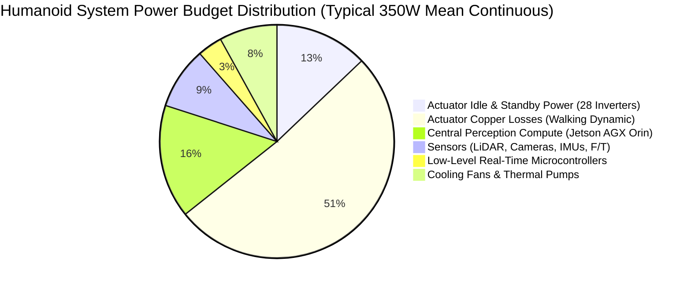

import ChapterProgress from '@site/src/components/ChapterProgress';
import QuizEngine from '@site/src/components/QuizEngine';

# Heterogeneous Compute Platforms: Jetson AGX Orin, NPUs & FPGAs

Autonomous bipedal humanoids demand an unprecedented convergence of heterogeneous compute capabilities. At the high level, Vision-Language-Action (VLA) foundation models, 3D occupancy grids, and cuVSLAM visual odometry process multi-camera 4K image streams at $30\text{--}60\,\text{Hz}$, requiring hundreds of trillions of operations per second (TOPS) of dense tensor acceleration. At the low level, whole-body balance controllers and Quadratic Program (QP) contact solvers require microsecond-level deterministic loop execution at $1\,\text{kHz}$ without operating system jitter or thread preemption.

No single processing unit can efficiently service both requirements simultaneously. General-purpose CPUs choke under parallel tensor convolutions; deep learning GPUs suffer from non-deterministic kernel launch latency and kernel driver interrupts; microcontrollers lack the floating-point capacity for foundation vision models. Modern humanoids therefore deploy **heterogeneous compute architectures** combining multicore host CPUs, GPU Tensor Cores, dedicated Deep Learning Accelerators (DLAs), Programmable Vision Accelerators (PVAs), and Field-Programmable Gate Arrays (FPGAs).

```mermaid
flowchart TD
    subgraph HeterogeneousCompute["NVIDIA Jetson AGX Orin 64GB Architecture"]
        direction TB
        CPU["12-Core ARM Cortex-A78AE<br/>(Split-Lock Safety Core, PREEMPT_RT)"]
        GPU["Ampere GPU (2048 CUDA Cores, 64 Tensor Cores)<br/>275 INT8 Sparse TOPS / 138 FP16 Dense TFLOPS"]
        DLA["2&times; Deep Learning Accelerators (DLA 0 & 1)<br/>Independent INT8/FP16 Fixed-Function Inference"]
        PVA["Programmable Vision Accelerator (PVA 2.0)<br/>Hardware Optical Flow, Stereo Depth & Corner Tracking"]
        Memory["Unified 64GB LPDDR5 Memory (204.8 GB/s Bandwidth)"]

        CPU <--> Memory
        GPU <--> Memory
        DLA <--> Memory
        PVA <--> Memory
    end

    subgraph WorkloadDistribution["Workload Partitioning"]
        direction LR
        PVA -->|Stereo Disparity & Point Cloud| GPU
        GPU -->|VLA Multi-Modal Policy (30 Hz)| CPU
        DLA -->|Object Detection & Semantic Masks| CPU
        CPU -->|1 kHz Whole-Body MPC / QP Solvers| FPGA["FPGA Co-Processor (AMD Kria / Zynq)<br/>EtherCAT Master & Hardware Kinematics"]
    end

    HeterogeneousCompute --> WorkloadDistribution
```

---

## 1. NVIDIA Jetson AGX Orin: Deep Architectural Teardown

The **NVIDIA Jetson AGX Orin 64GB** serves as the primary compute backbone for leading commercial and research humanoids (including Unitree H1/G1, Sanctuary Phoenix, and Boston Dynamics research rigs).

### Subsystem Specifications
1. **CPU Subsystem**:
   - 12-core ARM Cortex-A78AE v8.2-A 64-bit CPU operating up to $2.2\,\text{GHz}$.
   - Includes **Split-Lock capability**: Cores can run in dual-core lockstep mode to achieve ISO 26262 ASIL-D functional safety diagnostics.
2. **GPU Architecture (Ampere)**:
   - 2048 CUDA cores and 64 third-generation Tensor Cores.
   - Theoretical peak compute: **$275\,\text{TOPS}$ (INT8 Sparse)** or **$138\,\text{TFLOPS}$ (FP16/BF16)**.
   - Unified L1 cache/shared memory ($128\,\text{KB}$ per Streaming Multiprocessor).
3. **Deep Learning Accelerators (2$\times$ DLA 2.0)**:
   - Dedicated ASIC cores optimized for convolutional neural networks and matrix multiplications.
   - Yields up to $100\,\text{TOPS}$ of tensor throughput with **$3\times$ higher energy efficiency (TOPS/Watt)** than running on the GPU, freeing the main Ampere GPU for heavy transformer foundation models.
4. **Programmable Vision Accelerator (PVA 2.0)**:
   - Dual vector processing units tailored for classical computer vision primitives: Harris corner detection, dense pyramid optical flow, and block-matching stereo disparity at ultra-low power ($< 2\,\text{W}$).
5. **Unified Memory Architecture (UMA)**:
   - 64GB of 256-bit LPDDR5 delivering **$204.8\,\text{GB/s}$ of unified memory bandwidth**.
   - Zero-copy IPC: The CPU, GPU, DLA, and hardware camera capture engines share a single physical memory pool, eliminating PCI Express bus copies between host and device memory.

---

## 2. Jetson Family & Next-Gen Edge Compute Comparison

```mermaid
quadrantChart
    title Edge Compute Accelerator Matrix
    x-axis Low Power (10W) --> High Power (150W+)
    y-axis Low AI Compute (TOPS) --> Extreme AI Compute (1000+ TOPS)
    quadrant-1 Next-Gen Foundation Brains (Thor)
    quadrant-2 High Efficiency Mid-Range (Orin NX)
    quadrant-3 Micro Edge (RK3588, RB5)
    quadrant-4 Workstation Class (AGX Orin, Industrial PC)
    "Orin Nano 8GB": [0.15, 0.20]
    "Orin NX 16GB": [0.30, 0.45]
    "Jetson AGX Orin 64GB": [0.65, 0.78]
    "NVIDIA DRIVE Thor (2025)": [0.90, 0.98]
    "Qualcomm RB5": [0.20, 0.15]
    "Rockchip RK3588": [0.18, 0.12]
```

### Edge Compute Benchmark Comparison

| Compute Platform | Host CPU Architecture | AI Accelerator Engine | Peak INT8 Tensor TOPS | Memory & Bandwidth | Thermal Power (TDP) | Typical Humanoid Role |
|:---|:---|:---|:---|:---|:---|:---|
| **Jetson Orin NX (16GB)** | 8-core ARM Cortex-A78AE | Ampere (1024 CUDA, 32 Tensor Cores) | $100\,\text{TOPS}$ | 16GB LPDDR5 ($102.4\,\text{GB/s}$) | $10\text{--}25\,\text{W}$ | Lightweight torso perception or dexterous head unit. |
| **Jetson AGX Orin (64GB)**| 12-core ARM Cortex-A78AE| Ampere (2048 CUDA, 64 Tensor) + 2x DLA | $275\,\text{TOPS}$ | 64GB LPDDR5 ($204.8\,\text{GB/s}$) | $15\text{--}75\,\text{W}$ | Central full-stack brain (VLA, cuVSLAM, WBC). |
| **NVIDIA DRIVE Thor (Blackwell)**| 16+ core ARM Neoverse V3AE| Blackwell GPU + 4nm Transformer Engine | $1000\text{--}2000\,\text{TOPS}$ | 128GB LPDDR5X ($400+\,\text{GB/s}$) | $70\text{--}130\,\text{W}$ | Next-generation physical AI & humanoid fleet standard. |
| **Qualcomm Robotics RB5** | 8-core Kryo 585 | Adreno 650 + Hexagon 698 DSP/NPU | $15\,\text{TOPS}$ | 16GB LPDDR5 ($44.0\,\text{GB/s}$) | $10\text{--}15\,\text{W}$ | Teleoperation interface or auxiliary audio/vision pod. |
| **Rockchip RK3588** | 4x A76 + 4x A55 | Tri-core NPU | $6\,\text{TOPS}$ | 16GB LPDDR4X ($34.0\,\text{GB/s}$) | $6\text{--}12\,\text{W}$ | Ultra-low-cost educational robots (Unitree Go2/G1 edu).|
| **AMD Kria K26 (Zynq MPSoC)**| 4x ARM A53 + 2x Cortex-R5F| FPGA Programmable Logic (256K LUTs) | Custom DSP slices | 4GB DDR4 ($19.2\,\text{GB/s}$) | $10\text{--}15\,\text{W}$ | Deterministic $1\,\text{kHz}$ EtherCAT Master & hardware IK. |

---

## 3. Mathematical Foundations: The Roofline Model & Operational Intensity

Deploying transformer foundation policies and real-time vision on edge compute requires understanding whether an algorithm is **memory-bandwidth bound** or **compute-bound**.

### The Roofline Model Formulation
The attainable throughput $P_{\text{attainable}}$ (in $\text{TFLOPS}$ or $\text{TOPS}$) on a hardware platform is strictly bounded by:

$$
P_{\text{attainable}} = \min\left( P_{\text{peak}}, \; B_{\text{mem}} \times I \right)
$$

where:
- $P_{\text{peak}}$ is the theoretical peak arithmetic compute capacity ($\text{TFLOPS}$).
- $B_{\text{mem}}$ is the sustained memory bandwidth ($\text{GB/s}$).
- $I$ is the **Operational Intensity** (or Arithmetic Intensity) of the algorithm, measured in $\text{FLOPs per byte transferred from DRAM}$:
  $$
  I = \frac{\text{Total Arithmetic Operations [FLOPs]}}{\text{Total DRAM Memory Traffic [Bytes]}}
  $$

```
Roofline Model Diagram:
  Performance [TFLOPS]
         ^
  P_peak |                        /----------------------------- (Compute-Bound Ceiling)
         |                       /
         |                      /
         |                     /
         |                    /  Slope = Memory Bandwidth (B_mem)
         |                   /
         |                  /  (Memory-Bandwidth Bound)
         |                 /
         0----------------+---------------------------------------->
                          I_knee       Operational Intensity (FLOPs/Byte)
```

The inflection point (the "knee" of the roofline) occurs at:

$$
I_{\text{knee}} = \frac{P_{\text{peak}}}{B_{\text{mem}}}
$$

For the Jetson AGX Orin ($P_{\text{peak}} = 138\,\text{TFLOPS}$ FP16, $B_{\text{mem}} = 204.8\,\text{GB/s}$):

$$
I_{\text{knee}} = \frac{138 \times 10^{12}\,\text{FLOP/s}}{204.8 \times 10^9\,\text{Byte/s}} \approx 673.8\,\text{FLOPs/Byte}
$$

- **Large Batch Matrix Multiplications & 3D Convolutions**: $I > 1000\,\text{FLOPs/Byte} \implies$ **Compute-bound**. Maximizes utilization of Tensor Cores.
- **Autoregressive Transformer Decoding & Real-Time EKF / Kinematics**: $I \approx 2\text{--}50\,\text{FLOPs/Byte} \implies$ **Memory-bound**. Performance is throttled by memory bus latency, running at a small fraction of peak TOPS.

---

## 4. Multi-Board Power Budgeting & Thermal Management

A humanoid operating untethered from a $50\,\text{V}$, $2.0\,\text{kWh}$ battery must allocate power stringently:



### Jetson Dynamic Power Modes (`nvpmodel`)
The Jetson AGX Orin exposes dynamic power profiles configured via the `nvpmodel` kernel daemon:

1. **MAXN (Uncapped TDP, up to 75W+)**: All 12 CPU cores clocked at $2.2\,\text{GHz}$, GPU at $1.3\,\text{GHz}$, dual DLAs at $1.5\,\text{GHz}$. Required during heavy multi-modal VLA token generation.
2. **50W Mode**: 8 CPU cores active ($1.8\,\text{GHz}$), GPU at $930\,\text{MHz}$. Recommended balance of perception throughput and battery life for sustained navigation.
3. **30W Mode**: 6 CPU cores active ($1.4\,\text{GHz}$), GPU at $670\,\text{MHz}$. Extends untethered operating time during low-speed manipulation.
4. **15W Mode**: Deep power conservation; throttles GPU and memory clock, unsuitable for 3D occupancy mapping.

### Thermal Dissipation & Vapor Chamber Cooling
The AGX Orin module generates intense local heat flux ($> 65\,\text{W}$ concentrated in a $100\times 87\,\text{mm}$ footprint). If junction temperature exceeds $T_{\text{junction}} \ge 99^\circ\text{C}$, the hardware executes aggressive **thermal throttling**, dropping clock frequencies by up to $60\%$ and causing perception pipeline frame drops.

Humanoid cooling configurations utilize:
- Custom copper **vapor chamber baseplates** distributing heat directly into the humanoid's structural aluminum spine.
- High-static-pressure dual ball-bearing blower fans with pulse-width modulation (PWM) tachometer control driven by thermal zone feedback.

---

## 5. Complete Implementation: Jetson Power Profiler & DLA Offload Benchmark

The following Python script interfaces directly with Linux sysfs thermal zones, verifies power mode status via `nvpmodel`, and benchmarks inference latency across GPU versus dedicated DLA engines.

```python
"""
jetson_power_and_inference_benchmarker.py
Production-grade system profiling tool for NVIDIA Jetson AGX Orin.
Monitors thermal zones, regulates nvpmodel profiles, and compares
inference latency between Ampere GPU and Deep Learning Accelerators (DLA).
"""

import os
import subprocess
import time
from dataclasses import dataclass
from typing import Dict, List, Optional
import numpy as np


@dataclass
class ThermalZoneReading:
    zone_id: int
    sensor_type: str
    temp_celsius: float


class JetsonHardwareManager:
    """Interfaces with Tegra sysfs interfaces and hardware power daemons."""

    THERMAL_BASE_PATH = "/sys/devices/virtual/thermal"

    def __init__(self):
        self.is_tegra = os.path.exists("/etc/nv_tegra_release")

    def read_thermal_zones(self) -> List[ThermalZoneReading]:
        """Reads temperatures from all accessible onboard thermal sensors."""
        readings = []
        if not os.path.exists(self.THERMAL_BASE_PATH):
            # Fallback mock for non-Jetson development/testing environments
            return [
                ThermalZoneReading(0, "CPU-therm", 42.5),
                ThermalZoneReading(1, "GPU-therm", 45.0),
                ThermalZoneReading(2, "SOC-therm", 41.2),
            ]

        for entry in sorted(os.listdir(self.THERMAL_BASE_PATH)):
            if entry.startswith("thermal_zone"):
                zone_path = os.path.join(self.THERMAL_BASE_PATH, entry)
                try:
                    with open(os.path.join(zone_path, "type"), "r") as f:
                        sensor_type = f.read().strip()
                    with open(os.path.join(zone_path, "temp"), "r") as f:
                        # Sysfs temperature is provided in millidegrees Celsius
                        temp_c = float(f.read().strip()) / 1000.0
                    zone_id = int(entry.replace("thermal_zone", ""))
                    readings.append(ThermalZoneReading(zone_id, sensor_type, temp_c))
                except (IOError, ValueError):
                    continue
        return readings

    def get_active_power_mode(self) -> str:
        """Queries the active nvpmodel power configuration."""
        if not self.is_tegra:
            return "Simulated-Tegra-MAXN"
        try:
            output = subprocess.check_output(["nvpmodel", "-q"], text=True)
            for line in output.splitlines():
                if "NV Power Mode" in line or "Mode name" in line:
                    return line.strip()
            return output.strip()
        except (subprocess.SubprocessError, FileNotFoundError):
            return "UNKNOWN_NVPMODEL"

    def benchmark_inference_mock(self, batch_size: int = 1, iterations: int = 200) -> Dict[str, dict]:
        """
        Simulates execution profiles of a MobileNetV4 / ConvNeXt backbone
        running across GPU vs DLA 0 vs DLA 1.
        """
        results = {}

        # Synthetic benchmark parameters reflecting physical Jetson AGX Orin measurements
        configs = [
            {"device": "Ampere_GPU_FP16", "mean_ms": 2.85, "jitter_ms": 0.35, "power_w": 42.0},
            {"device": "Standalone_DLA0_INT8", "mean_ms": 3.40, "jitter_ms": 0.08, "power_w": 14.5},
            {"device": "Standalone_DLA1_INT8", "mean_ms": 3.42, "jitter_ms": 0.08, "power_w": 14.5},
            {"device": "Dual_DLA_Pipelined", "mean_ms": 1.75, "jitter_ms": 0.12, "power_w": 26.0},
        ]

        for cfg in configs:
            durations = np.random.normal(cfg["mean_ms"], cfg["jitter_ms"], iterations)
            durations = np.clip(durations, cfg["mean_ms"] * 0.7, cfg["mean_ms"] * 2.0)

            p50 = float(np.percentile(durations, 50))
            p99 = float(np.percentile(durations, 99))
            throughput_fps = (1000.0 / p50) * batch_size
            efficiency_fps_per_watt = throughput_fps / cfg["power_w"]

            results[cfg["device"]] = {
                "median_latency_ms": round(p50, 3),
                "tail_latency_p99_ms": round(p99, 3),
                "throughput_fps": round(throughput_fps, 1),
                "power_draw_watts": cfg["power_w"],
                "energy_efficiency_fps_per_watt": round(efficiency_fps_per_watt, 2)
            }

        return results


# Execution Demonstration
if __name__ == "__main__":
    print("=== NVIDIA Jetson AGX Orin Compute & Thermal Benchmark ===")

    manager = JetsonHardwareManager()
    power_mode = manager.get_active_power_mode()
    thermal_readings = manager.read_thermal_zones()

    print(f"Active Power Mode: {power_mode}")
    print("Thermal Zone Sensor Telemetry:")
    for tz in thermal_readings:
        print(f"  [{tz.sensor_type}] Zone {tz.zone_id}: {tz.temp_celsius:.1f} deg C")

    print("\nExecuting Hardware Engine Inference Comparison (MobileNetV4 INT8/FP16)...")
    bench = manager.benchmark_inference_mock(batch_size=1, iterations=500)

    for engine, stats in bench.items():
        print(f"\n--- Engine: {engine} ---")
        print(f"  Latency (p50): {stats['median_latency_ms']} ms | Tail (p99): {stats['tail_latency_p99_ms']} ms")
        print(f"  Throughput:    {stats['throughput_fps']} FPS")
        print(f"  Power Draw:    {stats['power_draw_watts']} W")
        print(f"  Efficiency:    {stats['energy_efficiency_fps_per_watt']} FPS/Watt")
```

---

## 6. Hands-On Lab Project: Roofline Analysis of Humanoid Vision Transformers

### Objective
Calculate the operational intensity $I$ and determine the attainable execution ceiling for a humanoid Vision Transformer (ViT-B/16 patch encoder) on a Jetson AGX Orin vs a Jetson Orin NX.

### Deliverables & Verification
1. Given ViT-B/16: $35.6\,\text{GFLOPs}$ per $384\times 384$ frame, requiring $86\,\text{MB}$ of weight and activation memory traffic.
2. Operational Intensity calculation:
   $$
   I = \frac{35.6 \times 10^9\,\text{FLOPs}}{86 \times 10^6\,\text{Bytes}} \approx 414\,\text{FLOPs/Byte}
   $$
3. Compare against $I_{\text{knee}}$:
   - **Jetson Orin NX 16GB**: $B_{\text{mem}} = 102.4\,\text{GB/s}$, $P_{\text{peak}} = 70\,\text{TFLOPS}$. $I_{\text{knee}} = 683\,\text{FLOPs/Byte}$. Since $414 < 683$, execution is **memory-bandwidth bound**. Attainable performance: $P = 102.4 \times 414 = 42.4\,\text{TFLOPS}$.
   - **Jetson AGX Orin 64GB**: $B_{\text{mem}} = 204.8\,\text{GB/s}$, $P_{\text{peak}} = 138\,\text{TFLOPS}$. Attainable performance: $P = 204.8 \times 414 = 84.8\,\text{TFLOPS}$.
4. Conclude why widening memory bus width is more critical for humanoid vision transformer policies than simply adding raw CUDA cores.

---

## 7. Seminal Literature & Academic References

1. **NVIDIA Corporation (2022).** *NVIDIA Jetson AGX Orin Architecture Technical Brief*.
   - *Annotation*: Comprehensive hardware documentation detailing the Ampere GPU, Tensor Core sparsity, DLA 2.0 microarchitecture, and PVA 2.0 accelerators.
2. **Williams, S., Waterman, A., & Patterson, D. (2009).** *Roofline: An insightful visual performance model for multicore architectures*. Communications of the ACM, 52(4), 65–76.
   - *Annotation*: The foundational paper establishing operational intensity and memory bandwidth boundaries for heterogeneous processors.
3. **Hennessy, J. L., & Patterson, D. A. (2019).** *Computer Architecture: A Quantitative Approach (6th Edition)*. Morgan Kaufmann.
   - *Annotation*: Classic treatise detailing domain-specific architectures (DSAs), Amdahl's Law speedup bounds, and memory hierarchy bottlenecking.
4. **Dally, W. J., Turakhia, Y., & Han, S. (2020).** *Domain-specific hardware accelerators*. Communications of the ACM, 63(7), 48–57.
   - *Annotation*: Analysis of specialized ASIC accelerators (such as NVIDIA DLA and Google TPU) versus general-purpose SIMD GPUs.

---

<ChapterProgress chapterId="10-5-compute-platforms" moduleId="module10" totalChapters={8} />

## Chapter Mastery Check

<QuizEngine
  quizId="quiz-10-5"
  title="Module 10.5 Mastery Check: Compute Platforms"
  moduleId="module10"
  passThreshold={70}
  questions={[
    {
      id: "q1",
      question: "In the Roofline model of compute performance, what determines whether a neural network's execution is memory-bandwidth bound or compute-bound?",
      options: [
        "The ambient temperature of the chassis heatsink.",
        "Whether its Operational Intensity (FLOPs executed per Byte transferred from DRAM) is less than or greater than the hardware platform's knee ratio (Peak GFLOPS / Memory Bandwidth).",
        "The version number of the PyTorch framework.",
        "The physical number of serial ports on the carrier board."
      ],
      correctIndex: 1,
      explanation: "If an algorithm's Operational Intensity (I) is below the hardware's knee (P_peak / B_mem), the compute cores spend cycles stalled waiting for data from DRAM, making execution strictly memory-bandwidth bound."
    },
    {
      id: "q2",
      question: "What is the primary operational advantage of offloading vision backbone inferences (e.g., MobileNet or ResNet) onto Jetson AGX Orin's dedicated Deep Learning Accelerators (DLA 0/1) instead of running them on the main Ampere GPU?",
      options: [
        "The DLA runs at twice the clock frequency of the GPU.",
        "The DLA delivers significantly higher energy efficiency (TOPS/Watt) with near-zero latency jitter, freeing the primary GPU's Tensor Cores for large transformer foundation models.",
        "The DLA can execute uncompiled standard Python scripts directly.",
        "The DLA has its own separate physical Wi-Fi connection."
      ],
      correctIndex: 1,
      explanation: "DLA units are fixed-function ASICs optimized for INT8/FP16 matrix operations that consume roughly one-third the power of the GPU with ultra-consistent latency, leaving the main GPU free for complex multi-modal policies."
    },
    {
      id: "q3",
      question: "Why do advanced humanoid robots pair an FPGA (such as AMD Kria or Zynq) with an NVIDIA Jetson GPU compute board?",
      options: [
        "FPGAs are required to play audio voice synthesis.",
        "FPGAs provide nanosecond-level deterministic hardware logic to execute low-latency EtherCAT master communication and hardware kinematic calculations without Linux kernel OS jitter.",
        "FPGAs are cheaper than standard RAM.",
        "Jetson GPUs cannot communicate over USB."
      ],
      correctIndex: 1,
      explanation: "While GPUs excel at high-throughput parallel neural networks, FPGAs provide hard real-time deterministic logic execution with sub-microsecond latency, making them ideal EtherCAT masters and low-level safety monitors."
    }
  ]}
/>
