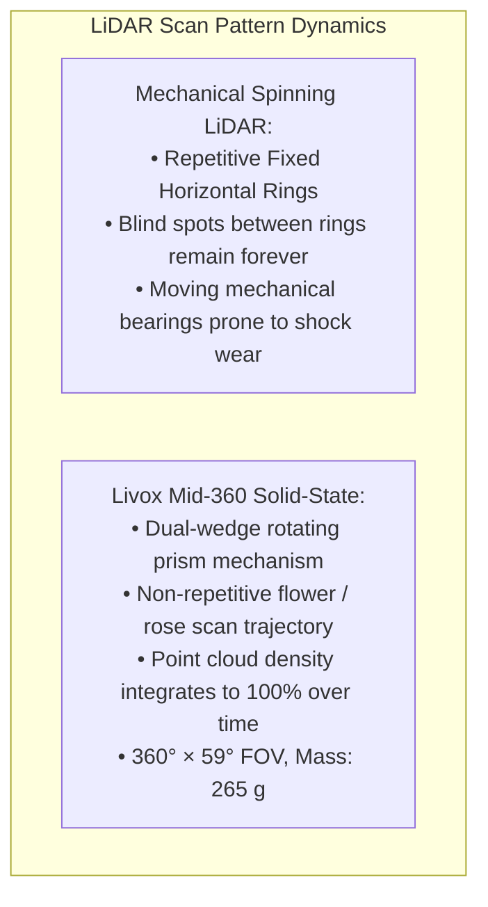

import ChapterProgress from '@site/src/components/ChapterProgress';
import QuizEngine from '@site/src/components/QuizEngine';

# Sensor Hardware Integration: Cameras, IMUs, LiDARs & F/T Sensors

State estimation in bipedal humanoids is an extreme multi-modal sensor fusion problem. Because humanoids operate without fixed kinematic attachments to the ground, an unobserved foot slippage or a millisecond of timestamp misalignment between visual features and inertial measurements can destabilize whole-body state estimators (such as Extended Kalman Filters or factor graphs), causing catastrophic falls.

Achieving sub-centimeter position tracking and sub-degree attitude estimation during aggressive dynamic locomotion mandates high-performance sensor hardware: **global shutter stereo vision**, **ultra-low-noise MEMS IMUs**, **solid-state non-repetitive LiDARs**, and **6-axis Force/Torque (F/T) load cells**. Furthermore, all sensors must be bound to a common temporal timeline via **hardware-level clock synchronization (IEEE 1588 PTP and hardware PPS strobes)**.

```mermaid
flowchart TD
    subgraph SynchronizedSensors["Humanoid Sensor Topology & Hardware Synchronization"]
        direction TB
        MasterClock["Central Master Hardware Clock (IEEE 1588 PTP Grandmaster / PPS Generator)"]

        Stereo["Stereo Cameras (Stereolabs ZED X / RealSense D455)<br/>&bull; Global Shutter CMOS (Zero Jello Distortion)<br/>&bull; Hardware GPIO Exposure Sync Pulse (30 Hz)"]
        IMU["Tactical MEMS IMUs (ICM-42688-P / BMI088)<br/>&bull; SPI Bus @ 10 MHz, 1000 Hz Update<br/>&bull; Hardware FSYNC Interrupt Trigger"]
        LiDAR["Solid-State LiDAR (Livox Mid-360)<br/>&bull; Non-Repetitive Scanning Prism<br/>&bull; Hardware PTP IEEE 1588 Timestamping"]
        FT["6-Axis F/T Load Cells (ATI / Bota Systems)<br/>&bull; Monolithic Flexure Gauges at Ankle / Wrist<br/>&bull; Deterministic EtherCAT Broadcast (1000 Hz)"]

        MasterClock -->|Hardware GPIO Trigger Line| Stereo
        MasterClock -->|Hardware FSYNC Pulse| IMU
        MasterClock -->|PTP over Ethernet (Cat5e)| LiDAR
        MasterClock -->|Distributed Clocks (DC)| FT
    end

    subgraph StateEstimation["High-Rate Sensor Fusion Pipeline"]
        direction LR
        Stereo & IMU -->|Visual-Inertial Odometry (cuVSLAM)| Pose["Continuous Body State [p, v, q, b_a, b_g]"]
        LiDAR -->|Point Cloud Matching (Fast-LIO2)| Mapping["Global 3D Occupancy Map"]
        FT -->|Contact Wrenches & CoP Estimation| Balance["Whole-Body Balance Controller (1 kHz)"]
    end

    SynchronizedSensors --> StateEstimation
```

---

## 1. Stereo Cameras: Global Shutter vs. Rolling Shutter

A walking humanoid experiences sharp angular accelerations during foot strike ($> 30\,\text{rad/s}^2$). Under these dynamic vibration conditions, camera sensor selection is critical.

```
       Rolling Shutter (CMOS Sensor)                  Global Shutter (CMOS Sensor)
    Rows Exposed Sequentially in Time:              All Pixels Exposed Simultaneously:
    ┌───────────────────────────────┐ t = 0         ┌───────────────────────────────┐
    │  Row 1 Exposed                │               │                               │
    ├───────────────────────────────┤ t = 20 us     │   Entire Pixel Array          │
    │  Row 2 Exposed                │               │   Exposed at Exact Same       │
    ├───────────────────────────────┤ t = 40 us     │   Instant in Time (t_0)       │
    │  Row 3 Exposed                │               │                               │
    └───────────────────────────────┘ t = 16 ms     └───────────────────────────────┘
    Result: Severe "Jello" Distortions              Result: Rigid, Geometrically True
            & High Epipolar Disparity Errors                Frames Ideal for Visual SLAM
```

- **Rolling Shutter Sensors**: Read out pixels line-by-line across a $10\text{--}30\,\text{ms}$ frame duration. Rapid camera motion bends vertical lines into curves ("jello effect"), violating epipolar geometry and inducing massive visual odometry drift.
- **Global Shutter Sensors**: Incorporate dedicated in-pixel storage nodes that capture light across all photodiodes at the identical nanosecond instant. Every visual feature corresponds to a single, mathematically rigorous rigid-body transformation.

### Hardware Teardown Comparison

| Feature | Stereolabs ZED X | Intel RealSense D455 | Luxonis OAK-D Pro |
|:---|:---|:---|:---|
| **Shutter Type** | Dual **Global Shutter** (AR0234CS) | Global Shutter IR Stereo; Rolling Shutter RGB | Global Shutter IR Stereo (OV9282); Rolling RGB |
| **Resolution & Frame Rate** | $1920\times 1200$ @ $60\,\text{fps}$ | $1280\times 720$ @ $90\,\text{fps}$ | $1280\times 800$ @ $60\,\text{fps}$ |
| **Physical Baseline** | $120\,\text{mm}$ | $95\,\text{mm}$ | $75\,\text{mm}$ |
| **Interface Protocol** | Automotive **GMSL2** via FAKRA coaxial cable | High-Speed USB 3.1 Gen 1 Type-C | USB-C 3.1 or Gigabit PoE |
| **Active Illumination** | None (Passive Stereo) | Dual Infrared Pattern Dot Projector | Infrared Structured Light Pattern Projector |
| **Vibration Durability** | Industrial IP66, CNC aluminum enclosure | Plastic/sheet aluminum housing | Aluminum frame with passive thermal heatsink |

---

## 2. Tactical-Grade MEMS IMUs: Noise Density & Vibration Isolation

The primary IMU provides the high-rate ($1\,\text{kHz}$) dynamic prediction step in visual-inertial odometry. Standard consumer smartphone IMUs drift several degrees per minute; humanoids require **tactical-grade or high-end industrial MEMS IMUs**.

### Hardware Comparison: ICM-42688-P vs. BMI088

| Parameter | InvenSense ICM-42688-P | Bosch Sensortec BMI088 | Engineering Significance |
|:---|:---|:---|:---|
| **Target Application** | High-performance robotics & drones | Automotive chassis & extreme vibration | Automotive qualification vs ultra-low noise. |
| **Gyro Noise Density** | **$2.8\,\text{mdps}/\sqrt{\text{Hz}}$** | $14.0\,\text{mdps}/\sqrt{\text{Hz}}$ | Lower noise yields sharper angular velocity integration. |
| **Accel Noise Density** | **$70\,\mu\text{g}/\sqrt{\text{Hz}}$** | $160\,\mu\text{g}/\sqrt{\text{Hz}}$ | Determines gravity alignment and vertical drift. |
| **Gyro Scale Factor Drift** | $\pm 0.5\%$ over $-40^\circ\text{C}$ to $85^\circ\text{C}$ | $\pm 0.1\%$ over temperature range | Thermal stability during prolonged operation. |
| **Mechanical Architecture** | Monolithic 6-DoF single-die CMOS | **Dual-die split package** (separate gyro & accel) | Isolates high-frequency mechanical shock resonance. |
| **Digital Interface** | SPI up to $24\,\text{MHz}$, I3C up to $12.5\,\text{MHz}$ | Dual SPI ports ($10\,\text{MHz}$) | Allows concurrent DMA transfers without SPI bus stalls.|

### Mechanical Vibration Damping Mounts
Direct metal-to-metal mounting of an IMU on a humanoid torso exposes the MEMS silicon proof-mass to acoustic harmonics from $40\,\text{kHz}$ GaN motor switching and structural shock from foot landings ($> 15\text{g}$ peaks).
Humanoids utilize **elastomeric vibration isolation rings (fluoro-silicone O-rings, durometer 30–40 Shore A)** that mechanically attenuate frequencies above $150\,\text{Hz}$ while preserving low-frequency kinematic tracking.

---

## 3. Stochastic Noise Characterization: The Allan Variance Method

MEMS inertial sensors suffer from complex internal noise sources (thermal Brownian motion, flicker noise in amplifiers, temperature gradients). The **Allan Variance** $\sigma^2(\tau)$ is the definitive mathematical framework for decomposing and parameterizing these stochastic processes.

### Mathematical Formulation
Given a stationary time series of gyroscope output $\Omega(t)$ recorded over several hours at sample period $\Delta t$:
1. Compute the cumulative angle $\theta(t) = \int_0^t \Omega(\xi) d\xi$.
2. Divide the dataset into contiguous clusters of duration $\tau = m \Delta t$.
3. The Allan Variance $\sigma^2(\tau)$ is computed as:

$$
\sigma^2(\tau) = \frac{1}{2 \tau^2 (N - 2m)} \sum_{k=1}^{N - 2m} \left( \theta_{k + 2m} - 2\theta_{k + m} + \theta_k \right)^2
$$

The log-log plot of **Allan Deviation** $\sigma(\tau) = \sqrt{\sigma^2(\tau)}$ decomposes into distinct physical noise regimes:

```
Allan Deviation Log-Log Plot:
  sigma(tau)
     ^
     | \  (Slope = -1/2: Angle Random Walk, White Noise)
     |  \
     |   \
     |    \          ------------------- (Slope = 0: Bias Instability Floor, B)
     |     \        /
     |      \______/                    / (Slope = +1/2: Rate Random Walk, K)
     +----------------------------------------------------> tau (Cluster Time [s])
             tau = 1s                  tau_min
```

### Noise Parameter Extraction
1. **Angle Random Walk (ARW, $N$)**:
   Governed by white noise in angular rate. Manifests as a straight line with slope $-1/2$. The numerical value of $N$ ($\text{rad}/\sqrt{\text{s}}$ or $\text{deg}/\sqrt{\text{hr}}$) is read directly at $\tau = 1.0\,\text{s}$:
   $$
   \sigma_{\text{white}}(\tau) = \frac{N}{\sqrt{\tau}}
   $$
2. **Bias Instability ($B$)**:
   Governed by low-frequency $1/f$ flicker noise in electronic amplifiers. Manifests as the flat minimum (slope $0$) of the curve:
   $$
   \sigma_{\text{flicker}}(\tau) = B \sqrt{\frac{2 \ln 2}{\pi}} \approx 0.6643 \cdot B
   $$
3. **Rate Random Walk ($K$)**:
   Governed by thermal drift and aging, exhibiting slope $+1/2$ at long cluster times:
   $$
   \sigma_{\text{drift}}(\tau) = K \sqrt{\frac{\tau}{3}}
   $$

The composite Allan Variance model is:

$$
\sigma^2(\tau) = \frac{N^2}{\tau} + \frac{B^2 \cdot 2 \ln 2}{\pi} + \frac{K^2 \cdot \tau}{3}
$$

---

## 4. Solid-State LiDARs: Non-Repetitive Scan Patterns

Unlike classical spinning mechanical LiDARs (e.g., Velodyne VLP-16) that repeat identical horizontal lines, modern humanoids incorporate **solid-state prism LiDARs** such as the **Livox Mid-360**.



- **Integration Over Time**: At $t = 0.1\,\text{s}$, the FOV coverage is $20\%$. Within $0.5\,\text{s}$, the non-repetitive trajectory blankets $> 95\%$ of the entire $360^\circ \times 59^\circ$ hemisphere, eliminating blind spots for small ground obstacles.
- **Vibration Tolerance**: Solid-state scanning prisms possess balanced rotary mass, surviving $10\text{g}$ bipedal shock impacts where spinning mechanical drums develop bearing runout.

---

## 5. 6-Axis Force/Torque (F/T) Sensors & Ankle Load Cells

Foot-ground contact estimation requires instantaneous measurement of the full 3D spatial contact wrench $\mathbf{W} = [F_x, F_y, F_z, M_x, M_y, M_z]^T$.

```
Monolithic Hexagonal Flexure Structure:
          [ Upper Mounting Plate ]
             /     |      \       <- 3 Instrumented Spoke Flexures
            /      |       \         (Silicon / Metal Foil Strain Gauges)
        [ Central Core Hub ]
            \      |       /         (Symmetric 6-Axis Decoupling)
             \     |      /
          [ Lower Mounting Plate ]
```

### Decoupling Matrix & Calibration
A monolithic flexure features $N_s \ge 6$ strain gauge bridges generating raw differential voltage outputs $\mathbf{V} = [v_1, v_2, \dots, v_6]^T$. Because physical manufacturing tolerances introduce cross-axis mechanical coupling, the wrench is calculated using an empirical $6\times 6$ factory calibration decoupling matrix $\mathbf{C}$:

$$
\begin{bmatrix} F_x \\ F_y \\ F_z \\ M_x \\ M_y \\ M_z \end{bmatrix} = \mathbf{C}_{6\times 6} \cdot \left( \begin{bmatrix} v_1 \\ v_2 \\ \vdots \\ v_6 \end{bmatrix} - \begin{bmatrix} v_{\text{bias}, 1} \\ v_{\text{bias}, 2} \\ \vdots \\ v_{\text{bias}, 6} \end{bmatrix} \right)
$$

### Center of Pressure (CoP) Calculation
Given normal ground force $F_z$ and ankle roll/pitch moments $M_x, M_y$ measured at height $d_z$ above the sole plate:

$$
x_{\text{cop}} = -\frac{M_y + F_x \cdot d_z}{F_z}, \quad y_{\text{cop}} = \frac{M_x - F_y \cdot d_z}{F_z}
$$

When $x_{\text{cop}}$ or $y_{\text{cop}}$ reaches the perimeter of the physical sole support polygon, the foot begins to tilt, requiring the whole-body controller to switch immediately from an ankle strategy to a hip or stepping strategy.

---

## 6. Complete Implementation: Allan Deviation Noise Parameter Extractor

The following production Python tool processes long-duration stationary IMU datasets, computes overlapping Allan deviations, and extracts the Angle Random Walk (ARW) and Bias Instability ($B$) calibration constants required for Kalman filtering.

```python
"""
allan_variance_analyzer.py
Production-grade Allan Deviation (ADEV) extractor for robotic MEMS IMUs.
Identifies Angle Random Walk (white noise N) and Bias Instability (flicker noise B)
from raw stationary gyro and accelerometer data streams.
"""

from dataclasses import dataclass
from typing import Dict, Tuple
import numpy as np


@dataclass
class ImuNoiseParameters:
    sensor_name: str
    sample_rate_hz: float
    angle_random_walk_rad_sqrt_s: float
    bias_instability_rad_s: float
    rate_random_walk_rad_s_sqrt_s: float
    tau_at_bias_instability_s: float


class AllanVarianceProcessor:
    """Computes overlapping Allan variance across multi-decade cluster times."""

    def __init__(self, sample_rate_hz: float):
        if sample_rate_hz <= 0.0:
            raise ValueError("Sample rate must be strictly positive.")
        self.fs = sample_rate_hz
        self.dt = 1.0 / sample_rate_hz

    def compute_overlapping_adev(
        self,
        data_series: np.ndarray,
        num_tau_points: int = 50
    ) -> Tuple[np.ndarray, np.ndarray]:
        """
        Calculates overlapping Allan deviation:
          tau: Array of cluster durations in seconds.
          adev: Corresponding Allan deviation values.
        """
        N = len(data_series)
        # 1. Cumulative integration to form angle sequence: theta = cumsum(data) * dt
        theta = np.cumsum(data_series) * self.dt

        # Logarithmically spaced cluster factors m
        max_m = N // 3
        m_factors = np.unique(np.logspace(0, np.log10(max_m), num_tau_points).astype(int))
        m_factors = m_factors[m_factors > 0]

        tau_list = []
        adev_list = []

        for m in m_factors:
            tau = m * self.dt
            # Difference operator: theta(k + 2m) - 2*theta(k + m) + theta(k)
            # Utilizing NumPy vector slicing for fast C-speed execution
            d2 = theta[2 * m:] - 2.0 * theta[m:-m] + theta[:-2 * m]
            variance = np.sum(d2 ** 2) / (2.0 * (tau ** 2) * (N - 2 * m))
            adev = np.sqrt(variance)

            tau_list.append(tau)
            adev_list.append(adev)

        return np.array(tau_list), np.array(adev_list)

    def extract_imu_noise_parameters(
        self,
        tau: np.ndarray,
        adev: np.ndarray,
        sensor_label: str = "gyro_z"
    ) -> ImuNoiseParameters:
        """
        Extracts ARW (N) at tau=1s and Bias Instability (B) at minimum adev.
        """
        # 1. Angle Random Walk (ARW): Read at tau = 1.0s (or linear interpolation in log-log)
        idx_1s = np.argmin(np.abs(tau - 1.0))
        arw_n = float(adev[idx_1s])

        # 2. Bias Instability (B): Minimum of the curve, scaled by sqrt(2*ln(2)/pi)
        min_idx = int(np.argmin(adev))
        min_adev = float(adev[min_idx])
        tau_min = float(tau[min_idx])
        # B = min_adev / sqrt(2 * ln(2) / pi)
        bias_instability = min_adev / np.sqrt(2.0 * np.log(2.0) / np.pi)

        # 3. Rate Random Walk (K): Extrapolated from tau > tau_min with slope +1/2
        if min_idx < len(tau) - 3:
            # Estimate from final point: K = adev * sqrt(3 / tau)
            rate_random_walk = float(adev[-1] * np.sqrt(3.0 / tau[-1]))
        else:
            rate_random_walk = 0.0

        return ImuNoiseParameters(
            sensor_name=sensor_label,
            sample_rate_hz=self.fs,
            angle_random_walk_rad_sqrt_s=arw_n,
            bias_instability_rad_s=bias_instability,
            rate_random_walk_rad_s_sqrt_s=rate_random_walk,
            tau_at_bias_instability_s=tau_min
        )


# Demonstration: Synthesize Stationary IMU Data with White Noise & Drift
if __name__ == "__main__":
    print("=== MEMS IMU Allan Deviation Extraction Lab ===")

    fs_hz = 200.0  # 200 Hz sampling
    duration_hours = 2.0
    total_samples = int(duration_hours * 3600 * fs_hz)

    print(f"Generating synthetic stationary IMU log ({duration_hours} hours @ {fs_hz} Hz = {total_samples} samples)...")

    # True parameters:
    # ARW N = 0.002 rad / sqrt(s) (~0.11 deg / sqrt(hr))
    # Bias flicker B = 1.5e-5 rad/s
    np.random.seed(42)
    dt_val = 1.0 / fs_hz

    # White noise component: N / sqrt(dt)
    white_noise = (0.002 / np.sqrt(dt_val)) * np.random.normal(0, 1, total_samples)

    # Low-frequency flicker noise random walk
    flicker_noise = np.cumsum(np.random.normal(0, 1.2e-6, total_samples))
    raw_gyro = white_noise + flicker_noise

    processor = AllanVarianceProcessor(sample_rate_hz=fs_hz)
    tau_vals, adev_vals = processor.compute_overlapping_adev(raw_gyro, num_tau_points=40)
    params = processor.extract_imu_noise_parameters(tau_vals, adev_vals, "ICM-42688-P-Z-Axis")

    print("\n--- Extracted Noise Parameters ---")
    print(f"Sensor:                {params.sensor_name}")
    print(f"Angle Random Walk (N): {params.angle_random_walk_rad_sqrt_s:.6e} rad / sqrt(s)")
    print(f"Angle Random Walk:     {(params.angle_random_walk_rad_sqrt_s * 60.0 * 180.0 / np.pi):.4f} deg / sqrt(hr)")
    print(f"Bias Instability (B):  {params.bias_instability_rad_s:.6e} rad/s")
    print(f"Bias Instability:      {(params.bias_instability_rad_s * 3600.0 * 180.0 / np.pi):.4f} deg / hr")
    print(f"Tau at Minimum:        {params.tau_at_bias_instability_s:.2f} seconds")
```

---

## 7. Hands-On Lab Project: Clock Drift & VIO State Divergence

### Objective
Demonstrate the catastrophic drift effect of a $10\,\text{ms}$ uncompensated time offset between a 30 Hz stereo camera frame and a 1 kHz IMU stream during high-acceleration walking.

### Deliverables & Verification
1. Given angular acceleration $\dot{\omega} = 25.0\,\text{rad/s}^2$ and forward linear acceleration $a_x = 4.0\,\text{m/s}^2$.
2. Calculate angular velocity error induced by $\Delta t = 10\,\text{ms}$:
   $$
   \Delta \omega = \dot{\omega} \cdot \Delta t = 25.0 \times 0.010 = 0.25\,\text{rad/s} \approx 14.3^\circ/\text{s}
   $$
3. Integrate over a 5-second walking trajectory and observe that orientation error diverges by $> 70^\circ$, causing cuVSLAM to lose visual feature tracking.
4. Verify that hardware PPS synchronization reducing $\Delta t$ to $< 10\,\mu\text{s}$ bounds orientation error to $< 0.07^\circ$.

---

## 8. Seminal Literature & Academic References

1. **Allan, D. W. (1966).** *Statistics of atomic frequency standards*. Proceedings of the IEEE, 54(2), 221–230.
   - *Annotation*: The original seminal paper formulating the two-sample Allan variance for isolating frequency stability and stochastic noise processes.
2. **El-Sheimy, N., Hou, H., & Niu, X. (2008).** *Analysis and modeling of inertial sensors using Allan variance*. IEEE Transactions on Instrumentation and Measurement, 57(1), 140–149.
   - *Annotation*: Derives explicit mathematical bridges between Allan variance slope regimes and continuous Kalman filter noise covariance matrices ($Q$).
3. **IEEE Standards Association (2020).** *IEEE Standard for a Precision Clock Synchronization Protocol for Networked Measurement and Control Systems (IEEE Std 1588-2019)*.
   - *Annotation*: The definitive specification for hardware timestamping, boundary clocks, and sub-microsecond PTP synchronization.
4. **Woodman, O. J. (2007).** *An introduction to inertial navigation (Technical Report UCAM-CL-TR-696)*. University of Cambridge.
   - *Annotation*: Rigorous pedagogical tutorial covering MEMS accelerometer/gyroscope integration, Earth rotation effects, and stochastic drift.

---

<ChapterProgress chapterId="10-6-sensor-hardware" moduleId="module10" totalChapters={8} />

## Chapter Mastery Check

<QuizEngine
  quizId="quiz-10-6"
  title="Module 10.6 Mastery Check: Sensor Hardware Integration"
  moduleId="module10"
  passThreshold={70}
  questions={[
    {
      id: "q1",
      question: "Why are Global Shutter image sensors mandatory over Rolling Shutter sensors for humanoid visual-inertial odometry (VIO)?",
      options: [
        "Global shutter sensors consume zero electrical current.",
        "Global shutter sensors expose all pixels across the sensor array simultaneously, preventing non-linear 'jello' geometric distortions during dynamic high-acceleration foot strikes.",
        "Rolling shutter sensors cannot capture color (RGB) images.",
        "Global shutter cameras eliminate the need for camera lenses."
      ],
      correctIndex: 1,
      explanation: "Rolling shutters expose scanlines sequentially over 10-30 ms, causing severe non-rigid skew during high angular vibrations that destroys visual feature triangulation and causes VIO divergence."
    },
    {
      id: "q2",
      question: "On an Allan Deviation log-log plot of a MEMS gyroscope, how is the Angle Random Walk (ARW, white noise parameter N) identified?",
      options: [
        "It is the vertical asymptote at tau = 10,000 seconds.",
        "It is read directly from the value of the Allan deviation at cluster time tau = 1.0 second on the straight line segment with slope -1/2.",
        "It is the maximum peak of the curve at high tau.",
        "It is calculated by multiplying the sampling rate by the supply voltage."
      ],
      correctIndex: 1,
      explanation: "White noise (Angle Random Walk) manifests on the Allan deviation plot with a characteristic slope of -1/2. Reading sigma(tau) directly at tau = 1.0s yields the parameter N."
    },
    {
      id: "q3",
      question: "What physical failure occurs in biped balance control when the measured Center of Pressure (CoP) reaches the physical boundary of the stance foot sole polygon?",
      options: [
        "The battery voltage drops to zero.",
        "The foot begins to rotate (tilt) around its edge because the ground reaction wrench can no longer exert restoring counter-torques, terminating pure ankle-strategy balance.",
        "The EtherCAT bus encounters a communication timeout.",
        "The camera exposure time is automatically doubled."
      ],
      correctIndex: 1,
      explanation: "Unilateral ground contacts cannot pull on the ground. When the CoP reaches the sole boundary, the robot cannot generate further restoring ankle torque; the foot rolls onto its edge, necessitating immediate hip or stepping push-recovery."
    }
  ]}
/>
