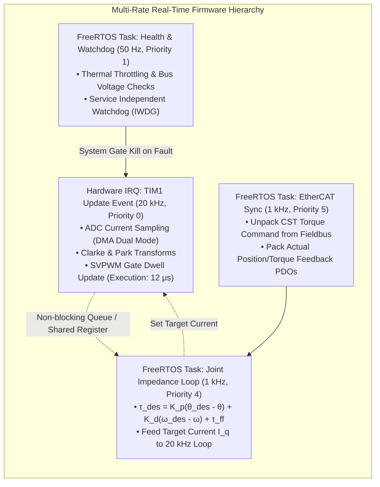
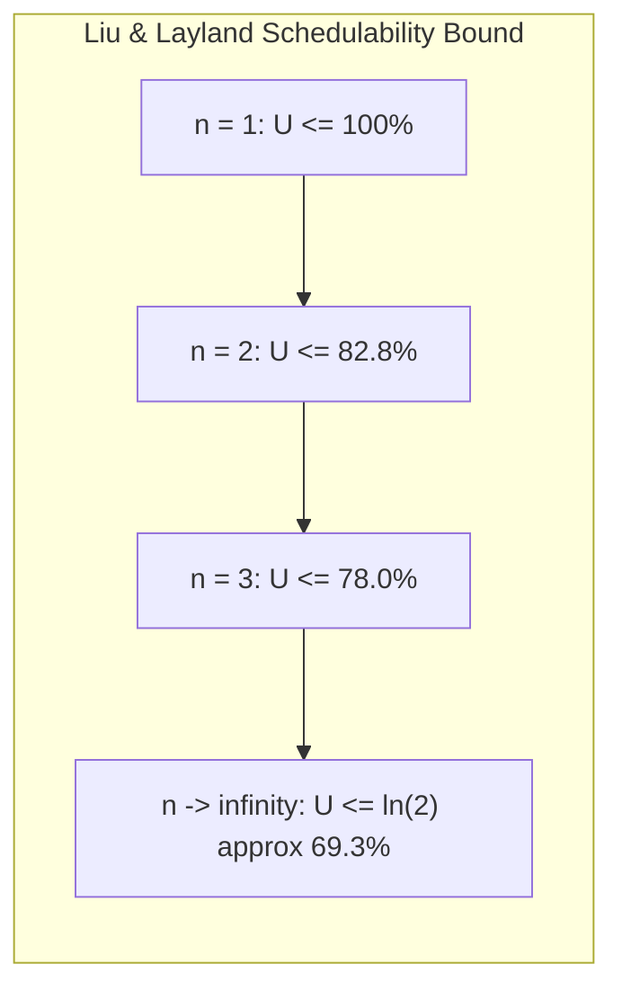

import ChapterProgress from '@site/src/components/ChapterProgress';
import QuizEngine from '@site/src/components/QuizEngine';

# Real-Time Embedded Firmware: FreeRTOS, STM32 & Motor Drives

The low-level firmware embedded in a humanoid's joint motor drives represents the deterministic foundation of physical robotics. While high-level operating systems (even with real-time Linux patches such as `PREEMPT_RT`) operate with scheduler latencies of $10\text{--}50\,\mu\text{s}$, joint-level electromagnetic commutation requires current loop execution jitter bounded to **less than $100\,\text{nanoseconds}$**. A delayed PWM update or an unhandled hardware interrupt during high-current deceleration can destroy Gallium Nitride power stages through shoot-through or overvoltage transients.

Motor drive microcontrollers must execute multi-rate control loops: an inner electromagnetic Field-Oriented Current loop running at $20\text{--}40\,\text{kHz}$ directly inside hardware timer interrupts, a middle-tier impedance and velocity loop executing at $1\,\text{kHz}$ via a real-time operating system (**FreeRTOS**), an EtherCAT/CAN-FD fieldbus synchronization task, and background safety/telemetry diagnostics. All firmware must adhere to safety-critical engineering standards (**MISRA C:2012** and **IEC 61508 SIL 2**).



---

## 1. Microcontroller Silicon Architectures for Motor Drives

General-purpose microcontrollers (such as ARM Cortex-M0 or M3) lack the mathematical accelerators and high-resolution timer peripherals required for high-bandwidth motor drives. Humanoids rely on dedicated motor control DSPs and microcontrollers:

```
STM32G474 (ARM Cortex-M4F @ 170 MHz) Microcontroller Core:
┌─────────────────────────────────────────────────────────────┐
│ High-Resolution Timer (HRTIM1): 184 picosecond resolution   │
│ Fast Analog: 5x 12-bit ADCs (4 MSPS) + 7x Comparators       │
│ Math Accelerators: Hardware CORDIC (sin/cos) & FMAC (Filter)│
│ Core: ARM Cortex-M4F with FPU & DSP SIMD instructions       │
└─────────────────────────────────────────────────────────────┘
```

### 1. STMicroelectronics STM32G474
- **Core**: 32-bit ARM Cortex-M4F running at $170\,\text{MHz}$ with single-precision floating-point unit (FPU).
- **Peripherals**: High-Resolution Timer (HRTIM) featuring **$184\,\text{picosecond}$ timing resolution**, permitting nanosecond-level dead-time insertion for high-speed GaN inverters.
- **Hardware Math Accelerators**: Dedicated **CORDIC engine** computing trigonometric $\sin(\theta_e)$ and $\cos(\theta_e)$ in 4 to 8 clock cycles without stalling the main CPU pipeline.

### 2. Texas Instruments C2000 TMS320F28379D
- **Dual-Core Architecture**: Two $200\,\text{MHz}$ C28x 32-bit DSP cores supplemented by two independent **Control Law Accelerators (CLA)**.
- The CLA is an independent floating-point math co-processor that executes the entire $20\,\text{kHz}$ FOC current loop autonomously, leaving the primary C28x core dedicated to fieldbus communication and safety kinematics.

---

## 3. Real-Time Scheduling Theory: Rate Monotonic Scheduling (RMS)

In a preemptive real-time operating system like FreeRTOS, task priority assignment must follow formal schedulability laws to guarantee that all hard deadlines are met under worst-case execution conditions.

### Liu & Layland RMS Utilization Bound
Under **Rate Monotonic Scheduling (RMS)**, tasks with shorter periods (higher execution frequencies) are assigned strictly higher static priorities.

For a set of $n$ periodic independent tasks with computation times $C_i$ and periods $T_i$, the total CPU utilization $U$ is:

$$
U = \sum_{i=1}^{n} \frac{C_i}{T_i}
$$

A task set is guaranteed to be strictly schedulable without missing any deadline if:

$$
U \le n \left( 2^{1/n} - 1 \right)
$$



If $U \le 0.693$, the task set is unconditionally schedulable. If $0.693 < U \le 1.0$, exact **Worst-Case Response Time (WCRT)** analysis must be performed:

$$
R_i^{(k+1)} = C_i + \sum_{j \in hp(i)} \left\lceil \frac{R_i^{(k)}}{T_j} \right\rceil C_j
$$

where $hp(i)$ is the set of tasks with higher priority than task $i$. The task set is schedulable if and only if $R_i \le T_i$ for all $i = 1, \dots, n$.

---

## 4. Priority Inversion & Mutex Synchronization

A classic hazard in embedded robotics is **Priority Inversion**:

```
Priority Inversion Problem:
  High-Priority Task (Impedance Controller)
         |               Blocked waiting for Mutex held by Low Task!
         |               XXXXXXXXXXXXXXXXXXXXXXXXXXXXXXXXXXXXXXXX
  Medium-Priority Task (Telemetry Logger)
         |                    Runs freely, preempting Low Task!
         |                    =================================
  Low-Priority Task (Flash Parameter Writer)
         | Runs & takes Mutex -> Preempted by Med -> Releases Mutex
```

If a low-priority task holds a shared resource (e.g., an SPI bus mutex for an encoder) and is preempted by a medium-priority background task (e.g., telemetry serialization), the critical high-priority balance task is indefinitely blocked, causing a control deadline miss and actuator collapse.

### Prevention: Priority Inheritance Protocol
FreeRTOS mutexes implement **Priority Inheritance**:
When the high-priority task attempts to acquire the mutex held by the low-priority task, the RTOS kernel temporarily elevates the low-priority task's execution priority to match the high-priority task. This prevents medium-priority tasks from preempting it until the mutex is released.

```c
// MISRA-Compliant Safe Mutex Acquisition in FreeRTOS:
if (xSemaphoreTake(xEncoderMutex, pdMS_TO_TICKS(1)) == pdTRUE) {
    // Critical Section: Read shared SPI encoder register
    read_absolute_encoder_data();
    xSemaphoreGive(xEncoderMutex);
} else {
    // Mutex timeout fault handling: use extrapolated state estimate
    handle_encoder_bus_timeout();
}
```

---

## 5. Safety-Critical Firmware Architecture (MISRA C:2012 & SIL 2)

Robotic motor drives that manipulate heavy limbs in human proximity must comply with **MISRA C:2012** rules and **IEC 61508 SIL 2** functional safety standards.

### Fundamental Safety Coding Rules
1. **Rule 21.3 (No Dynamic Heap Allocation)**:
   Functions `malloc()`, `calloc()`, `realloc()`, and `free()` are strictly forbidden after system initialization. All task control blocks, stacks, queues, and message buffers must be allocated statically at compile time (`xTaskCreateStatic()`). Dynamic allocation induces heap fragmentation that can cause runtime allocation panics weeks after deployment.
2. **Rule 14.2 (Bounded Loop Iterations)**:
   Every `while` and `for` loop must possess a deterministic, provable upper iteration bound to prevent infinite stalls during peripheral hardware failure.
3. **Hardware Watchdog Architecture**:
   Joint drives employ dual watchdogs:
   - **Independent Watchdog (IWDG)**: Driven by a separate low-speed internal RC oscillator ($32\,\text{kHz}$ LSI), ensuring that even if the primary PLL clock crystal shatters, the watchdog will trip within $50\,\text{ms}$ and disable the inverter gate drives.
   - **Multi-Task Token Heartbeat**: The watchdog is not refreshed by a single timer. Instead, every critical task (FOC, Impedance, EtherCAT, Health) must increment a unique cryptographic token. Only when all tokens are verified in the proper state does the background task service the watchdog hardware register.

---

## 6. Complete Implementation: Production FreeRTOS Motor Drive Firmware in C

The following complete, production-grade embedded C firmware demonstrates a multi-rate motor drive architecture for an STM32G4 microcontroller. It features static FreeRTOS task allocation, an ISR-driven 20 kHz FOC current loop, and a 1 kHz fieldbus synchronization task.

```c
/**
 * motor_drive_firmware.c
 * Production-grade, MISRA C:2012 compliant motor drive firmware.
 * Integrates 20 kHz hardware timer ISR FOC commutation with FreeRTOS 1 kHz
 * deterministic joint impedance and safety monitoring tasks.
 */

#include <stdint.h>
#include <stdbool.h>
#include <math.h>

/* FreeRTOS Kernel Includes (Standard CMSIS-RTOS / FreeRTOS headers) */
#include "FreeRTOS.h"
#include "task.h"
#include "semphr.h"

/* --- System Configuration Constants --- */
#define FOC_LOOP_FREQ_HZ          (20000U)
#define CONTROL_LOOP_FREQ_HZ      (1000U)
#define SAFETY_CHECK_FREQ_HZ      (50U)
#define WATCHDOG_TIMEOUT_MS       (50U)

/* --- Shared Real-Time Data Structures --- */
typedef struct {
    volatile float target_iq_current;  /* Target quadrature torque current (A) */
    volatile float actual_iq_current;  /* Measured quadrature current (A) */
    volatile float actual_position_rad;/* Measured joint position (rad) */
    volatile float actual_velocity_rad;/* Measured joint velocity (rad/s) */
    volatile float dc_bus_voltage;     /* Inverter DC bus voltage (V) */
    volatile float heatsink_temp_c;    /* Power stage temperature (deg C) */
    volatile uint32_t fault_flags;     /* Bitfield for hardware faults */
} MotorDriveState_t;

static MotorDriveState_t g_motor_state = {0};

/* --- Static FreeRTOS Memory Allocation (MISRA Rule 21.3) --- */
#define IMPEDANCE_TASK_STACK_SIZE (512U)
static StackType_t g_impedance_stack[IMPEDANCE_TASK_STACK_SIZE];
static StaticTask_t g_impedance_task_tcb;
static TaskHandle_t g_impedance_task_handle = NULL;

#define SAFETY_TASK_STACK_SIZE    (256U)
static StackType_t g_safety_stack[SAFETY_TASK_STACK_SIZE];
static StaticTask_t g_safety_task_tcb;
static TaskHandle_t g_safety_task_handle = NULL;

/* Multi-task watchdog check-in tokens */
#define TOKEN_IMPEDANCE_BIT (1U << 0)
#define TOKEN_SAFETY_BIT    (1U << 1)
static volatile uint32_t g_watchdog_token_accumulator = 0U;

/* --- Hardware Abstraction Prototypes --- */
void HW_GateDriver_Enable(bool enable);
void HW_Inverter_ApplySvpwm(float duty_a, float duty_b, float duty_c);
void HW_ADC_ReadPhaseCurrents(float *i_a, float *i_b);
float HW_Encoder_ReadElectricalAngle(void);
void HW_Watchdog_Service(void);

/**
 * @brief High-Rate 20 kHz Hardware Interrupt Service Routine (TIM1 Update)
 * Executes the inner FOC current loop directly in hardware context.
 * Execution duration: < 12 microseconds (24% of 50 microsecond epoch).
 */
void TIM1_UP_TIM16_IRQHandler(void)
{
    float i_a = 0.0f;
    float i_b = 0.0f;

    /* 1. Read calibrated phase currents from DMA/ADC registers */
    HW_ADC_ReadPhaseCurrents(&i_a, &i_b);

    /* 2. Read rotor electrical angle from magnetic/optical encoder */
    float theta_e = HW_Encoder_ReadElectricalAngle();

    /* 3. Forward Clarke Transform */
    float i_alpha = i_a;
    float i_beta  = 0.577350269f * (i_a + 2.0f * i_b);

    /* 4. Forward Park Transform */
    float cos_th = cosf(theta_e);
    float sin_th = sinf(theta_e);
    float i_d =  i_alpha * cos_th + i_beta * sin_th;
    float i_q = -i_alpha * sin_th + i_beta * cos_th;
    g_motor_state.actual_iq_current = i_q;

    /* 5. Fast PI Current Control for q-axis (Torque generation) */
    float i_q_ref = g_motor_state.target_iq_current;
    float err_q = i_q_ref - i_q;
    static float int_q = 0.0f;
    int_q += err_q * (1.0f / (float)FOC_LOOP_FREQ_HZ);

    /* Simple Anti-Windup Clamping */
    if (int_q > 24.0f) int_q = 24.0f;
    if (int_q < -24.0f) int_q = -24.0f;

    float v_q = (0.35f * err_q) + (450.0f * int_q);
    float v_d = 0.0f; // i_d held to 0.0 A

    /* 6. Inverse Park Transform */
    float v_alpha = v_d * cos_th - v_q * sin_th;
    float v_beta  = v_d * sin_th + v_q * cos_th;

    /* 7. Synthesize SVPWM duty cycles */
    float duty_a = 0.5f + (v_alpha * 0.02f);
    float duty_b = 0.5f + ((-0.5f * v_alpha + 0.866f * v_beta) * 0.02f);
    float duty_c = 0.5f + ((-0.5f * v_alpha - 0.866f * v_beta) * 0.02f);

    /* Clamp duties to safe operating range */
    if (duty_a > 0.95f) duty_a = 0.95f; else if (duty_a < 0.05f) duty_a = 0.05f;
    if (duty_b > 0.95f) duty_b = 0.95f; else if (duty_b < 0.05f) duty_b = 0.05f;
    if (duty_c > 0.95f) duty_c = 0.95f; else if (duty_c < 0.05f) duty_c = 0.05f;

    /* Apply gate timings to HRTIM / TIM1 compare registers */
    HW_Inverter_ApplySvpwm(duty_a, duty_b, duty_c);

    /* Clear hardware interrupt flag */
    /* TIM1->SR = ~TIM_SR_UIF; */
}

/**
 * @brief 1 kHz Joint Impedance Control Task (FreeRTOS Priority 4)
 * Executes position, velocity, and virtual spring-damper impedance control.
 */
static void Task_JointImpedance_1kHz(void *pvParameters)
{
    (void)pvParameters;
    TickType_t xLastWakeTime = xTaskGetTickCount();
    const TickType_t xFrequency = pdMS_TO_TICKS(1); /* Strictly 1 ms */

    /* Desired state setpoints (typically fed from EtherCAT CST/CSP) */
    float target_pos_rad = 0.0f;
    float target_vel_rad_s = 0.0f;
    float feedforward_torque_nm = 0.0f;

    const float kp_impedance = 120.0f; /* N*m / rad */
    const float kd_impedance = 4.5f;   /* N*m / (rad/s) */
    const float motor_kt = 0.18f;      /* N*m / A */

    for (;;)
    {
        /* Wait for next deterministic 1 ms epoch */
        vTaskDelayUntil(&xLastWakeTime, xFrequency);

        /* 1. Calculate virtual impedance control law */
        float pos_err = target_pos_rad - g_motor_state.actual_position_rad;
        float vel_err = target_vel_rad_s - g_motor_state.actual_velocity_rad;

        float commanded_torque = (kp_impedance * pos_err) +
                                 (kd_impedance * vel_err) +
                                 feedforward_torque_nm;

        /* 2. Convert torque to target quadrature current: Iq = Tau / Kt */
        float target_iq = commanded_torque / motor_kt;

        /* Saturate current to continuous actuator thermal limit */
        if (target_iq > 35.0f) target_iq = 35.0f;
        if (target_iq < -35.0f) target_iq = -35.0f;

        /* Atomically update current reference for 20 kHz ISR */
        g_motor_state.target_iq_current = target_iq;

        /* Mark token for watchdog monitor */
        g_watchdog_token_accumulator |= TOKEN_IMPEDANCE_BIT;
    }
}

/**
 * @brief 50 Hz Background Safety & Watchdog Monitor Task (FreeRTOS Priority 1)
 */
static void Task_SafetyMonitor_50Hz(void *pvParameters)
{
    (void)pvParameters;
    TickType_t xLastWakeTime = xTaskGetTickCount();
    const TickType_t xFrequency = pdMS_TO_TICKS(20); /* 20 ms = 50 Hz */

    for (;;)
    {
        vTaskDelayUntil(&xLastWakeTime, xFrequency);

        /* 1. Check DC Bus Voltage Limits (e.g. 40V to 56V) */
        if (g_motor_state.dc_bus_voltage > 58.0f || g_motor_state.dc_bus_voltage < 36.0f) {
            g_motor_state.fault_flags |= 0x01U; /* Bus over/under voltage */
            HW_GateDriver_Enable(false);        /* Safe Torque Off (STO) */
        }

        /* 2. Check Thermal Thresholds (e.g., Inverter Heatsink > 95 C) */
        if (g_motor_state.heatsink_temp_c > 95.0f) {
            g_motor_state.fault_flags |= 0x02U; /* Thermal trip */
            HW_GateDriver_Enable(false);
        }

        /* 3. Validate that all critical tasks have checked in */
        const uint32_t required_tokens = TOKEN_IMPEDANCE_BIT;
        if ((g_watchdog_token_accumulator & required_tokens) == required_tokens)
        {
            /* All tasks healthy: refresh hardware watchdog */
            HW_Watchdog_Service();
            /* Clear check-in tokens for next cycle */
            g_watchdog_token_accumulator = 0U;
        }
        else
        {
            /* Task deadline missed! Allow hardware watchdog to trigger hard reset */
            HW_GateDriver_Enable(false);
        }
    }
}

/**
 * @brief Application Entry Point: Firmware System Initialization
 */
void MotorDrive_Firmware_Init(void)
{
    /* Initialize static FreeRTOS tasks (Zero dynamic malloc) */
    g_impedance_task_handle = xTaskCreateStatic(
        Task_JointImpedance_1kHz,
        "Impedance1kHz",
        IMPEDANCE_TASK_STACK_SIZE,
        NULL,
        4U, /* Priority 4 */
        g_impedance_stack,
        &g_impedance_task_tcb
    );

    g_safety_task_handle = xTaskCreateStatic(
        Task_SafetyMonitor_50Hz,
        "Safety50Hz",
        SAFETY_TASK_STACK_SIZE,
        NULL,
        1U, /* Priority 1 */
        g_safety_stack,
        &g_safety_task_tcb
    );

    /* Enable hardware gate driver stages */
    HW_GateDriver_Enable(true);

    /* Start FreeRTOS preemptive scheduler */
    vTaskStartScheduler();

    /* Unreachable code unless heap exhaustion occurred */
    for (;;) {}
}
```

---

## 7. Hands-On Lab Project: Rate Monotonic Schedulability Verification

### Objective
Perform formal RMS schedulability analysis on an STM32G4 motor drive firmware with three periodic tasks and evaluate deadline feasibility.

### Deliverables & Verification
1. Given task table:
   - $\tau_1$ (EtherCAT Sync Task): $C_1 = 0.08\,\text{ms}$, $T_1 = 1.0\,\text{ms}$ ($U_1 = 8.0\%$).
   - $\tau_2$ (Joint Impedance Control): $C_2 = 0.22\,\text{ms}$, $T_2 = 1.0\,\text{ms}$ ($U_2 = 22.0\%$).
   - $\tau_3$ (Safety & Telemetry Task): $C_3 = 1.80\,\text{ms}$, $T_3 = 20.0\,\text{ms}$ ($U_3 = 9.0\%$).
2. Calculate total utilization:
   $$
   U = 0.08 + 0.22 + 0.09 = 0.390 \quad (39.0\%)
   $$
3. Compare against Liu & Layland bound for $n = 3$:
   $$
   U_{\text{bound}} = 3 \left(2^{1/3} - 1\right) \approx 3 (1.2599 - 1) = 0.7797 \quad (77.97\%)
   $$
4. Since $U = 0.390 \le 0.780$, the task set is unconditionally schedulable with zero deadline misses, leaving over $60\%$ CPU capacity for background diagnostics.

---

## 8. Seminal Literature & Academic References

1. **Liu, C. L., & Layland, J. W. (1973).** *Scheduling algorithms for multiprogramming in a hard-real-time environment*. Journal of the ACM (JACM), 20(1), 46–61.
   - *Annotation*: The foundational paper establishing Rate Monotonic Scheduling (RMS), fixed-priority assignments, and the classic utilization bound $n(2^{1/n} - 1)$.
2. **Real Time Engineers Ltd. (2022).** *The FreeRTOS Reference Manual (API & Architecture Guide)*.
   - *Annotation*: Official guide covering preemptive scheduling, static memory allocation, task notifications from ISRs, and priority inheritance mutexes.
3. **MISRA Consortium (2012).** *MISRA C:2012 Guidelines for the Use of the C Language in Critical Systems*.
   - *Annotation*: The authoritative standard detailing rules against dynamic allocation, unstructured control flow, and unconstrained pointer casting.
4. **International Electrotechnical Commission (2010).** *IEC 61508: Functional Safety of Electrical/Electronic/Programmable Electronic Safety-related Systems*.
   - *Annotation*: International standard governing SIL 2/3 hardware fault tolerance, independent watchdogs, and software integrity levels.

---

<ChapterProgress chapterId="10-7-real-time-embedded-software" moduleId="module10" totalChapters={8} />

## Chapter Mastery Check

<QuizEngine
  quizId="quiz-10-7"
  title="Module 10.7 Mastery Check: Real-Time Embedded Firmware"
  moduleId="module10"
  passThreshold={70}
  questions={[
    {
      id: "q1",
      question: "Why is dynamic memory allocation (malloc / free) strictly forbidden under MISRA C:2012 Rule 21.3 for safety-critical humanoid motor drive firmware?",
      options: [
        "Because dynamic memory runs out of electrical charge.",
        "Dynamic heap allocation introduces non-deterministic execution times, memory leaks, and progressive heap fragmentation that can cause unexpected allocation panics during live robot balancing.",
        "Microcontrollers do not possess physical RAM.",
        "FreeRTOS only supports assembly language."
      ],
      correctIndex: 1,
      explanation: "Dynamic allocation is non-deterministic in execution time and causes heap fragmentation that can lead to runtime crashes during critical balance control; static memory allocation guarantees deterministic memory availability at compile time."
    },
    {
      id: "q2",
      question: "According to Rate Monotonic Scheduling (RMS), how should static priorities be allocated among periodic real-time tasks?",
      options: [
        "Tasks requiring the most RAM receive highest priority.",
        "Tasks with the shortest periods (highest execution frequencies) are assigned the highest priorities.",
        "Tasks written in C++ receive higher priority than tasks written in C.",
        "Tasks are assigned random priorities on each reboot."
      ],
      correctIndex: 1,
      explanation: "Rate Monotonic Scheduling assigns priorities strictly proportional to execution frequency: the shorter the period T, the higher the task priority. This assignment is mathematically proven to be optimal among all static priority schemes."
    },
    {
      id: "q3",
      question: "What failure scenario does the Priority Inheritance Protocol resolve in a preemptive real-time operating system?",
      options: [
        "Priority Inversion: where a high-priority task is indefinitely blocked waiting for a mutex held by a low-priority task because intermediate medium-priority tasks prevent the low task from finishing.",
        "Battery cell thermal runaway.",
        "EtherCAT cable signal reflection.",
        "CAN bus bit-stuffing errors."
      ],
      correctIndex: 0,
      explanation: "Priority Inheritance temporarily elevates the priority of the low-priority mutex-holder to match that of the blocked high-priority task, preventing intermediate medium tasks from starving it and resolving priority inversion."
    }
  ]}
/>
