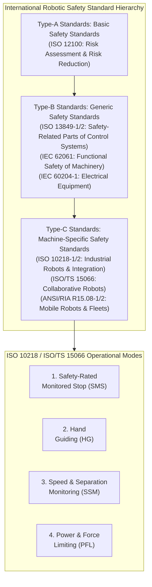
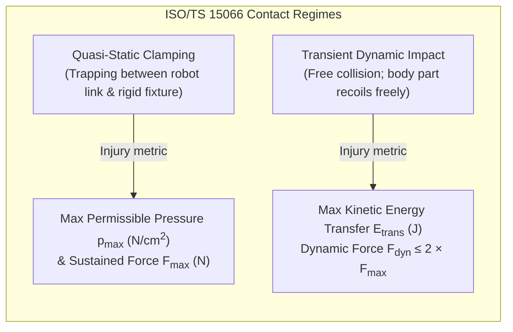
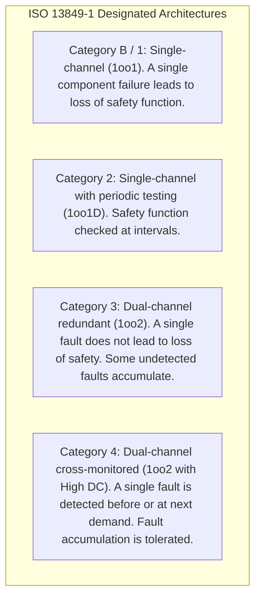
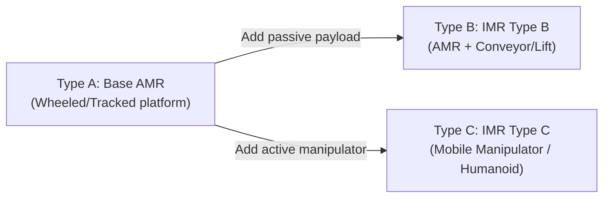

import ChapterProgress from '@site/src/components/ChapterProgress';
import QuizEngine from '@site/src/components/QuizEngine';

# Global Robot Safety Standards: ISO 10218, ISO/TS 15066 & ISO 13849

As autonomous bipedal humanoids and high-payload collaborative robots transition from fenced industrial workcells into unstructured commercial, domestic, and logistics spaces, functional safety engineering shifts from a peripheral compliance checklist to a core architectural determinant. A 60 kg humanoid robot operating with high joint velocities ($> 300^\circ/\text{s}$) and dynamic multi-link momentum carries sufficient mechanical energy to cause fatal blunt-force trauma or irreversible crushing injuries upon unmitigated human contact.

Designing safety-critical robotic systems requires navigating a layered hierarchy of international safety standards established by the International Organization for Standardization (ISO), the International Electrotechnical Commission (IEC), and the American National Standards Institute (ANSI) / Robotic Industries Association (RIA). This chapter develops the mathematical foundations, regulatory architectures, and engineering methodologies governing robot safety: from classical machine guarding in ISO 10218-1/2 to collaborative biomechanical pain and pressure limits in ISO/TS 15066, deterministic Performance Levels (PL) in ISO 13849-1, mobile robot safety in ANSI/RIA R15.08, and the acute regulatory vacuum presented by free-walking bipedal humanoid platforms.



---

## 1. The Standard Hierarchy & Legal Enforceability

In machine safety law—predicated on the European Union Machinery Directive (Directive 2006/42/EC) and its successor, the EU Machinery Regulation (Regulation (EU) 2023/1230), as well as OSHA 29 CFR 1910 in the United States—safety standards follow a strict tri-level hierarchy:

1. **Type-A Standards (Fundamental Safety Standards)**: Applicable to all machinery. **ISO 12100:2010** defines the core methodology of iterative risk assessment and risk reduction through intrinsically safe design, engineering safeguards, and administrative information for use.
2. **Type-B Standards (Generic Group Safety Standards)**: Subdivided into:
   - **Type-B1 Standards** on particular safety aspects: e.g., safe distances (**ISO 13857**), surface temperatures (**ISO 13732-1**), and functional safety architecture (**ISO 13849-1/2**, **IEC 62061**).
   - **Type-B2 Standards** on safety devices: e.g., emergency stop pushbuttons (**ISO 13850**), electro-sensitive protective equipment (ESPE / Light Curtains, **IEC 61496-1**), and two-hand control devices (**ISO 13851**).
3. **Type-C Standards (Machine-Specific Safety Standards)**: Detailed safety requirements for a particular machine family. When a Type-C standard deviates from Type-A or Type-B provisions, the Type-C standard takes precedence. In robotics:
   - **ISO 10218-1:2011**: Safety requirements for the robot manufacturer (the manipulator and its controller).
   - **ISO 10218-2:2011**: Safety requirements for robot system integration and installation.
   - **ISO/TS 15066:2016**: Technical specification for collaborative robot operations.
   - **ANSI/RIA R15.08-1-2020**: Standard for industrial mobile robots (AMRs and AGVs).

When a robotic product complies with a "harmonized" Type-C standard published in the Official Journal of the European Union, it benefits from a legal **presumption of conformity** with the essential health and safety requirements (EHSR) of the Machinery Directive, enabling CE self-declaration or certified third-party notified body marking.

---

## 2. ISO 10218-1/2: Industrial Robots & Collaborative Operation

Historically, industrial robotics enforced safety through physical segregation: interlocking perimeter fences, optoelectronic light curtains, and safety interlock switches that removed power to actuator motor drives the moment a human entered the safeguarded space.

ISO 10218 introduced a formal definition for **collaborative workspace**—a safeguarded space where the robot system and a human operator can perform tasks concurrently. ISO 10218-1 and ISO 10218-2 identify four distinct collaborative operational modes:

### The Four Collaborative Modes

1. **Safety-Rated Monitored Stop (SMS)**:
   The robot may operate at high speeds while the human is outside the collaborative space. When a human crosses into the monitored collaborative zone (detected via laser scanners or safety mats), the robot initiates an active deceleration and halts motion. Drive torque remains applied to hold position (Safe Operating Stop, SOS), but all trajectory generation is suspended. If the drive drifts or safety monitoring detects uncommanded joint motion exceeding a calibrated threshold ($\Delta q > \epsilon$), power is abruptly cut via electromechanical contactors (Safe Torque Off, STO). The robot resumes operation automatically only after the human leaves the zone.
2. **Hand Guiding (HG)**:
   The operator directly guides the robot motion by applying force to an articulated hand-guiding device or handle mounted at or near the end-effector. The system requires an enabling device (typically a three-position dead-man switch) and an emergency stop button physically integrated into the guiding device. The robot operates under safe-limited speed ($v \le 250\text{ mm/s}$) and safe-limited acceleration.
3. **Speed and Separation Monitoring (SSM)**:
   The robot and human coexist and move simultaneously within the same physical space. The distance between the human and robot is continuously tracked by 2D/3D safety-rated perception systems (e.g., safety LiDARs, time-of-flight stereovision). The robot's operational speed is dynamically modulated such that the protective separation distance $S_p$ is maintained at all times. If the human approaches too closely, the robot decelerates; if the separation distance falls below $S_p$, a protective stop is triggered before contact can occur.
4. **Power and Force Limiting (PFL)**:
   Physical contact between the robot and human is intentionally permitted during normal or anomalous operation. However, the contact forces and mechanical energy dissipation must be physically or control-limited so that any incidental impact or clamping event does not exceed strictly calibrated biomechanical pain and injury thresholds.

---

## 3. ISO/TS 15066: Biomechanical Pain & Injury Thresholds

While ISO 10218 established the conceptual framework for PFL, it did not provide quantitative numerical limits. In 2016, ISO published **ISO/TS 15066**, establishing the first comprehensive biomechanical thresholds derived from human cadaveric testing and pain tolerance clinical trials conducted by the University of Mainz.

### Contact Physics: Transient vs. Quasi-Static Contact

ISO/TS 15066 rigorously divides physical contact into two fundamental kinematic categories:

1. **Quasi-Static Clamping (Trapping / Crushing)**:
   Contact where a human body part is trapped or clamped between a moving robot link and a rigid stationary surface (e.g., a table, machine frame, or wall), or between two converging robot links. The contact duration is sustained ($t > 0.5\text{ s}$), and the injury mechanism is compressive tissue deformation, ischemia, or skeletal fracture.
2. **Transient Dynamic Impact (Free Collision)**:
   Contact where the human body part is struck by a moving robot link but is free to recoil or retract without being clamped against a secondary surface. The contact duration is brief ($t \approx 0.05\text{ s}$), and human body inertia absorbs part of the impact kinetic energy.



### Kinetic Energy Transfer & Reduced Mass Formulation

In transient impacts, the maximum kinetic energy transferred to the human tissue is governed by the relative velocity and the **effective reduced mass** of the coupled robot-human impact system.

For a one-dimensional translational impact along normal unit vector $\mathbf{u} \in \mathbb{R}^3$, the effective mass of the robot manipulator at joint configuration $\mathbf{q}$ is given by the Operational Space Inertia Matrix $\boldsymbol{\Lambda}(\mathbf{q})$:

$$
\boldsymbol{\Lambda}(\mathbf{q}) = \left( \mathbf{J}(\mathbf{q}) \mathbf{M}(\mathbf{q})^{-1} \mathbf{J}(\mathbf{q})^T \right)^{-1}
$$

The scalar effective mass of the robot in the impact direction $\mathbf{u}$ is:

$$
m_{robot}(\mathbf{q}, \mathbf{u}) = \frac{1}{\mathbf{u}^T \boldsymbol{\Lambda}(\mathbf{q})^{-1} \mathbf{u}} = \frac{1}{\mathbf{u}^T \mathbf{J}(\mathbf{q}) \mathbf{M}(\mathbf{q})^{-1} \mathbf{J}(\mathbf{q})^T \mathbf{u}}
$$

The human body part also presents an effective inertial resistance $m_{human}$, tabulated empirically in ISO/TS 15066 (e.g., $m_{human} = 4.4\text{ kg}$ for the hand, $m_{human} = 40\text{ kg}$ for the torso, $m_{human} = 4.6\text{ kg}$ for the head).

The **effective reduced mass** $m_{red}$ of the two-body collision pair is:

$$
m_{red} = \left( \frac{1}{m_{robot}} + \frac{1}{m_{human}} \right)^{-1} = \frac{m_{robot} m_{human}}{m_{robot} + m_{human}}
$$

The total kinetic energy dissipated into the compliant human tissue during an inelastic collision where the relative approach velocity is $v_{rel} = \|\mathbf{v}_{robot} - \mathbf{v}_{human}\|$ is:

$$
E = \frac{1}{2} m_{red} v_{rel}^2
$$

If the human body part behaves as an elastic spring with effective surface contact stiffness $k_{human}$ (in $\text{N/mm}$) over contact area $A$ (in $\text{cm}^2$), the maximum dynamic impact force generated during compression is:

$$
F_{dyn} = v_{rel} \sqrt{m_{red} k_{human}}
$$

To prevent the dynamic peak pressure $p_{dyn} = \frac{F_{dyn}}{A}$ from exceeding the permissible threshold $p_{max}$, the maximum allowable Cartesian velocity $v_{max}$ of the robot link is strictly bounded:

$$
v_{max} = \frac{p_{max} A}{\sqrt{m_{red} k_{human}}} = \frac{F_{max, dyn}}{\sqrt{m_{red} k_{human}}}
$$

### The 29 Human Body Regions

ISO/TS 15066 defines maximum permissible quasi-static pressure, quasi-static force, and transient energy limits across **29 distinct anatomical regions**. A representative sample of these regulatory limits is summarized below:

| Body Region ID | Anatomical Location | Quasi-Static Pressure $p_{max}$ ($\text{N/cm}^2$) | Quasi-Static Force $F_{max}$ ($\text{N}$) | Effective Mass $m_{human}$ ($\text{kg}$) | Spring Constant $k$ ($\text{N/mm}$) |
|---|---|---|---|---|---|
| **Skull / Forehead** | Head (Meninges, Calvaria) | 130 | 130 | 4.6 | 150 |
| **Masticatory Muscle** | Face (Jaw, Cheeks) | 110 | 65 | 4.6 | 75 |
| **Neck** | Cervical Spine, Throat | 140 | 150 | 1.2 | 50 |
| **Pectoral Muscle** | Chest (Thorax) | 140 | 140 | 40.0 | 25 |
| **Abdominal Muscle** | Abdomen (Stomach) | 140 | 140 | 40.0 | 10 |
| **Deltoid Muscle** | Upper Arm / Shoulder | 190 | 150 | 3.0 | 30 |
| **Forearm Muscle** | Ventral / Dorsal Forearm | 180 | 160 | 2.0 | 40 |
| **Hand Palm / Back** | Metacarpus | 200 | 140 | 0.6 | 75 |
| **Finger Tip** | Distal Phalanx | 300 | 140 | 0.1 | 100 |
| **Thigh Muscle** | Quadriceps | 250 | 220 | 15.0 | 50 |
| **Shin / Calf** | Tibia / Gastrocnemius | 220 | 210 | 4.0 | 60 |

*Note: For transient dynamic impacts, ISO/TS 15066 permits transient forces up to $2 \times F_{max}$ provided the impact duration satisfies $t \le 0.5\text{ s}$. Contacts with the skull, temple, eyes, and larynx are strictly forbidden in collaborative operations; mechanical protective shielding or minimum geometric clearances must prevent access to these zones.*

---

## 4. Dynamic Speed & Separation Monitoring (SSM)

Under Speed and Separation Monitoring (SSM), the safety controller maintains a dynamic protective separation distance $S_p$ between the robot and any tracked human operator.

### The Formal Kinematic Derivation

The minimum separation distance $S_p$ at time $t_0$ must guarantee that if the human moves directly toward the robot at maximum approach velocity $v_h$, and the robot initiates a protective stop at the exact moment the threshold is breached, the robot comes to a complete standstill before physical contact occurs:

$$
S_p(t_0) = S_h + S_r + S_s + C
$$

Where:
- **$S_h$ (Human Traveled Distance)**: The distance the human travels during the system's reaction latency and the robot's physical braking phase:
  $$S_h = v_h (T_r + T_s)$$
  where $v_h$ is the maximum expected human approach speed (standardized by ISO 13855 as $v_h = 1600\text{ mm/s}$ for general bodily approach, or $2000\text{ mm/s}$ for upper limb / hand reaching), $T_r$ is the worst-case sensor-to-actuator reaction latency (sensor exposure + network communication + controller cycle + brake release/engage delay), and $T_s$ is the robot's physical stopping time under maximum deceleration.
- **$S_r$ (Robot Reaction Distance)**: The distance the robot traverses during the system reaction latency $T_r$ before brakes or active decelerations engage:
  $$S_r = v_r T_r$$
  where $v_r$ is the robot's current directed velocity toward the human.
- **$B$ or $S_s$ (Robot Stopping Distance)**: The mechanical stopping distance traversed by the robot from the instant braking initiates until $v_r = 0$. Under constant safe-limited deceleration $a_{max}$:
  $$B = \frac{v_r^2}{2 a_{max}} = \frac{1}{2} v_r T_s$$
- **$C$ (Intrusion Distance / Measurement Tolerance)**: An empirical margin accounting for sensor depth inaccuracy, human clothing penetration, reach-through tolerances, and field-of-view occlusion uncertainties:
  $$C = z_s + d_{sensor\_uncertainty}$$

Combining these terms yields the fundamental ISO/TS 15066 SSM equation:

$$
S_p(t_0) = v_h (T_r + T_s) + v_r T_r + \frac{v_r^2}{2 a_{max}} + C
$$

```mermaid
sequenceDiagram
    autonumber
    participant Human as Human Operator (v_h)
    participant Sensor as Safety Perception (LiDAR/3D Vision)
    participant Controller as Safety Controller (SRP/CS)
    participant Drives as Actuator Brakes (Deceleration a_max)

    Human->>Sensor: Human steps across boundary d(t) < S_p
    Sensor->>Controller: Sensor detection + filtering (t_sensor)
    Controller->>Drives: Safety logic eval + STO/SS1 command (t_logic)
    Note over Controller,Drives: Reaction Time T_r = t_sensor + t_bus + t_logic
    Drives->>Drives: Actuator dynamic braking initiates (t = T_r)
    Drives-->>Drives: Robot decelerates at a_max over duration T_s
    Note over Human,Drives: Total stopping distance = B = v_r^2 / (2 a_max)
    Drives->>Drives: Robot velocity reaches 0 m/s
    Note over Human,Drives: Minimum residual clearance &ge; C
```

---

## 5. ISO 13849-1: Functional Safety & Performance Levels

While ISO 10218 and ISO/TS 15066 specify *what* physical constraints must be enforced, **ISO 13849-1** governs the *architectural reliability* of the Safety-Related Parts of Control Systems (SRP/CS).

### Performance Levels (PL a to PL e)

ISO 13849-1 defines five distinct **Performance Levels (PL)**, which quantify the probability of a dangerous failure per hour ($\text{PFH}_D$):

| Performance Level (PL) | Probability of Dangerous Failure per Hour ($\text{PFH}_D$) ($\text{h}^{-1}$) | Approximate Equivalent IEC 62061 / IEC 61508 SIL Rating |
|---|---|---|
| **PL a** | $10^{-5} \le \text{PFH}_D < 10^{-4}$ | No equivalent SIL |
| **PL b** | $3 \times 10^{-6} \le \text{PFH}_D < 10^{-5}$ | SIL 1 |
| **PL c** | $10^{-6} \le \text{PFH}_D < 3 \times 10^{-6}$ | SIL 1 |
| **PL d** | $10^{-7} \le \text{PFH}_D < 10^{-6}$ | SIL 2 |
| **PL e** | $10^{-8} \le \text{PFH}_D < 10^{-7}$ | SIL 3 |

For industrial and collaborative robotics, **PL d with Category 3** or **PL e with Category 4** is almost universally required for primary safety functions (Emergency Stop, Safe Limited Speed, Safety-Rated Monitored Stop).

### The Four Determinants of Performance Level

Achieving a specific PL requires satisfying four interdependent criteria:
1. **Designated Category (Architecture)**: Structural redundancy and cross-monitoring topology (Categories B, 1, 2, 3, 4).
2. **Mean Time to Dangerous Failure of each channel ($\text{MTTF}_D$)**:
   - Low: $3\text{ years} \le \text{MTTF}_D < 10\text{ years}$
   - Medium: $10\text{ years} \le \text{MTTF}_D < 30\text{ years}$
   - High: $30\text{ years} \le \text{MTTF}_D \le 100\text{ years}$
3. **Diagnostic Coverage ($\text{DC}_{avg}$)**: The percentage of dangerous failures detected by internal automated self-tests:
   $$\text{DC}_{avg} = \frac{\sum \frac{\text{DC}_i}{\text{MTTF}_{D, i}}}{\sum \frac{1}{\text{MTTF}_{D, i}}}$$
   - None: $\text{DC} < 60\%$
   - Low: $60\% \le \text{DC} < 90\%$
   - Medium: $90\% \le \text{DC} < 99\%$
   - High: $\text{DC} \ge 99\%$
4. **Common Cause Failure ($\text{CCF}$)**: Susceptibility to shared thermal, electrical, or environmental failure modes, scored via a checklist (minimum 65 points required out of 100).



---

## 6. ANSI/RIA R15.08: Industrial Mobile Robots (AMRs)

With the advent of autonomous mobile robots (AMRs) that transport goods through warehouses, the stationary assumptions of ISO 10218 were violated. In 2020, ANSI/RIA published **ANSI/RIA R15.08-1**, expanding mobile robotics safety into three explicit categories:

1. **Type A (Autonomous Mobile Robot - AMR)**: The bare mobile base capable of autonomous navigation within an unstructured map, without an active task-specific payload.
2. **Type B (Industrial Mobile Robot - IMR Type B)**: An AMR equipped with a passive attachment (e.g., roller conveyor, tote lift, fixed shelving).
3. **Type C (Industrial Mobile Robot - IMR Type C)**: An AMR equipped with an articulated manipulator or high-DoF robotic arm.



### Dynamic Footprint Expansion & Safety Zones

ANSI/RIA R15.08 mandates that mobile robots adjust their active safety sensor fields dynamically based on:
- **Instantaneous Velocity**: Switching to longer forward LiDAR safety zones as linear velocity increases ($v > 1.5\text{ m/s}$).
- **Turning Radius / Yaw Rate**: Activating asymmetrical side-curving warning fields during pivot turns.
- **Payload Configuration**: Expanding the protective footprint when carrying overhang loads.
- **Braking Distance Variation**: Factoring floor friction coefficient variations ($\mu \in [0.3, 0.9]$) and payload mass shifts into real-time stopping distances.

---

## 7. Regulatory Gap Analysis for Untethered Humanoids

While existing standards govern stationary arms (ISO 10218, ISO/TS 15066) and wheeled mobile bases (ANSI/RIA R15.08), **untethered bipedal humanoids expose critical gaps in global safety regulations**:

### 1. Inapplicability of Zero-Velocity Safe States
In classical machinery, the ultimate fail-safe state is **Safe Torque Off (STO)**—de-energizing all motor windings and applying mechanical friction brakes. On a fixed-base arm or wheeled AMR, STO halts the robot rigidly in place.
On a dynamically balanced bipedal humanoid, abruptly de-energizing joint actuators at walking mid-stance causes the robot to **collapse gravitationally**, acting as an unconstrained 60 kg inverted pendulum falling onto nearby human personnel. The traditional STO response directly *induces* an acute crushing hazard.

### 2. Multi-Contact Balance & Momentum Redistribution
Existing cobot standards assume a rigid base anchored to the factory floor. In a biped, joint accelerations in the arms or torso directly inject reaction wrenches into the floating pelvis:

$$
\mathbf{w}_{base} = \mathbf{M}_{bp}(\mathbf{q}) \ddot{\mathbf{q}}_j + \mathbf{h}_{base}(\mathbf{q}, \dot{\mathbf{q}})
$$

If an arm decelerates rapidly to comply with ISO/TS 15066 speed limits, the sudden angular momentum transfer $\dot{\mathbf{H}}_{pelvis}$ may trigger an uncontrollable foot tip-over if the Zero-Moment Point (ZMP) leaves the support polygon, turning a low-force collaborative interaction into a catastrophic fall.

### 3. Whole-Body Collision Geometry
Unlike a stationary arm where the danger zone is localized around the end-effector and forearm, a humanoid presents moving links at head, torso, knee, and foot heights simultaneously. Standard planar 2D LiDAR scanners mounted at 15 cm above the floor (standard on AMRs) fail to detect approaching human arms, table overhangs, or overhead crane hooks, necessitating certified 3D volumetric safety perception fields that do not yet exist under ISO 13849 PL e certification.

---

## 8. Python Implementation: Dynamic Speed & Separation Monitoring (SSM) Calculator

Below is a production-grade Python calculator implementing the complete ISO/TS 15066 Speed and Separation Monitoring (SSM) algorithm, including real-time human tracking, dynamic stopping distance computation, 29-region biomechanical threshold lookups, and deterministic safety zone state transitions.

```python
"""
Dynamic Speed and Separation Monitoring (SSM) Compliance Calculator
Compliant with ISO/TS 15066:2016 and ISO 13849-1 (PL d / Category 3).
"""

from dataclasses import dataclass
from enum import Enum
from typing import Dict, Optional, Tuple
import math


class SafetyState(Enum):
    NORMAL_OPERATION = 1       # Human outside monitored boundary; full speed allowed
    SPEED_REDUCTION = 2        # Human approaching; speed dynamically scaled
    PROTECTIVE_STOP = 3        # Separation distance breached; Safe Stop 1 (SS1) commanded
    EMERGENCY_STOP = 4         # Immediate Safe Torque Off (STO) / Mechanical Brake


@dataclass(frozen=True)
class BiomechanicalLimit:
    region_name: str
    p_max_quasi_static: float  # Maximum quasi-static pressure in N/cm^2
    f_max_quasi_static: float  # Maximum quasi-static force in N
    p_max_transient: float     # Maximum transient impact pressure in N/cm^2
    f_max_transient: float      # Maximum transient impact force in N
    effective_mass_kg: float   # Human body part effective mass m_human (kg)
    spring_stiffness_n_mm: float  # Human tissue stiffness k (N/mm)


# ISO/TS 15066 Table A.2: Biomechanical Limits for Selected Human Anatomical Regions
ISO_15066_BODY_LIMITS: Dict[str, BiomechanicalLimit] = {
    "skull_forehead": BiomechanicalLimit("Skull / Forehead", 130.0, 130.0, 260.0, 260.0, 4.6, 150.0),
    "face_jaw": BiomechanicalLimit("Face / Jaw", 110.0, 65.0, 220.0, 130.0, 4.6, 75.0),
    "neck": BiomechanicalLimit("Neck", 140.0, 150.0, 280.0, 300.0, 1.2, 50.0),
    "chest": BiomechanicalLimit("Chest (Pectoral)", 140.0, 140.0, 280.0, 280.0, 40.0, 25.0),
    "abdomen": BiomechanicalLimit("Abdomen", 140.0, 140.0, 280.0, 280.0, 40.0, 10.0),
    "upper_arm": BiomechanicalLimit("Upper Arm / Shoulder", 190.0, 150.0, 380.0, 300.0, 3.0, 30.0),
    "forearm": BiomechanicalLimit("Forearm", 180.0, 160.0, 360.0, 320.0, 2.0, 40.0),
    "hand_palm": BiomechanicalLimit("Hand / Palm", 200.0, 140.0, 400.0, 280.0, 0.6, 75.0),
    "fingertip": BiomechanicalLimit("Fingertip", 300.0, 140.0, 600.0, 280.0, 0.1, 100.0),
    "thigh": BiomechanicalLimit("Thigh", 250.0, 220.0, 500.0, 440.0, 15.0, 50.0),
    "lower_leg": BiomechanicalLimit("Lower Leg (Shin)", 220.0, 210.0, 440.0, 420.0, 4.0, 60.0),
}


class SpeedSeparationMonitor:
    """
    Evaluates real-time protective separation distance S_p between an autonomous
    manipulator or mobile humanoid and a tracked human operator.
    """

    def __init__(
        self,
        t_reaction_s: float = 0.080,         # Total reaction time T_r (80 ms: perception + bus + brake trigger)
        a_robot_max_mps2: float = 2.5,        # Maximum deceleration a_max (m/s^2)
        v_human_max_mps: float = 1.6,         # Human approach speed v_h (1.6 m/s per ISO 13855)
        c_clearance_intrusion_m: float = 0.20, # Intrusion & measurement uncertainty C (200 mm)
    ) -> None:
        self.t_r: float = t_reaction_s
        self.a_max: float = a_robot_max_mps2
        self.v_h_max: float = v_human_max_mps
        self.c_margin: float = c_clearance_intrusion_m

    def compute_protective_distance(
        self,
        v_robot_directed_mps: float,
        v_human_directed_mps: Optional[float] = None,
    ) -> float:
        """
        Calculates S_p according to ISO/TS 15066 clause 5.5.4.
        
        S_p = v_h * (T_r + T_s) + v_r * T_r + (v_r^2 / (2 * a_max)) + C
        where T_s = v_r / a_max
        """
        v_r = max(0.0, v_robot_directed_mps)
        v_h = self.v_h_max if v_human_directed_mps is None else max(0.0, v_human_directed_mps)

        # Robot physical braking time from speed v_r to 0 under max deceleration a_max
        t_s = v_r / self.a_max if self.a_max > 0.0 else 0.0

        # Component distances
        s_human = v_h * (self.t_r + t_s)
        s_robot_reaction = v_r * self.t_r
        s_robot_braking = (v_r ** 2) / (2.0 * self.a_max) if self.a_max > 0.0 else 0.0

        s_p = s_human + s_robot_reaction + s_robot_braking + self.c_margin
        return s_p

    def compute_max_safe_speed(
        self,
        measured_distance_m: float,
        v_human_directed_mps: Optional[float] = None,
    ) -> float:
        """
        Inverts the S_p quadratic equation to determine the maximum permissible robot velocity
        v_r_max that satisfies S_p(v_r_max) <= measured_distance_m.
        
        Quadratic form:
        (1 / (2 * a_max)) * v_r^2 + (T_r + (v_h / a_max)) * v_r + (v_h * T_r + C - S_measured) = 0
        """
        v_h = self.v_h_max if v_human_directed_mps is None else max(0.0, v_human_directed_mps)
        d_meas = measured_distance_m

        a = 1.0 / (2.0 * self.a_max)
        b = self.t_r + (v_h / self.a_max)
        c = (v_h * self.t_r) + self.c_margin - d_meas

        discriminant = (b ** 2) - (4.0 * a * c)

        if discriminant < 0.0:
            # Even at v_r = 0, distance is insufficient -> Robot must be stopped
            return 0.0

        v_safe = (-b + math.sqrt(discriminant)) / (2.0 * a)
        return max(0.0, v_safe)

    def evaluate_safety_state(
        self,
        measured_distance_m: float,
        v_robot_directed_mps: float,
        v_human_directed_mps: Optional[float] = None,
    ) -> Tuple[SafetyState, float, float]:
        """
        Evaluates the current discrete safety state, required S_p, and max allowed speed.
        """
        s_p = self.compute_protective_distance(v_robot_directed_mps, v_human_directed_mps)
        v_safe = self.compute_max_safe_speed(measured_distance_m, v_human_directed_mps)

        if measured_distance_m <= self.c_margin:
            state = SafetyState.EMERGENCY_STOP
        elif measured_distance_m < s_p:
            state = SafetyState.PROTECTIVE_STOP
        elif measured_distance_m < (s_p * 1.35):
            state = SafetyState.SPEED_REDUCTION
        else:
            state = SafetyState.NORMAL_OPERATION

        return state, s_p, v_safe

    @staticmethod
    def calculate_impact_energy_limit(
        body_part_key: str,
        robot_effective_mass_kg: float,
        contact_area_cm2: float,
    ) -> Dict[str, float]:
        """
        Computes maximum permissible impact velocity and dissipated kinetic energy
        for a transient collision with a specified anatomical region under ISO/TS 15066.
        """
        limit = ISO_15066_BODY_LIMITS.get(body_part_key)
        if limit is None:
            raise ValueError(f"Unknown anatomical region: {body_part_key}")

        # Reduced mass calculation
        m_r = robot_effective_mass_kg
        m_h = limit.effective_mass_kg
        m_red = (m_r * m_h) / (m_r + m_h)

        # Tissue contact spring stiffness (converted N/mm to N/m: k * 1000)
        k_human_si = limit.spring_stiffness_n_mm * 1000.0

        # Maximum permissible transient force
        # Governed by lesser of transient force limit and pressure * area
        f_max_from_pressure = limit.p_max_transient * contact_area_cm2
        f_max_permissible = min(limit.f_max_transient, f_max_from_pressure)

        # Maximum permissible relative impact velocity: v_rel = F_max / sqrt(m_red * k)
        v_max_rel = f_max_permissible / math.sqrt(m_red * k_human_si)

        # Total dissipated kinetic energy: E = 0.5 * m_red * v_rel^2
        e_transient = 0.5 * m_red * (v_max_rel ** 2)

        return {
            "region": limit.region_name,
            "reduced_mass_kg": m_red,
            "f_max_allowed_n": f_max_permissible,
            "v_max_impact_mps": v_max_rel,
            "e_max_kinetic_joules": e_transient,
        }


if __name__ == "__main__":
    monitor = SpeedSeparationMonitor(
        t_reaction_s=0.080,      # 80 ms reaction latency
        a_robot_max_mps2=3.0,    # 3.0 m/s^2 deceleration
        v_human_max_mps=1.6,     # 1.6 m/s standard approach speed
        c_clearance_intrusion_m=0.25 # 250 mm safety intrusion margin
    )

    print("=================================================================")
    print("  ISO/TS 15066 SPEED AND SEPARATION MONITORING (SSM) SIMULATION  ")
    print("=================================================================\n")

    # Scenario: Robot is extending arm toward workstation at 1.2 m/s
    robot_speed = 1.2
    test_distances = [4.0, 2.5, 1.8, 1.2, 0.5, 0.15]

    for dist in test_distances:
        state, req_sp, v_allowed = monitor.evaluate_safety_state(
            measured_distance_m=dist,
            v_robot_directed_mps=robot_speed
        )
        print(f"Distance: {dist:4.2f} m | Robot Speed: {robot_speed:.1f} m/s | "
              f"Required S_p: {req_sp:4.2f} m | Max Permissible Speed: {v_allowed:4.2f} m/s | "
              f"State: {state.name}")

    print("\n-----------------------------------------------------------------")
    print("  BIOMECHANICAL TRANSIENT IMPACT VELOCITY LIMITS (60 kg Humanoid)")
    print("-----------------------------------------------------------------")
    
    # Evaluate collision with robot arm effective mass = 5.0 kg
    robot_link_mass = 5.0
    tool_contact_area = 3.0  # 3 cm^2 contact surface

    for region_key in ["forearm", "chest", "hand_palm", "skull_forehead"]:
        res = monitor.calculate_impact_energy_limit(region_key, robot_link_mass, tool_contact_area)
        print(f"Region: {res['region']:<20} | m_red: {res['reduced_mass_kg']:4.2f} kg | "
              f"F_max: {res['f_max_allowed_n']:5.1f} N | V_max: {res['v_max_impact_mps']:4.2f} m/s | "
              f"E_max: {res['e_max_kinetic_joules']:4.2f} J")
```

---

<ChapterProgress chapterId="11-1-robot-safety-standards" moduleId="module11" totalChapters={6} />

## Chapter Mastery Check

<QuizEngine
  quizId="quiz-11-1"
  title="Module 11.1 Mastery Check: Robot Safety Standards"
  moduleId="module11"
  passThreshold={70}
  questions={[
    {
      id: "q1",
      question: "Under ISO/TS 15066, what is the fundamental difference between quasi-static clamping and transient dynamic impact?",
      options: [
        "Quasi-static clamping occurs only when the robot is unpowered, whereas transient impact occurs at high speeds",
        "Quasi-static clamping involves entrapment of a body part between moving and stationary parts (sustained contact > 0.5 s), whereas transient impact allows the body part to freely recoil without entrapment",
        "Quasi-static clamping applies only to mobile bases, whereas transient impact applies to robot arms",
        "Transient impact has lower permissible pressure thresholds than quasi-static clamping"
      ],
      correctIndex: 1,
      explanation: "Quasi-static clamping traps human tissue against a secondary rigid fixture for >0.5 s, causing compressive crushing. Transient impact allows the body part to recoil freely, dissipating kinetic energy over a brief impulse duration (~0.05 s), allowing up to 2x higher peak forces."
    },
    {
      id: "q2",
      question: "In the dynamic Speed and Separation Monitoring (SSM) equation Sp = v_h*(T_r + T_s) + v_r*T_r + B + C, what physical phenomenon does term B represent?",
      options: [
        "The reaction distance traversed by the human during sensor processing latency",
        "The sensor depth measurement tolerance and clothing penetration margin",
        "The physical stopping distance of the robot from the initiation of braking until zero velocity (v_r^2 / (2 * a_max))",
        "The biomechanical tissue compression distance of the human anatomical region"
      ],
      correctIndex: 2,
      explanation: "B represents the physical braking distance traversed by the robot from the moment braking decelerations engage at t = T_r until the robot reaches a complete standstill (v_r = 0), calculated as B = v_r^2 / (2 * a_max) = 0.5 * v_r * T_s."
    },
    {
      id: "q3",
      question: "Why does commanding an immediate Safe Torque Off (STO) trigger an acute hazard when applied to a walking bipedal humanoid robot?",
      options: [
        "Because STO reverses the direction of the motor current, causing high electrical back-EMF",
        "Because abruptly removing actuator torque causes the floating-base humanoid to lose balance and collapse as an inverted pendulum, creating severe falling and crushing hazards",
        "Because ISO 13849 forbids the use of STO in industrial facilities",
        "Because bipedal robots have no electromechanical friction brakes"
      ],
      correctIndex: 1,
      explanation: "Unlike stationary manipulators or wheeled AMRs that remain statically stable upon de-energization, a bipedal humanoid is a dynamically balanced floating-base inverted pendulum. Cut-off of motor torque (STO) without controlled multi-link deceleration causes the robot to tip over and violently strike personnel."
    }
  ]}
/>

---

## Annotated Research Citations & Regulatory References

1. **International Organization for Standardization (ISO). (2011).** *ISO 10218-1:2011: Robots and robotic devices — Safety requirements for industrial robots — Part 1: Robots*. Geneva, Switzerland.  
   *Foundational Type-C standard governing mechanical hazard mitigation, control system performance, and collaborative modes for industrial manipulators.*

2. **International Organization for Standardization (ISO). (2016).** *ISO/TS 15066:2016: Robots and robotic devices — Collaborative robots*. Geneva, Switzerland.  
   *Specifies quantitative biomechanical thresholds for 29 human body regions and the formal mathematical model for Speed and Separation Monitoring (SSM).*

3. **International Organization for Standardization (ISO). (2023).** *ISO 13849-1:2023: Safety of machinery — Safety-related parts of control systems — Part 1: General principles for design*. Geneva, Switzerland.  
   *Defines Performance Levels (PL a through PL e), designated architectures (Categories B, 1–4), MTTF_D, and diagnostic coverage criteria for safety-critical machine controllers.*

4. **American National Standards Institute / Robotic Industries Association (ANSI/RIA). (2020).** *ANSI/RIA R15.08-1-2020: Standard for Industrial Mobile Robots and Mobile Robot Systems — Part 1: Safety Requirements*. Ann Arbor, MI.  
   *Establishes safety classifications for AMRs (Type A), passive attachment platforms (Type B), and mobile manipulators (Type C), including dynamic footprint expansion.*

5. **Haddadin, S., Albu-Schäffer, A., De Luca, A., & Hirzinger, G. (2017).** *Collision Detection and Safe Reaction in Technology-Embodied Physical Human-Robot Interaction*. IEEE Transactions on Robotics, 33(4), 812–826.  
   *Comprehensive experimental validation of human tissue pain tolerance thresholds and fast momentum-observer-based reflex strategies in industrial cobots.*
