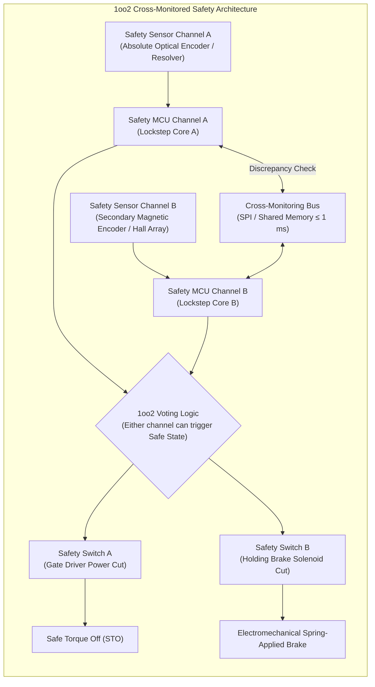
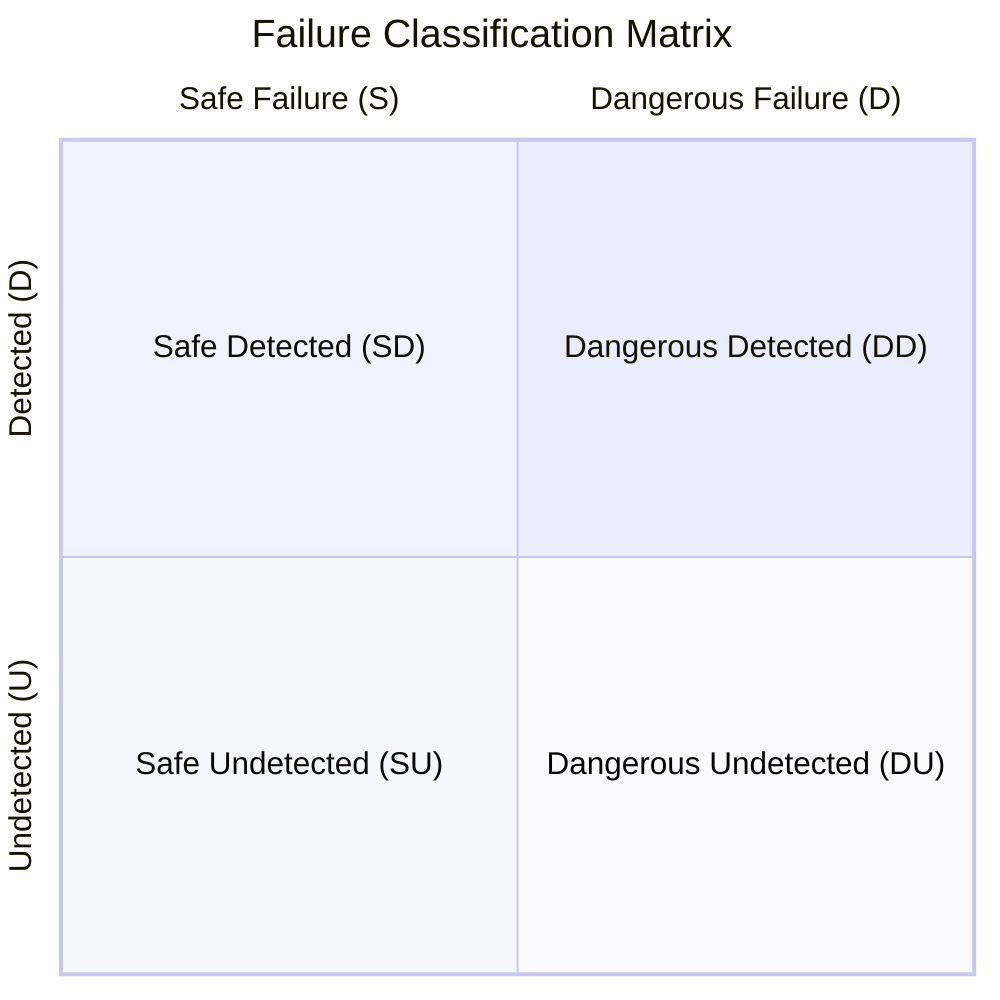
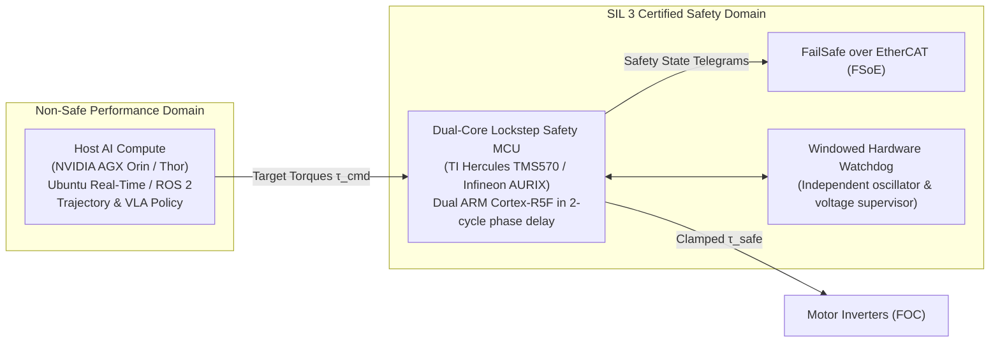
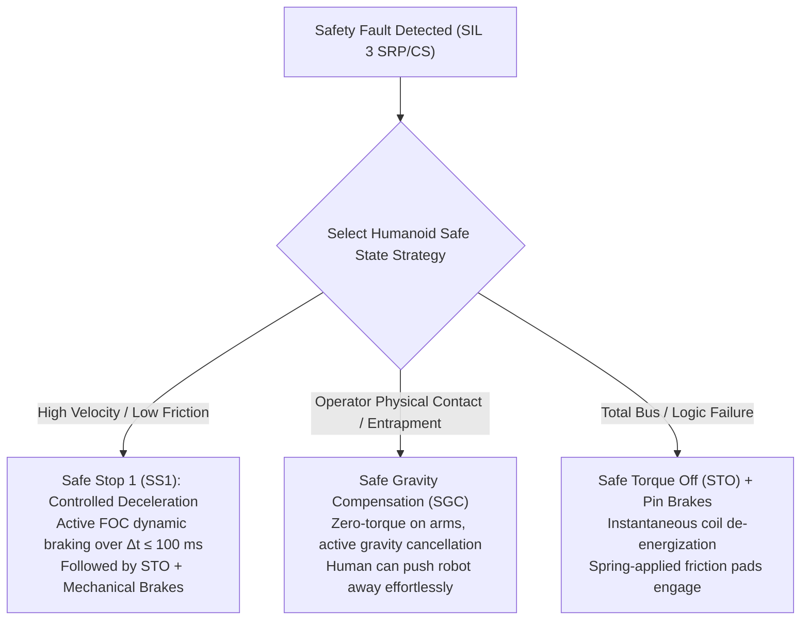
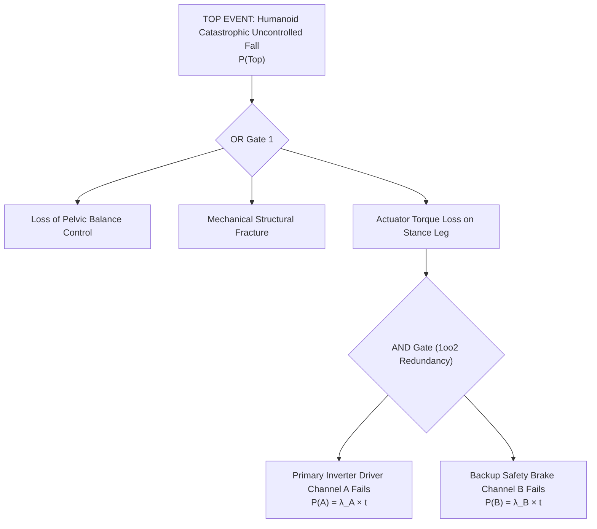

import ChapterProgress from '@site/src/components/ChapterProgress';
import QuizEngine from '@site/src/components/QuizEngine';

# Functional Safety Architecture: SIL Ratings, Redundancy & FMEA

Humanoid robots are complex electro-mechanical-computational organisms consisting of dozens of high-power brushless servo actuators, lithium-ion battery packs capable of hundreds of amperes of discharge, high-speed real-time Ethernet buses (EtherCAT, CAN-FD), and heterogeneous compute clusters running neural foundation policies alongside real-time trajectory generators. In such systems, a single random bit-flip in an FPGA gate array, a cracked encoder flex cable, an insulated-gate bipolar transistor (IGBT) shoot-through fault, or a software memory leak can induce uncontrolled limb flailing, runaway torque generation, or violent ground collapse.

Functional safety engineering—codified under the foundational umbrella standard **IEC 61508** and industrial machinery standard **IEC 62061**—mandates that safety functions operate with quantifiable, provable reliability. This chapter examines the hardware redundancy topologies, voting logic, dual-core lockstep safety microcontrollers, quantitative reliability metrics, failure analysis methodologies (FMEA and FTA), and fail-safe state selections required to achieve high Safety Integrity Levels (SIL 2 / SIL 3) on advanced humanoid platforms.



---

## 1. Safety Integrity Levels (SIL) & Quantitative Reliability

The international standard **IEC 61508** (*Functional Safety of Electrical/Electronic/Programmable Electronic Safety-related Systems*) defines functional safety as the absence of unacceptable risk caused by hazards resulting from functional failures of E/E/PE systems.

### Low Demand vs. High Demand / Continuous Mode

IEC 61508 differentiates safety functions based on operational frequency:
- **Low Demand Mode**: Operating frequency no greater than once per year (typical in petrochemical process plants). The safety metric is the **Average Probability of Dangerous Failure on Demand ($\text{PFD}_{avg}$)**.
- **High Demand or Continuous Mode**: Operating frequency greater than once per year or where the safety function continuously monitors and controls the hazard (universal in robotics and active humanoid locomotion). The safety metric is the **Probability of Dangerous Failure per Hour ($\text{PFH}$)**.

The relationship between SIL ratings and target failure probabilities in high-demand continuous mode is established in the following table:

| Safety Integrity Level (SIL) | Probability of Dangerous Failure per Hour ($\text{PFH}$) ($\text{h}^{-1}$) | Risk Reduction Factor ($\text{RRF} = 1/\text{PFH}$) | Target Humanoid Subsystems |
|---|---|---|---|
| **SIL 1** | $10^{-6} \le \text{PFH} < 10^{-5}$ | $10^5 \text{ to } 10^6$ | Non-critical auxiliary tools, telemetry loggers |
| **SIL 2** | $10^{-7} \le \text{PFH} < 10^{-6}$ | $10^6 \text{ to } 10^7$ | Upper-limb collaborative reach limits, Cartesian speed clamp |
| **SIL 3** | $10^{-8} \le \text{PFH} < 10^{-7}$ | $10^7 \text{ to } 10^8$ | Whole-body E-stop, joint Safe Torque Off (STO), dynamic fall arrest |
| **SIL 4** | $10^{-9} \le \text{PFH} < 10^{-8}$ | $10^8 \text{ to } 10^9$ | Nuclear manipulators, commercial fly-by-wire avionics |

For commercial humanoids operating in close proximity to unshielded humans, primary safety functions—such as E-Stop circuits, safe joint velocity limits, and brake monitoring—must meet at least **SIL 2** or **SIL 3** (corresponding to **ISO 13849-1 PL d** or **PL e**).

---

## 2. Quantitative Failure Metrics: Lambda, DC, and SFF

To mathematically evaluate whether a hardware architecture fulfills a targeted SIL rating, reliability engineers classify all theoretical component failure modes into four disjoint categories:



- **$\lambda_S$ (Safe Failure Rate)**: Failures that cause the system to transition to the safe state or do not compromise the safety function:
  $$\lambda_S = \lambda_{SD} + \lambda_{SU}$$
- **$\lambda_{DD}$ (Dangerous Detected Failure Rate)**: Failures that would inhibit the safety function on demand, but are successfully detected and isolated by internal online diagnostic mechanisms within the defined Fault Reaction Time.
- **$\lambda_{DU}$ (Dangerous Undetected Failure Rate)**: The most hazardous category—failures that prevent the safety function from executing on demand and remain hidden during normal operation until revealed by an explicit proof test or an accident.
- **$\lambda_{total}$**: The total failure rate of the component:
  $$\lambda_{total} = \lambda_S + \lambda_D = \lambda_{SD} + \lambda_{SU} + \lambda_{DD} + \lambda_{DU}$$

### Diagnostic Coverage (DC)

**Diagnostic Coverage ($\text{DC}$)** measures the efficacy of the automated self-tests, hardware watchdogs, plausibility checks, and loopback verifications implemented within the architecture:

$$
\text{DC} = \frac{\sum \lambda_{DD}}{\sum \lambda_D} = \frac{\sum \lambda_{DD}}{\sum (\lambda_{DD} + \lambda_{DU})}
$$

A system with $\text{DC} = 0\%$ detects no dangerous faults; a system with $\text{DC} \ge 99\%$ (classified as "High Diagnostic Coverage" under ISO 13849 and IEC 61508) detects virtually all dangerous hardware corruptions before they cause harm.

### Safe Failure Fraction (SFF)

The **Safe Failure Fraction ($\text{SFF}$)** measures the fraction of total failure rates that result in safe outcomes (either by intrinsic design or through diagnostic intervention):

$$
\text{SFF} = \frac{\sum \lambda_S + \sum \lambda_{DD}}{\sum \lambda_{total}} = \frac{\sum \lambda_S + \sum \lambda_{DD}}{\sum \lambda_S + \sum \lambda_{DD} + \sum \lambda_{DU}}
$$

Under IEC 61508 Table 2 and Table 3, the achieved SFF dictates the maximum permissible SIL for a given hardware fault tolerance (HFT):
- A **Type B subsystem** (complex microcontrollers, FPGAs, ASICs where failure modes cannot be fully predicted):
  - With $\text{HFT} = 0$ (single channel) and $\text{SFF} \ge 90\%$: Maximum SIL 2.
  - With $\text{HFT} = 1$ (dual channel) and $\text{SFF} \ge 90\%$: Maximum SIL 3.

---

## 3. Redundancy Topologies: 1oo1, 1oo2, and 2oo2

Robotics functional safety architectures are synthesized from standardized redundant voting channels denoted as **$M\text{oo}N$** ($M$ out of $N$ channels must agree to maintain operation):

### 1. 1oo1 (One out of One) Architecture
A single channel executing the safety function. Any failure in sensors, processing, or actuators leads either to spurious trip (if safe) or complete failure to protect (if dangerous):

$$
\text{PFH}_{1oo1} = \lambda_{DU}
$$

Single-channel architectures cannot exceed SIL 1 / PL c for complex electronics because $\text{HFT} = 0$.

### 2. 1oo2 (One out of Two) Architecture
Two independent channels operate in parallel. If **either** channel detects an anomaly or requests a safety stop, the safe state is commanded immediately. This configuration maximizes **safety reliability** (fault tolerance against dangerous failures):

$$
\text{PFH}_{1oo2} = 2 (1 - \beta) \lambda_{DU} \left( (1 - \beta) \lambda_{DU} \frac{T_1}{2} + \lambda_{DD} \text{MTTR} \right) + \beta \lambda_D
$$

Where:
- $T_1$ is the periodic proof test interval (e.g., annual overhaul).
- $\text{MTTR}$ is the Mean Time to Restoration.
- $\beta$ is the **Common Cause Failure ($\text{CCF}$)** factor (typically $1\%$ to $5\%$), representing shared vulnerabilities such as voltage surges, ground loops, or thermal hotspots that can disable both channels simultaneously.

In high-demand robotic applications where online diagnostic coverage is high ($\text{DC} \ge 90\%$) and $\text{MTTR} \ll T_1$, the simplified dangerous failure rate per hour is approximated as:

$$
\text{PFH}_{1oo2} \approx (1 - \beta)^2 \lambda_D^2 T_1 + \beta \lambda_D
$$

Notice that without common cause coupling ($\beta = 0$), the failure rate scales with $\lambda_D^2$, providing orders-of-magnitude safety improvements over single-channel systems.

### 3. 2oo2 (Two out of Two) Architecture
Both channels must simultaneously confirm a fault before the safe state is commanded. This architecture maximizes **operational availability** and minimizes spurious false alarms, but *reduces* safety integrity because a single dangerous undetected failure in either channel inhibits the safety function:

$$
\text{PFH}_{2oo2} \approx 2 \lambda_{DU}
$$

For this reason, humanoids employ **1oo2 voting** for safety-critical trip functions (E-stop, STO) and reserve **2oo2 voting** for non-safety task execution channels.

---

## 4. Hardware Safety Controllers & Lockstep Microcontrollers

Modern humanoid architectures enforce a strict structural demarcation between **Performance Compute** (running non-safe high-level autonomy: ROS 2, Vision-Language-Action policies, visual SLAM) and **Deterministic Safety Controllers** (certified to SIL 3 / PL e).



### Dual-Core Lockstep Microcontrollers

In safety microcontrollers such as the **Texas Instruments Hercules TMS570** (ARM Cortex-R4F/R5F) or **Infineon AURIX TC3xx**:
1. **Physical Redundancy**: Two identical CPU cores execute the exact same instruction stream cycle-by-cycle.
2. **Phase Delay & Orthogonal Placement**: Core B runs with a fixed **2-clock-cycle delay** relative to Core A, and its physical silicon layout is rotated $90^\circ$ on the die. This spatial and temporal offset guarantees that localized transient radiation events (single-event upsets from cosmic rays) or localized clock jitter affect both cores differently.
3. **Hardware Comparator**: A cycle-accurate hardware comparator checks the buses of both cores. If a discrepancy is detected at clock cycle $k$, an unmaskable hardware Fault Collection and Control Unit (FCCU) interrupt fires within **1 clock cycle**, forcing outputs into a high-impedance safe state without relying on software.
4. **Built-In Self-Test (BIST)**: Hardware Logic BIST (LBIST) and Memory BIST (MBIST) test the logic gates and SRAM arrays upon boot, achieving $\text{DC} > 99\%$.

---

## 5. Fail-Safe States for Humanoid Platforms

Choosing the appropriate safe state when a safety violation or hardware fault occurs on a bipedal humanoid is one of the most critical dilemmas in robotics safety engineering:



### Comparison of Humanoid Safe State Mechanisms

1. **Safe Torque Off (STO - IEC 61800-5-2)**:
   - *Mechanism*: Optocouplers or safety relays physically disconnect gate driver power to the inverter MOSFET/IGBT stages. No rotating magnetic field can be generated.
   - *Humanoid Implication*: If invoked while walking, the robot immediately falls under gravity. Suitable *only* when the robot is already resting on a physical support stand or as the terminal stage of a controlled deceleration.
2. **Safe Stop 1 (SS1)**:
   - *Mechanism*: The safety controller commands an active controlled dynamic braking ramp ($a_{max}$ deceleration) while monitoring the deceleration curve. Once velocity reaches zero (or a time limit expires), STO is triggered and mechanical holding brakes engage.
   - *Humanoid Implication*: Prevents tipping. The robot actively drives joint velocities to zero, maintaining base posture and foot flat-contact, before engaging mechanical brakes.
3. **Safe Gravity Compensation (SGC)**:
   - *Mechanism*: Actuators cut task-oriented trajectory torques but retain active high-frequency model-based gravity compensation:
     $$\boldsymbol{\tau}_{cmd} = \hat{\mathbf{g}}(\mathbf{q})$$
   - *Humanoid Implication*: If an operator is pinched or trapped by the robot arm, SGC allows the operator to effortlessly push the robot arm away with minimal resistance ($< 10\text{ N}$), preventing crushing injuries.
4. **Electromechanical Spring-Applied Friction Brakes**:
   - *Mechanism*: De-energize-to-engage solenoids. Under normal operation, a 24V coil holds brake friction pads apart against heavy spring pressure. When power drops, springs instantly force the pads against the rotor disk.
   - *Humanoid Implication*: Guarantees mechanical holding even during total battery depletion, but subjects joint gearheads to high shock loads ($> 3 \times \tau_{peak}$) if engaged at high rotational velocities.

---

## 6. Failure Modes & Effects Analysis (FMEA)

A **Failure Modes and Effects Analysis (FMEA)** systematically identifies every single-point failure mode across the humanoid's electrical, mechanical, and software subsystems, ranking them by **Risk Priority Number (RPN)**:

$$
\text{RPN} = \text{Severity (S)} \times \text{Occurrence (O)} \times \text{Detection (D)}
$$

Where $S, O, D \in [1, 10]$:
- **Severity ($S$)**: 1 = Negligible cosmetic flaw; 10 = Catastrophic fatal injury or complete destruction of machinery without warning.
- **Occurrence ($O$)**: 1 = Extremely rare ($< 1$ failure per $10^6$ hours); 10 = Inevitable recurrent failure.
- **Detection ($D$)**: 1 = Automated online diagnostic detects fault immediately; 10 = Undetectable latent fault.

### Excerpt: Humanoid Actuator & Control Subsystem FMEA

| Subsystem / Component | Failure Mode | Potential Cause | Potential Effect | $S$ | $O$ | $D$ | $\text{RPN}_{init}$ | Recommended Mitigation / Safety Architecture | $S'$ | $O'$ | $D'$ | $\text{RPN}_{final}$ |
|---|---|---|---|---|---|---|---|---|---|---|---|---|
| **Hip Pitch Motor Inverter** | Upper IGBT short-circuit failure | Thermal breakdown / Gate overvoltage | Uncontrolled continuous max torque step ($+\tau_{max}$) causing rapid leg kick and backward robot launch | 9 | 3 | 8 | **216** | Hardware overcurrent comparator tripping gate power in $< 2\ \mu\text{s}$; dual-channel STO circuit | 9 | 1 | 2 | **18** |
| **Knee Joint Optical Encoder** | Disk contamination / Glass fracture | Mechanical shock from foot strike | Complete loss of position feedback; motor runaway under FOC velocity loop | 8 | 4 | 7 | **224** | Dual diverse encoder architecture: 1x 19-bit optical on motor shaft + 1x 16-bit magnetic on link side; cross-check trip | 8 | 1 | 1 | **8** |
| **EtherCAT Communication Bus** | Cable severance at pelvic articulation | Cyclic flex fatigue across hip pitch joint | Actuator nodes stop receiving command frames; hold last commanded torque | 9 | 4 | 6 | **216** | FSoE (FailSafe over EtherCAT) watchdog: Missing telegrams for $> 4\text{ ms}$ triggers autonomous local drive STO | 9 | 1 | 1 | **9** |
| **Host Compute ROS 2 Node** | Trajectory generator thread crash / segfault | Memory exhaustion / Null pointer exception | Joint trajectory stream freezes abruptly mid-gait | 7 | 5 | 5 | **175** | Independent hardware safety PLC pinging host heartbeat at 500 Hz; commands SS1 deceleration upon 5 ms timeout | 7 | 2 | 1 | **14** |

---

## 7. Fault Tree Analysis (FTA)

**Fault Tree Analysis (FTA)** is a top-down deductive graphical failure analysis technique that evaluates the logical combination of lower-level basic events leading to an undesired **Top Event** (e.g., "Humanoid falls and strikes human personnel").



### Boolean Evaluation of Probabilities
For independent failure events:
- **OR Gate** (any input event triggers the output):
  $$P(\text{OR}) = 1 - \prod_{i=1}^n (1 - P(E_i)) \approx \sum_{i=1}^n P(E_i) \quad (\text{for } P \ll 1)$$
- **AND Gate** (all input events must occur simultaneously to trigger the output):
  $$P(\text{AND}) = \prod_{i=1}^n P(E_i)$$

By implementing redundant voting gates (AND logic), the cumulative probability of catastrophic actuator failure drops from $10^{-4}$ per year to $10^{-8}$ per year, meeting SIL 3 criteria.

---

## 8. C++ / ROS 2 Implementation: Dual-Channel Cross-Monitoring Node

The following production-grade C++ ROS 2 node implements a deterministic **Dual-Channel Cross-Monitoring Heartbeat & Safety Controller**. It cross-checks dual encoder channels, monitors communications latency, enforces a 5 ms discrepancy timer, and triggers Safe Stop 1 (SS1) / Safe Torque Off (STO) upon single-point failure detection.

```cpp
/**
 * DualChannelSafetyMonitor.hpp
 * 
 * Functional Safety Cross-Monitoring Node compliant with ISO 13849-1 Category 4 / PL e.
 * Executes at 1000 Hz real-time loop. Detects single-channel discrepancy,
 * enforces lockstep verification, and commands Safe Torque Off (STO) within 5 ms.
 */

#include <chrono>
#include <cmath>
#include <memory>
#include <string>
#include <rclcpp/rclcpp.hpp>
#include <std_msgs/msg/bool.hpp>
#include <sensor_msgs/msg/joint_state.hpp>

using namespace std::chrono_literals;

enum class SafetyState : uint8_t {
    SYSTEM_OK = 0,
    DISCREPANCY_WARNING = 1,
    SAFE_STOP_1 = 2,
    SAFE_TORQUE_OFF = 3
};

struct ChannelData {
    double position_rad{0.0};
    double velocity_rad_s{0.0};
    double torque_nm{0.0};
    rclcpp::Time timestamp{0, 0, RCL_ROS_TIME};
    bool valid{false};
};

class DualChannelSafetyMonitor : public rclcpp::Node {
public:
    DualChannelSafetyMonitor()
    : Node("dual_channel_safety_monitor"),
      discrepancy_start_time_(0, 0, RCL_ROS_TIME)
    {
        // Safety threshold parameters
        this->declare_parameter("max_pos_discrepancy_rad", 0.035);   // ~2 degrees tolerance
        this->declare_parameter("max_discrepancy_duration_ms", 5.0); // 5 ms Fault Reaction Time
        this->declare_parameter("heartbeat_timeout_ms", 10.0);       // 10 ms communication watchdog
        this->declare_parameter("max_safe_joint_velocity_rad_s", 6.28); // 1.0 rev/s max speed clamp

        max_pos_discrepancy_ = this->get_parameter("max_pos_discrepancy_rad").as_double();
        max_duration_ms_ = this->get_parameter("max_discrepancy_duration_ms").as_double();
        heartbeat_timeout_ms_ = this->get_parameter("heartbeat_timeout_ms").as_double();
        max_velocity_clamp_ = this->get_parameter("max_safe_joint_velocity_rad_s").as_double();

        // Subscriptions to redundant independent sensor channels
        sub_channel_a_ = this->create_subscription<sensor_msgs::msg::JointState>(
            "/hardware/channel_a/joint_states", rclcpp::QoS(1).reliable(),
            std::bind(&DualChannelSafetyMonitor::ChannelACallback, this, std::placeholders::_1));

        sub_channel_b_ = this->create_subscription<sensor_msgs::msg::JointState>(
            "/hardware/channel_b/joint_states", rclcpp::QoS(1).reliable(),
            std::bind(&DualChannelSafetyMonitor::ChannelBCallback, this, std::placeholders::_1));

        // Safety output commands to hardware safety PLCs / FSoE bridge
        pub_sto_cmd_ = this->create_publisher<std_msgs::msg::Bool>(
            "/safety/hardware_sto_trip", rclcpp::QoS(1).reliable());

        pub_ss1_cmd_ = this->create_publisher<std_msgs::msg::Bool>(
            "/safety/controlled_stop_ss1", rclcpp::QoS(1).reliable());

        // Deterministic 1 kHz evaluation timer
        timer_ = this->create_wall_timer(
            1ms, std::bind(&DualChannelSafetyMonitor::EvaluateSafetyLogic, this));

        RCLCPP_INFO(this->get_logger(), "SIL 3 Dual-Channel Safety Monitor Initialized at 1000 Hz.");
    }

private:
    void ChannelACallback(const sensor_msgs::msg::JointState::SharedPtr msg) {
        if (!msg->position.empty()) {
            channel_a_.position_rad = msg->position[0];
            channel_a_.velocity_rad_s = msg->velocity.empty() ? 0.0 : msg->velocity[0];
            channel_a_.timestamp = this->now();
            channel_a_.valid = true;
        }
    }

    void ChannelBCallback(const sensor_msgs::msg::JointState::SharedPtr msg) {
        if (!msg->position.empty()) {
            channel_b_.position_rad = msg->position[0];
            channel_b_.velocity_rad_s = msg->velocity.empty() ? 0.0 : msg->velocity[0];
            channel_b_.timestamp = this->now();
            channel_b_.valid = true;
        }
    }

    void TriggerSafeTorqueOff(const std::string& fault_reason) {
        current_state_ = SafetyState::SAFE_TORQUE_OFF;
        std_msgs::msg::Bool trip_msg;
        trip_msg.data = true;
        pub_sto_cmd_->publish(trip_msg);

        RCLCPP_FATAL(this->get_logger(),
            "[CRITICAL SAFETY FAULT] Safe Torque Off (STO) Commanded! Reason: %s",
            fault_reason.c_str());
    }

    void TriggerSafeStop1(const std::string& warning_reason) {
        current_state_ = SafetyState::SAFE_STOP_1;
        std_msgs::msg::Bool ss1_msg;
        ss1_msg.data = true;
        pub_ss1_cmd_->publish(ss1_msg);

        RCLCPP_ERROR(this->get_logger(),
            "[SAFETY INTERVENTION] Safe Stop 1 (SS1) Active. Reason: %s",
            warning_reason.c_str());
    }

    void EvaluateSafetyLogic() {
        if (current_state_ == SafetyState::SAFE_TORQUE_OFF) {
            // Latching safety state: once tripped into STO, requires manual key-reset
            std_msgs::msg::Bool trip_msg;
            trip_msg.data = true;
            pub_sto_cmd_->publish(trip_msg);
            return;
        }

        const rclcpp::Time now = this->now();

        // 1. Channel Liveness Watchdog Check
        if (!channel_a_.valid || !channel_b_.valid) {
            return; // Waiting for initialization
        }

        double dt_a_ms = (now - channel_a_.timestamp).seconds() * 1000.0;
        double dt_b_ms = (now - channel_b_.timestamp).seconds() * 1000.0;

        if (dt_a_ms > heartbeat_timeout_ms_ || dt_b_ms > heartbeat_timeout_ms_) {
            TriggerSafeTorqueOff("Channel heartbeat loss: Channel A dt=" +
                                 std::to_string(dt_a_ms) + "ms, Channel B dt=" +
                                 std::to_string(dt_b_ms) + "ms");
            return;
        }

        // 2. Over-speed Safe Limited Speed (SLS) Monitoring
        if (std::abs(channel_a_.velocity_rad_s) > max_velocity_clamp_ ||
            std::abs(channel_b_.velocity_rad_s) > max_velocity_clamp_) {
            TriggerSafeStop1("Velocity threshold exceeded (SLS violation)");
            return;
        }

        // 3. Cross-Channel Discrepancy Evaluation
        double pos_error = std::abs(channel_a_.position_rad - channel_b_.position_rad);

        if (pos_error > max_pos_discrepancy_) {
            if (current_state_ != SafetyState::DISCREPANCY_WARNING) {
                // Enter Discrepancy Timer phase
                current_state_ = SafetyState::DISCREPANCY_WARNING;
                discrepancy_start_time_ = now;
                RCLCPP_WARN(this->get_logger(),
                    "Discrepancy detected: error = %.4f rad. Discrepancy timer initiated.", pos_error);
            } else {
                double elapsed_ms = (now - discrepancy_start_time_).seconds() * 1000.0;
                if (elapsed_ms >= max_duration_ms_) {
                    // Discrepancy persisted beyond allowable 5 ms fault reaction window
                    TriggerSafeTorqueOff("Discrepancy persisted > " +
                                         std::to_string(max_duration_ms_) + " ms");
                    return;
                }
            }
        } else {
            // Channels agree within tolerance
            if (current_state_ == SafetyState::DISCREPANCY_WARNING) {
                RCLCPP_INFO(this->get_logger(), "Discrepancy cleared within allowable window.");
            }
            if (current_state_ != SafetyState::SAFE_STOP_1) {
                current_state_ = SafetyState::SYSTEM_OK;
            }
        }
    }

    // Safety thresholds
    double max_pos_discrepancy_;
    double max_duration_ms_;
    double heartbeat_timeout_ms_;
    double max_velocity_clamp_;

    SafetyState current_state_{SafetyState::SYSTEM_OK};
    rclcpp::Time discrepancy_start_time_;

    ChannelData channel_a_;
    ChannelData channel_b_;

    rclcpp::Subscription<sensor_msgs::msg::JointState>::SharedPtr sub_channel_a_;
    rclcpp::Subscription<sensor_msgs::msg::JointState>::SharedPtr sub_channel_b_;
    rclcpp::Publisher<std_msgs::msg::Bool>::SharedPtr pub_sto_cmd_;
    rclcpp::Publisher<std_msgs::msg::Bool>::SharedPtr pub_ss1_cmd_;
    rclcpp::TimerBase::SharedPtr timer_;
};

int main(int argc, char** argv) {
    rclcpp::init(argc, argv);
    auto node = std::make_shared<DualChannelSafetyMonitor>();
    rclcpp::spin(node);
    rclcpp::shutdown();
    return 0;
}
```

---

<ChapterProgress chapterId="11-2-functional-safety-architecture" moduleId="module11" totalChapters={6} />

## Chapter Mastery Check

<QuizEngine
  quizId="quiz-11-2"
  title="Module 11.2 Mastery Check: Functional Safety Architecture"
  moduleId="module11"
  passThreshold={70}
  questions={[
    {
      id: "q1",
      question: "Why is a 1oo2 redundant voting architecture preferred over a 2oo2 architecture for safety-critical E-Stop and STO shutdown functions?",
      options: [
        "Because 1oo2 requires only half the computational power of 2oo2",
        "Because in 1oo2, either channel can independently trip the system into the safe state, tolerating a dangerous undetected failure in one channel, whereas 2oo2 requires both channels to agree, making it susceptible to a single dangerous undetected failure",
        "Because 2oo2 architectures are strictly forbidden by IEC 61508",
        "Because 1oo2 eliminates all common cause failures completely"
      ],
      correctIndex: 1,
      explanation: "In a 1oo2 voting structure, if either channel detects an anomaly or fails dangerously to high signal, the safe trip occurs. In 2oo2, both channels must vote to trip; if one channel suffers a dangerous undetected failure, the shutdown is blocked, severely undermining safety integrity."
    },
    {
      id: "q2",
      question: "What is the purpose of the 2-cycle phase delay and 90-degree physical rotation between the two cores in a dual-core lockstep safety microcontroller?",
      options: [
        "To allow Core B to act as a graphics processing coprocessor",
        "To prevent localized transient physical events (e.g., ionizing radiation single-event upsets or localized clock noise) from corrupting both cores identically, ensuring discrepancies are detected by the hardware comparator",
        "To halve the overall power consumption of the microcontroller die",
        "To comply with USB-IF communication timing standards"
      ],
      correctIndex: 1,
      explanation: "Lockstep cores must not fail simultaneously due to a localized common-cause event (such as cosmic ray strike or localized voltage sag). Delaying execution by 2 clock cycles and physically rotating the silicon core layout ensures spatial and temporal diversity."
    },
    {
      id: "q3",
      question: "In robotic joint failure analysis, what is the Risk Priority Number (RPN) if an IGBT driver failure has Severity S = 9, Occurrence O = 4, and Detection D = 6?",
      options: [
        "19",
        "54",
        "216",
        "432"
      ],
      correctIndex: 2,
      explanation: "RPN is calculated as the product of Severity, Occurrence, and Detection: RPN = S * O * D = 9 * 4 * 6 = 216. Any component with RPN > 100 or S >= 9 mandates formal engineering mitigation."
    }
  ]}
/>

---

## Annotated Research Citations & Regulatory References

1. **International Electrotechnical Commission (IEC). (2010).** *IEC 61508-1..7:2010: Functional safety of electrical/electronic/programmable electronic safety-related systems*. Geneva, Switzerland.  
   *The international umbrella standard establishing the probabilistic SIL framework (SIL 1–4), architectural constraints, and life-cycle requirements.*

2. **International Electrotechnical Commission (IEC). (2021).** *IEC 62061:2021: Safety of machinery — Functional safety of safety-related control systems*. Geneva, Switzerland.  
   *Machinery-specific harmonization of IEC 61508, defining SIL Claim Limits (SIL CL) and system integration requirements.*

3. **Storey, N. (1996).** *Safety-Critical Computer Systems*. Addison-Wesley Longman Publishing Co., Inc., Boston, MA.  
   *Seminal textbook detailing redundant voting architectures (1oo2, 2oo3), hardware fault tolerance, common-cause failure modeling, and software diversity.*

4. **Texas Instruments. (2020).** *Safety Manual for Hercules TMS570LS31x and TMS570LS21x SafeTI ARM Cortex-R4F Dual-Core Lockstep Microcontrollers*. Technical Document SPNU515C. Dallas, TX.  
   *Exemplar architectural specification of silicon-level lockstep cores, hardware BIST, and fault collection controllers for SIL 3 compliance.*

5. **Rausand, M., & Høyland, A. (2004).** *System Reliability Theory: Models, Statistical Methods, and Applications* (2nd ed.). John Wiley & Sons, Hoboken, NJ.  
   *Standard mathematical treatise on Markov reliability modeling, PFD/PFH derivations, and quantitative Fault Tree Analysis.*
