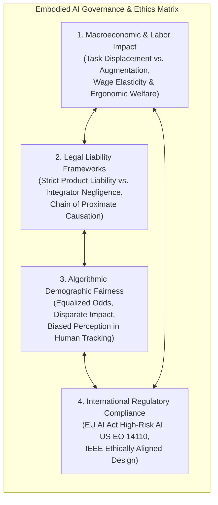
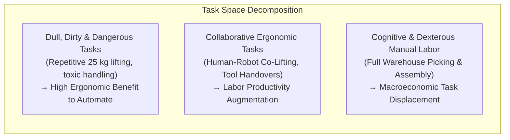
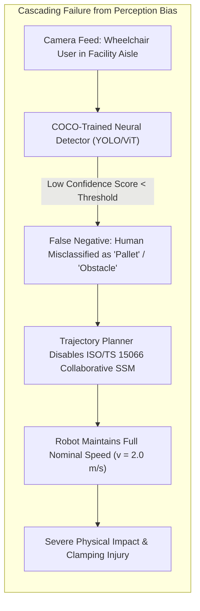
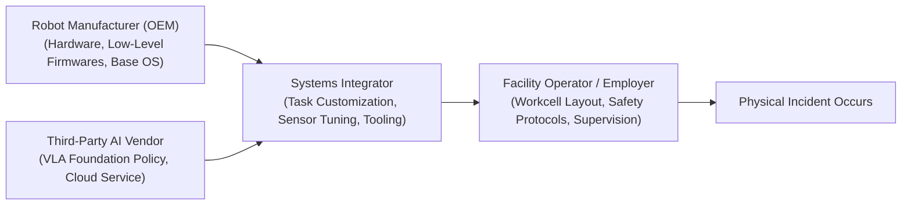

import ChapterProgress from '@site/src/components/ChapterProgress';
import QuizEngine from '@site/src/components/QuizEngine';

# Ethics of Autonomous Humanoids: Labor, Liability & Bias

As general-purpose bipedal humanoids move from laboratory testbenches into manufacturing assembly lines, fulfillment centers, retail stores, eldercare facilities, and private residences, engineering decisions transcend pure mechanics and control theory. Designing an embodied autonomous agent with human morphology and high physical agency inherently embeds socioeconomic, ethical, and legal ramifications.

When an autonomous humanoid displaces human warehouse selectors, fails to detect an elderly patient due to algorithmic demographic bias in its neural perception pipeline, or inflicts physical harm during an unmodeled grasping maneuver, who is held liable? How do we measure and mitigate disparate impact across diverse human demographics? How do international regulatory frameworks like the **EU Artificial Intelligence Act (Regulation (EU) 2024/1689)** and **US Executive Order 14110** govern embodied AI deployment? This chapter formalizes the ethics, legal frameworks, algorithmic fairness metrics, and macroeconomic modeling of humanoid robotics.



---

## 1. IEEE Ethically Aligned Design & Embodied AI Principles

The IEEE Global Initiative on Ethics of Autonomous and Intelligent Systems established **Ethically Aligned Design (EAD)**, articulating fundamental pillars specifically adapted for physical robotics:

1. **Human Well-being (Beneficence & Non-maleficence)**: Robotic platforms must explicitly promote human physical, mental, and economic thriving without diminishing human dignity or safety.
2. **Accountability & Traceability**: Autonomous decisions must be deterministically auditable. When an embodied agent commands a hazardous physical action, an immutable cryptographically sealed flight-data recorder (black box) must log sensory inputs, internal neural activations, safety monitor states, and commanded joint torques.
3. **Transparency (Algorithmic & Behavioral)**: The internal intent and operational state of a humanoid must be legible to co-present humans. Deceptive anthropomorphism—designing a robot to feign genuine human consciousness, emotional empathy, or personal affection—is categorized as an unethical manipulation of vulnerable human populations (children, dementia patients).
4. **Human Autonomy & Meaningful Human Control**: The robotic architecture must guarantee that human operators retain the ultimate override authority (E-stop, manual teleoperation takeover) over autonomous policies.

---

## 2. Macroeconomic Labor Displacement & Ergonomics

The deployment of general-purpose humanoids is fundamentally driven by industrial economics: the substitution of variable human labor with amortized capital equipment operating continuously across multiple shifts.



### The Acemoglu-Restrepo Task-Based Model

In macroeconomic theory, Acemoglu and Restrepo (2018, 2020) demonstrated that robotics affects aggregate labor demand through two competing economic forces:
1. **The Displacement Effect**: Direct displacement of human workers from tasks in which the robot exhibits a comparative cost or speed advantage, reducing the labor share of value added.
2. **The Reinstatement & Productivity Effect**: Creation of new complex complementary tasks (fleet maintenance, robot programming, exception teleoperation) and lower overall production costs that expand industry output.

Formally, aggregate output $Y$ is produced by combining a continuum of tasks $x \in [N-1, N]$:

$$
y(x) = \begin{cases} 
\gamma_L(x) l(x) + \gamma_R(x) r(x) & \text{if automated} \\
\gamma_L(x) l(x) & \text{if unautomated} 
\end{cases}
$$

Where $l(x)$ and $r(x)$ represent human labor and robotic capital allocated to task $x$, and $\gamma_L(x), \gamma_R(x)$ are their task productivities. The net shift in equilibrium labor demand $\frac{\Delta L}{L}$ resulting from an expansion in robotic capital $\Delta K_{robot}$ is modeled as:

$$
\frac{\Delta L}{L} = (1 - \sigma) \frac{\Delta w}{w} - \eta_{robot} \Delta K_{robot} + \sum_{j \in \text{new tasks}} \psi_j \Delta T_j
$$

Where:
- $\sigma$ is the elasticity of substitution between tasks.
- $\eta_{robot}$ is the pure displacement elasticity coefficient.
- $\psi_j$ is the task reinstatement coefficient of newly generated technical roles.

### Ergonomic Welfare vs. Job Displacement Trade-off
In heavy industry (foundries, cold-storage distribution), human workers suffer disproportionately from Musculoskeletal Disorders (MSDs)—such as chronic lumbar disk herniation and rotator cuff tears. Humanoids replacing workers in sustained lifting $> 20\text{ kg}$ provide substantial net occupational health gains. Conversely, complete workforce displacement without worker reskilling or regional economic transition creates severe localized economic hysteresis.

---

## 3. Algorithmic Demographic Bias in Embodied Vision

While bias in text foundation models manifests as skewed language generation, **algorithmic bias in embodied robot perception directly threatens physical safety**.

A humanoid robot relies on neural vision backbones (YOLOv8, Mask2Former, OpenPose, ViT foundation models) to detect humans, estimate skeletal pose, predict approach trajectories, and maintain ISO/TS 15066 Speed and Separation Monitoring (SSM). If the training dataset predominantly consists of upright, able-bodied young adults with light skin tones under bright factory lighting, the perception model's false-negative rate ($\text{FNR}$) surges when encountering:
- People of color in low-light environments (sub-optimal contrast on dark skin tones).
- Individuals using mobility aids (wheelchairs, walkers, crutches) whose skeletal topology diverges radically from standard 17-keypoint COCO human models.
- Children or individuals of short stature whose low center of mass confuses bounding box height heuristics.



### Mathematical Metrics of Algorithmic Fairness

To rigorously audit robot perception models for demographic bias, four standard mathematical criteria must be evaluated across sensitive demographic attributes $D \in \{0, 1\}$ (where $D=0$ represents the unprivileged subgroup, and $D=1$ represents the privileged subgroup):

#### 1. Demographic Statistical Parity Difference (SPD)
The difference in the probability of a positive outcome (e.g., successful human detection $\hat{Y} = 1$) between unprivileged and privileged groups:

$$
\text{SPD} = P(\hat{Y}=1 \mid D=0) - P(\hat{Y}=1 \mid D=1)
$$

A fair detector satisfies $\text{SPD} \approx 0$. If $\text{SPD} < -0.10$, the model demonstrates statistically significant demographic under-detection.

#### 2. Disparate Impact Ratio (DI)
The ratio of positive detection rates:

$$
\text{DI} = \frac{P(\hat{Y}=1 \mid D=0)}{P(\hat{Y}=1 \mid D=1)}
$$

Under the US Equal Employment Opportunity Commission (EEOC) "Four-Fifths Rule," any system with $\text{DI} < 0.80$ is legally presumed to exhibit disparate impact.

#### 3. Equal Opportunity Difference (EOD)
Measures the disparity in True Positive Rates ($\text{TPR}$)—ensuring that when a human is physically present ($Y=1$), the probability of correct detection is identical across groups:

$$
\text{EOD} = \text{TPR}_{D=0} - \text{TPR}_{D=1} = P(\hat{Y}=1 \mid Y=1, D=0) - P(\hat{Y}=1 \mid Y=1, D=1)
$$

In safety-critical robotics, an $\text{EOD} < 0$ means the robot fails to detect and safeguard the unprivileged demographic group more frequently, directly causing higher collision exposure.

#### 4. Equalized Odds Disparity
Requires that both True Positive Rates ($\text{TPR}$) and False Positive Rates ($\text{FPR}$) are equal across subgroups:

$$
P(\hat{Y}=1 \mid Y=y, D=0) = P(\hat{Y}=1 \mid Y=y, D=1) \quad \forall y \in \{0, 1\}
$$

---

## 4. Legal Liability Frameworks: Manufacturer vs. Integrator vs. Operator

When an autonomous humanoid causes personal injury or property damage, the legal system must apportion liability across the commercial value chain:



### The Three Doctrinal Regimes

1. **Strict Product Liability (Restatement (Third) of Torts: Products Liability)**:
   The injured party does not need to prove negligence, only that:
   - The product was defective when it left the manufacturer's control.
   - The defect was the **proximate cause** of the injury.
   - *Three Defect Classes*:
     - **Manufacturing Defect**: A single defective actuator gearhead sheared due to metal fatigue during normal operation.
     - **Design Defect**: The humanoid lacked mechanical joint limits or hard E-stop buttons, rendering it unreasonably dangerous.
     - **Warning / Instruction Defect**: Inadequate user documentation regarding SSM sensor occlusion blind spots.
2. **Systems Integrator Liability**:
   Under **ISO 10218-2**, the entity that integrates the robot into a specific production environment (configuring the end-effector gripper, programming workcell waypoints, setting laser scanner zones) is legally deemed the machine manufacturer. If the integrator fails to perform a formal risk assessment (ISO 12100) or programs a trajectory with insufficient clearance to a fixed architectural pillar, the integrator bears primary liability under common-law negligence.
3. **The "Black Box" Problem in AI Policy Liability**:
   If an end-to-end Vision-Language-Action (VLA) policy generates an erratic torque command that causes an arm swing injury, classical product liability struggles to identify a traditional "defect." Did the software fail, was the prompt ambiguous, or did unpredictable sim-to-real transfer occur? This challenge has catalyzed the modern regulatory requirements for deterministic human oversight.

---

## 5. International Regulatory Landscape

### The EU Artificial Intelligence Act (Regulation (EU) 2024/1689)
The EU AI Act represents the world's first comprehensive horizontal legal framework for AI, categorizing systems into four risk tiers:
- **Unacceptable Risk**: Prohibited systems (e.g., social scoring, biometric categorization of sexual orientation, cognitive behavioral manipulation).
- **High-Risk AI Systems (Annex III)**: **Autonomous robotics equipped with safety components governed by the Machinery Directive / Machinery Regulation are automatically classified as High-Risk AI Systems.**

#### Mandatory High-Risk Humanoid Obligations:
1. **Risk Management System (Article 9)**: Continuous identification and mitigation of emerging physical safety hazards throughout the entire lifecycle.
2. **Data Governance (Article 10)**: Training, validation, and testing datasets must be vetted for statistical representation, demographic diversity, and data poisoning vulnerabilities.
3. **Technical Documentation & Logging (Articles 11 & 12)**: Automated logging of operational events throughout the robot's lifecycle to ensure post-incident forensics.
4. **Human Oversight (Article 14)**: The system must be engineered to enable natural persons to oversee operation, prevent or minimize risks, and immediately halt execution via an unmaskable physical interface.

### US Executive Order 14110 & NIST AI RMF
In the United States, **Executive Order 14110 on Safe, Secure, and Trustworthy Artificial Intelligence** directs the National Institute of Standards and Technology (NIST) to establish rigorous red-teaming benchmarks, cybersecurity controls, and testing standards through the **NIST AI Risk Management Framework (AI RMF 1.0)**. Robotics companies deploying dual-use foundation models above specific computational training thresholds ($> 10^{26}$ integer or floating-point operations) must report safety evaluations and red-team test findings to the federal government.

---

## 6. Python Implementation: Algorithmic Fairness & Bias Evaluation Harness

The following production-grade Python script implements an automated **Algorithmic Fairness and Bias Evaluation Harness** for a robot perception pipeline. It evaluates object detection and human-presence classification across demographic subgroups, computing confusion matrices, Statistical Parity Difference (SPD), Disparate Impact (DI), and Equal Opportunity Difference (EOD).

```python
"""
Robot Perception Demographic Bias & Algorithmic Fairness Evaluation Harness
Evaluates model fairness across demographic subgroups (e.g., skin tone, mobility aid usage).
Computes SPD, Disparate Impact, and Equalized Odds compliant with IEEE Ethically Aligned Design.
"""

from dataclasses import dataclass
from typing import List, Dict, Any, Tuple
import numpy as np


@dataclass
class EvaluationSample:
    sample_id: str
    ground_truth_present: int      # 1 if human is present, 0 otherwise
    predicted_presence: int        # 1 if model detected human, 0 otherwise
    detection_confidence: float    # Continuous confidence score [0.0, 1.0]
    demographic_group: str         # "privileged" (e.g., group A) or "unprivileged" (e.g., group B)


class DemographicFairnessAuditor:
    """
    Audits a robot perception model for demographic bias and disparate safety impact.
    """

    def __init__(self, samples: List[EvaluationSample]) -> None:
        self.samples = samples

    def compute_confusion_matrix(self, group: str) -> Dict[str, float]:
        """
        Computes TP, FP, TN, FN, TPR, and FPR for a specific demographic subgroup.
        """
        group_samples = [s for s in self.samples if s.demographic_group == group]
        if not group_samples:
            raise ValueError(f"No samples found for demographic group: {group}")

        tp = sum(1 for s in group_samples if s.ground_truth_present == 1 and s.predicted_presence == 1)
        fp = sum(1 for s in group_samples if s.ground_truth_present == 0 and s.predicted_presence == 1)
        tn = sum(1 for s in group_samples if s.ground_truth_present == 0 and s.predicted_presence == 0)
        fn = sum(1 for s in group_samples if s.ground_truth_present == 1 and s.predicted_presence == 0)

        n_actual_pos = tp + fn
        n_actual_neg = tn + fp
        n_total = len(group_samples)

        tpr = tp / n_actual_pos if n_actual_pos > 0 else 0.0
        fpr = fp / n_actual_neg if n_actual_neg > 0 else 0.0
        fnr = fn / n_actual_pos if n_actual_pos > 0 else 0.0
        positive_prediction_rate = (tp + fp) / n_total if n_total > 0 else 0.0

        return {
            "group": group,
            "total_samples": n_total,
            "tp": tp, "fp": fp, "tn": tn, "fn": fn,
            "tpr": tpr, "fpr": fpr, "fnr": fnr,
            "positive_prediction_rate": positive_prediction_rate
        }

    def evaluate_fairness(
        self,
        privileged_group: str = "privileged",
        unprivileged_group: str = "unprivileged"
    ) -> Dict[str, Any]:
        """
        Calculates demographic fairness metrics:
        1. Statistical Parity Difference (SPD)
        2. Disparate Impact (DI)
        3. Equal Opportunity Difference (EOD)
        4. Average Odds Difference (AOD)
        """
        metrics_priv = self.compute_confusion_matrix(privileged_group)
        metrics_unpriv = self.compute_confusion_matrix(unprivileged_group)

        # 1. Statistical Parity Difference: P(Y_hat=1 | D=unpriv) - P(Y_hat=1 | D=priv)
        spd = metrics_unpriv["positive_prediction_rate"] - metrics_priv["positive_prediction_rate"]

        # 2. Disparate Impact Ratio: P(Y_hat=1 | D=unpriv) / P(Y_hat=1 | D=priv)
        di = (metrics_unpriv["positive_prediction_rate"] / metrics_priv["positive_prediction_rate"]
              if metrics_priv["positive_prediction_rate"] > 0 else 0.0)

        # 3. Equal Opportunity Difference: TPR_unpriv - TPR_priv
        eod = metrics_unpriv["tpr"] - metrics_priv["tpr"]

        # 4. Average Odds Difference: 0.5 * [(FPR_unpriv - FPR_priv) + (TPR_unpriv - TPR_priv)]
        fpr_diff = metrics_unpriv["fpr"] - metrics_priv["fpr"]
        aod = 0.5 * (fpr_diff + eod)

        # Check compliance against IEEE EAD and EEOC 4/5ths benchmarks
        passes_eeoc_disparate_impact = 0.80 <= di <= 1.25
        passes_statistical_parity = abs(spd) <= 0.10
        passes_equal_opportunity = abs(eod) <= 0.05

        return {
            "privileged_metrics": metrics_priv,
            "unprivileged_metrics": metrics_unpriv,
            "statistical_parity_difference": spd,
            "disparate_impact_ratio": di,
            "equal_opportunity_difference": eod,
            "average_odds_difference": aod,
            "compliance": {
                "eeoc_four_fifths_rule": passes_eeoc_disparate_impact,
                "statistical_parity_fair": passes_statistical_parity,
                "equal_opportunity_fair": passes_equal_opportunity
            }
        }


def generate_synthetic_perception_audit_data() -> List[EvaluationSample]:
    """
    Generates realistic synthetic evaluation dataset representing a robot vision detector
    evaluated on two demographic cohorts (e.g. standard lighting able-bodied vs wheelchair users).
    """
    np.random.seed(42)
    samples = []

    # 1. Privileged Cohort (1000 instances: High detection accuracy, low FNR)
    for i in range(1000):
        actual = 1 if np.random.rand() < 0.70 else 0
        if actual == 1:
            pred = 1 if np.random.rand() < 0.96 else 0  # 96% TPR
            conf = np.random.uniform(0.85, 0.99) if pred == 1 else np.random.uniform(0.10, 0.40)
        else:
            pred = 1 if np.random.rand() < 0.03 else 0  # 3% FPR
            conf = np.random.uniform(0.55, 0.75) if pred == 1 else np.random.uniform(0.01, 0.30)
        samples.append(EvaluationSample(f"priv_{i}", actual, pred, conf, "privileged"))

    # 2. Unprivileged Cohort (1000 instances: Biased lower TPR, higher FNR)
    for i in range(1000):
        actual = 1 if np.random.rand() < 0.70 else 0
        if actual == 1:
            pred = 1 if np.random.rand() < 0.78 else 0  # 78% TPR (Substantial demographic gap!)
            conf = np.random.uniform(0.60, 0.88) if pred == 1 else np.random.uniform(0.10, 0.45)
        else:
            pred = 1 if np.random.rand() < 0.08 else 0  # 8% FPR
            conf = np.random.uniform(0.52, 0.78) if pred == 1 else np.random.uniform(0.01, 0.35)
        samples.append(EvaluationSample(f"unpriv_{i}", actual, pred, conf, "unprivileged"))

    return samples


if __name__ == "__main__":
    dataset = generate_synthetic_perception_audit_data()
    auditor = DemographicFairnessAuditor(dataset)
    results = auditor.evaluate_fairness()

    print("=================================================================")
    print("      ROBOT EMBODIED VISION DEMOGRAPHIC FAIRNESS AUDIT REPORT    ")
    print("=================================================================\n")

    priv = results["privileged_metrics"]
    unpriv = results["unprivileged_metrics"]

    print(f"Cohort 1 (Privileged):   TPR = {priv['tpr']*100:.2f}% | FNR = {priv['fnr']*100:.2f}% | FPR = {priv['fpr']*100:.2f}%")
    print(f"Cohort 2 (Unprivileged): TPR = {unpriv['tpr']*100:.2f}% | FNR = {unpriv['fnr']*100:.2f}% | FPR = {unpriv['fpr']*100:.2f}%")
    print("-----------------------------------------------------------------")
    print(f"Statistical Parity Difference (SPD): {results['statistical_parity_difference']:+.4f} (Ideal: 0.00)")
    print(f"Disparate Impact Ratio (DI):         {results['disparate_impact_ratio']:.4f} (Threshold >= 0.80)")
    print(f"Equal Opportunity Difference (EOD):  {results['equal_opportunity_difference']:+.4f} (Ideal: 0.00)")
    print(f"Average Odds Difference (AOD):       {results['average_odds_difference']:+.4f}")
    print("-----------------------------------------------------------------")
    print("REGULATORY & ETHICAL COMPLIANCE VERIFICATION:")
    for rule, passed in results["compliance"].items():
        status = "PASSED [OK]" if passed else "FAILED [VIOLATION]"
        print(f"  * {rule:<25}: {status}")

    if not all(results["compliance"].values()):
        print("\n[CRITICAL WARNING]: Model fails safety-critical demographic fairness criteria.")
        print("Under-detection of unprivileged groups induces acute collision risks under ISO/TS 15066.")
        print("Action required: Augment training dataset with diverse poses and mobility aid imagery.")
```

---

<ChapterProgress chapterId="11-4-ethics-of-autonomous-humanoids" moduleId="module11" totalChapters={6} />

## Chapter Mastery Check

<QuizEngine
  quizId="quiz-11-4"
  title="Module 11.4 Mastery Check: Ethics, Labor & Liability"
  moduleId="module11"
  passThreshold={70}
  questions={[
    {
      id: "q1",
      question: "Under the European Union Artificial Intelligence Act (Regulation (EU) 2024/1689), why are general-purpose autonomous humanoids classified as High-Risk AI systems?",
      options: [
        "Because they utilize electric batteries that exceed 48 volts",
        "Because they function as safety components of physical machinery regulated under the EU Machinery Directive / Machinery Regulation",
        "Because they have anthropomorphic bipedal legs rather than wheels",
        "Because all artificial intelligence systems deployed in Europe are classified as high risk"
      ],
      correctIndex: 1,
      explanation: "Under Annex III of the EU AI Act, AI systems intended to be used as safety components of products subject to EU harmonized product safety legislation (including the Machinery Directive / Regulation) are legally designated as High-Risk AI systems, requiring conformity assessments and continuous risk management."
    },
    {
      id: "q2",
      question: "In robot perception fairness evaluation, why is a negative Equal Opportunity Difference (EOD < -0.05) considered an acute safety hazard?",
      options: [
        "Because it indicates the camera lens has optical spherical aberration",
        "Because an EOD < 0 means the True Positive Rate (TPR) for detecting humans in an unprivileged demographic group is significantly lower than for the privileged group, directly causing the robot to fail to detect them and disengage safety stops",
        "Because it violates the laws of thermodynamic entropy",
        "Because it means the robot will run out of battery twice as fast"
      ],
      correctIndex: 1,
      explanation: "Equal Opportunity Difference is TPR_unprivileged - TPR_privileged. If EOD < 0, humans belonging to the unprivileged group (e.g., wheelchair users or underrepresented skin tones) suffer from higher False Negative Rates, meaning the robot's collision avoidance system fails to see them, leading to physical collisions."
    },
    {
      id: "q3",
      question: "According to Acemoglu and Restrepo's macroeconomic task-based framework, what economic mechanism counterbalances the labor displacement effect of robotics?",
      options: [
        "The permanent reduction of minimum wage standards",
        "The creation of new complementary complex tasks (reinstatement effect) and cost-reduction output expansion (productivity effect)",
        "The complete banning of automated machinery by industrial unions",
        "The depreciation of physical robotic hardware over time"
      ],
      correctIndex: 1,
      explanation: "While robots directly displace workers from automated routine tasks, the reduction in production costs expands aggregate industry demand, and the technological frontier creates new non-automated tasks (programming, fleet operations, maintenance), partially or fully restoring aggregate labor demand."
    }
  ]}
/>

---

## Annotated Research Citations & Regulatory References

1. **IEEE Global Initiative on Ethics of Autonomous and Intelligent Systems. (2019).** *Ethically Aligned Design: A Vision for Prioritizing Human Well-being with Autonomous and Intelligent Systems* (1st ed.). Piscataway, NJ: IEEE.  
   *The global standard establishing human well-being, accountability, transparency, and data governance principles for embodied robotic systems.*

2. **Acemoglu, D., & Restrepo, P. (2020).** *Robots and Jobs: Evidence from US Labor Markets*. Journal of Political Economy, 128(6), 2188–2244.  
   *Groundbreaking econometric study establishing the macroeconomic task-based displacement model, wage elasticity, and employment share impacts of industrial robotics.*

3. **European Parliament and Council of the European Union. (2024).** *Regulation (EU) 2024/1689 laying down harmonised rules on artificial intelligence (Artificial Intelligence Act)*. Official Journal of the European Union, L 2024/1689.  
   *The horizontal European legislation governing high-risk AI classification, data governance, algorithmic transparency, and human oversight in robotics.*

4. **Barocas, S., Hardt, M., & Narayanan, A. (2019).** *Fairness and Machine Learning: Limitations and Opportunities*. MIT Press, Cambridge, MA.  
   *Definitive mathematical treatise on statistical parity, equalized odds, predictive parity, and the trade-offs in algorithmic fairness formulation.*

5. **Executive Office of the President of the United States. (2023).** *Executive Order 14110 on Safe, Secure, and Trustworthy Artificial Intelligence*. 88 FR 75191. Washington, DC.  
   *Mandates red-teaming safety benchmarks, cybersecurity controls, and NIST AI Risk Management Framework compliance for dual-use foundation models and embodied autonomous systems.*
