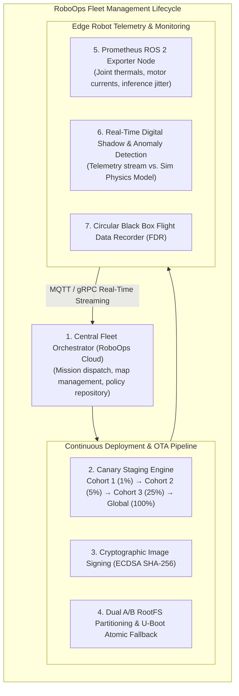
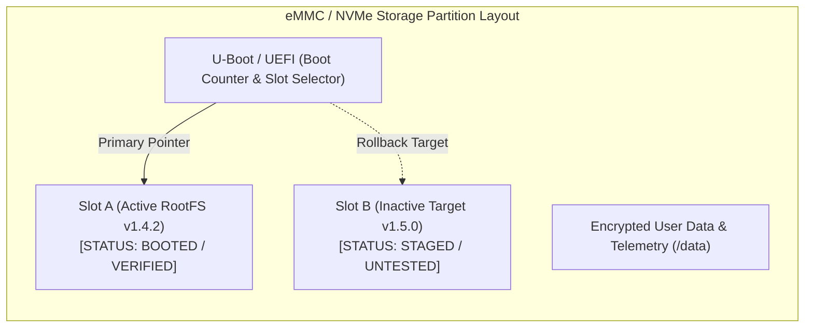
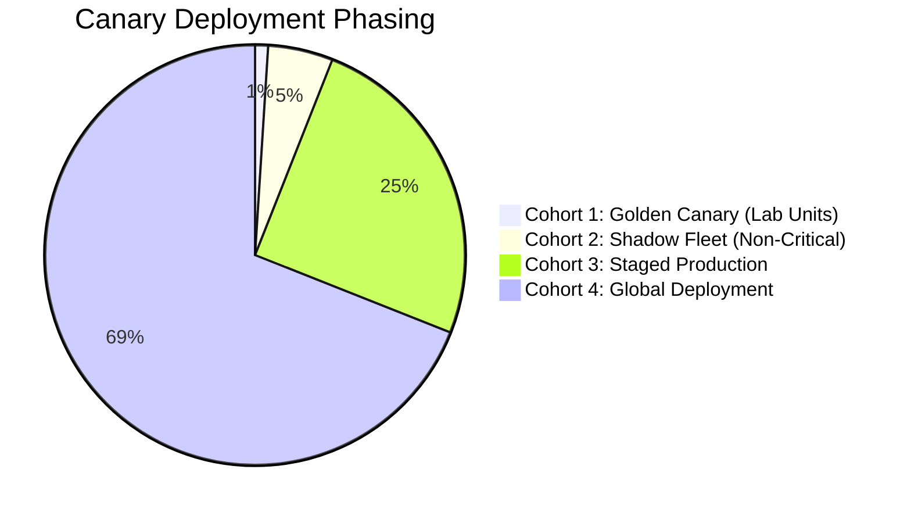
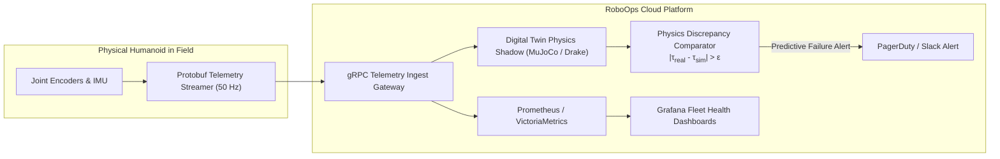
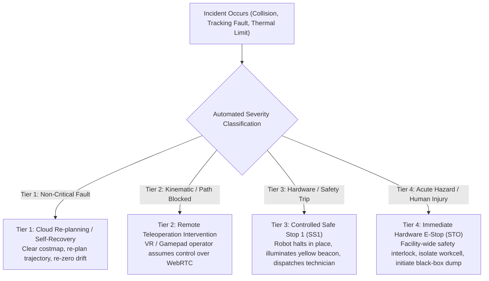
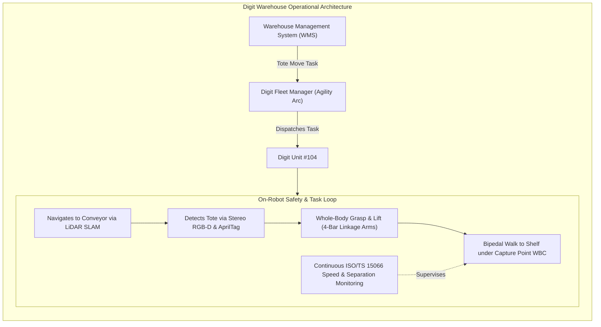

import ChapterProgress from '@site/src/components/ChapterProgress';
import QuizEngine from '@site/src/components/QuizEngine';

# Deployment Operations: Fleet Management, OTA Updates & Digital Shadows

Transitioning humanoid robots from prototype demonstrations into revenue-generating, round-the-clock commercial operations marks the boundary between laboratory robotics and **RoboOps (Robotics Operations)**. A fleet of 500 bipedal humanoids handling parcel totes across multiple logistics fulfillment centers constitutes a distributed, safety-critical cyber-physical network.

In this operational regime, an unvetted firmware update pushed to the fleet can cause systemic motor drive failures across hundreds of units; an undetected drift in joint gearhead backlash can lead to sudden falls; and an uncalibrated battery cell can cause thermal runaway. Managing such fleets requires enterprise-grade DevOps tailored for physical hardware: atomic dual-partition Over-The-Air (OTA) updates, statistical canary rollouts, continuous Prometheus and Grafana telemetry monitoring, real-time digital twin shadows, formal incident response playbooks, and strict adherence to international CE marking and UL 1740 certification processes.



---

## 1. RoboOps & Fleet CI/CD Principles

**RoboOps** bridges classical software Continuous Integration / Continuous Deployment (CI/CD) and physical robotics operations. While web services can be redeployed in seconds with zero physical consequences if a server container crashes, physical robots interact with gravity, inertia, and human co-workers.

### The Five Inviolable Axioms of RoboOps

1. **Never Update a Moving Robot**: OTA updates must be locked out unless the humanoid is statically docked in an approved maintenance fixture or charging cradle with mechanical interlocks verified.
2. **Deterministic Partition Redundancy (A/B Boot)**: Firmware, root filesystems, and neural policies must install onto an inactive standby partition. Activation occurs via an atomic bootloader flag. If the new image fails health verification, the system automatically falls back to the known-good partition.
3. **Canary Staging over Big-Bang Releases**: Updates roll out to a strictly controlled statistical sample of the fleet, verifying thermal, energetic, and kinematic stability before wider release.
4. **Comprehensive Real-Time Observability**: Telemetry streams high-frequency health metrics (temperatures, bus ripple, inference latency) to centralized time-series databases (Prometheus/Grafana).
5. **Fail-Safe Incident Response Tiers**: Explicit escalation procedures—from remote teleoperation intervention to hardware-isolated facility-wide safe stops.

---

## 2. Over-The-Air (OTA) Updates: Dual A/B Partitioning

Modern humanoid computers (e.g., NVIDIA Jetson AGX Orin / Thor running customized Ubuntu Real-Time kernels) utilize **Dual A/B Partition Architecture** managed by U-Boot or systemd-boot:



### The Atomic OTA Update Workflow

1. **Cryptographic Validation**: The update payload is signed with an offline hardware security module (HSM) private key. The robot's on-board public key verifies the ECDSA SHA-256 signature before touching non-volatile storage.
2. **Staging to Inactive Slot**: The orchestrator writes the new kernel, drivers, and ROS 2 workspaces into the inactive partition (Slot B) while the robot remains functional on Slot A.
3. **Atomic Switchover**: The bootloader environment variable `boot_target` is toggled from Slot A to Slot B, and a `boot_count` counter is initialized to 3.
4. **Boot Verification & Watchdog Rollback**:
   - The robot boots into Slot B.
   - A dedicated system health daemon executes an automated 60-second hardware qualification test:
     - All 28 EtherCAT actuator nodes reach operational state (`OP`).
     - Real-Time loop jitter satisfies $\sigma_{jitter} \le 15\ \mu\text{s}$.
     - Camera pipeline frames stream at $\ge 30\text{ fps}$.
     - Neural policy inference latency satisfies $t_{inf} \le 20\text{ ms}$.
   - If the verification suite passes, the daemon marks Slot B as `SUCCESSFUL` (`boot_count = 0`).
   - If the system hangs, kernel panics, or the test fails within the timeout, the hardware watchdog timer reboots the machine. Upon the third failed attempt, U-Boot automatically reverts `boot_target` to Slot A, restoring operational capability without manual technician intervention.

---

## 3. Canary Deployment Strategy & Rollout Risk Bounds

To prevent latent edge-case software defects from incapacitating an entire fleet simultaneously, updates follow a phased **canary deployment strategy**.



### Mathematical Formulation of Rollout Defect Detection

Suppose an update contains a subtle software bug (e.g., a memory leak in the terrain elevation mapping node) that manifests under rare physical conditions with probability $p_{defect}$ per operating hour.

If we deploy this update to a canary cohort of $N$ robots operating for $T_{eval}$ hours, the probability of detecting at least one failure event during the canary window is:

$$
P(\text{Detection}) = 1 - (1 - p_{defect})^{N \cdot T_{eval}}
$$

To guarantee a targeted detection confidence $\beta = 1 - \alpha$ (e.g., $\beta = 0.99$, or $99\%$ confidence of catching the defect before wider fleet rollout), the required cumulative operating exposure $N \cdot T_{eval}$ must satisfy:

$$
1 - (1 - p_{defect})^{N \cdot T_{eval}} \ge \beta \implies N \cdot T_{eval} \ge \frac{\ln(1 - \beta)}{\ln(1 - p_{defect})}
$$

For small defect probabilities ($p_{defect} \ll 1$), using the Taylor approximation $\ln(1 - p) \approx -p$:

$$
N \cdot T_{eval} \ge \frac{\ln(1 / (1 - \beta))}{p_{defect}}
$$

*Example*: If a subtle bug causes a joint tracking divergence once every $1,000$ operating hours ($p_{defect} = 0.001\text{ h}^{-1}$), and management requires $99\%$ confidence ($\beta = 0.99$) before fleet-wide rollout:

$$
N \cdot T_{eval} \ge \frac{\ln(1 / 0.01)}{0.001} = \frac{4.605}{0.001} \approx 4605\text{ robot-hours}
$$

A canary cohort of 20 robots must operate successfully for $T_{eval} = \frac{4605}{20} \approx 230\text{ hours}$ (approx. 9.6 days) without failure before the update is released to the remaining 480 production units.

---

## 4. Digital Twin Shadows & Telemetry Observability

Each physical robot in the field maintains a synchronized cloud-hosted **Digital Shadow**—a virtual simulation instance (running in NVIDIA Isaac Sim, MuJoCo, or Drake) mirroring the robot's real-time joint states over low-bandwidth gRPC / MQTT protobuf channels:



### Anomaly Detection via Digital Shadow Physics Discrepancy
The digital twin simulates the robot's nominal multi-body dynamics under identical commanded trajectories:

$$
\boldsymbol{\Delta}_{\tau}(t) = \boldsymbol{\tau}_{measured}(t) - \boldsymbol{\tau}_{sim}(\mathbf{q}, \dot{\mathbf{q}}, \ddot{\mathbf{q}}_{nominal})
$$

If the residual discrepancy $\boldsymbol{\Delta}_{\tau}$ on a knee pitch actuator exhibits a monotonic upward drift over several shifts while temperature remains normal, the system flags **early mechanical gearhead degradation or bearing spalling** days before catastrophic seizure occurs, automatically dispatching a preventative maintenance work order.

---

## 5. Quantitative Fleet Reliability Metrics

Fleet performance is evaluated using standardized industrial reliability metrics:

### 1. Fleet Operational Availability ($A$)
The fraction of scheduled time that the robotic fleet is actively operational and capable of executing missions:

$$
A = \frac{\text{MTBF}}{\text{MTBF} + \text{MTTR}}
$$

Where:
- **$\text{MTBF}$ (Mean Time Between Failures)**: The average operational hours between unscheduled stops:
  $$\text{MTBF}_{fleet} = \frac{\sum_{i=1}^M T_{operating, i}}{\sum_{i=1}^M N_{failures, i}}$$
- **$\text{MTTR}$ (Mean Time to Repair / Recovery)**: The average time required to clear an incident, reset safety faults, or complete mechanical repair and return the robot to operational service.

In high-throughput e-commerce fulfillment centers, humanoid fleets must achieve **$A \ge 98.5\%$** to remain economically competitive with conventional fixed automation.

---

## 6. Incident Response Playbook: The Four Escalation Tiers

When a humanoid experiences an operational fault, anomaly, or safety trip, operators must follow an immutable **Incident Response Playbook**:



### Black Box Flight Data Recorder (FDR)
All humanoids must run an in-memory high-frequency circular ring-buffer (FDR) capturing the last 30 seconds of:
- Raw joint positions, velocities, and motor currents ($1\text{ kHz}$).
- Safety state flags, E-stop circuit lines, and watchdog ticks.
- Compressed front-facing camera frames ($10\text{ fps}$).
- Commanded vs actual Cartesian end-effector wrenches.

Upon any Tier 3 or Tier 4 event, the buffer is frozen immediately, written to non-volatile tamper-evident flash storage, and cryptographically signed for regulatory and forensic auditing.

---

## 7. Regulatory Certification Workflows: CE Marking & UL 1740

Deploying robots commercially requires formal regulatory certification:

### 1. European Conformity (CE Marking)
Under the **EU Machinery Directive (2006/42/EC)** and **Machinery Regulation (EU) 2023/1230**:
- **Conformity Assessment**: For non-annex IV machines, internal manufacturing control (Module A) is permitted if harmonized standards (**EN ISO 10218-1/2**, **EN ISO 13849-1**) are applied in full. If deviations exist (common in novel humanoids), an **EU Type-Examination (Module B)** by an accredited Notified Body (e.g., TÜV SÜD, TÜV Rheinland) is mandatory.
- **Directives Applicable to Humanoids**:
  - Machinery Directive (2006/42/EC) / Machinery Regulation ((EU) 2023/1230).
  - Electromagnetic Compatibility (EMC) Directive (2014/30/EU).
  - Radio Equipment Directive (RED - 2014/53/EU) for Wi-Fi/5G/Bluetooth interfaces.
  - Low Voltage Directive (LVD - 2014/35/EU) for battery chargers and high-voltage DC buses ($> 75\text{V DC}$).

### 2. North American Certification (UL 1740 & ANSI/RIA R15.08)
- **UL 1740**: Standard for Robots and Robotic Equipment, focusing on electrical shock hazards, motor stall fire risks, battery containment, and mechanical stability.
- **Nationally Recognized Testing Laboratory (NRTL)**: In the US (OSHA jurisdiction), field evaluation or full NRTL listing (UL, CSA, Intertek) is required for workplace machinery.

---

## 8. Case Study: Agility Robotics Digit in Warehouse Logistics

To examine how functional safety, fleet operations, and standards converge in practice, consider the commercial deployment of **Agility Robotics Digit** at Amazon and GXO Logistics fulfillment facilities:



### Operational Architecture & Safety Strategy:
1. **Morphological Adaptation for Human Workspaces**: Digit's backward-facing knee linkages (inspired by bird morphology) allow it to crouch into standard shelving units without sweeping knees forward into warehouse pedestrian walkways.
2. **Safety Zoning**: In early deployments, Digit operates in hybrid collaboration spaces: humans and robots work on opposite sides of tote conveyors, with safety laser scanners enforcing ANSI/RIA R15.08 safety zones. If a worker reaches across the conveyor into Digit's picking envelope, the robot pauses via Safety-Rated Monitored Stop (SMS).
3. **Availability Metrics**: Production trials achieved $> 98\%$ task completion rates across 10,000+ tote handling cycles, with MTBF exceeding 400 operational hours between manual interventions.

---

## 9. Python Implementation: ROS 2 Prometheus Metrics Exporter

The following production-grade Python ROS 2 node collects real-time fleet health telemetry (actuator temperatures, winding currents, bus voltage, policy inference latency, and safety stop event counters) and exposes them on a standard **Prometheus HTTP endpoint (`/metrics`)** at `0.0.0.0:9100` for Grafana dashboard visualization.

```python
"""
ROS 2 Prometheus Metrics Exporter Node for Humanoid Fleet Telemetry
Streams real-time actuator health, thermals, policy jitter, and safety stop counters
to Prometheus / Grafana monitoring infrastructure.
Compliant with RoboOps enterprise observability standards.
"""

import time
from typing import Dict, List
import threading
from http.server import HTTPServer, BaseHTTPRequestHandler

import rclpy
from rclpy.node import Node
from sensor_msgs.msg import JointState, Temperature, BatteryState
from std_msgs.msg import Bool, Float32


class PrometheusMetricsRegistry:
    """Thread-safe Prometheus in-memory metric registry."""

    def __init__(self) -> None:
        self._lock = threading.Lock()
        self.joint_temperatures: Dict[str, float] = {}
        self.joint_currents: Dict[str, float] = {}
        self.joint_torques: Dict[str, float] = {}
        self.battery_voltage: float = 48.0
        self.battery_soc: float = 1.0
        self.policy_inference_latency_ms: float = 12.5
        self.safety_stop_events_total: int = 0
        self.fleet_node_id: str = "humanoid_unit_042"

    def update_joint_state(self, names: List[str], currents: List[float], torques: List[float]) -> None:
        with self._lock:
            for name, curr, torq in zip(names, currents, torques):
                self.joint_currents[name] = curr
                self.joint_torques[name] = torq

    def update_temperature(self, joint_name: str, temp_c: float) -> None:
        with self._lock:
            self.joint_temperatures[joint_name] = temp_c

    def update_battery(self, voltage: float, soc: float) -> None:
        with self._lock:
            self.battery_voltage = voltage
            self.battery_soc = soc

    def update_inference_latency(self, latency_ms: float) -> None:
        with self._lock:
            self.policy_inference_latency_ms = latency_ms

    def increment_safety_stops(self) -> None:
        with self._lock:
            self.safety_stop_events_total += 1

    def format_prometheus_metrics(self) -> str:
        """Serializes current telemetry into standard Prometheus text exposition format."""
        with self._lock:
            lines = [
                "# HELP robot_battery_voltage_volts Real-time main bus battery voltage",
                "# TYPE robot_battery_voltage_volts gauge",
                f'robot_battery_voltage_volts{{robot_id="{self.fleet_node_id}"}} {self.battery_voltage:.2f}',
                "",
                "# HELP robot_battery_state_of_charge Fraction of remaining battery capacity [0.0 - 1.0]",
                "# TYPE robot_battery_state_of_charge gauge",
                f'robot_battery_state_of_charge{{robot_id="{self.fleet_node_id}"}} {self.battery_soc:.3f}',
                "",
                "# HELP robot_policy_inference_latency_ms Neural foundation policy inference latency",
                "# TYPE robot_policy_inference_latency_ms gauge",
                f'robot_policy_inference_latency_ms{{robot_id="{self.fleet_node_id}"}} {self.policy_inference_latency_ms:.2f}',
                "",
                "# HELP robot_safety_stop_events_total Cumulative count of safety-rated stops",
                "# TYPE robot_safety_stop_events_total counter",
                f'robot_safety_stop_events_total{{robot_id="{self.fleet_node_id}"}} {self.safety_stop_events_total}',
                "",
                "# HELP robot_joint_temperature_celsius Actuator motor winding temperature",
                "# TYPE robot_joint_temperature_celsius gauge",
            ]
            for joint, temp in self.joint_temperatures.items():
                lines.append(f'robot_joint_temperature_celsius{{robot_id="{self.fleet_node_id}",joint="{joint}"}} {temp:.2f}')

            lines.append("")
            lines.append("# HELP robot_joint_current_amperes Actuator phase current RMS")
            lines.append("# TYPE robot_joint_current_amperes gauge")
            for joint, curr in self.joint_currents.items():
                lines.append(f'robot_joint_current_amperes{{robot_id="{self.fleet_node_id}",joint="{joint}"}} {curr:.2f}')

            return "\n".join(lines) + "\n"


class PrometheusHttpHandler(BaseHTTPRequestHandler):
    registry: PrometheusMetricsRegistry = None  # Injected

    def do_GET(self) -> None:
        if self.path == "/metrics":
            content = self.registry.format_prometheus_metrics().encode("utf-8")
            self.send_response(200)
            self.send_header("Content-Type", "text/plain; version=0.0.4; charset=utf-8")
            self.send_header("Content-Length", str(len(content)))
            self.end_headers()
            self.wfile.write(content)
        else:
            self.send_response(404)
            self.end_headers()

    def log_message(self, format: str, *args) -> None:
        pass  # Suppress default HTTP console logs


class RobotPrometheusExporterNode(Node):
    """
    ROS 2 Telemetry Ingest & Prometheus Exporter Server Node.
    """

    def __init__(self, registry: PrometheusMetricsRegistry, port: int = 9100) -> None:
        super().__init__("robot_prometheus_exporter")
        self.registry = registry

        # ROS 2 Subscriptions
        self.sub_joint_states = self.create_subscription(
            JointState, "/joint_states", self._joint_state_cb, 10
        )
        self.sub_battery = self.create_subscription(
            BatteryState, "/hardware/battery_state", self._battery_cb, 10
        )
        self.sub_policy_latency = self.create_subscription(
            Float32, "/ai/policy_inference_latency_ms", self._latency_cb, 10
        )
        self.sub_safety_trip = self.create_subscription(
            Bool, "/safety/emergency_stop_tripped", self._safety_trip_cb, 10
        )

        # Launch HTTP Prometheus Server in dedicated daemon thread
        PrometheusHttpHandler.registry = self.registry
        self.http_server = HTTPServer(("0.0.0.0", port), PrometheusHttpHandler)
        self.server_thread = threading.Thread(target=self.http_server.serve_forever, daemon=True)
        self.server_thread.start()

        self.get_logger().info(f"Prometheus Metrics Exporter active on http://0.0.0.0:{port}/metrics")

    def _joint_state_cb(self, msg: JointState) -> None:
        names = list(msg.name)
        currents = list(msg.effort) if msg.effort else [0.0] * len(names)
        self.registry.update_joint_state(names, currents, currents)

    def _battery_cb(self, msg: BatteryState) -> None:
        self.registry.update_battery(msg.voltage, msg.percentage)

    def _latency_cb(self, msg: Float32) -> None:
        self.registry.update_inference_latency(msg.data)

    def _safety_trip_cb(self, msg: Bool) -> None:
        if msg.data:
            self.registry.increment_safety_stops()
            self.get_logger().warn("Safety stop event registered in Prometheus metrics.")


def main(args=None) -> None:
    rclpy.init(args=args)
    registry = PrometheusMetricsRegistry()

    # Pre-populate sample joints for immediate telemetry verification
    registry.update_joint_state(
        ["l_hip_pitch", "l_knee_pitch", "r_hip_pitch", "r_knee_pitch"],
        [4.2, 8.5, 4.1, 8.3],
        [12.0, 28.5, 11.8, 27.9]
    )
    registry.update_temperature("l_knee_pitch", 48.5)
    registry.update_temperature("r_knee_pitch", 50.1)

    node = RobotPrometheusExporterNode(registry=registry, port=9100)

    try:
        rclpy.spin(node)
    except KeyboardInterrupt:
        pass
    finally:
        node.http_server.shutdown()
        node.destroy_node()
        rclpy.shutdown()


if __name__ == "__main__":
    main()
```

---

<ChapterProgress chapterId="11-6-deployment-operations" moduleId="module11" totalChapters={6} />

## Chapter Mastery Check

<QuizEngine
  quizId="quiz-11-6"
  title="Module 11.6 Mastery Check: Deployment Operations & RoboOps"
  moduleId="module11"
  passThreshold={70}
  questions={[
    {
      id: "q1",
      question: "In dual A/B partition Over-The-Air (OTA) architecture, what mechanism prevents a bricked or hanging kernel update from permanently disabling a remote humanoid robot?",
      options: [
        "A field technician manually swapping SSD drives with a screwdriver",
        "A hardware watchdog timer combined with a boot counter in U-Boot that automatically falls back to the known-good partition (Slot A) if the new partition (Slot B) fails to complete automated health qualification within the timeout",
        "Cloud servers sending an SSH reboot command",
        "The robot walking back to the manufacturing factory"
      ],
      correctIndex: 1,
      explanation: "Dual A/B partitioning stages updates to the inactive partition and initializes a boot-counter. If the new kernel hangs or fails health tests, the hardware watchdog triggers a reboot, decrementing the counter. Once exhausted, the bootloader automatically reverts the boot pointer to the verified partition."
    },
    {
      id: "q2",
      question: "Why is a statistical canary deployment strategy necessary when rolling out updated neural foundation policies to a robotics fleet?",
      options: [
        "Because Wi-Fi bandwidth cannot support downloading updates to more than one robot at a time",
        "Because rare physical-world edge case failures (p_defect) cannot be fully caught in simulation, requiring controlled statistical operational exposure across cohorts to catch defects before whole-fleet exposure",
        "Because the EU Machinery Directive prohibits updating more than 5% of machines per month",
        "Because canary updates are free whereas global updates cost money"
      ],
      correctIndex: 1,
      explanation: "Physical robots operate in unstructured physical environments where subtle bugs (e.g., unexpected lighting reflections or terrain friction transitions) occur with low hourly probability. Canary cohorts provide mathematically bounded cumulative operating hours to detect defects before exposing the entire fleet."
    },
    {
      id: "q3",
      question: "In the fleet operational availability equation A = MTBF / (MTBF + MTTR), how does improving remote teleoperation triage and self-recovery directly increase availability?",
      options: [
        "It increases the battery capacity of the robot",
        "It drastically decreases the Mean Time to Recovery (MTTR), allowing minor software or path-planning locks to be resolved in seconds rather than waiting for a physical maintenance technician",
        "It eliminates the need for CE marking certification",
        "It doubles the maximum payload capacity of the robot"
      ],
      correctIndex: 1,
      explanation: "Operational availability depends inversely on MTTR. If every minor navigation pause requires a human technician to physically walk across a 100,000 m^2 warehouse (MTTR = 20 minutes), availability collapses. Remote teleoperation intervention drops MTTR to < 30 seconds, maintaining high fleet availability (A > 98%)."
    }
  ]}
/>

---

## Annotated Research Citations & Regulatory References

1. **Kim, S., Park, J., & Lee, K. (2020).** *Continuous Integration and Deployment for Robotics Software: Challenges and Practical Guidelines*. IEEE Robotics & Automation Magazine, 27(3), 44–55.  
   *Comprehensive engineering framework defining RoboOps, automated hardware-in-the-loop (HIL) test suites, and partition rollback mechanisms.*

2. **Agility Robotics. (2023).** *Digit: Design, Operation, and Safety Architecture for Humanoid Logistics*. Technical Whitepaper. Corvallis, OR: Agility Robotics Inc.  
   *Industrial case study detailing the architectural design, safety zones, conveyor tote handling workflows, and fleet management of the Digit bipedal platform.*

3. **International Organization for Standardization (ISO). (2010).** *ISO 12100:2010: Safety of machinery — General principles for design — Risk assessment and risk reduction*. Geneva, Switzerland.  
   *The primary international standard defining the methodology of iterative risk assessment, safeguarding design, and technical file compilation.*

4. **Underwriters Laboratories (UL). (2020).** *UL 1740: Standard for Robots and Robotic Equipment* (4th ed.). Northbrook, IL: UL Standard.  
   *North American standard covering electrical safety, mechanical risk mitigation, battery systems, and functional safety verification for robotic equipment.*

5. **European Parliament and Council of the European Union. (2023).** *Regulation (EU) 2023/1230 on machinery, repealing Directive 2006/42/EC*. Official Journal of the European Union, L 165/1.  
   *The new European Machinery Regulation addressing cybersecurity risks, autonomous mobile robots, artificial intelligence software, and digital instructions.*
