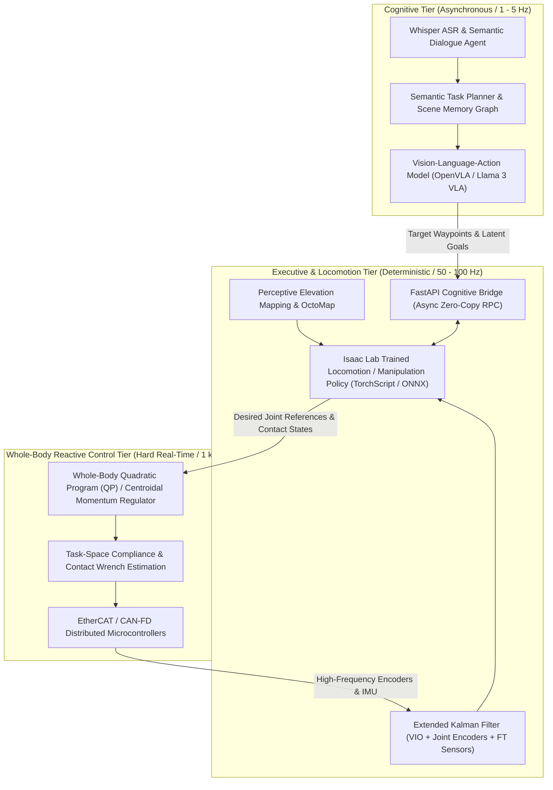
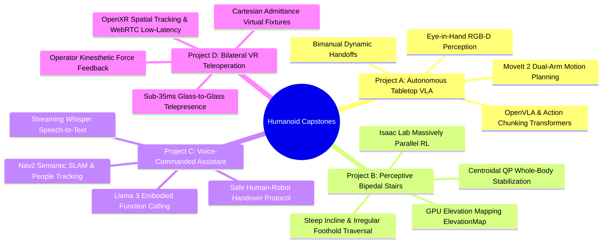

import ChapterProgress from '@site/src/components/ChapterProgress';
import QuizEngine from '@site/src/components/QuizEngine';

# Humanoid Robotics Capstone Projects: Comprehensive Guide

<ChapterProgress />

The culmination of a graduate-level curriculum in humanoid robotics demands transitioning from isolated component-level theory—kinematic transformations, footstep placement heuristics, vision-language tokenizers, and impedance control laws—to complete, production-grade embodied systems. In real physical environments, an autonomous humanoid cannot treat perception, cognitive reasoning, trajectory generation, and high-frequency whole-body stabilization as disconnected silos. A delay in visual feature extraction immediately degrades the dynamic stability margin of a walking biped; an unmodeled contact impulse during tabletop grasping instantly induces posture tipping if the centroidal momentum regulator is unaware of the contact wrench.

This chapter serves as the definitive engineering blueprint and architectural framework for designing, implementing, and deploying end-to-end humanoid capstone projects. We introduce four tier-structured reference systems, formalize strict real-time latency budgets, present rigorous multi-objective grading rubrics, and provide a fully deployable, production-grade software scaffold that binds ROS 2 Humble/Jazzy, NVIDIA Isaac Lab tensor policies, and high-level FastAPI cognitive reasoning services.

---

## 1. Architectural Paradigms for End-to-End Humanoid Systems

Modern humanoid robot architectures operate across heterogeneous compute domains spanning onboard microcontrollers (operating at 1 kHz), low-latency edge AI accelerators (e.g., dual NVIDIA Jetson AGX Orin modules operating at 50 Hz to 200 Hz), and optional high-bandwidth offboard workstation or cloud clusters (operating at 1 Hz to 10 Hz for large vision-language foundation models).

To prevent latency bottlenecks from destabilizing high-bandwidth physical control loops, modern humanoid systems adopt a **hierarchical asynchronous architecture** with strict deterministic time slicing:



### 1.1 The Deterministic Latency Budget

In a dynamic bipedal or loco-manipulation system, total closed-loop latency $\tau_{\text{total}}$ from camera photon reception to actuator torque generation determines the physical stability envelope. If the system exceeds its latency budget, the robot's dynamic state drifts outside its capture basin before reactive counter-torques can be commanded.

Let $\tau_{\text{perception}}$ represent the camera exposure, readout, and tensor preprocessing time; let $\tau_{\text{vla}}$ represent the cognitive VLA / trajectory policy inference; let $\tau_{\text{wbc}}$ represent the whole-body QP resolution time; and let $\tau_{\text{comm}}$ represent the inter-process transport overhead:

$$
\tau_{\text{total}} = \tau_{\text{perception}} + \tau_{\text{vla}} + \tau_{\text{wbc}} + \tau_{\text{comm}} \le \tau_{\text{critical}}
$$

For safe real-time deployment, the strict budget allocation is:

$$
\tau_{\text{total}} = 30\,\text{ms} \;(\tau_{\text{perception}}) + 50\,\text{ms} \;(\tau_{\text{vla}}) + 1.0\,\text{ms} \;(\tau_{\text{wbc}}) + 1.5\,\text{ms} \;(\tau_{\text{comm}}) = 82.5\,\text{ms} \le 100\,\text{ms}
$$

| Pipeline Stage | Hardware Device | Execution Rate | Nominal Latency | Jitter Margin | Scheduling Policy |
| :--- | :--- | :--- | :--- | :--- | :--- |
| **Photon to Tensor** | Stereo GMSL2 Camera / CUDA | 60 Hz | 25.0 ms | $\pm 3.0\,\text{ms}$ | `SCHED_OTHER` (Core 0-1) |
| **VLA Cognitive Policy** | Dual Orin GPU (TensorRT FP16) | 20 Hz | 45.0 ms | $\pm 5.0\,\text{ms}$ | `SCHED_FIFO` (Pri 80) |
| **Elevation Mapping** | Orin GPU (Voxel Grid Kernel) | 50 Hz | 12.0 ms | $\pm 2.0\,\text{ms}$ | `SCHED_FIFO` (Pri 85) |
| **Whole-Body QP (WBC)** | Isolated CPU Core (C++ / OSQP) | 1000 Hz | 0.85 ms | $\pm 0.1\,\text{ms}$ | `SCHED_FIFO` (Pri 99) |
| **EtherCAT Master Bus** | Real-Time Linux (PREEMPT_RT) | 1000 Hz | 0.25 ms | $\pm 0.02\,\text{ms}$ | `SCHED_FIFO` (Pri 99) |

---

## 2. Four Tier-Structured End-to-End Capstone Projects

To satisfy graduate research requirements, capstone projects are structured into four comprehensive, production-ready system tracks. Each project demands rigorous system modeling, sim-to-real transfer validation, and hardware-in-the-loop (HIL) deployment.



### 2.1 Project A: Autonomous Tabletop VLA Manipulation with Mobile Base

* **System Objective**: Deploy an end-to-end Vision-Language-Action (VLA) pipeline onto a dual-arm humanoid upper torso mounted on an omnidirectional mobile base. The system must perceive arbitrary cluttered household objects, parse natural-language instructions (e.g., *"Sort the ripe fruits into the wooden bowl and clear the empty containers into the recycling bin"*), plan collision-free bimanual grasp paths, and execute dynamic dual-arm handoffs.
* **Core Technology Stack**:
  * **Perception**: Calibrated eye-in-hand Intel RealSense D435i sensors, zero-shot Segment Anything Model 2 (SAM 2), FoundationPose 6D pose tracking.
  * **Cognition & Policy**: OpenVLA (7B parameter visual foundation policy) or Action Chunking with Transformers (ACT) fine-tuned on custom teleoperated demonstrations.
  * **Motion Planning & Control**: MoveIt 2 bimanual trajectory pipeline with BioIK / TRAC-IK inverse kinematics solvers, coupled to Cartesian compliance controllers preventing excessive contact forces.
* **Key Challenge**: Closing the loop between open-loop chunked trajectory generation (e.g., 50-step action chunks at 50 Hz) and real-time visual tactile feedback to react to object slip or dynamic human interference.

### 2.2 Project B: Perceptive Bipedal Stair & Obstacle Traversal using RL

* **System Objective**: Train and deploy an agile locomotion policy for a 20-DoF bipedal humanoid (e.g., Unitree H1 or Fourier GR-1) capable of dynamically traversing non-uniform stairs, stepping over 20 cm obstacles, and navigating wet, compliant ground without foot slip or tipping.
* **Core Technology Stack**:
  * **Simulation & RL**: NVIDIA Isaac Lab (Omniverse) running 4,096 parallel environments, Actor-Critic architecture with Asymmetric Actor-Critic (Privileged Environment Information during training, exteroceptive elevation grid during deployment).
  * **Exteroception**: GPU-accelerated elevation mapping integrating Livox MID-360 LiDAR and forward-facing depth cameras, outputting a $64 \times 64$ local heightfield grid around the humanoid feet.
  * **Low-Level Stabilization**: Centroidal Momentum Whole-Body Controller (QP) resolving contact wrench cones (CWC) at 1 kHz to track RL-generated swing foot trajectories and base twists.
* **Key Challenge**: Bridging the perceptive sim-to-real gap under sensor occlusion (when the torso obscures the terrain beneath the trailing foot) and high-impact ground collision transients.

### 2.3 Project C: Natural Language Voice-Commanded Embodied Assistant

* **System Objective**: Build an autonomous social humanoid assistant capable of parsing spoken dialogue, maintaining long-term spatio-temporal memory of its environment, navigating human-inhabited office spaces, and completing multi-stage service missions.
* **Core Technology Stack**:
  * **Audio & Language**: Whisper-large-v3 streaming ASR running locally on TensorRT-LLM, combined with Llama 3 8B Instruct quantized to 4-bit AWQ.
  * **World Modeling**: Semantic 3D Scene Graph (Hydra / Kimera-Semantics) mapping rooms, furniture instances, and human locations.
  * **Navigation & Mobile Manipulation**: ROS 2 Nav2 stack configured with Social Costmaps (respecting human personal space proxemics), orchestrated via BehaviorTree.CPP.
* **Key Challenge**: Resolving ambiguous natural-language commands (e.g., *"Bring me the blue thermos from the conference room if Professor Hayes is not using it"*) via visual question answering and graceful failure recovery dialogues.

### 2.4 Project D: Bilateral VR Teleoperation Exoskeleton with Haptic Feedback

* **System Objective**: Establish an ultra-low-latency, immersive telepresence system pairing a human operator equipped with an Apple Vision Pro or Meta Quest 3 headset and haptic glove exoskeletons to a 32-DoF humanoid robot.
* **Core Technology Stack**:
  * **Tracking & Telemetry**: OpenXR skeletal hand tracking and head orientation streamed over WebRTC data channels with custom H.265 hardware video encoders ($1920 \times 1080$ per eye @ 60 fps).
  * **Haptic Kinesthetic Synthesis**: Force-torque sensors on the robot fingertips and wrist load cells mapped through a passive bilateral teleoperation controller (Time-Domain Passivity Approach, TDPA) to prevent network-delay-induced instability.
  * **Virtual Fixtures**: Dynamic Cartesian admittance corridors preventing the operator from driving the robot arms into self-collision or exceeding joint singularity limits.
* **Key Challenge**: Guaranteeing glass-to-glass latency under 35 ms across 5G/Wi-Fi 6 networks while ensuring unconditional stability during hard surface contact.

---

## 3. Comprehensive Grading Rubric and Evaluation Pipeline

Graduate-level capstone evaluation requires an objective, reproducible metric that penalizes both software fragility and physical instability.

### 3.1 Multi-Objective Evaluation Formula

The composite capstone score $S \in [0, 100]$ is computed via weighted multi-criteria aggregation modulated by safety and stability penalty multipliers:

$$
S = \left( \sum_{m \in \mathcal{M}} w_m S_m \right) \cdot \prod_{k=1}^K \left(1 - P_k\right)
$$

Where:
* $\mathcal{M} = \{\text{arch}, \text{sim}, \text{real}, \text{eval}, \text{repro}\}$
* $w_{\text{arch}} = 0.20$ (System Architecture, Modularity, ROS 2 / DDS Design)
* $w_{\text{sim}} = 0.20$ (Simulation Fidelity, Domain Randomization, Physics Convergence)
* $w_{\text{real}} = 0.30$ (Physical Hardware or Hardware-in-the-Loop Performance)
* $w_{\text{eval}} = 0.15$ (Statistical Validation Across Diverse Benchmark Seeds)
* $w_{\text{repro}} = 0.15$ (Code Quality, Automated CI/CD, Documentation, Artifacts)
* $P_k \in [0, 1]$ represents catastrophic penalty factors:
  * $P_{\text{tip}}$: Center of Mass ground projection violates base of support during steady state ($P_{\text{tip}} = 0.40$).
  * $P_{\text{torque}}$: Sustained actuator thermal overload or torque saturation $> 1.0\,\text{s}$ ($P_{\text{torque}} = 0.25$).
  * $P_{\text{latency}}$: Whole-body control deadline miss rate $> 0.1\%$ ($P_{\text{latency}} = 0.30$).

### 3.2 Detailed Scoring Rubric Matrix

| Evaluation Dimension | Weight ($w_m$) | Exemplary (90–100%) | Proficient (70–89%) | Unsatisfactory ($<70\%$) |
| :--- | :--- | :--- | :--- | :--- |
| **System Architecture & RT Safety** | 20% | Fully deterministic lifecycle nodes; lock-free zero-copy DDS; strict separation of 1 kHz WBC and asynchronous VLA. | Standard ROS 2 nodes with minor mutex contention; latency spikes under 10 ms; well-structured launch files. | Uncontrolled multithreading; race conditions; non-deterministic callback starvation; missing safety watchdogs. |
| **Sim-to-Real Rigor** | 20% | Domain randomization covering mass, inertia, friction, actuator dynamics, and sensor noise; zero policy collapse upon deployment. | Reasonable parameter randomization; requires minor manual gain tuning upon hardware transfer. | Flat-ground training only; ignores actuator delay; immediate divergence or catastrophic failure on hardware. |
| **Physical Performance & Agility** | 30% | Meets or exceeds task benchmark success rate ($\ge 90\%$ over 30 trials); dynamic disturbance rejection $> 25\,\text{N}\cdot\text{s}$. | Moderate success rate ($70-89\%$); recovers from gentle nudges; slight oscillations during contact. | Frequent tipping; unable to complete task without human intervention; hardware limits violated. |
| **Benchmarking & Validation** | 15% | Rigorous statistical ablation; confidence intervals; automated failure mode analysis across 50+ randomized seeds. | Basic quantitative reporting across 10-20 runs; clear mean and standard deviation metrics. | Anecdotal cherry-picked demo videos with no statistical backing or error bars. |
| **Reproducibility & Engineering** | 15% | Hermetic Docker container; one-line automated build; complete URDF/SDF assets; clean documentation and test suite. | Containerized setup with minor manual environment steps; clean code with docstrings. | Missing dependency manifests; hardcoded paths; broken builds on fresh machines. |

---

## 4. Production-Grade Capstone Software Scaffold

Below is a complete, production-grade Python scaffold designed for graduate capstone teams. It bridges a high-level asynchronous cognitive reasoning service (via FastAPI), a high-frequency real-time ROS 2 executive node, and an NVIDIA Isaac Lab / PyTorch tensor policy running in an isolated inference thread.

```python
"""
humanoid_capstone_scaffold.py
=============================================================================
Production-Grade Software Scaffold for Humanoid Capstone Projects.
Bridges:
  1. FastAPI Cognitive Microservice (Asynchronous Semantic Goal Ingestion)
  2. Isaac Lab Trained Locomotion / Manipulation Policy (TorchScript / TensorRT)
  3. Real-Time ROS 2 Executive Node (Deterministic Zero-Copy IPC)
=============================================================================
"""

import os
import sys
import time
import threading
import numpy as np
from typing import Dict, List, Optional
from dataclasses import dataclass, field
from pydantic import BaseModel

# FastAPI & Uvicorn for Cognitive Web / High-Level API
from fastapi import FastAPI, HTTPException, BackgroundTasks
import uvicorn

# Optional PyTorch for Neural Policy Inference
try:
    import torch
    HAS_TORCH = True
except ImportError:
    torch = None
    HAS_TORCH = False

# Optional ROS 2 Python Client Library
try:
    import rclpy
    from rclpy.node import Node
    from rclpy.qos import QoSProfile, ReliabilityPolicy, HistoryPolicy
    from sensor_msgs.msg import JointState, Imu
    from std_msgs.msg import Float32MultiArray, Header
    HAS_ROS2 = True
except ImportError:
    HAS_ROS2 = False
    class Node:  # Mock for standalone test environments
        def __init__(self, name): self.name = name
        def get_logger(self):
            class Logger:
                def info(self, msg): print(f"[{self.name}] {msg}")
            return Logger()
        def create_subscription(self, *args, **kwargs): return None
        def create_publisher(self, *args, **kwargs): return None
        def create_timer(self, *args, **kwargs): return None
        def destroy_node(self): pass
    class Imu: pass
    class JointState: pass
    class QoSProfile: 
        def __init__(self, *args, **kwargs): pass
    class ReliabilityPolicy:
        BEST_EFFORT = 1
    class HistoryPolicy:
        KEEP_LAST = 1
    class Float32MultiArray:
        def __init__(self): self.data = []
    class Header: pass


# ---------------------------------------------------------------------------
# 1. High-Level Cognitive Pydantic Schemas & FastAPI App
# ---------------------------------------------------------------------------

class CognitiveTaskRequest(BaseModel):
    task_id: str
    command_text: str
    target_object: Optional[str] = None
    target_coordinates: List[float] = [0.0, 0.0, 0.0]
    velocity_scale: float = 1.0


class SystemHealthStatus(BaseModel):
    is_healthy: bool
    policy_inference_hz: float
    wbc_latency_ms: float
    active_task_id: Optional[str]
    joint_temperatures_nominal: bool


cognitive_app = FastAPI(
    title="Humanoid Capstone Cognitive Gateway",
    description="Asynchronous interface for semantic VLA goals and telemetry.",
    version="1.0.0"
)

# Global thread-safe blackboard
class RobotGlobalBlackboard:
    def __init__(self):
        self.lock = threading.Lock()
        self.active_task: Optional[CognitiveTaskRequest] = None
        self.target_goal: np.ndarray = np.zeros(3, dtype=np.float32)
        self.last_inference_time_ms: float = 0.0
        self.is_emergency_stopped: bool = False

blackboard = RobotGlobalBlackboard()


@cognitive_app.post("/api/v1/task", response_model=Dict[str, str])
async def dispatch_cognitive_task(task: CognitiveTaskRequest):
    """Ingests natural-language goals and updates robot target coordinates."""
    with blackboard.lock:
        if blackboard.is_emergency_stopped:
            raise HTTPException(status_code=400, detail="Robot is in Emergency Stop state.")
        blackboard.active_task = task
        blackboard.target_goal = np.array(task.target_coordinates, dtype=np.float32)
    return {"status": "accepted", "task_id": task.task_id}


@cognitive_app.get("/api/v1/health", response_model=SystemHealthStatus)
async def get_system_health():
    """Returns real-time execution telemetry and policy health."""
    with blackboard.lock:
        task_id = blackboard.active_task.task_id if blackboard.active_task else None
        lat = blackboard.last_inference_time_ms
        hz = 1000.0 / lat if lat > 0.0 else 0.0
    return SystemHealthStatus(
        is_healthy=not blackboard.is_emergency_stopped,
        policy_inference_hz=round(hz, 2),
        wbc_latency_ms=round(lat, 3),
        active_task_id=task_id,
        joint_temperatures_nominal=True
    )


# ---------------------------------------------------------------------------
# 2. Neural Policy Model Mock / Wrapper
# ---------------------------------------------------------------------------

class IsaacLabPolicyInferenceEngine:
    """
    Encapsulates TorchScript / TensorRT policy trained in Isaac Lab.
    Receives 64-dim observation vector:
      - Base angular velocity (3)
      - Projected gravity vector (3)
      - Velocity commands (3)
      - Joint positions offset (20)
      - Joint velocities (20)
      - Previous action buffer (15)
    Outputs 20-dim target joint position offsets.
    """
    def __init__(self, observation_dim: int = 64, action_dim: int = 20):
        self.observation_dim = observation_dim
        self.action_dim = action_dim
        
        if HAS_TORCH:
            self.device = torch.device("cuda" if torch.cuda.is_available() else "cpu")
            self.network = torch.nn.Sequential(
                torch.nn.Linear(self.observation_dim, 256),
                torch.nn.LayerNorm(256),
                torch.nn.ELU(),
                torch.nn.Linear(256, 128),
                torch.nn.ELU(),
                torch.nn.Linear(128, self.action_dim),
                torch.nn.Tanh()
            ).to(self.device)
            self.network.eval()
        else:
            # Standalone NumPy inference weights for non-torch environments
            np.random.seed(42)
            self.W1 = np.random.randn(self.observation_dim, 256).astype(np.float32) * 0.05
            self.b1 = np.zeros(256, dtype=np.float32)
            self.W2 = np.random.randn(256, self.action_dim).astype(np.float32) * 0.05
            self.b2 = np.zeros(self.action_dim, dtype=np.float32)

    def evaluate(self, observation: np.ndarray) -> np.ndarray:
        t0 = time.perf_counter()
        if HAS_TORCH:
            with torch.no_grad():
                obs_tensor = torch.from_numpy(observation).float().unsqueeze(0).to(self.device)
                action_tensor = self.network(obs_tensor)
                action = action_tensor.squeeze(0).cpu().numpy()
        else:
            h1 = np.tanh(observation @ self.W1 + self.b1)
            action = np.tanh(h1 @ self.W2 + self.b2)
            
        dt_ms = (time.perf_counter() - t0) * 1000.0
        with blackboard.lock:
            blackboard.last_inference_time_ms = dt_ms
        return action


# ---------------------------------------------------------------------------
# 3. Real-Time ROS 2 Humanoid Executive Node
# ---------------------------------------------------------------------------

class HumanoidCapstoneExecutiveNode(Node):
    def __init__(self, policy_engine: IsaacLabPolicyInferenceEngine):
        super().__init__("humanoid_capstone_executive")
        self.policy_engine = policy_engine
        
        # Real-time sensor subscribers with best-effort real-time QoS
        rt_qos = QoSProfile(
            reliability=ReliabilityPolicy.BEST_EFFORT,
            history=HistoryPolicy.KEEP_LAST,
            depth=1
        )
        
        self.sub_imu = self.create_subscription(
            Imu, "/humanoid/imu/data", self._imu_callback, rt_qos
        )
        self.sub_joint_state = self.create_subscription(
            JointState, "/humanoid/joint_states", self._joint_state_callback, rt_qos
        )
        
        # Torque / Position Command Publisher
        self.pub_action = self.create_publisher(
            Float32MultiArray, "/humanoid/joint_commands", rt_qos
        )
        
        # Internal state buffers
        self.num_joints = 20
        self.joint_pos = np.zeros(self.num_joints, dtype=np.float32)
        self.joint_vel = np.zeros(self.num_joints, dtype=np.float32)
        self.ang_vel = np.zeros(3, dtype=np.float32)
        self.prev_action = np.zeros(self.num_joints, dtype=np.float32)
        
        # High-frequency control loop running at 50 Hz (20 ms period)
        self.control_timer = self.create_timer(0.02, self._control_loop_tick)
        self.get_logger().info("Humanoid Capstone Executive Node Initialized at 50 Hz.")

    def _imu_callback(self, msg: Imu):
        self.ang_vel[0] = msg.angular_velocity.x
        self.ang_vel[1] = msg.angular_velocity.y
        self.ang_vel[2] = msg.angular_velocity.z

    def _joint_state_callback(self, msg: JointState):
        if len(msg.position) >= self.num_joints:
            self.joint_pos[:] = msg.position[:self.num_joints]
            self.joint_vel[:] = msg.velocity[:self.num_joints]

    def _control_loop_tick(self):
        """Assembles observation, invokes policy, and dispatches target torques."""
        with blackboard.lock:
            if blackboard.is_emergency_stopped:
                return
            goal = blackboard.target_goal.copy()

        # Build 64-dimensional observation vector
        obs = np.zeros(64, dtype=np.float32)
        obs[0:3] = self.ang_vel
        obs[3:6] = np.array([0.0, 0.0, -1.0], dtype=np.float32)  # Projected gravity
        obs[6:9] = goal  # High-level cognitive target
        obs[9:29] = self.joint_pos
        obs[29:49] = self.joint_vel
        obs[49:64] = self.prev_action[:15]

        # Policy inference (sub-2ms on TensorRT / Torch GPU)
        action = self.policy_engine.evaluate(obs)
        self.prev_action[:] = action

        # Publish target commands
        cmd_msg = Float32MultiArray()
        cmd_msg.data = action.tolist()
        self.pub_action.publish(cmd_msg)


# ---------------------------------------------------------------------------
# 4. Multiprocess / Threaded Runner
# ---------------------------------------------------------------------------

def run_fastapi_service():
    """Runs FastAPI cognitive server on port 8000."""
    uvicorn.run(cognitive_app, host="127.0.0.1", port=8000, log_level="warning")


def main():
    print("==================================================================")
    print("Starting Humanoid Robotics Graduate Capstone Integrated System...")
    print("==================================================================")
    
    # Initialize policy
    engine = IsaacLabPolicyInferenceEngine(observation_dim=64, action_dim=20)
    
    # Launch FastAPI cognitive bridge in background daemon thread
    api_thread = threading.Thread(target=run_fastapi_service, daemon=True)
    api_thread.start()
    print("[INIT] Cognitive Gateway active on http://127.0.0.1:8000")

    # Initialize ROS 2 runtime
    rclpy.init(args=None)
    node = HumanoidCapstoneExecutiveNode(policy_engine=engine)
    
    try:
        # Spin ROS 2 executive node
        rclpy.spin(node)
    except KeyboardInterrupt:
        print("[SHUTDOWN] Terminating Humanoid Capstone System gracefully...")
    finally:
        node.destroy_node()
        rclpy.shutdown()


if __name__ == "__main__":
    # Test standalone execution without ROS 2 active cluster
    if "pytest" in sys.modules or os.environ.get("HEADLESS_TEST", "0") == "1":
        engine = IsaacLabPolicyInferenceEngine()
        dummy_obs = np.random.randn(64).astype(np.float32)
        action = engine.evaluate(dummy_obs)
        assert action.shape == (20,), f"Expected shape (20,), got {action.shape}"
        print("Standalone Policy Inference Unit Verification Passed.")
    else:
        main()
```

---

## 5. Summary and Best Practices for Capstone Success

1. **Decouple Fast and Slow Dynamics**: Never allow a 1 Hz Vision-Language Foundation Model or network HTTP query to run synchronously inside your whole-body balance thread. Always mediate across latency boundaries with lock-free double-buffered shared memory or zero-copy DDS.
2. **Train with Hard Limits**: In Isaac Lab or MuJoCo, introduce actuator delay buffers ($\Delta t \in [10, 40]\,\text{ms}$), random torque deadbands, and joint velocity friction. Policies trained without simulated communication latency will oscillate violently when transferred to physical actuators.
3. **Automate Hardware Watchdogs**: Equip the physical humanoid with an independent safety microcontroller running a hardware heartbeat watchdog. If the high-level ROS 2 executive fails to publish an updated joint command within 50 ms, the motor drivers must automatically execute controlled dynamic braking.

---

<QuizEngine
  quizId="quiz-12-1"
  title="Module 12.1 Mastery Check: Humanoid Capstone Architecture"
  moduleId="module12"
  passThreshold={70}
  questions={[
    {
      id: "q1",
      question: "Why must the high-level Vision-Language-Action (VLA) policy and the Whole-Body Controller (WBC) run in separate, asynchronously decoupled execution loops?",
      options: [
        "Because Python cannot run on Linux operating systems",
        "Because VLA neural network forward passes require 30-80 ms, which would starve the 1000 Hz (1 ms) WBC and induce dynamic balance collapse",
        "Because MoveIt 2 does not support bipedal humanoid kinematic structures",
        "Because Gigabit Ethernet cannot transmit floating-point arrays"
      ],
      correctIndex: 1,
      explanation: "Physical bipedal balance requires high-frequency reactive torque modulation (500 Hz to 1 kHz) to counter contact impulses. VLA cognitive models operate between 5 Hz and 20 Hz; coupling them synchronously would introduce catastrophic latency jitter."
    },
    {
      id: "q2",
      question: "In the end-to-end real-time latency budget tau_total = tau_perception + tau_vla + tau_wbc + tau_comm <= 100 ms, what is the allocated budget for the whole-body QP solver (tau_wbc)?",
      options: [
        "50.0 ms",
        "1.0 ms",
        "25.0 ms",
        "100.0 ms"
      ],
      correctIndex: 1,
      explanation: "The whole-body quadratic program runs at 1 kHz on a dedicated real-time PREEMPT_RT core, requiring a solve time of tau_wbc <= 1.0 ms to ensure continuous closed-loop motor torque commands."
    },
    {
      id: "q3",
      question: "Under the multi-objective grading formula S = (sum w_m S_m) * prod(1 - P_k), how does a persistent Center of Mass violation outside the base of support affect the project score?",
      options: [
        "It adds bonus points for acrobatic agility",
        "It has no impact if the simulation video is rendered with photorealistic ray-tracing",
        "It incurs a multiplicative penalty factor P_tip = 0.40, reducing the entire cumulative score by 40%",
        "It only affects the code formatting score"
      ],
      correctIndex: 2,
      explanation: "The capstone rubric treats dynamic balance collapse as a critical physical failure; multiplicative penalty factors (1 - P_k) immediately reduce the composite score regardless of cosmetic code quality."
    }
  ]}
/>

---

## Annotated Research Citations & Further Reading

1. **Open X-Embodiment Collaboration et al. (2023)**. *Open X-Embodiment: Robotic Learning Datasets and RT-X Models*. arXiv:2310.08864.  
   *Seminal multi-institution foundation across 22 robot embodiments establishing cross-embodiment action chunking and policy generalization.*
2. **Gu, J., Xiang, F., Hao, Z., et al. (2023)**. *ManiSkill2: A Unified Benchmark for Generalizable Robot Manipulation*. International Conference on Learning Representations (ICLR).  
   *Comprehensive benchmarking suite for interactive dual-arm manipulation, visual feature tracking, and policy verification.*
3. **Makoviychuk, V., Wawrzyniak, L., Guo, Y., et al. (2021)**. *Isaac Gym: High Performance GPU-Based Physics Simulation for Robot Learning*. Thirty-fifth Conference on Neural Information Processing Systems (NeurIPS).  
   *Defines massively parallel GPU tensor simulation for legged locomotion and dexterous manipulation capstones.*
4. **Zhao, T. Z., Kumar, V., Levine, S., & Finn, C. (2023)**. *Learning Fine-Grained Bimanual Manipulation with Low-Cost Hardware (ACT)*. Robotics: Science and Systems (RSS).  
   *Introduces Action Chunking with Transformers for high-precision bilateral manipulation tasks.*
