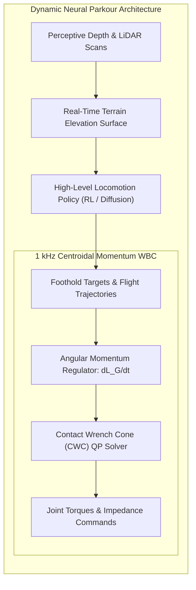
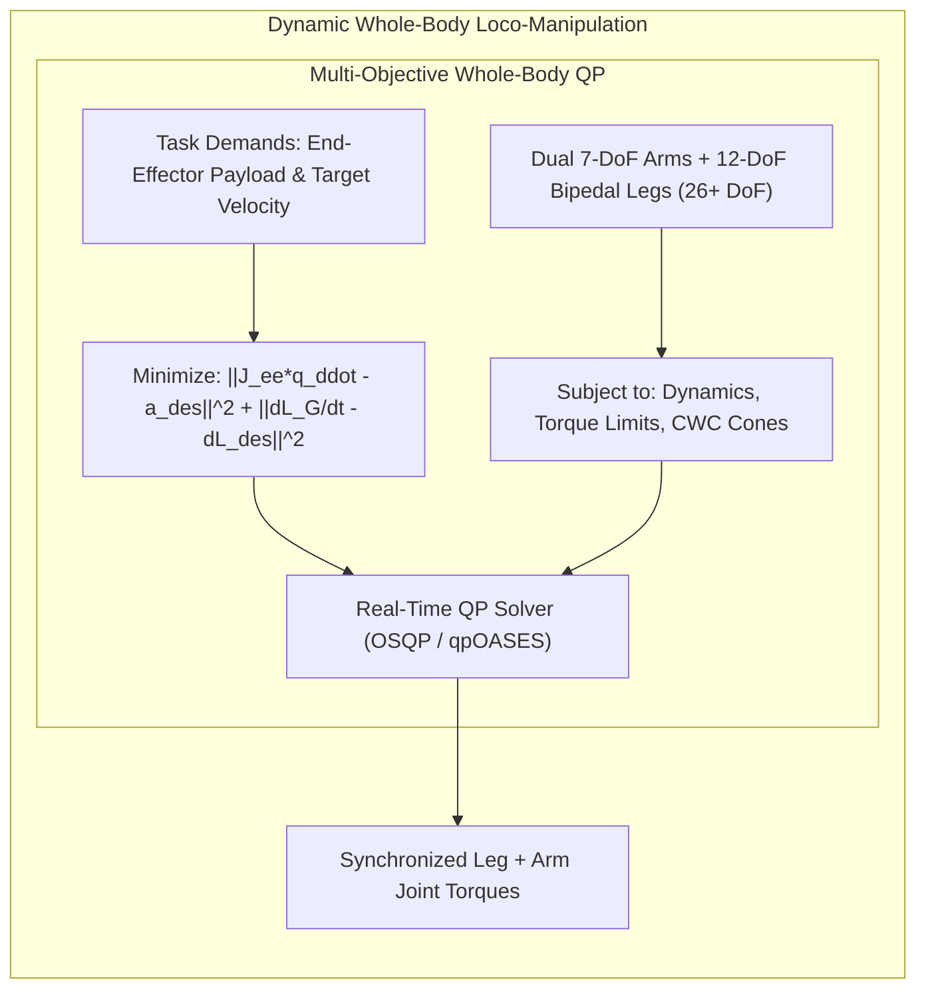
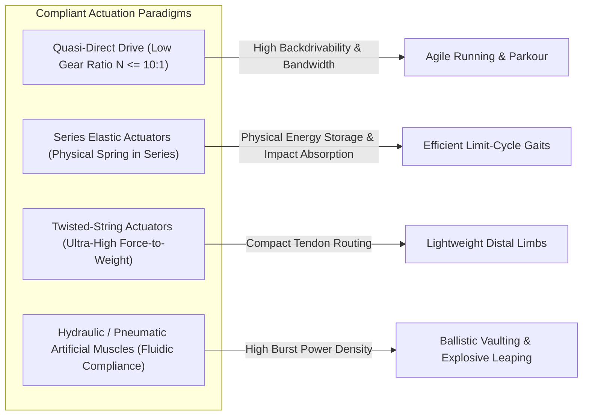
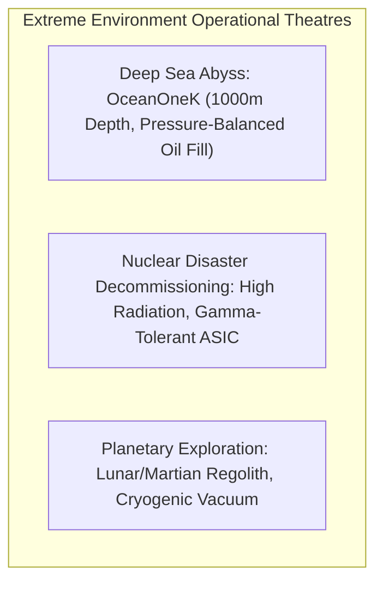

import ChapterProgress from '@site/src/components/ChapterProgress';
import QuizEngine from '@site/src/components/QuizEngine';

# Research Frontiers in Locomotion: Parkour, Loco-Manipulation & Extreme Environments

<ChapterProgress />

Over the past two decades, bipedal locomotion has evolved from quasi-static, flat-footed shuffling governed by conservative Zero-Moment Point (ZMP) margins to dynamic, non-conservative limit-cycle gaits. Today, robotics stands at the threshold of a new paradigm: **acrobatic physical intelligence**. Humanoids are no longer confined to structured factory floors; they are leaping across discontinuous terrain gaps, vaulting obstacles, carrying heavy dynamic payloads while ascending staircases, and operating in unstructured, life-threatening environments ranging from the deep ocean abyss to the lunar south pole.

Achieving such agility requires unifying non-linear hybrid dynamical systems, high-bandwidth whole-body centroidal momentum regulation, distributed contact wrench cones, and bio-inspired compliant actuation. This chapter explores the theoretical foundations, mathematical formalisms, and hardware architectures driving the frontiers of dynamic locomotion.

---

## 1. Dynamic Parkour and Acrobatic Agility

Human parkour is defined by the rapid, fluid negotiation of complex environmental obstacles through running, jumping, climbing, and vaulting. Translating parkour to humanoid robots pushes physical actuators to their thermal and torque boundaries while demanding microsecond-level contact planning.



### 1.1 Flight Phases and Angular Momentum Regulation

Unlike terrestrial walking, parkour maneuvers feature sustained ballistic **flight phases** where the robot loses all contact with the ground ($N_c = 0$). During flight, the total momentum rate of change is strictly governed by gravity:

$$
\dot{\mathbf{P}}_G = m\mathbf{g}, \quad \dot{\mathbf{L}}_G = \mathbf{0}
$$

Where $\mathbf{P}_G \in \mathbb{R}^3$ is the linear momentum, $\mathbf{L}_G \in \mathbb{R}^3$ is the angular momentum about the Center of Mass (CoM) $\mathbf{p}_G$, and $m$ is the total robot mass. Because the robot cannot alter its centroidal angular momentum in free flight, any reorientation of the torso or preparation for touchdown must be achieved through **inertial body shaping**—rapidly swinging the arms and legs to generate counter-inertial torques via the system's inertia tensor $\mathbf{I}_G(\mathbf{q})$:

$$
\mathbf{L}_G = \mathbf{I}_G(\mathbf{q})\boldsymbol{\omega}_{\text{base}} + \mathbf{A}_{\text{locked}}(\mathbf{q})\dot{\mathbf{q}} = \text{constant}
$$

Where $\mathbf{A}_{\text{locked}}(\mathbf{q})$ is the Centroidal Momentum Matrix (CMM) mapping internal joint velocities $\dot{\mathbf{q}}$ to angular momentum.

### 1.2 Touchdown Impact and Contact Wrench Cones

Upon impact, the ground reaction forces $\mathbf{f}_i \in \mathbb{R}^3$ applied at contact footholds $\mathbf{p}_i$ must instantaneously dissipate the accumulated kinetic energy without inducing foot slippage or tipping. The time derivative of centroidal angular momentum during multi-contact phases becomes:

$$
\dot{\mathbf{L}}_G = \sum_{i=1}^{N_c} (\mathbf{p}_i - \mathbf{p}_G) \times \mathbf{f}_i + \sum_{i=1}^{N_c} \boldsymbol{\tau}_i
$$

To prevent slippage and foot rollover, each contact wrench $\mathbf{w}_i = [\mathbf{f}_i^T, \boldsymbol{\tau}_i^T]^T$ must reside within the **Contact Wrench Cone (CWC)** $\mathcal{K}_i$, defined by the Coulomb friction coefficient $\mu$ and foot sole geometry:

$$
\mathcal{K}_i = \left\{ [\mathbf{f}_i^T, \boldsymbol{\tau}_i^T]^T \in \mathbb{R}^6 \;\middle|\; f_{i,z} \ge 0, \; \sqrt{f_{i,x}^2 + f_{i,y}^2} \le \mu f_{i,z}, \; \lvert \tau_{i,z} \rvert \le \mu_s f_{i,z}, \; \mathbf{p}_{\text{cop},i} \in \partial \mathcal{S}_i \right\}
$$

The net wrench delivered to the CoM is the Minkowski sum of the individual contact cones mapped through their spatial grasp matrices $\mathbf{X}_i$:

$$
\mathcal{W}_{\text{total}} = \bigoplus_{i=1}^{N_c} \mathbf{X}_i \mathcal{K}_i
$$

---

## 2. Simultaneous Whole-Body Loco-Manipulation

Traditional robotic control decouples locomotion from manipulation: the mobile base navigates to a waypoint, halts, locks its stance legs, and then executes an arm trajectory. In dynamic human operations, locomotion and manipulation occur concurrently: a human worker uses leg thrust to push open a heavy door while swinging an arm to grasp a rail.



When a humanoid transports a dynamic payload of mass $m_L$ with acceleration $\mathbf{a}_L$, the load exerts a dynamic disturbance wrench $\mathbf{w}_{\text{ext}} = [m_L(\mathbf{g} - \mathbf{a}_L)^T, \boldsymbol{\tau}_L^T]^T$ on the torso. The whole-body controller counteracts this by:
1. **Dynamic Counter-Leaning**: Shifting the CoM $\mathbf{p}_G$ away from the payload to keep the net Zero-Moment Point centered within the support polygon.
2. **Torque Redundancy Exploitation**: Leveraging the null space of the end-effector Jacobian $\mathbf{J}_{\text{ee}}(\mathbf{q})$ to adjust pelvis posture without deflecting the payload trajectory.

---

## 3. Compliant Actuation and Soft Robotic Structures

Rigid geared actuators (such as high-ratio harmonic drives) exhibit excessive reflected rotor inertia ($J_{\text{refl}} = N^2 J_m$), making them vulnerable to gear tooth fracture during high-velocity impacts. The locomotion frontier is shifting toward **compliant actuation**:



### 3.1 Actuation Comparison Matrix

| Actuation Technology | Torque/Power Density | Reflected Inertia | Shock Tolerance | Control Bandwidth | Ideal Domain |
| :--- | :--- | :--- | :--- | :--- | :--- |
| **Harmonic Drive Rigid Servo** | High ($8\,\text{Nm/kg}$) | Extreme ($N \ge 100$) | Very Low (brittle) | High ($> 100\,\text{Hz}$) | Precision tabletop manipulation |
| **Quasi-Direct Drive (QDD)** | Medium ($3-5\,\text{Nm/kg}$) | Low ($N \le 10$) | High (backdrivable) | Very High ($> 200\,\text{Hz}$) | Dynamic running, MIT Cheetah |
| **Series Elastic Actuator (SEA)** | Medium ($4\,\text{Nm/kg}$) | Decoupled by spring | Extreme (passive compliance) | Medium ($20-40\,\text{Hz}$) | NASA Valkyrie, robust walking |
| **Hydraulic Cylinder** | Extreme ($30\,\text{Nm/kg}$) | Negligible (fluidic) | Absolute (cushioned) | High ($50-100\,\text{Hz}$) | Boston Dynamics Atlas |
| **Twisted-String Actuator (TSA)** | High ($10\,\text{Nm/kg}$) | Low | High (tendon elasticity) | Low-Medium ($15-30\,\text{Hz}$) | Prosthetics, lightweight hands |

---

## 4. Wearable Robotic Exoskeletons & Human Augmentation

Exoskeletons represent the inverse problem of autonomous humanoids: rather than replacing human locomotion, they operate in parallel with the human musculoskeletal system to reduce metabolic consumption:

$$
\Delta \dot{E}_{\text{metabolic}} = \frac{\dot{E}_{\text{unassisted}} - \dot{E}_{\text{assisted}}}{\dot{E}_{\text{unassisted}}} \times 100\%
$$

State-of-the-art autonomous hip-knee-ankle exoskeletons (such as systems pioneered at Harvard and Stanford) achieve greater than $25\%$ metabolic reductions during level-ground walking and load carriage. 

Key challenges include:
* **Human-in-the-Loop Optimization (HILO)**: Adapting torque assistance profiles $\tau_{\text{assist}}(t, \boldsymbol{\theta})$ in real time using metabolic respirometry or electromyography (EMG) signals.
* **Biomechanical Transparency**: Ensuring zero resistance when the user executes unplanned motions (turning, stumbling, sudden stops).

---

## 5. Extreme Environment Humanoids

Humanoids are increasingly engineered to operate where humans cannot survive:



1. **Underwater Humanoids (Stanford OceanOne & OceanOneK)**:
   * Replaces leg walking with 8 vectored thrusters while retaining a dexterous dual-arm torso.
   * Internal cavities are flooded with non-conductive dielectric silicone oil, equalizing internal pressure to surrounding hydrostatic pressure at depths exceeding 1,000 meters.
2. **Radiation-Hardened Systems (Fukushima Decommissioning)**:
   * Total Ionizing Dose (TID) tolerance exceeding $10^4\,\text{Gy}$.
   * Silicon-on-insulator (SOI) rad-hard electronics, optical fiber link conduits, and radiation-shielded lead/boron polymer housings.
3. **Planetary Exploration (NASA Valkyrie & Lunar Humanoids)**:
   * Operation in lunar dust vacuum ($10^{-9}\,\text{Torr}$) with extreme temperature swings ($-170^\circ\text{C}$ to $+120^\circ\text{C}$).
   * Magnetic seal dust caps and sublimation heat-pipe cooling radiators.

---

## 6. The 20 Unsolved Grand Challenges in Legged Locomotion

Despite remarkable progress, bipedal locomotion science faces deep open theoretical and mechanical bottlenecks. The following 20 open problems define the next decade of academic research:

1. **Real-Time Non-Convex Contact Sequence Optimization**: Solving simultaneous foothold selection, contact timing, and continuous kinematics in non-convex multi-surface environments at $> 100\,\text{Hz}$.
2. **Dynamic Foothold Fracture Recovery**: Instantaneous stabilization when a chosen stepping contact surface collapses (e.g., loose rock, shattering ice) mid-stance.
3. **Perceptive Blind-Spot Occlusion Under Agile Tilting**: Maintaining a coherent 3D heightfield when explosive torso pitch maneuvers rotate depth sensors away from the terrain.
4. **Generalizable Zero-Shot Sim-to-Real Friction Adaptation**: Instantly identifying ground friction coefficients $\mu \in [0.05, 1.2]$ within a single contact stride without slippage-induced falling.
5. **Ultra-High Bandwidth Tactile Ground Sensing**: Full-sole sensor skins delivering spatial contact pressure distributions at 1 kHz with durability exceeding $10^7$ impact cycles.
6. **Explosive Hydraulic-Equivalent Electromechanical Power Density**: Achieving continuous joint power densities exceeding $1.5\,\text{kW/kg}$ using brushless electric motors without thermal burnout.
7. **Metabolic Efficiency Parity with Biological Locomotion**: Reducing the Cost of Transport (CoT) of electric humanoids from $\approx 1.5$ down to biological human efficiency ($\approx 0.2$).
8. **Long-Horizon Whole-Body Loco-Manipulation Planning**: Synthesizing minutes-long sequences where legs, torso, and arms coordinate to traverse obstacles and reposition furniture.
9. **Universal Stability Margins for Hybrid Dynamic Limit Cycles**: Analytical closed-form orbital stability metrics for multi-contact, 3D non-periodic walking on compliant terrain.
10. **Catastrophic Failure Self-Arrest & Fall Damage Mitigation**: Autonomous dynamic rolling, tucking, and sacrificial energy dissipation policies during unrecoverable falls.
11. **Continuous Visco-Elastic Ground Interaction Modeling**: Real-time simulation and predictive control over mud, deep sand, snow, and gravel.
12. **High-Frequency Torque-Sensing Noise Rejection**: Extracting clean joint torque signals in the presence of severe structural vibration induced by plastic foot impacts.
13. **Sub-Millisecond Multi-Contact Quadratic Programming**: Developing specialized FPGA / ASIC interior-point solvers resolving 100-variable CWC problems in $< 100\,\mu\text{s}$.
14. **Co-Design of Humanoid Morphological Kinematics**: Algorithmic optimization of link lengths, gear ratios, and mass distributions simultaneously with neural control policies.
15. **Bio-Inspired Tendon-Driven Musculoskeletal Routing**: Controlling multi-articular muscle tendon networks with dynamic stiffness modulation across 50+ tendon pathways.
16. **Autonomous Transition Across Multi-Modal Locomotion**: Seamless, reactive switching between bipedal walking, quadrupedal crawling, hand-supported scrambling, and brachiating.
17. **Dynamic Crowded-Space Human Disturbance Rejection**: Maintaining bipedal balance under unpredictable physical nudges, jostling, and tugging from crowds of humans.
18. **Acoustic and Micro-Doppler Terrain Characterization**: Leveraging footfall sound signatures and radar to predict soil structural strength prior to full weight transfer.
19. **Thermal Equilibrium in Prolonged Extreme Cold**: Cryogenic motor lubrication and battery self-heating enabling autonomous polar or planetary operations at $-50^\circ\text{C}$.
20. **Provably Safe Neural Policy Certificates**: Embedding Control Barrier Functions (CBFs) directly inside deep neural network policies to mathematically guarantee zero tipping.

---

## 7. Python Implementation: Centroidal Momentum Parkour Landing Controller

The following production script implements a real-time Whole-Body Centroidal Momentum Regulator designed to stabilize a humanoid robot absorbing a high-energy jump landing. It formulates a Quadratic Program (QP) that calculates optimal ground reaction forces $\mathbf{f}_1, \mathbf{f}_2$ satisfying friction cone constraints while driving centroidal linear and angular momentum rates to zero.

```python
"""
parkour_landing_controller.py
=============================================================================
Centroidal Momentum Regulator for Dynamic Jump Landing Stabilization.
Formulates a Real-Time Quadratic Program (QP) to compute ground reaction
forces (GRF) for bilateral foot contacts under friction cone constraints.
=============================================================================
"""

import numpy as np
import scipy.optimize as opt
from typing import Tuple, Dict


class CentroidalMomentumLandingController:
    r"""
    Stabilizes high-energy parkour jump landings by resolving:
      min_{f} || \dot{P}_G - \dot{P}_des ||^2_W_p + || \dot{L}_G - \dot{L}_des ||^2_W_l + || f ||^2_R
    Subject to:
      - Coulomb friction pyramid constraints: |f_x| <= mu * f_z, |f_y| <= mu * f_z
      - Unilateral contact constraint: f_z_min <= f_z <= f_z_max
    """
    def __init__(
        self,
        robot_mass: float = 65.0,
        friction_coeff: float = 0.6,
        f_z_min: float = 10.0,
        f_z_max: float = 2000.0
    ):
        self.mass = robot_mass
        self.gravity = np.array([0.0, 0.0, -9.81], dtype=np.float64)
        self.mu = friction_coeff
        self.f_z_min = f_z_min
        self.f_z_max = f_z_max

        # Momentum tracking PD gains
        self.kp_lin = np.diag([80.0, 80.0, 150.0])
        self.kd_lin = np.diag([20.0, 20.0, 35.0])
        self.kp_ang = np.diag([120.0, 120.0, 120.0])
        self.kd_ang = np.diag([25.0, 25.0, 25.0])

        # QP Objective Weights
        self.W_linear = 10.0
        self.W_angular = 50.0
        self.W_regularization = 1e-4

    def compute_desired_momentum_rates(
        self,
        com_pos: np.ndarray,
        com_vel: np.ndarray,
        com_pos_ref: np.ndarray,
        com_vel_ref: np.ndarray,
        base_rot_error: np.ndarray,
        base_ang_vel: np.ndarray
    ) -> Tuple[np.ndarray, np.ndarray]:
        """Calculates desired linear and angular momentum rates via feedback."""
        # Linear momentum rate: \dot{P}_des = Kp*(x_ref - x) + Kd*(v_ref - v)
        p_dot_des = (
            self.kp_lin @ (com_pos_ref - com_pos)
            + self.kd_lin @ (com_vel_ref - com_vel)
        )
        
        # Angular momentum rate: \dot{L}_des = -Kp*rot_err - Kd*ang_vel
        l_dot_des = -self.kp_ang @ base_rot_error - self.kd_ang @ base_ang_vel
        return p_dot_des, l_dot_des

    def solve_ground_reaction_forces(
        self,
        com_pos: np.ndarray,
        foot_pos_left: np.ndarray,
        foot_pos_right: np.ndarray,
        p_dot_des: np.ndarray,
        l_dot_des: np.ndarray
    ) -> Dict[str, np.ndarray]:
        r"""
        Solves QP for bilateral contact forces f = [f_left(3), f_right(3)]^T.
        Total contact wrench:
          \dot{P} = f_left + f_right + m*g
          \dot{L} = (p_left - p_com) x f_left + (p_right - p_com) x f_right
        """
        r_left = foot_pos_left - com_pos
        r_right = foot_pos_right - com_pos

        # Skew-symmetric cross product matrices
        def skew(r: np.ndarray) -> np.ndarray:
            return np.array([
                [0.0, -r[2], r[1]],
                [r[2], 0.0, -r[0]],
                [-r[1], r[0], 0.0]
            ], dtype=np.float64)

        S_left = skew(r_left)
        S_right = skew(r_right)

        # Mapping matrix A (6 x 6): [f_left; f_right] -> [\dot{P} - m*g; \dot{L}]
        # \dot{P} - m*g = f_left + f_right
        # \dot{L} = S_left * f_left + S_right * f_right
        A_lin = np.hstack([np.eye(3), np.eye(3)])
        A_ang = np.hstack([S_left, S_right])
        A = np.vstack([A_lin, A_ang])  # Shape: (6, 6)

        b = np.concatenate([p_dot_des - self.mass * self.gravity, l_dot_des])

        # Quadratic objective: 0.5 * f^T * H * f + g^T * f
        W = np.diag([self.W_linear]*3 + [self.W_angular]*3)
        H = A.T @ W @ A + self.W_regularization * np.eye(6)
        g_vec = -A.T @ W @ b

        # Friction cone linear inequality constraints: C * f <= d
        # For each foot:
        #  f_x - mu * f_z <= 0
        # -f_x - mu * f_z <= 0
        #  f_y - mu * f_z <= 0
        # -f_y - mu * f_z <= 0
        # -f_z <= -f_z_min
        #  f_z <=  f_z_max
        C_block = np.array([
            [ 1.0,  0.0, -self.mu],
            [-1.0,  0.0, -self.mu],
            [ 0.0,  1.0, -self.mu],
            [ 0.0, -1.0, -self.mu],
            [ 0.0,  0.0, -1.0],
            [ 0.0,  0.0,  1.0]
        ], dtype=np.float64)

        d_block = np.array([0.0, 0.0, 0.0, 0.0, -self.f_z_min, self.f_z_max], dtype=np.float64)

        C = np.zeros((12, 6), dtype=np.float64)
        C[0:6, 0:3] = C_block
        C[6:12, 3:6] = C_block
        d = np.concatenate([d_block, d_block])

        # Solve convex QP via scipy.optimize.linprog / minimize
        def objective(f):
            return 0.5 * f @ H @ f + g_vec @ f

        def jacobian(f):
            return H @ f + g_vec

        constraints = ({
            'type': 'ineq',
            'fun': lambda f: d - C @ f,
            'jac': lambda f: -C
        })

        f_init = np.array([0.0, 0.0, self.mass * 9.81 / 2.0, 0.0, 0.0, self.mass * 9.81 / 2.0])
        res = opt.minimize(
            objective, f_init, jac=jacobian, constraints=constraints, method='SLSQP'
        )

        if not res.success:
            print(f"[WARN] QP Landing Solver failed to converge: {res.message}")

        f_opt = res.x
        return {
            "f_left": f_opt[0:3],
            "f_right": f_opt[3:6],
            "total_normal_force": f_opt[2] + f_opt[5],
            "cost": res.fun
        }


# ---------------------------------------------------------------------------
# Unit Verification & Simulation Harness
# ---------------------------------------------------------------------------

if __name__ == "__main__":
    print("Initializing Parkour Landing Controller...")
    controller = CentroidalMomentumLandingController(robot_mass=65.0, friction_coeff=0.6)

    # Simulated jump landing state: robot descending at -2.5 m/s
    com_pos = np.array([0.0, 0.0, 0.75])
    com_vel = np.array([0.2, 0.0, -2.5])  # High downward velocity
    com_pos_ref = np.array([0.0, 0.0, 0.70])
    com_vel_ref = np.array([0.0, 0.0, 0.0])

    base_rot_error = np.array([0.05, -0.02, 0.0])  # Slight roll/pitch tilt
    base_ang_vel = np.array([0.1, -0.3, 0.0])

    foot_left = np.array([0.0, 0.15, 0.0])
    foot_right = np.array([0.0, -0.15, 0.0])

    p_dot, l_dot = controller.compute_desired_momentum_rates(
        com_pos, com_vel, com_pos_ref, com_vel_ref, base_rot_error, base_ang_vel
    )

    forces = controller.solve_ground_reaction_forces(
        com_pos, foot_left, foot_right, p_dot, l_dot
    )

    print(f"Computed Left Foot Force  (N): {np.round(forces['f_left'], 2)}")
    print(f"Computed Right Foot Force (N): {np.round(forces['f_right'], 2)}")
    print(f"Total Normal Force Fz (N): {round(forces['total_normal_force'], 2)}")
    
    # Assert physical feasibility
    assert forces['total_normal_force'] >= controller.mass * 9.81, "Normal force insufficient for gravity compensation!"
    assert forces['f_left'][2] >= controller.f_z_min, "Left foot tensile force violation!"
    assert forces['f_right'][2] >= controller.f_z_min, "Right foot tensile force violation!"
    assert np.abs(forces['f_left'][0]) <= controller.mu * forces['f_left'][2] + 1e-3, "Friction cone violated!"
    print("[PASS] Centroidal Momentum Parkour Controller verification passed.")
```

---

<QuizEngine
  quizId="quiz-12-2"
  title="Module 12.2 Mastery Check: Locomotion Frontiers & Parkour"
  moduleId="module12"
  passThreshold={70}
  questions={[
    {
      id: "q1",
      question: "During the unconstrained ballistic flight phase of a humanoid parkour leap, what fundamental conservation law dictates its angular momentum?",
      options: [
        "Conservation of electric current through the battery harness",
        "The angular momentum rate of change dL_G/dt is strictly zero because no external contact wrenches exist to impart external torque",
        "The angular momentum increases proportionally to aerodynamic lift",
        "The robot's base orientation is permanently frozen"
      ],
      correctIndex: 1,
      explanation: "In flight, the only external force is gravity, which acts through the Center of Mass (yielding zero gravitational torque about the CoM). Hence dL_G/dt = 0, meaning internal joint motions can reorient limbs but cannot alter net centroidal angular momentum."
    },
    {
      id: "q2",
      question: "Why are Quasi-Direct Drive (QDD) actuators preferred over high-gear-ratio (100:1) Harmonic Drive servos for dynamic parkour jump landings?",
      options: [
        "Because harmonic drives are too light",
        "Because harmonic drives exhibit huge reflected rotor inertia (N^2), causing catastrophic gear tooth fracture upon high-speed touchdown impacts",
        "Because QDD motors do not consume electrical power",
        "Because harmonic drives cannot rotate clockwise"
      ],
      correctIndex: 1,
      explanation: "Reflected rotor inertia scales with the square of the gear ratio (N^2). Under high-velocity impact transients, high-ratio drives cannot backdrive rapidly enough, transferring massive mechanical shock directly to fragile gear teeth."
    },
    {
      id: "q3",
      question: "In the context of extreme environment robotics, how does the Stanford OceanOneK humanoid prevent water ingress and structural crushing at 1,000 meters depth?",
      options: [
        "By utilizing thick 10-inch titanium armor plating",
        "By flooding all internal electronic and actuator cavities with non-conductive dielectric silicone oil, balancing internal pressure to surrounding hydrostatic pressure",
        "By continuously pumping compressed air into the chassis",
        "By operating exclusively inside an airtight pressurized submarine dome"
      ],
      correctIndex: 1,
      explanation: "OceanOneK utilizes pressure-balanced oil-filled (PBOF) compliance. Flooding structural voids with incompressible dielectric silicone oil equalizes internal and external pressures, eliminating crushing pressure differentials without requiring bulky pressure hulls."
    }
  ]}
/>

---

## Annotated Research Citations & Further Reading

1. **Hoeller, D., Rudin, N., Sako, D., & Hutter, M. (2024)**. *Neural Parkour: Learning Agile Locomotion over Challenging Terrains*. Science Robotics, 9(88), eadi8012.  
   *Demonstrates vision-based end-to-end RL policies running on ANYmal quadrupeds and humanoids executing dynamic jumps, climbs, and gap traversals.*
2. **Khatib, O., Yeh, X., Brantner, G., et al. (2016)**. *OceanOne: A Robotic Avatar for Oceanic Exploration*. IEEE Robotics & Automation Magazine, 23(4), 20–29.  
   *Presents the mechanics, bilateral haptics, and pressure-balanced fluidic design of deep-sea humanoid avatars.*
3. **Wensing, P. M., Wang, A., Seok, S., Otten, D., Lang, J., & Kim, S. (2017)**. *Proprioceptive Actuator Design in the MIT Cheetah: Impact Mitigation and High-Bandwidth Physical Interaction*. IEEE Transactions on Robotics, 33(3), 509–522.  
   *Foundational paper establishing low-inertia quasi-direct drive (QDD) actuation principles for dynamic terrestrial robots.*
4. **Caron, S., Pham, Q. C., & Nakamura, Y. (2015)**. *ZMP Support Areas for Multi-Contact Mobility Under Friction Cone Constraints*. IEEE Transactions on Robotics, 31(6), 1395–1407.  
   *Formalizes the 6D Contact Wrench Cone (CWC) and generalized support areas for whole-body multi-contact locomotion.*
