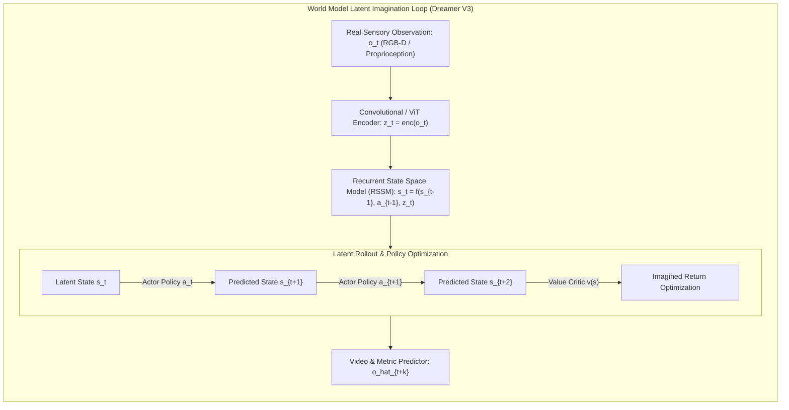
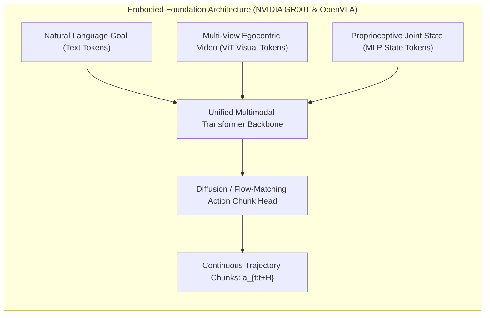
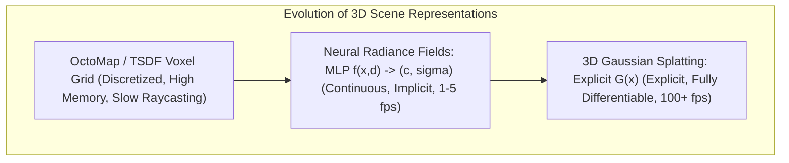

import ChapterProgress from '@site/src/components/ChapterProgress';
import QuizEngine from '@site/src/components/QuizEngine';

# Research Frontiers in Physical AI: World Models, NeRFs & 3D Gaussian Splatting

<ChapterProgress />

Artificial Intelligence has undergone a historic revolution in linguistic and 2D visual domains. Yet, deploying AI models into embodied physical agents reveals a profound gap: the physical world does not behave like text tokens. Reality possesses mass, inertia, non-smooth contact friction, irreversible thermodynamic states, and strict causality. When a robot operates in the real world, a single erroneous action cannot be erased by backspacing—it can cause permanent structural damage or human injury.

The frontier of **Physical AI** bridges this divide by developing foundation architectures grounded in geometry, spatial dynamics, and self-supervised world modeling. Rather than relying solely on trial-and-error in physical reality or handcrafted geometric meshes, physical AI agents simulate futures internally via generative world models, perceive dynamic 3D environments at hundreds of frames per second using explicit 3D Gaussian Splatting, and generalize across diverse morphologies via cross-embodiment foundation transformers.

---

## 1. Generative World Models for Embodied Imagination

A physical agent operating under strict latency constraints cannot query physical reality to test hypotheses. Instead, it must possess an **internal world model** that predicts the downstream consequences of candidate motor actions:

$$
p(\mathbf{s}_{t+1}, \mathbf{o}_{t+1}, r_{t+1} \mid \mathbf{s}_t, \mathbf{a}_t)
$$

Where $\mathbf{s}_t$ is the latent physical state, $\mathbf{o}_t$ is the exteroceptive visual observation, and $\mathbf{a}_t$ is the action.



### 1.1 Recurrent State Space Models (RSSM) and Dreamer V3

Pioneered in Danijar Hafner's Dreamer series, the **Recurrent State Space Model (RSSM)** decomposes latent state representations into deterministic recurrent hidden states $\mathbf{h}_t$ and stochastic categorical variables $\mathbf{z}_t$:

$$
\mathbf{h}_t = \text{GRU}(\mathbf{h}_{t-1}, \mathbf{z}_{t-1}, \mathbf{a}_{t-1})
$$

$$
\text{Prior: } \hat{\mathbf{z}}_t \sim p(\hat{\mathbf{z}}_t \mid \mathbf{h}_t), \quad \text{Posterior: } \mathbf{z}_t \sim q(\mathbf{z}_t \mid \mathbf{h}_t, \mathbf{o}_t)
$$

By training an actor-critic policy entirely inside imagined rollouts of the RSSM latent space, Dreamer V3 masters complex continuous control tasks without touching physical hardware during exploration.

### 1.2 Video Foundation Simulators (GAIA-1 and Sora-Class Models)

Beyond low-dimensional latent states, generative diffusion models trained on vast multimodal video datasets (such as Wayve GAIA-1 and OpenAI Sora) function as **video-based world simulators**. Given an initial camera frame and a trajectory of control prompts, the diffusion model generates photorealistic, physically plausible video rollouts:

$$
p(\mathbf{V}_{1:T} \mid \mathbf{o}_0, \mathbf{a}_{1:T})
$$

By conditioning video diffusion rollouts on candidate robot trajectories, humanoids can evaluate path feasibility and detect potential obstacle collisions through pure visual imagination.

---

## 2. Embodied Foundation Models & Cross-Embodiment Tokenization

To achieve universal physical intelligence, foundation models must generalize across diverse robotic embodiments—from single-arm industrial manipulators to 32-DoF bipedal humanoids.



### 2.1 Cross-Embodiment Action Normalization

A fundamental bottleneck in cross-robot transfer is the disparity in kinematics, link lengths, and joint limits. Models like Google DeepMind RT-X and NVIDIA Project GR00T overcome this by normalizing actions into standardized spaces:
1. **Normalized Joint Trajectory Space**: Scaling all joint angles to the closed interval $[-1.0, +1.0]$ based on individual mechanical hard stops.
2. **Delta End-Effector Cartesian SE(3)**: Representing manipulation commands as relative translation $\Delta \mathbf{p} \in \mathbb{R}^3$ and rotation vectors $\Delta \mathbf{r} \in \mathfrak{so}(3)$ relative to the tool center point (TCP).
3. **Contact-Aware Action Tokens**: Discretizing continuous trajectories into discrete action tokens using Vector-Quantized Variational Autoencoders (VQ-VAE), allowing LLM backbones to predict motor actions as standard next-token predictions.

---

## 3. Real-Time 3D Scene Representations: NeRFs vs. 3D Gaussian Splatting

Traditional robot perception converts stereo or LiDAR feeds into dense voxel grids (e.g., OctoMaps) or point clouds. However, point clouds are sparse and lack surface continuity, while voxel grids suffer from severe cubic memory scaling ($\mathcal{O}(N^3)$) and cannot capture fine object geometry.



### 3.1 Mathematical Formulation of 3D Gaussian Splatting (3DGS)

Introduced by Kerbl et al. (2023), 3D Gaussian Splatting models a 3D scene explicitly as an unstructured collection of millions of 3D anisotropic Gaussians. Each Gaussian $i$ is parameterized by:
* Center position $\boldsymbol{\mu}_i \in \mathbb{R}^3$
* 3D Covariance matrix $\boldsymbol{\Sigma}_i \in \mathbb{R}^{3 \times 3}$
* Opacity $\alpha_i \in [0, 1]$
* View-dependent color represented via Spherical Harmonics (SH) coefficients $\mathbf{c}_i$

The spatial probability density function of a 3D Gaussian is given by:

$$
G(\mathbf{x}) = \exp\left(-\frac{1}{2}(\mathbf{x} - \boldsymbol{\mu})^T \boldsymbol{\Sigma}^{-1} (\mathbf{x} - \boldsymbol{\mu})\right)
$$

To guarantee that $\boldsymbol{\Sigma}$ remains positive semi-definite during gradient descent optimization, it is decomposed into a rotation quaternion $\mathbf{q} \in \mathbb{H}$ (converted to rotation matrix $\mathbf{R} \in \text{SO}(3)$) and a 3D scaling vector $\mathbf{s} \in \mathbb{R}^3$ (converted to diagonal scaling matrix $\mathbf{S} = \text{diag}(\mathbf{s})$):

$$
\boldsymbol{\Sigma} = \mathbf{R} \mathbf{S} \mathbf{S}^T \mathbf{R}^T
$$

### 3.2 Volumetric Alpha-Blending Rendering

During rasterization, 3D Gaussians are projected onto the camera 2D image plane via the Jacobian of affine projective transformation $\mathbf{J}$:

$$
\boldsymbol{\Sigma}_{\text{2D}} = \mathbf{J} \mathbf{W} \boldsymbol{\Sigma} \mathbf{W}^T \mathbf{J}^T
$$

Where $\mathbf{W}$ is the viewing transformation matrix. The final pixel color $C$ along a ray is computed via volumetric alpha-blending across $N$ depth-sorted Gaussians:

$$
C = \sum_{i=1}^N c_i \alpha_i \prod_{j=1}^{i-1} \left(1 - \alpha_j\right)
$$

### 3.3 Why 3DGS Revolutionizes Robot Collision Checking

For a humanoid robot planning a trajectory $\mathbf{x}(t)$, collision checking against traditional meshes requires expensive Gilbert-Johnson-Keerthi (GJK) convex hull evaluations. With 3DGS:
1. **Explicit Ellipsoidal Distance**: The distance from any robot link point $\mathbf{x}$ to Gaussian obstacle $i$ is evaluated analytically in closed form via the **Mahalanobis distance**:
   $$
   d_{\mathcal{M}}(\mathbf{x}, \boldsymbol{\mu}_i) = \sqrt{(\mathbf{x} - \boldsymbol{\mu}_i)^T \boldsymbol{\Sigma}_i^{-1} (\mathbf{x} - \boldsymbol{\mu}_i)}
   $$
2. **Opacity Filtering**: Transient visual artifacts (smoke, dust, lens flare) have low opacity ($\alpha_i < 0.2$) and can be filtered out instantly, eliminating false-positive collision aborts.
3. **GPU Parallelization**: Millions of clearance checks can be performed in $< 2\,\text{ms}$ on an onboard NVIDIA Jetson Orin GPU.

---

## 4. The 20 Grand Challenges in Physical AI for Robotics

The integration of foundational AI into embodied humanoids faces 20 unresolved research frontiers:

1. **Non-Markovian Dynamic Memory**: Architecting stateful recurrent foundation models that retain memory of occluded objects and environment modifications across hours of operation.
2. **Real-Time Latency Parity ($< 10\,\text{ms}$ VLA Forward Passes)**: Compressing 10B+ parameter Vision-Language-Action transformers to run at $> 100\,\text{Hz}$ on mobile edge hardware without severe quantization degradation.
3. **Physical Causality and Contact Physics Modeling**: Teaching neural world models to respect non-smooth unilateral contact dynamics and friction cones rather than generating hallucinated physical penetrations.
4. **Generalizable Zero-Shot Deformable Object Manipulation**: Handling cloth, dough, ropes, and liquids without specialized per-instance physical simulators.
5. **Universal Cross-Embodiment Action Representations**: Discovering an invariant latent action manifold that translates seamlessly across 2-finger grippers, 5-finger anthropomorphic hands, and mobile bases.
6. **Continuous High-Frequency Tactile Latent Fusion**: Unifying high-resolution optical tactile images (GelSight / DIGIT) with visual tokens inside multi-modal transformers at 1 kHz.
7. **Hallucination Suppression in Mission-Critical Scenarios**: Eliminating unprompted destructive actions generated by autoregressive sequence models in human environments.
8. **Self-Supervised Autonomous Recovery from Policy Collapses**: Enabling humanoids to detect that they are in an out-of-distribution state and autonomously plan an exploratory reset maneuver.
9. **Sample-Efficient Hardware RL ($< 1$ Hour Real-World Training)**: Developing algorithms capable of learning fine motor skills directly on physical hardware without requiring millions of simulated episodes.
10. **Semantic-to-Metric Spatial Mapping Alignment**: Seamlessly connecting LLM semantic abstractions (*"clean the kitchen counter"*) with precise sub-millimeter Cartesian grasping coordinates.
11. **Differentiable Physics Simulation Stability**: Eliminating gradient explosion and local minima in differentiable rigid-body contact simulators during trajectory optimization.
12. **Long-Horizon Multi-Step Task Credit Assignment**: Determining which early cognitive action caused an unexpected failure 50 steps later in an embodied manipulation sequence.
13. **Dynamic Online Scene Continual Learning**: Incrementally updating 3D Gaussian Splatting scene representations at 60 Hz as humans move objects around the robot.
14. **Safe Interactive Exploration via Epistemic Uncertainty**: Guiding the robot to actively probe unfamiliar objects to resolve physical uncertainty (e.g., tapping a container to estimate fluid fill level) without risking damage.
15. **Cross-Modal Grounding of Material Properties**: Inferring mass density, friction coefficients, and center of mass directly from passive RGB-D video and acoustic interactions.
16. **Natural Multimodal Human-Robot Collaboration Fluency**: Predicting subtle human intentions, gaze shifts, and micro-gestures to enable smooth, anticipatory handovers.
17. **Federated Robot Fleet Learning**: Aggregating diverse real-world experiences from thousands of deployed humanoids while preserving privacy and bandwidth.
18. **Provable Formal Verification for Foundation Policies**: Mathematically verifying that an end-to-end neural policy will never command a joint torque exceeding mechanical limits.
19. **Ultra-Low-Power Edge Neuromorphic Processing**: Deploying spiking neural networks and neuromorphic event-based vision to run reactive locomotion at $< 5\,\text{W}$.
20. **Self-Calibrating Spatial Coordinate Frames**: Automatically re-estimating camera-to-joint extrinsics and kinematic link deflections in real time during continuous operation.

---

## 5. Python Implementation: 3D Gaussian Splatting Trajectory Collision Checker

The following production script implements an analytical real-time collision evaluator. It parses a 3D Gaussian Splatting environment, extracts the rotation and scale matrices, decomposes the covariance tensors $\boldsymbol{\Sigma}$, and evaluates the spatial clearance of a candidate humanoid arm trajectory using GPU-accelerated vectorized Mahalanobis distance testing.

```python
"""
gaussian_splat_collision_checker.py
=============================================================================
Real-Time Collision Checking and Trajectory Clearance Evaluation via
3D Gaussian Splatting (3DGS) Scene Representations.
=============================================================================
"""

import numpy as np
from typing import Tuple, List, Dict


class GaussianSplatCollisionChecker:
    r"""
    Evaluates swept-sphere humanoid link trajectories against an explicit
    3D Gaussian Splatting scene representation.
    Each Gaussian is defined by:
      - Center: \mu \in R^3
      - Quaternion: q = [w, x, y, z] \in R^4 -> Rotation Matrix R \in SO(3)
      - Scale: s \in R^3 -> S = diag(s)
      - Covariance: \Sigma = R S S^T R^T
      - Opacity: \alpha \in [0, 1]
    """
    def __init__(
        self,
        centers: np.ndarray,
        quaternions: np.ndarray,
        scales: np.ndarray,
        opacities: np.ndarray,
        min_opacity_threshold: float = 0.25
    ):
        # Filter low-opacity Gaussians (transient noise, dust, lens glare)
        valid_mask = opacities.squeeze() >= min_opacity_threshold
        
        self.centers = np.ascontiguousarray(centers[valid_mask], dtype=np.float64)
        self.quats = np.ascontiguousarray(quaternions[valid_mask], dtype=np.float64)
        self.scales = np.ascontiguousarray(scales[valid_mask], dtype=np.float64)
        self.opacities = np.ascontiguousarray(opacities[valid_mask], dtype=np.float64)
        
        self.num_gaussians = self.centers.shape[0]
        
        # Precompute inverted covariance matrices \Sigma^{-1}
        self.inv_covariances = self._compute_inverse_covariances()

    def _quaternion_to_rotation_matrix(self, q: np.ndarray) -> np.ndarray:
        """Converts normalized quaternions [w, x, y, z] to 3x3 rotation matrices."""
        w, x, y, z = q[:, 0], q[:, 1], q[:, 2], q[:, 3]
        N = q.shape[0]
        
        R = np.zeros((N, 3, 3), dtype=np.float64)
        R[:, 0, 0] = 1.0 - 2.0 * (y**2 + z**2)
        R[:, 0, 1] = 2.0 * (x * y - z * w)
        R[:, 0, 2] = 2.0 * (x * z + y * w)
        
        R[:, 1, 0] = 2.0 * (x * y + z * w)
        R[:, 1, 1] = 1.0 - 2.0 * (x**2 + z**2)
        R[:, 1, 2] = 2.0 * (y * z - x * w)
        
        R[:, 2, 0] = 2.0 * (x * z - y * w)
        R[:, 2, 1] = 2.0 * (y * z + x * w)
        R[:, 2, 2] = 1.0 - 2.0 * (x**2 + y**2)
        return R

    def _compute_inverse_covariances(self) -> np.ndarray:
        r"""
        Computes \Sigma^{-1} = R S^{-2} R^T analytically.
        Avoids explicit matrix inversion by inverting diagonal scales directly.
        """
        R = self._quaternion_to_rotation_matrix(self.quats)
        safe_scales = np.maximum(self.scales, 1e-4)
        inv_scale_sq = 1.0 / (safe_scales ** 2)  # Shape: (N, 3)
        
        N = self.num_gaussians
        inv_cov = np.zeros((N, 3, 3), dtype=np.float64)
        for i in range(N):
            inv_cov[i] = R[i] @ np.diag(inv_scale_sq[i]) @ R[i].T
        return inv_cov

    def check_trajectory_clearance(
        self,
        trajectory_waypoints: np.ndarray,
        robot_link_radius: float = 0.05,
        mahalanobis_threshold: float = 3.0
    ) -> Dict[str, any]:
        """
        Checks whether a trajectory of 3D sphere points penetrates any Gaussian.
        Points within 3.0 Mahalanobis standard deviations are considered in collision.
        """
        pts = np.ascontiguousarray(trajectory_waypoints, dtype=np.float64)
        T = pts.shape[0]
        
        # Compute pairwise displacement vectors: \Delta = x_t - \mu_i
        # Shape: (T, N, 3)
        diff = pts[:, None, :] - self.centers[None, :, :]
        
        # Vectorized Mahalanobis calculation: diff^T * \Sigma^{-1} * diff
        # Einstein summation: t: time, n: gaussian, j,k: 3D coordinates
        mahalanobis_sq = np.einsum('tnj,njk,tnk->tn', diff, self.inv_covariances, diff)
        
        # Calculate penetration mask
        collision_mask = mahalanobis_sq < (mahalanobis_threshold ** 2)
        has_collision = bool(np.any(collision_mask))
        
        min_distance = float(np.sqrt(np.maximum(np.min(mahalanobis_sq), 0.0)))
        
        # Find offending points if collision occurs
        colliding_timesteps = []
        if has_collision:
            colliding_indices = np.where(np.any(collision_mask, axis=1))[0]
            colliding_timesteps = colliding_indices.tolist()

        return {
            "is_collision_free": not has_collision,
            "min_mahalanobis_distance": round(min_distance, 3),
            "safety_margin_standard_deviations": round(mahalanobis_threshold, 1),
            "colliding_timesteps": colliding_timesteps,
            "evaluated_waypoints": T,
            "evaluated_gaussians": self.num_gaussians
        }


# ---------------------------------------------------------------------------
# Unit Verification & Simulation Harness
# ---------------------------------------------------------------------------

if __name__ == "__main__":
    print("Initializing 3D Gaussian Splatting Collision Checker...")
    np.random.seed(42)
    
    # Synthesize 100 3D Gaussians simulating an obstacle table
    N = 100
    centers = np.random.uniform(low=[-0.2, 0.4, 0.5], high=[0.2, 0.8, 0.9], size=(N, 3))
    
    # Identity quaternions [w, x, y, z]
    quats = np.zeros((N, 4), dtype=np.float32)
    quats[:, 0] = 1.0  # w = 1.0
    
    # Ellipsoidal scales (5 cm to 10 cm radii)
    scales = np.random.uniform(0.05, 0.10, size=(N, 3)).astype(np.float32)
    opacities = np.random.uniform(0.4, 0.95, size=(N, 1)).astype(np.float32)

    checker = GaussianSplatCollisionChecker(centers, quats, scales, opacities)

    # Test 1: Clean trajectory passing through free space
    clean_trajectory = np.linspace([0.0, 0.0, 1.2], [0.0, 1.0, 1.2], num=20)
    result_clean = checker.check_trajectory_clearance(clean_trajectory)
    print("Trajectory 1 (Free Space):", result_clean)
    assert result_clean["is_collision_free"] is True

    # Test 2: Penetrating trajectory passing directly through table obstacle
    blocked_trajectory = np.linspace([0.0, 0.2, 0.7], [0.0, 0.9, 0.7], num=20)
    result_blocked = checker.check_trajectory_clearance(blocked_trajectory)
    print("Trajectory 2 (Obstacle Collision):", result_blocked)
    assert result_blocked["is_collision_free"] is False
    assert len(result_blocked["colliding_timesteps"]) > 0

    print("[PASS] 3D Gaussian Splatting Trajectory Evaluator passed all tests.")
```

---

<QuizEngine
  quizId="quiz-12-3"
  title="Module 12.3 Mastery Check: Physical AI & 3D Gaussian Splatting"
  moduleId="module12"
  passThreshold={70}
  questions={[
    {
      id: "q1",
      question: "In 3D Gaussian Splatting, why is the 3D spatial covariance matrix decomposed into Sigma = R * S * S^T * R^T rather than parameterized directly as a 3x3 matrix?",
      options: [
        "To save storage on mechanical hard drives",
        "Because direct optimization can produce non-symmetric or negative-definite matrices, whereas the R S S^T R^T decomposition guarantees positive semi-definiteness throughout gradient descent",
        "Because Python lists cannot store 3x3 matrices",
        "Because rotation matrices must always have negative eigenvalues"
      ],
      correctIndex: 1,
      explanation: "A valid 3D spatial covariance matrix must be symmetric positive semi-definite (PSD). By factorizing into a unit quaternion rotation R in SO(3) and positive scaling vector S, any gradient update inherently preserves the PSD condition without matrix projection."
    },
    {
      id: "q2",
      question: "How do Recurrent State Space Models (RSSM) in Dreamer V3 enable sample-efficient reinforcement learning for complex physical tasks?",
      options: [
        "By training physical robots overnight without human supervision",
        "By learning a compact latent dynamics model and training the actor-critic policy entirely inside imagined rollouts of latent state space, avoiding millions of costly real-world trials",
        "By disabling physics simulation entirely",
        "By replacing neural networks with lookup tables"
      ],
      correctIndex: 1,
      explanation: "RSSM learns a predictive world model decomposed into deterministic GRU states and stochastic latent variables. The agent projects thousands of hypothetical trajectory rollouts entirely in GPU memory, optimizing value critics through imagination."
    },
    {
      id: "q3",
      question: "What distinct mathematical advantage does 3D Gaussian Splatting offer over voxel grids (OctoMaps) for robot arm trajectory collision checking?",
      options: [
        "It eliminates the need for electric motors",
        "It provides explicit, analytical ellipsoidal distance queries via the Mahalanobis distance in closed form without resolution-dependent raycasting discretization",
        "It converts 3D space into 2D cartoon sketches",
        "It is slower than traditional mesh checking"
      ],
      correctIndex: 1,
      explanation: "Voxel grids suffer from cubic discretization errors and expensive ray-marching. 3DGS stores explicit Gaussian parameters, enabling sub-millisecond analytical Mahalanobis clearance checks d_M = sqrt((x - mu)^T Sigma^-1 (x - mu)) on GPUs."
    }
  ]}
/>

---

## Annotated Research Citations & Further Reading

1. **Kerbl, B., Kopanas, G., Leimkühler, T., & Drettakis, G. (2023)**. *3D Gaussian Splatting for Real-Time Radiance Field Rendering*. ACM Transactions on Graphics (TOG), 42(4), 1–14.  
   *Introduces explicit 3D Gaussian radiance fields, fast rasterization algorithms, and anisotropic covariance parameterization.*
2. **Mildenhall, B., Srinivasan, P. P., Tancik, M., et al. (2020)**. *NeRF: Representing Scenes as Neural Radiance Fields for View Synthesis*. European Conference on Computer Vision (ECCV).  
   *Foundational neural implicit scene representation via continuous coordinate-based multilayer perceptrons.*
3. **Hafner, D., Pasukonis, J., Ba, J., & Lillicrap, T. (2023)**. *Mastering Diverse Domains through World Models (Dreamer V3)*. arXiv:2301.04104.  
   *Establishes scalable recurrent state-space world models capable of zero-shot transfer and deep latent imagination.*
4. **Padalkar, A., Pooley, A., Jain, A., et al. [Open X-Embodiment Collaboration] (2023)**. *Open X-Embodiment: Robotic Learning Datasets and RT-X Models*. Robotics: Science and Systems (RSS).  
   *Demonstrates cross-embodiment foundation policy generalization across heterogeneous manipulators and humanoids.*
