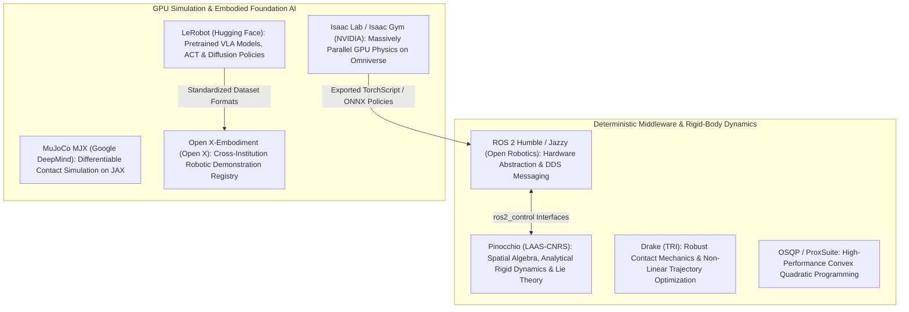
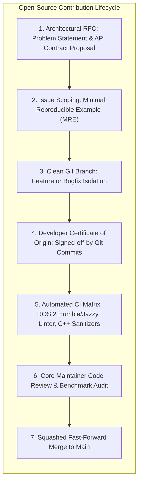
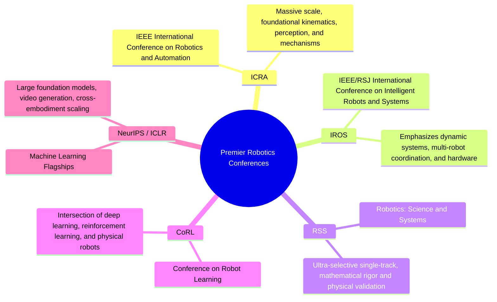
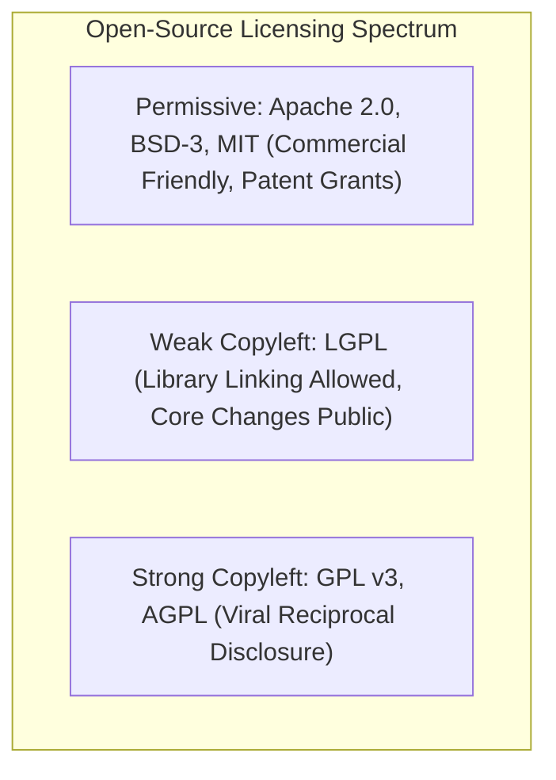

import ChapterProgress from '@site/src/components/ChapterProgress';
import QuizEngine from '@site/src/components/QuizEngine';

# Contributing to Open-Source Robotics & Research Communities

<ChapterProgress />

Robotics is among the most multidisciplinary fields in human engineering. No single academic institution, industrial laboratory, or technology conglomerate possesses the capacity to build every layer of the modern humanoid stack in isolation—from real-time fieldbus drivers and multi-body rigid contact solvers to multimodal vision-language transformers. The rapid acceleration of physical intelligence over the past decade is directly attributable to the vibrant global **open-source robotics ecosystem**.

Contributing to open-source robotics is more than pushing code to a public repository; it requires navigating rigorous architectural Request for Comments (RFCs), adhering to deterministic real-time testing standards, writing reproducible peer-reviewed academic manuscripts for premier conferences (ICRA, IROS, RSS, CoRL), and designing sound intellectual property (IP) licensing strategies when spinning out deep-tech commercial ventures.

---

## 1. The Modern Open-Source Robotics Ecosystem

The open-source stack has bifurcated into two mutually supportive foundations: **deterministic real-time control frameworks** and **accelerated physical learning platforms**.



### 1.1 Comparative Landscape of Open-Source Projects

| Open-Source Project | Maintainer / Foundation | Core Focus | Programming Language | Primary License |
| :--- | :--- | :--- | :--- | :--- |
| **ROS 2** (Humble/Jazzy) | Open Robotics / OSRF | Distributed middleware, DDS communication, hardware drivers. | C++17 / Python 3 | Apache 2.0 |
| **Isaac Lab** | NVIDIA | Massively parallel GPU reinforcement learning on Omniverse. | Python / CUDA | BSD-3-Clause |
| **LeRobot** | Hugging Face | Democratized PyTorch VLA policies, imitation learning (ACT, Diffusion). | Python | Apache 2.0 |
| **MuJoCo MJX** | Google DeepMind | Fast GPU/TPU differentiable physics simulation on JAX. | Python / C++ | Apache 2.0 |
| **Pinocchio** | LAAS-CNRS | Analytical multi-body kinematics, spatial Jacobians, Lie group math. | C++17 / Python | BSD-2-Clause |
| **Drake** | Toyota Research Institute | Model-predictive control, convex collision geometry, certifiable optimization. | C++17 / Python | BSD-3-Clause |
| **Open X-Embodiment** | Multi-University Consortium | Universal robot demonstration repository covering 22+ embodiments. | TFDS / Python | CC-BY-4.0 |

---

## 2. Professional Contribution Workflows & Repository Hygiene

Premier open-source repositories maintain strict architectural standards to safeguard against regressions, memory leaks, and non-deterministic behavior.



### 2.1 The Request for Comments (RFC) Process

Before authoring hundreds of lines of code for major features (such as adding a new humanoid hardware interface to `ros2_control` or adding custom contact solvers to Isaac Lab), contributors must submit a formal RFC:
1. **Motivation & Scope**: Why is existing functionality insufficient? What specific failure mode does this resolve?
2. **API Contract**: Concrete C++ header or Python typing signatures showing backward-compatible design.
3. **Performance Impact**: Theoretical latency budget impact on 1 kHz control loops.
4. **Alternative Approaches**: Explicit rationale detailing why alternative designs were rejected.

### 2.2 Minimal Reproducible Examples (MRE) and Seed Determinism

When reporting physics or control defects, bug reports must provide:
* **Headless Reproduction Script**: A standalone Python script running in under 5 seconds without requiring graphical displays or physical hardware.
* **Deterministic Random Seeding**: Explicit `torch.manual_seed(seed)`, `np.random.seed(seed)`, and simulator initialization seeds.
* **Hardware Environment Manifest**: Exact GPU driver, CUDA version, OS kernel (`uname -r`), and pip lockfile.

---

## 3. Academic Paper Writing for Premier Robotics Conferences

Academic publication remains the primary vehicle for validating novel theoretical contributions. Robotics researchers target five premier venues:



### 3.1 Anatomical Structure of a Top-Tier Robotics Paper

A high-impact robotics manuscript follows a rigorous structural blueprint:

1. **Title & Abstract**: Concisely states the core physical capability unlocked, the underlying mathematical or algorithmic insight, and quantitative improvement over baselines on physical hardware.
2. **Introduction & Motivation**: Formulates the physical bottleneck (e.g., dynamic foot slippage, high-latency VLA inference) and itemizes explicit, bulleted technical contributions.
3. **Related Work**: Situates the work within the literature, objectively acknowledging prior art without superficial criticism.
4. **Mathematical Problem Formulation**: Formalizes state spaces $\mathcal{S}$, action spaces $\mathcal{A}$, floating-base equations of motion, and contact constraints with consistent mathematical notation.
5. **System Architecture & Methodology**: Details the algorithmic innovation with flowcharts, network topology diagrams, and pseudocode.
6. **Sim-to-Real Pipeline**: Explains the exact domain randomization distributions, observation noise injection, and latency modeling.
7. **Experimental Results & Physical Validation**:
   * *Simulation Benchmark*: Statistical ablation over 50+ seeds with mean and standard deviation confidence bounds.
   * *Hardware Experiments*: Quantitative trial success rates on physical platforms under dynamic disturbances.
   * *Failure Mode Analysis*: Transparent discussion of physical boundary conditions where the method fails.
8. **Supplementary Video**: A continuous, unedited video demonstrating physical hardware execution with multiple camera angles and overlaid sensor telemetry.

---

## 4. Open-Source Licensing & Intellectual Property Strategy

When transitioning research from an academic laboratory into a commercial deep-tech startup, open-source licensing dictates commercial freedom and investment defensibility:



### 4.1 Permissive vs. Copyleft Licenses

* **Apache 2.0**: The gold standard for modern robotics (ROS 2, PyTorch). Allows commercial closed-source derivative works and includes an **express patent grant**, protecting users from downstream patent infringement claims from contributors.
* **BSD-3-Clause / MIT**: Highly permissive, widely adopted in academic research (Drake, Isaac Lab, Pinocchio). Minimal restrictions, allowing proprietary inclusion.
* **GPL v3 / AGPL**: Strong copyleft. Any proprietary application that links against a GPL v3 codebase must release its entire proprietary source code under GPL v3. Commercial robotics startups strictly avoid incorporating GPL libraries into their commercial firmware.

### 4.2 Spinning Out Deep-Tech Robotics Startups

The dominant commercialization model for modern robotics is the **Open-Core Strategy**:
1. **Open-Source Base**: Release core drivers, URDF/SDF assets, basic gym simulation environments, and ROS 2 wrappers under Apache 2.0 to cultivate a global developer ecosystem.
2. **Proprietary Moat**: Retain proprietary ownership of the cognitive foundation model weights, enterprise fleet management software, proprietary hardware designs, and private teleoperation telematics.

---

## 5. Mathematical Formulations: Community Health and Citation Networks

Quantitative evaluation of open-source health and academic citation influence can be modeled mathematically.

### 5.1 Repository Community Health Index

The health index $H_{\text{repo}} \in [0, 100]$ evaluates repository vitality, maintainer responsiveness, and contribution velocity:

$$
H_{\text{repo}} = w_c \cdot \log\left(1 + C_{\text{active}}\right) + w_t \cdot \frac{T_{\text{target}}}{T_{\text{median\_triage}}} + w_r \cdot R_{\text{pr\_merge}}
$$

Where $C_{\text{active}}$ is the number of active monthly contributors, $T_{\text{median\_triage}}$ is the median issue triage duration (hours), $R_{\text{pr\_merge}}$ is the pull-request merge ratio, and $w_c, w_t, w_r$ are normalization weights.

### 5.2 Academic Citation Graph Connectivity

A research ecosystem forms a directed citation graph $G = (V, E)$, where vertices $V$ represent published papers and directed edges $E = \{(u, v)\}$ represent paper $u$ citing paper $v$. The network density $D_{\text{graph}}$ and PageRank / Hub authority score $a_i$ of seminal foundation papers are given by:

$$
D_{\text{graph}} = \frac{\lvert E \rvert}{\lvert V \rvert (\lvert V \rvert - 1)}, \quad a_i = \sum_{j \to i} \frac{a_j}{\text{out-degree}(j)}
$$

---

## 6. Complete GitHub Actions CI/CD Workflow for Robotics

Below is a complete, production-grade GitHub Actions CI/CD matrix configuration YAML (`.github/workflows/robotics_ci.yml`). It tests robotics software across ROS 2 Humble and Jazzy distributions, runs static linting (`ruff`, `flake8`, `cppcheck`), executes unit tests with `colcon test`, and validates simulation fixtures headlessly.

```yaml
name: Robotics Open-Source CI/CD Matrix

on:
  push:
    branches: [ main, develop ]
  pull_request:
    branches: [ main ]

jobs:
  code-hygiene-lint:
    name: Code Hygiene & Static Analysis
    runs-on: ubuntu-22.04
    steps:
      - name: Checkout Code Repository
        uses: actions/checkout@v4

      - name: Set up Python 3.10
        uses: actions/setup-python@v5
        with:
          python-version: "3.10"
          cache: "pip"

      - name: Install Linting & Formatting Tools
        run: |
          pip install --upgrade pip
          pip install ruff black flake8 mypy pre-commit

      - name: Run Ruff Code Quality Lint
        run: |
          ruff check . --config pyproject.toml

      - name: Run Black Code Formatting Check
        run: |
          black --check --diff .

      - name: Verify Developer Certificate of Origin (DCO)
        uses: chef/chef-style-action@v1
        with:
          dco: true

  ros2-build-and-test:
    name: ROS 2 (${{ matrix.ros_distro }}) Multi-Distribution Matrix
    runs-on: ubuntu-22.04
    strategy:
      fail-fast: false
      matrix:
        ros_distro: [ humble, iron ]
        include:
          - ros_distro: humble
            docker_image: "ros:humble-ros-base"
          - ros_distro: iron
            docker_image: "ros:iron-ros-base"

    container:
      image: ${{ matrix.docker_image }}

    steps:
      - name: Checkout Source Code
        uses: actions/checkout@v4

      - name: Install Build Dependencies & Tools
        run: |
          apt-get update && apt-get install -y \
            python3-colcon-common-extensions \
            python3-rosdep \
            git \
            build-essential
          rosdep update

      - name: Initialize Workspace and Resolve Rosdep Dependencies
        run: |
          mkdir -p /ws/src
          cp -r $GITHUB_WORKSPACE /ws/src/robotics_package
          cd /ws
          rosdep install --from-paths src --ignore-src -r -y --rosdistro ${{ matrix.ros_distro }}

      - name: Build Colcon Workspace with CMake Symlink
        run: |
          cd /ws
          . /opt/ros/${{ matrix.ros_distro }}/setup.sh
          colcon build --symlink-install --cmake-args -DCMAKE_BUILD_TYPE=Release

      - name: Execute Colcon Automated Test Suite
        run: |
          cd /ws
          . /opt/ros/${{ matrix.ros_distro }}/setup.sh
          colcon test --event-handlers console_direct+

      - name: Verify Zero Test Failures
        run: |
          cd /ws
          colcon test-result --verbose

  headless-simulation-fixture:
    name: Isaac Lab Headless Physics Fixture Check
    runs-on: ubuntu-22.04
    steps:
      - name: Checkout Repository
        uses: actions/checkout@v4

      - name: Set up Python 3.10
        uses: actions/setup-python@v5
        with:
          python-version: "3.10"

      - name: Install Headless Test Dependencies
        run: |
          pip install torch numpy scipy pytest

      - name: Run Standalone Dynamics Verification Tests
        env:
          HEADLESS_TEST: "1"
        run: |
          pytest tests/ -v -k "not hardware"
```

---

<QuizEngine
  quizId="quiz-12-5"
  title="Module 12.5 Mastery Check: Open-Source Robotics & Communities"
  moduleId="module12"
  passThreshold={70}
  questions={[
    {
      id: "q1",
      question: "Why do commercial robotics startups strictly avoid incorporating GPL v3 licensed software into their proprietary robot control firmware?",
      options: [
        "Because GPL v3 code does not compile on modern Linux systems",
        "Because GPL v3 has a strong copyleft clause requiring any proprietary application linking against it to release its entire source code under GPL v3",
        "Because GPL v3 prohibits running software on electric motors",
        "Because GPL v3 requires paying royalties to the Free Software Foundation"
      ],
      correctIndex: 1,
      explanation: "GPL v3 is a reciprocal copyleft license. If a company statically or dynamically links proprietary control firmware against a GPL v3 library, the copyleft terms compel the company to disclose its entire proprietary codebase."
    },
    {
      id: "q2",
      question: "What primary benefit does the Apache 2.0 license offer over standard BSD-3 or MIT licenses for commercial robotics developers?",
      options: [
        "It provides a higher maximum CPU clock speed",
        "It includes an express grant of patent rights from contributors, protecting users against patent infringement claims regarding contributed code",
        "It guarantees free cloud server compute",
        "It eliminates the need for software testing"
      ],
      correctIndex: 1,
      explanation: "Section 3 of the Apache 2.0 license provides an explicit patent grant, ensuring that any contributor automatically grants the user a perpetual, worldwide, non-exclusive patent license to make, use, or sell the contributed technology."
    },
    {
      id: "q3",
      question: "Which of the following conferences is considered the premier single-track venue dedicated to foundational mathematical rigor and physical robotics validation?",
      options: [
        "Robotics: Science and Systems (RSS)",
        "Consumer Electronics Show (CES)",
        "SIGGRAPH Computer Graphics",
        "PyCon"
      ],
      correctIndex: 0,
      explanation: "Robotics: Science and Systems (RSS) is the premier single-track robotics conference, universally recognized for its ultra-selective acceptance rate, theoretical depth, and strict requirement for physical robotic validation."
    }
  ]}
/>

---

## Annotated Research Citations & Further Reading

1. **Macenski, S., Foote, T., Gerkey, B., Lalancette, C., & Woodall, W. (2022)**. *Robot Operating System 2: Design, Architecture, and Uses In The Wild*. Science Robotics, 7(66), eabm6074.  
   *Definitive peer-reviewed architecture paper covering ROS 2 middleware, DDS integration, and real-time execution.*
2. **Carpentier, J., Saurel, G., Buondonno, G., et al. (2019)**. *The Pinocchio C++ Library: A Fast and Flexible Implementation of Rigid Body Dynamics Algorithms and Their Analytical Derivatives*. IEEE International Symposium on System Integration (SII).  
   *Covers open-source spatial dynamics algorithms and analytical Lie group Jacobians powering modern whole-body controllers.*
3. **Todorov, E., Erez, T., & Tassa, Y. (2012)**. *MuJoCo: A Physics Engine for Model-Based Control*. IEEE/RSJ International Conference on Intelligent Robots and Systems (IROS).  
   *Presents the open-source contact physics engine that revolutionized reinforcement learning for locomotion and manipulation.*
4. **Tedrake, R., & the Drake Development Team (2019)**. *Drake: Model-Based Design and Verification for Robotics*. Toyota Research Institute.  
   *Comprehensive documentation and design principles of the open-source Drake planning and non-linear trajectory optimization toolbox.*
