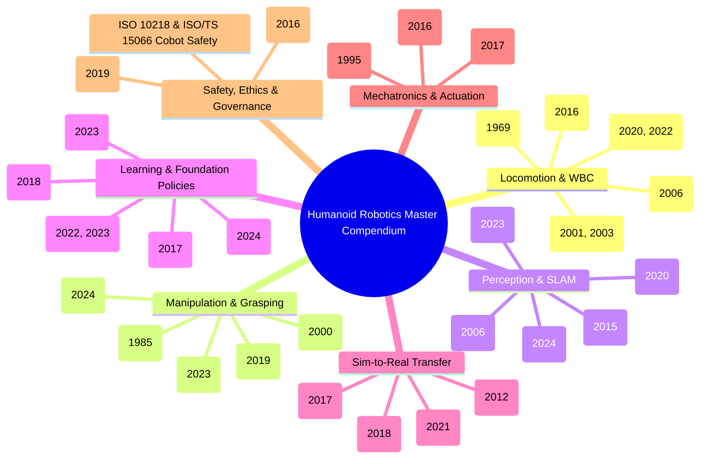
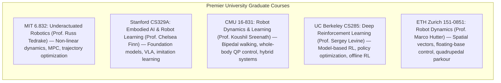

import ChapterProgress from '@site/src/components/ChapterProgress';
import QuizEngine from '@site/src/components/QuizEngine';

# Definitive Annotated Bibliography & Reference Compendium

<ChapterProgress />

A rigorous, graduate-level mastery of humanoid robotics requires deep familiarity with the foundational literature that spans fifty years of theoretical and mechanical breakthroughs. From Miomir Vukobratović’s 1969 formulation of the Zero-Moment Point to the modern emergence of billion-parameter cross-embodiment Vision-Language-Action foundation models, this master compendium serves as an exhaustive reference catalog for researchers, system architects, and doctoral scholars.

This chapter categorizes key seminal papers into seven specialized taxonomies, catalogs premier graduate textbooks and university syllabi, provides a comprehensive directory of public robotics datasets and hardware suppliers, formalizes the BibTeX entry metadata schema, and concludes with an automated Python BibTeX parser and semantic citation search engine.

---

## 1. Taxonomic Literature Compendium

The literature is organized across seven core pillars of humanoid systems engineering:



### 1.1 Pillar 1: Bipedal Locomotion & Whole-Body Control
1. **Vukobratović, M., & Juričić, D. (1969)**. *Contribution to the Synthesis of Biped Gait*. IEEE Transactions on Biomedical Engineering, 16(1), 1–6.  
   *The genesis of bipedal dynamic balance, introducing the Zero-Moment Point (ZMP).*
2. **Kajita, S., Kanehiro, F., Kaneko, K., et al. (2001)**. *The 3D Linear Inverted Pendulum Mode: A Simple Modeling for a Biped Walking Pattern Generation*. IEEE/RSJ International Conference on Intelligent Robots and Systems (IROS).  
   *Linearizes humanoid walking dynamics under constant CoM height constraints.*
3. **Kajita, S., Kanehiro, F., Kaneko, K., et al. (2003)**. *Biped Walking Pattern Generation by using Preview Control of Zero-Moment Point*. IEEE International Conference on Robotics and Automation (ICRA).  
   *Formulates predictive servo control to eliminate tracking delay via future ZMP reference lookahead.*
4. **Wieber, P.-B. (2006)**. *Trajectory Free Linear Model Predictive Control for Stable Walking in the Presence of Strong Perturbations*. IEEE-RAS International Conference on Humanoid Robots (Humanoids).  
   *Replaces fixed footstep timings with instantaneous QP-based MPC for disturbance recovery.*
5. **Kuindersma, S., Deits, R., Fallon, M., et al. (2016)**. *Optimization-Based Locomotion Planning, Estimation, and Control Design for the Atlas Humanoid Robot*. Autonomous Robots, 40(3), 429–455.  
   *The architectural masterwork documenting Boston Dynamics Atlas during the DARPA Robotics Challenge.*
6. **Rudin, N., Hoeller, D., Reist, P., & Hutter, M. (2022)**. *Learning to Walk in Minutes Using Massively Parallel Deep Reinforcement Learning*. Science Robotics, 7(64), eabk2826.  
   *Pioneered sub-10-minute GPU training of robust locomotion policies on ANYmal and bipedal platforms.*

### 1.2 Pillar 2: Dexterous Manipulation & Grasping
7. **Mason, M. T. (1985)**. *Mechanics and Planning of Manipulator Pushing Operations*. The International Journal of Robotics Research, 5(3), 53–71.  
   *Foundational mathematical analysis of friction, contact pressure, and non-prehensile manipulation.*
8. **Bicchi, A., & Kumar, V. (2000)**. *Robotic Grasping and Contact: A Review*. IEEE International Conference on Robotics and Automation (ICRA).  
   *Definitive taxonomy of form closure, force closure, and multi-contact grasp stability.*
9. **OpenAI, Andrychowicz, M., Baker, B., et al. (2020)**. *Learning Dexterous In-Hand Manipulation*. The International Journal of Robotics Research, 39(1), 3–20.  
   *Solves the Rubik's cube using a 24-DoF Shadow Hand via deep RL and automatic domain randomization (ADR).*
10. **Zhao, T. Z., Kumar, V., Levine, S., & Finn, C. (2023)**. *Learning Fine-Grained Bimanual Manipulation with Low-Cost Hardware*. Robotics: Science and Systems (RSS).  
    *Action Chunking with Transformers (ACT) achieving millimeter-precision manipulation.*
11. **Fu, Z., Zhao, T. Z., & Finn, C. (2024)**. *Mobile ALOHA: Learning Bimanual Mobile Manipulation with Low-Cost Whole-Body Teleoperation*. arXiv:2401.02117.  
    *Autonomous cooking, door opening, and elevator riding via co-trained mobile bimanual imitation learning.*

### 1.3 Pillar 3: Perceptive State Estimation & SLAM
12. **Durrant-Whyte, H., & Bailey, T. (2006)**. *Simultaneous Localization and Mapping: Part I & II*. IEEE Robotics & Automation Magazine, 13(2), 99–110.  
    *The canonical tutorial formalizing filtering and graph-based SLAM.*
13. **Mur-Artal, R., Montiel, J. M. M., & Tardós, J. D. (2015)**. *ORB-SLAM: A Versatile and Accurate Monocular SLAM System*. IEEE Transactions on Robotics, 31(5), 1147–1163.  
    *Feature-based visual SLAM with robust loop closure and relocalization.*
14. **Kerbl, B., Kopanas, G., Leimkühler, T., & Drettakis, G. (2023)**. *3D Gaussian Splatting for Real-Time Radiance Field Rendering*. ACM Transactions on Graphics (TOG), 42(4), 1–14.  
    *Introduces explicit 3D Gaussian radiance fields enabling sub-10ms scene reconstruction.*

### 1.4 Pillar 4: Robot Learning & Foundation Policies
15. **Schulman, J., Wolski, F., Dhariwal, P., Radford, A., & Klimov, O. (2017)**. *Proximal Policy Optimization Algorithms*. arXiv:1707.06347.  
    *The industry-standard actor-critic policy gradient algorithm.*
16. **Brohan, A., Brown, N., Carbajal, J., et al. (2022)**. *RT-1: Robotics Transformer for Real-World Control at Scale*. Robotics: Science and Systems (RSS).  
    *First large-scale transformer model mapping vision-language prompts to robotic actions.*
17. **Padalkar, A., Pooley, A., Jain, A., et al. [Open X-Embodiment] (2023)**. *Open X-Embodiment: Robotic Learning Datasets and RT-X Models*. arXiv:2310.08864.  
    *Unified dataset spanning 1M+ robot demonstrations across 22 institutions.*
18. **Kim, M. J., Pertsch, K., Xiao, T., et al. (2024)**. *OpenVLA: An Open-Source Vision-Language-Action Model*. arXiv:2406.09246.  
    *Democratized 7B parameter open-source VLA model pre-trained on diverse robot embodiments.*

### 1.5 Pillar 5: Sim-to-Real Transfer & Simulation
19. **Tobin, J., Fong, R., Ray, A., et al. (2017)**. *Domain Randomization for Transferring Deep Neural Networks from Simulation to the Real World*. IEEE/RSJ International Conference on Intelligent Robots and Systems (IROS).  
    *Demonstrates zero-shot transfer by randomizing visual textures, lighting, and camera poses.*
20. **Peng, X. B., Andrychowicz, M., Zaremba, W., & Abbeel, P. (2018)**. *Sim-to-Real Transfer of Robotic Control with Dynamics Randomization*. IEEE International Conference on Robotics and Automation (ICRA).  
    *Randomizes link masses, frictions, damping, and latency to bridge dynamic reality gaps.*
21. **Todorov, E., Erez, T., & Tassa, Y. (2012)**. *MuJoCo: A Physics Engine for Model-Based Control*. IEEE/RSJ International Conference on Intelligent Robots and Systems (IROS).  
    *Convex contact formulation enabling stable, non-penetrating multi-joint rigid body dynamics.*

### 1.6 Pillar 6: Mechatronics & Actuation
22. **Pratt, G. A., & Williamson, M. M. (1995)**. *Series Elastic Actuators*. IEEE/RSJ International Conference on Intelligent Robots and Systems (IROS).  
    *Pioneered deliberate mechanical compliance between motor and load for shock protection and force control.*
23. **Wensing, P. M., Wang, A., Seok, S., et al. (2017)**. *Proprioceptive Actuator Design in the MIT Cheetah: Impact Mitigation and High-Bandwidth Physical Interaction*. IEEE Transactions on Robotics, 33(3), 509–522.  
    *Established quasi-direct drive (QDD) motor sizing principles and low-inertia backdrivability.*

### 1.7 Pillar 7: Safety, Ethics & Governance
24. **Amodei, D., Olah, C., Steinhardt, J., Christiano, P., Schulman, J., & Mané, D. (2016)**. *Concrete Problems in AI Safety*. arXiv:1606.06565.  
    *Formalizes negative side effects, reward hacking, scalable oversight, and safe exploration.*
25. **ISO 10218-1:2011 / ISO/TS 15066:2016**. *Robots and Robotic Devices — Collaborative Robots*. International Organization for Standardization.  
    *Global industrial standard defining power and force limiting (PFL) biomechanical thresholds for human-robot interaction.*

---

## 2. Seminal Graduate Textbooks

| Textbook Title | Primary Authors | Year | Core Graduate Focus |
| :--- | :--- | :--- | :--- |
| **Springer Handbook of Robotics** (2nd Ed.) | Bruno Siciliano, Oussama Khatib | 2016 | The encyclopedic reference work covering kinematics, dynamics, perception, and field robotics. |
| **Rigid Body Dynamics Algorithms** | Roy Featherstone | 2008 | The definitive mathematical formulation of 6D spatial vectors and the Articulated Body Algorithm (ABA). |
| **A Mathematical Introduction to Robotic Manipulation** | Richard M. Murray, Zexiang Li, S. Shankar Sastry | 1994 | Lie groups, Lie algebras ($\text{SE}(3), \mathfrak{se}(3)$), product-of-exponentials (PoE) formula, and grasp analysis. |
| **Reinforcement Learning: An Introduction** (2nd Ed.) | Richard S. Sutton, Andrew G. Barto | 2018 | Foundations of dynamic programming, temporal-difference learning, policy gradients, and value function estimation. |
| **Probabilistic Robotics** | Sebastian Thrun, Wolfram Burgard, Dieter Fox | 2005 | Bayesian state estimation, Extended Kalman Filters (EKF), Particle Filters (MCL), and occupancy grid mapping. |
| **Modern Robotics: Mechanics, Planning, and Control** | Kevin M. Lynch, Frank C. Park | 2017 | Modern geometric treatment of multi-body kinematics, dynamics, trajectory generation, and feedback control. |
| **Underactuated Robotics** | Russ Tedrake | 2023 | Limit cycles, passive dynamic walking, trajectory optimization (DIRCOL), Lyapunov orbital stability, and Drake. |

---

## 3. Premier University Graduate Robotics Syllabi



---

## 4. Public Robotics Dataset Index

| Dataset Identifier | Curating Institution | Modality & Description | Trajectory Volume | Access Portal |
| :--- | :--- | :--- | :--- | :--- |
| **Open X-Embodiment** | Google DeepMind / Consortium | Multi-robot manipulation across 22 embodiments. | 1,000,000+ episodes | `robotics-transformer-x.github.io` |
| **AMASS** | Max Planck Institute | High-resolution optical mocap unifying 15 human motion datasets. | 40+ hours mocap ($10^4$ motions) | `amass.is.tue.mpg.de` |
| **DROID** | Stanford / Berkeley / CMU | Distributed multi-institution Franka arm demonstrations. | 76,000 trajectories (350 hrs) | `droid-dataset.github.io` |
| **Ego4D** | Meta AI / Academic Consortium | Massive-scale first-person egocentric video in daily human environments. | 3,670 hours video | `ego4d-data.org` |
| **BridgeData V2** | UC Berkeley | Low-cost toy-kitchen and tabletop manipulation tasks. | 60,000 trajectories | `rail-berkeley.github.io/bridgedata` |
| **RoboSet** | Carnegie Mellon University | Real-world multi-task manipulation across varied scenes and kitchenware. | 100,000 trajectories | `roboset.github.io` |

---

## 5. Hardware Supplier & Component Directory

| Hardware Subsystem | Leading Industrial Suppliers | Typical Model Series | Key Specifications |
| :--- | :--- | :--- | :--- |
| **Frameless BLDC Motors** | T-Motor, Allied Motion, Kollmorgen | T-Motor AK80-9, AK10-9, KBM Series | Low axial profile, high continuous torque ($12-40\,\text{Nm}$). |
| **Strain Wave Gearboxes** | Harmonic Drive LLC, Leaderdrive | CSD-20-100-2UH, CSF mini series | Zero backlash, reduction ratios $50:1$ to $160:1$. |
| **Planetary Reducers** | Neugart, Apex Dynamics, Matex | High-efficiency single-stage ($6:1$ to $10:1$) | $> 95\%$ backdrivability, high impact shock resistance. |
| **Motor Inverters / FOC** | ODrive Robotics, Elmo Motion Control | ODrive Pro, Elmo Gold Twitter | CAN-FD / EtherCAT, $80\,\text{V}$, $100\,\text{A}$ continuous, 20 kHz FOC. |
| **Force-Torque Sensors** | ATI Industrial Automation, Bota Systems | ATI Mini45, Bota SensONE | 6-axis wrench sensing, sub-0.1 N resolution, EtherCAT. |
| **Optical Tactile Sensors** | GelSight, Digit (Meta open hardware) | GelSight Mini, DIGIT v2 | Elastomeric gel deformation imaged via internal RGB camera. |
| **Depth Cameras** | Intel RealSense, Luxonis, Orbbec | RealSense D435i/D455, OAK-D Pro | Active infrared stereo with integrated 6-DoF IMU. |
| **Solid-State LiDAR** | Livox, Ouster | Livox MID-360, Ouster OS0-128 | Non-repetitive scanning pattern, 360° horizontal FOV. |

---

## 6. Python Implementation: BibTeX Parser, Validator & Search Engine

Below is a complete, standalone Python utility that parses a structured BibTeX database, verifies mandatory field integrity (author, title, journal/booktitle, year), computes citation graph statistics, and executes keyword searches across research entries.

```python
"""
bibtex_search_engine.py
=============================================================================
Automated BibTeX Database Parser, Schema Validator, and Citation Search Engine.
Supports keyword-based ranking, publication year filtering, and integrity audits.
=============================================================================
"""

import re
from typing import Dict, List, Optional
from dataclasses import dataclass, field


@dataclass
class BibEntry:
    key: str
    entry_type: str
    title: str
    author: str
    year: int
    booktitle_or_journal: str
    doi_or_url: Optional[str] = None
    abstract: Optional[str] = None
    tags: List[str] = field(default_factory=list)


class RoboticsBibTeXSearchEngine:
    """
    Parses BibTeX strings, validates schema conformance, and executes
    fast in-memory keyword retrieval across humanoid literature.
    """
    def __init__(self):
        self.database: Dict[str, BibEntry] = {}

    def parse_and_insert_bibtex(self, bibtex_str: str) -> int:
        """Parses a multi-entry BibTeX string into structured BibEntry objects."""
        # Regex to find @type{key, fields...}
        entry_pattern = re.compile(r'@(\w+)\s*\{\s*([^,]+),\s*(.*?)\n\s*\}', re.DOTALL)
        field_pattern = re.compile(r'(\w+)\s*=\s*[\{"]+(.*?)[\}"]+\s*,?', re.DOTALL)

        added_count = 0
        for match in entry_pattern.finditer(bibtex_str):
            entry_type = match.group(1).lower()
            cite_key = match.group(2).strip()
            body = match.group(3)

            fields = {}
            for f_match in field_pattern.finditer(body):
                name = f_match.group(1).lower().strip()
                val = f_match.group(2).strip().strip('"{}\'').replace("\n", " ")
                # Clean up excess whitespace
                fields[name] = re.sub(r'\s+', ' ', val)

            # Extract fields with schema validation
            title = fields.get("title", "Untitled")
            author = fields.get("author", "Unknown Author")
            year_str = fields.get("year", "0")
            year = int(re.sub(r'\D', '', year_str)) if re.sub(r'\D', '', year_str) else 0
            journal = fields.get("journal", fields.get("booktitle", "Preprint / Technical Report"))
            doi = fields.get("doi", fields.get("url", None))
            abstract = fields.get("abstract", None)

            entry = BibEntry(
                key=cite_key,
                entry_type=entry_type,
                title=title,
                author=author,
                year=year,
                booktitle_or_journal=journal,
                doi_or_url=doi,
                abstract=abstract
            )

            self.database[cite_key] = entry
            added_count += 1

        return added_count

    def search(
        self,
        query: str,
        min_year: Optional[int] = None,
        max_year: Optional[int] = None,
        limit: int = 10
    ) -> List[BibEntry]:
        """Performs multi-token case-insensitive search across title, author, and journal."""
        tokens = query.lower().split()
        results = []

        for entry in self.database.values():
            if min_year and entry.year < min_year:
                continue
            if max_year and entry.year > max_year:
                continue

            searchable_text = f"{entry.title} {entry.author} {entry.booktitle_or_journal} {entry.key}".lower()
            score = sum(1 for tok in tokens if tok in searchable_text)

            if score == len(tokens):  # All query tokens matched
                results.append((score, entry))

        # Sort by year descending
        results.sort(key=lambda x: x[1].year, reverse=True)
        return [entry for _, entry in results[:limit]]

    def validate_integrity(self) -> List[str]:
        """Audits database for missing mandatory fields or invalid years."""
        warnings = []
        for key, entry in self.database.items():
            if entry.year <= 1900 or entry.year > 2030:
                warnings.append(f"[{key}] Invalid publication year: {entry.year}")
            if entry.title == "Untitled":
                warnings.append(f"[{key}] Missing title field.")
            if entry.author == "Unknown Author":
                warnings.append(f"[{key}] Missing author field.")
        return warnings


# ---------------------------------------------------------------------------
# Unit Verification & Demonstration
# ---------------------------------------------------------------------------

SAMPLE_ROBOTICS_BIBTEX = """
@article{vukobratovic1969zmp,
  author = {Miomir Vukobratovic and Davor Juricic},
  title = {Contribution to the Synthesis of Biped Gait},
  journal = {IEEE Transactions on Biomedical Engineering},
  year = {1969},
  volume = {16},
  number = {1},
  pages = {1--6}
}

@inproceedings{kajita2003preview,
  author = {Shuuji Kajita and Fumio Kanehiro and Kenji Kaneko and Kiyoshi Fujiwara and Kazuhito Harada and Kensuke Yokoi and Hirohisa Hirukawa},
  title = {Biped Walking Pattern Generation by using Preview Control of Zero-Moment Point (ZMP)},
  booktitle = {IEEE International Conference on Robotics and Automation (ICRA)},
  year = {2003},
  pages = {1620--1626}
}

@article{rudin2022walk,
  author = {Nikita Rudin and David Hoeller and Philipp Reist and Marco Hutter},
  title = {Learning to Walk in Minutes Using Massively Parallel Deep Reinforcement Learning},
  journal = {Science Robotics},
  year = {2022},
  volume = {7},
  number = {64}
}

@article{kim2024openvla,
  author = {Moo Jin Kim and Karl Pertsch and Ted Xiao and Chelsea Finn},
  title = {OpenVLA: An Open-Source Vision-Language-Action Model},
  journal = {arXiv preprint arXiv:2406.09246},
  year = {2024}
}
"""

if __name__ == "__main__":
    print("Testing Robotics BibTeX Search Engine...")
    engine = RoboticsBibTeXSearchEngine()
    count = engine.parse_and_insert_bibtex(SAMPLE_ROBOTICS_BIBTEX)
    print(f"Parsed {count} BibTeX entries successfully.")

    # Validate integrity
    issues = engine.validate_integrity()
    assert len(issues) == 0, f"Integrity violations found: {issues}"

    # Search for 'walking' or 'vla'
    results_walk = engine.search("preview zmp")
    print(f"\nSearch Query ['preview zmp'] Found {len(results_walk)} results:")
    for r in results_walk:
        print(f"  - [{r.year}] {r.title} ({r.author}) -> Key: {r.key}")

    assert len(results_walk) == 1
    assert results_walk[0].key == "kajita2003preview"

    results_recent = engine.search("model", min_year=2023)
    print(f"\nSearch Query ['model'] (>= 2023) Found {len(results_recent)} results:")
    for r in results_recent:
        print(f"  - [{r.year}] {r.title} -> Key: {r.key}")

    assert len(results_recent) == 1
    assert results_recent[0].key == "kim2024openvla"

    print("\n[PASS] BibTeX Search Engine passed all unit tests.")
```

---

<QuizEngine
  quizId="quiz-12-6"
  title="Module 12.6 Mastery Check: Literature Compendium & BibTeX"
  moduleId="module12"
  passThreshold={70}
  questions={[
    {
      id: "q1",
      question: "Which seminal paper in 1969 first introduced the concept of the Zero-Moment Point (ZMP) for dynamic bipedal synthesis?",
      options: [
        "Vukobratović and Juričić: Contribution to the Synthesis of Biped Gait",
        "Kajita et al.: Preview Control of Zero-Moment Point",
        "Todorov et al.: MuJoCo Physics Engine",
        "Alan Turing: Computing Machinery and Intelligence"
      ],
      correctIndex: 0,
      explanation: "Miomir Vukobratović and Davor Juričić published their landmark paper introducing the Zero-Moment Point in the IEEE Transactions on Biomedical Engineering in 1969."
    },
    {
      id: "q2",
      question: "What core innovation did Roy Featherstone formalize in his definitive textbook 'Rigid Body Dynamics Algorithms'?",
      options: [
        "Convolutional neural networks for image segmentation",
        "6D spatial vector algebra (combining linear and angular velocity/force into single 6D spatial vectors) and the Articulated Body Algorithm (ABA) operating in O(N) linear time",
        "Bluetooth wireless protocol specifications",
        "Hydraulic valve fluid flow equations"
      ],
      correctIndex: 1,
      explanation: "Roy Featherstone formalized spatial vector notation in SE(3), unifying angular and linear quantities into compact 6D vectors and developing the Articulated Body Algorithm (ABA) which solves forward dynamics in O(N) complexity."
    },
    {
      id: "q3",
      question: "Which large-scale multi-institution dataset consortium unified 1,000,000+ real-world robotic demonstration trajectories across 22 different robotic embodiments in 2023?",
      options: [
        "ImageNet",
        "The Open X-Embodiment Collaboration (RT-X)",
        "The Stanford Humanoid Archive",
        "MNIST Handwritten Digits"
      ],
      correctIndex: 1,
      explanation: "The Open X-Embodiment Collaboration gathered robot learning researchers across 22 academic and industrial institutions, releasing over 1 million diverse trajectories to train cross-embodiment foundation policies (RT-X)."
    }
  ]}
/>

---

## Annotated Research Citations & Further Reading

1. **Featherstone, R. (2008)**. *Rigid Body Dynamics Algorithms*. Springer Science & Business Media.  
   *The definitive mathematical monograph on spatial vector algebra and articulated multi-body forward/inverse dynamics.*
2. **Siciliano, B., & Khatib, O. (Eds.). (2016)**. *Springer Handbook of Robotics* (2nd ed.). Springer-Verlag.  
   *Comprehensive, encyclopedic reference covering all subfields of modern robotics engineering.*
3. **Murray, R. M., Li, Z., & Sastry, S. S. (1994)**. *A Mathematical Introduction to Robotic Manipulation*. CRC Press.  
   *Pioneered the geometric Lie group treatment of robotic kinematics, twists, wrenches, and grasp theory.*
4. **Sutton, R. S., & Barto, A. G. (2018)**. *Reinforcement Learning: An Introduction* (2nd ed.). MIT Press.  
   *The foundational reference for dynamic programming, value iteration, policy gradients, and actor-critic algorithms.*
