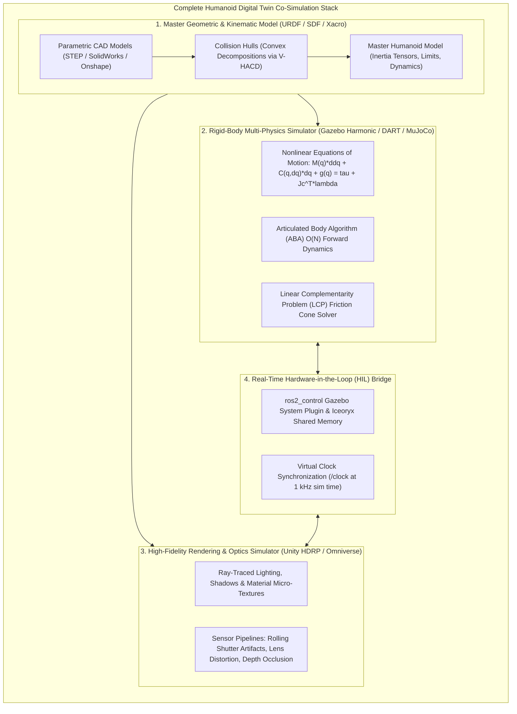
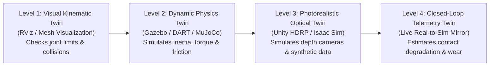
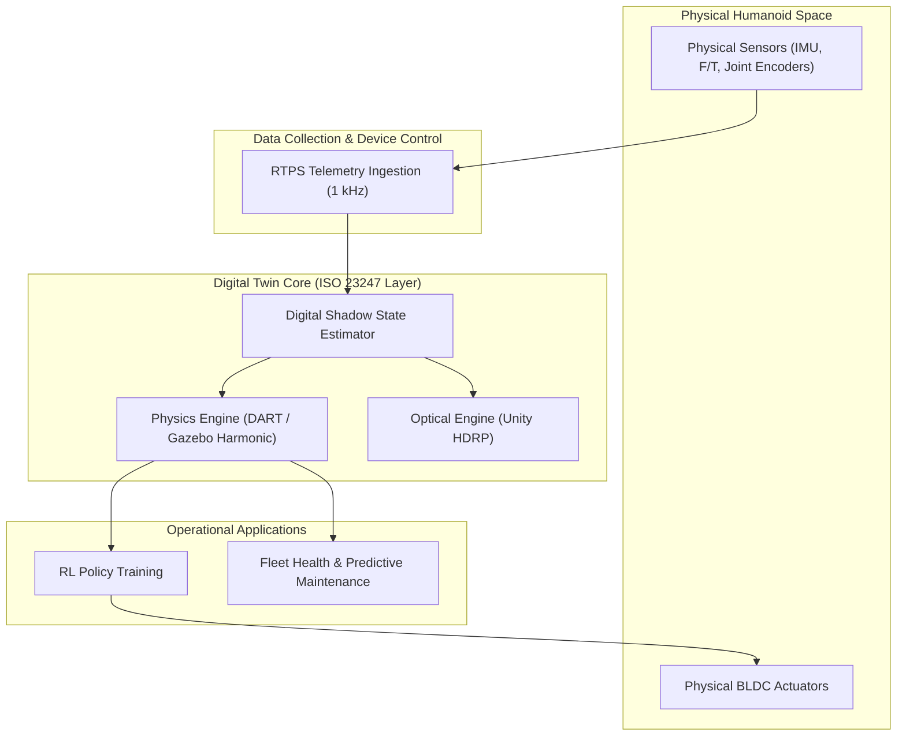

# The Digital Twin Paradigm in Humanoid Robotics

Before an autonomous humanoid robot takes a single physical step in the real world, it must execute billions of simulated steps across virtual environments. In modern embodied AI engineering, a **Digital Twin** is not merely a 3D animation model; it is an authoritative, multi-physics computational mirror of the robot’s kinematics, joint inertia, contact mechanics, actuator dynamics, and sensor noise characteristics.



---

## 1. The Underactuated Floating-Base Challenge

Unlike industrial robotic arms that are bolted securely to an immovable concrete floor, a bipedal humanoid robot is a **floating-base system**. 

### The Mathematical Formulation of Floating-Base Dynamics
Let the configuration space of a humanoid with $n$ actuated joints be described by the generalized coordinates:

```text
q = [x_b, y_b, z_b, roll_b, pitch_b, yaw_b, q_1, q_2, ..., q_n]^T in SE(3) x R^n
```

where the floating base possesses 6 unactuated degrees of freedom representing the position and orientation of the pelvis in the inertial world frame.

The full equations of motion are governed by the constrained Euler-Lagrange equations:

```text
M(q) * ddq + C(q, dq) * dq + g(q) = S^T * tau + sum( J_ci(q)^T * lambda_i )
```

- **`M(q)` in `R^{(n+6) x (n+6)}`**: The symmetric, positive-definite Generalized Inertia Matrix.
- **`C(q, dq) * dq` in `R^{n+6}`**: Generalized Coriolis and centrifugal force vector.
- **`g(q)` in `R^{n+6}`**: Gravity force vector.
- **`S = [0_{n x 6} | I_{n x n}]`**: Selection matrix projecting actuated torques onto joints. Notice that the top 6 rows are identically zero: **there is no motor that directly rotates or pushes the floating base!**
- **`J_ci(q)^T * lambda_i`**: Contact Jacobians mapping ground reaction contact wrenches `lambda_i` (forces and moments exerted on the soles of the feet) into generalized forces.

**The Fundamental Insight of Humanoid Control**: A humanoid robot can *only* accelerate its center of mass or prevent itself from falling by carefully modulating contact forces `lambda_i` against the ground through the friction cone constraints. 

A high-fidelity Digital Twin is mandatory because contact forces cannot be accurately modeled with simple linear kinematics—they require numerical solving of nonlinear contact complementarity problems.

---

## 2. The Digital Twin Maturity Model



1. **Level 1 (Visual Kinematic Twin)**: Used in RViz2 to visualize transform frames (TF2) and verify Denavit-Hartenberg kinematic chains and collision bounds without physics.
2. **Level 2 (Dynamic Physics Twin)**: Utilizes rigid-body dynamics solvers (DART, Bullet Featherstone, MuJoCo) to simulate joint torques, ground contact friction, and passive compliance.
3. **Level 3 (Photorealistic Optical Twin)**: Simulates ray-traced materials, sensor exposure, motion blur, and ambient illumination in Unity or Omniverse to train vision models without sim-to-real transfer failure.
4. **Level 4 (Closed-Loop Operational Twin)**: Live sensor telemetry from the physical humanoid streams continuously into the simulation, enabling digital shadow state estimation, predictive thermal monitoring, and real-time failure diagnostics.

---

## 3. Industrial Sim-to-Real Economics

Why do organizations like Tesla, Boston Dynamics, Figure, and Unitree invest tens of thousands of engineering hours in digital twins?
- **Destructive Testing**: Simulating high-impact slips, stair tripping, and external pushes (e.g., a 200 N lateral impulse applied to the torso) safely in software.
- **Hardware-in-the-Loop (HIL)**: The exact C++ control code running on the physical humanoid PC runs against Gazebo with zero code modifications simply by switching `use_sim_time: true`.
- **Parallel Scaling**: While a physical humanoid team might only have access to 2 physical prototypes, a digital twin can be instantiated 10,000 times in parallel on GPU clusters to evaluate gait stability across millions of parameter variations.

---

## 4. ISO 23247 Architecture & Real-Time Synchronization Budgets

The international standard **ISO 23247 (Digital Twin Framework for Manufacturing)** defines four functional entities that govern humanoid digital twins:



To maintain synchronization without phase lag, the telemetry pipeline latency budget must satisfy:
`Latency_total = T_sample (1.0 ms) + T_network (0.2 ms) + T_state_fusion (0.3 ms) <= 2.0 ms`.

In the next chapter, we master the computational foundation of the physics twin: **Gazebo Harmonic and Numerical Physics Solvers**.
