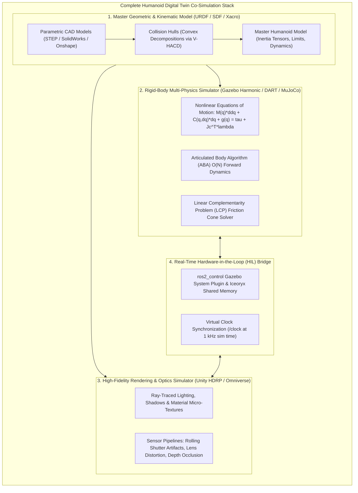
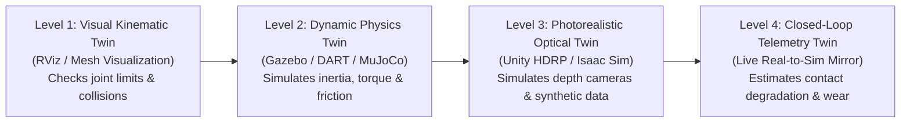
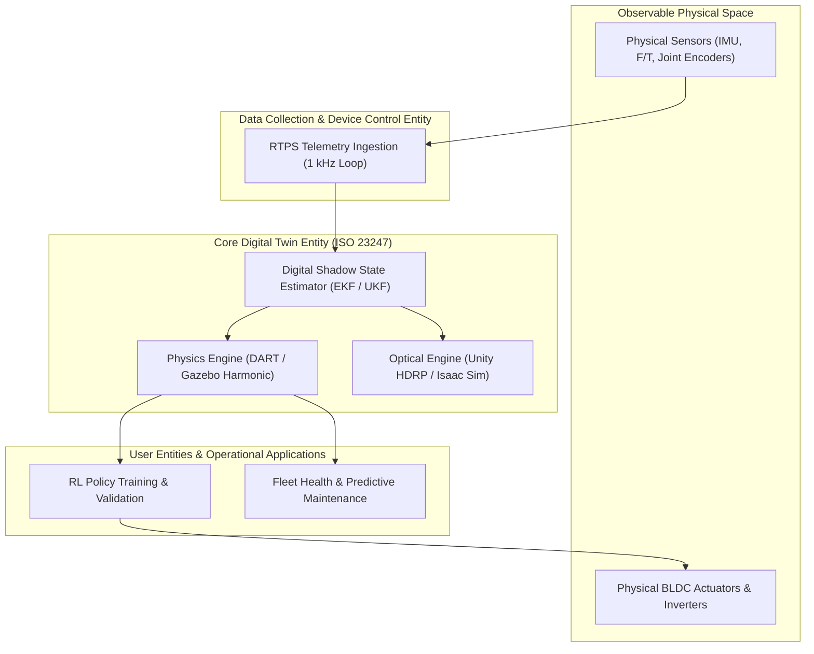

import ChapterProgress from '@site/src/components/ChapterProgress';
import QuizEngine from '@site/src/components/QuizEngine';

# The Digital Twin Paradigm in Humanoid Robotics

Before an autonomous humanoid robot takes a single physical step in the real world, it must execute billions of simulated steps across virtual environments. In modern embodied AI engineering, a **Digital Twin** is not merely a 3D animation model; it is an authoritative, multi-physics computational mirror of the robot's kinematics, joint inertia, contact mechanics, actuator dynamics, and sensor noise characteristics.



---

## 1. The Underactuated Floating-Base Challenge

Unlike industrial robotic manipulators that are bolted rigidly to an immovable concrete floor, a bipedal humanoid robot is a **floating-base system**. The base link (the pelvis) possesses no mechanical bearing constraining it to the inertial reference frame.

### Mathematical Formulation of Floating-Base Dynamics

Let the configuration space of a humanoid robot with $n$ actuated revolute joints be described by generalized coordinates $\mathbf{q} \in SE(3) \times \mathbb{R}^n$:

$$
\mathbf{q} = \begin{bmatrix} \mathbf{p}_b \\ \boldsymbol{\phi}_b \\ \mathbf{q}_j \end{bmatrix} = \begin{bmatrix} x_b \\ y_b \\ z_b \\ \phi_{\text{roll}} \\ \theta_{\text{pitch}} \\ \psi_{\text{yaw}} \\ q_1 \\ q_2 \\ \vdots \\ q_n \end{bmatrix} \in \mathbb{R}^{n+6}
$$

where $\mathbf{p}_b \in \mathbb{R}^3$ represents the Cartesian position of the pelvis center of mass in the world frame $\mathcal{W}$, $\boldsymbol{\phi}_b \in SO(3)$ parameterizes base orientation (expressed locally via unit quaternions $\mathbf{Q}_b \in \mathbb{H}$ to avoid kinematic gimbal singularities), and $\mathbf{q}_j \in \mathbb{R}^n$ denotes internal joint angles.

The full equations of motion are governed by the constrained Euler-Lagrange equations:

$$
\mathbf{M}(\mathbf{q})\ddot{\mathbf{q}} + \mathbf{C}(\mathbf{q}, \dot{\mathbf{q}})\dot{\mathbf{q}} + \mathbf{g}(\mathbf{q}) = \mathbf{S}^T \boldsymbol{\tau} + \sum_{i=1}^{N_c} \mathbf{J}_{c,i}^T(\mathbf{q}) \boldsymbol{\lambda}_i
$$

where:
- $\mathbf{M}(\mathbf{q}) \in \mathbb{R}^{(n+6) \times (n+6)}$ is the symmetric, positive-definite Generalized Mass-Inertia Matrix ($\mathbf{M}(\mathbf{q}) \succ 0$).
- $\mathbf{C}(\mathbf{q}, \dot{\mathbf{q}})\dot{\mathbf{q}} \in \mathbb{R}^{n+6}$ represents the vector of generalized Coriolis and centrifugal forces.
- $\mathbf{g}(\mathbf{q}) \in \mathbb{R}^{n+6}$ is the gravitational wrench vector: $\mathbf{g}(\mathbf{q}) = \frac{\partial \mathcal{U}(\mathbf{q})}{\partial \mathbf{q}}$.
- $\mathbf{S} = [\mathbf{0}_{n \times 6} \mid \mathbf{I}_{n \times n}] \in \mathbb{R}^{n \times (n+6)}$ is the actuated joint selection matrix. Because the first six rows of $\mathbf{S}^T$ are identically zero:

$$
\mathbf{S}^T \boldsymbol{\tau} = \begin{bmatrix} \mathbf{0}_{6 \times 1} \\ \boldsymbol{\tau} \end{bmatrix}
$$

**there are no actuators acting directly on the floating base!**
- $N_c$ is the number of active ground contact points.
- $\mathbf{J}_{c,i}(\mathbf{q}) = \frac{\partial \mathbf{p}_{c,i}(\mathbf{q})}{\partial \mathbf{q}} \in \mathbb{R}^{3 \times (n+6)}$ is the contact Jacobian at contact point $i$.
- $\boldsymbol{\lambda}_i = [f_{x,i}, f_{y,i}, f_{z,i}]^T \in \mathbb{R}^3$ is the ground reaction force (GRF) vector at contact point $i$.

### The Fundamental Insight of Humanoid Control
A humanoid robot can *only* accelerate its center of mass or prevent itself from toppling by modulating contact forces $\boldsymbol{\lambda}_i$ against the ground under friction cone constraints:

$$
\mathcal{K}_i = \left\{ \boldsymbol{\lambda}_i \in \mathbb{R}^3 \;\middle|\; \lambda_{z,i} \ge 0, \; \sqrt{\lambda_{x,i}^2 + \lambda_{y,i}^2} \le \mu_i \lambda_{z,i} \right\}
$$

A high-fidelity Digital Twin is mandatory because contact forces cannot be modeled with simple linear kinematics; they require numerical solving of non-smooth contact complementarity problems.

---

## 2. The Digital Twin Maturity Model

Embodied AI simulation pipelines progress through four distinct capability tiers:



1. **Level 1 (Visual Kinematic Twin)**: Used in RViz2 to visualize transform trees (`/tf`), verify kinematic reachability, inspect Denavit-Hartenberg frames, and detect self-collisions without dynamic forces.
2. **Level 2 (Dynamic Physics Twin)**: Utilizes rigid-body dynamics solvers (DART, Bullet Featherstone, MuJoCo) to simulate generalized joint inertias, motor back-EMF, gearbox compliance, and ground contact friction cones.
3. **Level 3 (Photorealistic Optical Twin)**: Simulates ray-traced materials, BRDF scattering, sensor exposure, rolling shutter motion blur, and ambient lighting in Unity HDRP or NVIDIA Omniverse to train vision-based policies without sim-to-real transfer collapse.
4. **Level 4 (Closed-Loop Operational Twin)**: Live sensor telemetry from the physical humanoid streams continuously into the simulation, enabling digital shadow state estimation, predictive thermal monitoring, and real-time failure diagnostics.

---

## 3. Industrial Standards: ISO 23247 Architecture

The international standard **ISO 23247 (Digital Twin Framework for Manufacturing)** establishes a four-entity reference architecture that governs humanoid digital twins:



### Co-Simulation Real-Time Execution Inequality

To maintain deterministic synchronization between simulation clocks and physical wall-clock time without phase lag, the discrete simulation step must satisfy the co-simulation latency budget inequality:

$$
\Delta t_{\text{sim\_step}} \le \Delta t_{\text{wall\_clock}} - \left( \tau_{\text{transport}} + \tau_{\text{render}} + \tau_{\text{bridge}} + \tau_{\text{solver}} \right)
$$

where:
- $\Delta t_{\text{sim\_step}}$ is the physics integration step (typically $1.0\text{ ms}$, or $1000\text{ Hz}$).
- $\tau_{\text{transport}}$ is the network transmission latency over the DDS or shared memory bus ($\le 0.15\text{ ms}$).
- $\tau_{\text{render}}$ is the optical frame draw time ($\le 16.6\text{ ms}$ for 60 Hz optical pipelines, executed asynchronously).
- $\tau_{\text{bridge}}$ is the serialization and IPC marshalling overhead ($\le 0.05\text{ ms}$ with Iceoryx zero-copy).
- $\tau_{\text{solver}}$ is the numerical physics solver convergence time ($\le 0.50\text{ ms}$ for 32-DOF LCP solutions).

The **Real-Time Factor (RTF)** is defined as:

$$
\text{RTF} = \frac{\Delta t_{\text{sim}}}{\Delta t_{\text{wall\_clock}}} = \frac{t_{\text{sim}}(k) - t_{\text{sim}}(k-1)}{t_{\text{wall}}(k) - t_{\text{wall}}(k-1)}
$$

A stable digital twin requires $\text{RTF} \ge 1.00$. If $\text{RTF} < 1.00$, the simulation experiences wall-clock dilation, causing derivative term spikes in discrete PID control loops.

---

## 4. Hardware Compute Topologies

Industrial digital twin deployments decouple heavy rigid-body contact mechanics from photorealistic optical rendering across dedicated compute tiers:

| Subsystem | Compute Hardware | Key Performance Metric | Interconnect Protocol |
| :--- | :--- | :--- | :--- |
| **Rigid-Body Physics Server** | Dual AMD EPYC 9654 (192 Cores / 384 Threads, 2.4 GHz) | $\ge 15,000$ multi-body contact steps/sec | PCIe Gen 5 x16 to NIC |
| **Photorealism Render Node** | Quad NVIDIA RTX 6000 Ada (4x 48 GB GDDR6 with ECC) | 60 FPS multi-camera ray tracing (4K G-buffers) | NVLink 900 GB/s inter-GPU |
| **Co-Sim Network Fabric** | Mellanox ConnectX-6 Dual-Port 100GbE NIC | $\le 1.2\,\mu\text{s}$ RoCE v2 transport latency | QSFP56 Direct Attach Copper |
| **Edge Robot Compute Node** | NVIDIA Jetson AGX Orin (64 GB 2048-bit LPDDR5, 275 TOPS) | 1 kHz real-time deterministic control loop | On-chassis Gigabit Ethernet & CAN-FD |

---

## 5. Industrial Sim-to-Real Economics

Why do robotics leaders invest tens of thousands of engineering hours into digital twins?
- **Destructive Testing**: Simulating high-impact slips, stair tripping, and external perturbations (e.g., a $200\text{ N}$ lateral torso impulse) safely in software without risking \$150,000 physical prototypes.
- **Hardware-in-the-Loop (HIL)**: The identical C++ control stack executed on the physical humanoid PC runs against Gazebo with zero code modifications simply by configuring `use_sim_time: true`.
- **Parallel Scaling**: While a laboratory hardware team might only have access to two physical prototypes, a digital twin can be replicated across 4,096 parallel GPU instances to evaluate locomotion robustness over millions of terrain permutations.

---

## 6. Runnable Benchmark: Co-Simulation Latency & RTF Monitor

The following complete, runnable Python script implements a ROS 2 node that subscribes to the `/clock` topic, calculates the instantaneous Real-Time Factor (RTF), and detects co-simulation jitter violations against hard real-time thresholds:

```python
#!/usr/bin/env python3
"""
cosim_latency_benchmark.py: Measures real-time factor and round-trip transport 
jitter between Gazebo Harmonic clock and external ROS 2 control loop.
"""
import time
import rclpy
from rclpy.node import Node
from rosgraph_msgs.msg import Clock

class CoSimLatencyBenchmark(Node):
    def __init__(self):
        super().__init__('cosim_latency_benchmark')
        self.subscription = self.create_subscription(
            Clock, '/clock', self.clock_callback, 10
        )
        self.prev_sim_time: float | None = None
        self.prev_wall_time: float | None = None
        self.step_deltas: list[float] = []
        self.get_logger().info("Co-Simulation Latency Benchmark node initialized. Listening to /clock...")

    def clock_callback(self, msg: Clock) -> None:
        curr_sim_time = msg.clock.sec + msg.clock.nanosec * 1e-9
        curr_wall_time = time.perf_counter()

        if self.prev_sim_time is not None and self.prev_wall_time is not None:
            sim_dt = curr_sim_time - self.prev_sim_time
            wall_dt = curr_wall_time - self.prev_wall_time
            rtf = sim_dt / wall_dt if wall_dt > 0.0 else 0.0
            self.step_deltas.append(rtf)

            if len(self.step_deltas) % 1000 == 0:
                recent_window = self.step_deltas[-1000:]
                avg_rtf = sum(recent_window) / len(recent_window)
                min_rtf = min(recent_window)
                max_rtf = max(recent_window)
                
                self.get_logger().info(
                    f"Physics Step Window [1000 steps] -> Avg RTF: {avg_rtf:.4f} | Min: {min_rtf:.4f} | Max: {max_rtf:.4f}"
                )
                if avg_rtf < 0.95:
                    self.get_logger().warn(
                        "Co-simulation lagging wall clock! RTF < 0.95. Reduce mesh collision complexity or solver iterations."
                    )

        self.prev_sim_time = curr_sim_time
        self.prev_wall_time = curr_wall_time

def main(args: list[str] | None = None) -> None:
    rclpy.init(args=args)
    node = CoSimLatencyBenchmark()
    try:
        rclpy.spin(node)
    except KeyboardInterrupt:
        node.get_logger().info("Shutting down benchmark node.")
    finally:
        node.destroy_node()
        rclpy.shutdown()

if __name__ == '__main__':
    main()
```

---

## 7. Research Foundations & Seminal Literature

1. **Grieves, M., & Vickers, J.** (2017). *Digital Twin: Mitigating Unpredictable, Undesirable Emergent Behavior in Complex Systems*. In Transdisciplinary Perspectives on System Complexity (pp. 85-113). Springer, Cham.
2. **International Organization for Standardization.** (2021). *ISO 23247: Automation systems and integration — Digital twin framework for manufacturing*. ISO Standard.
3. **Kuffner, J. J., Nishiwaki, K., Kagami, S., Inaba, M., & Inoue, H.** (2000). *Dynamically stable motion planning for humanoid robots*. In Proceedings 2000 IEEE/RSJ International Conference on Intelligent Robots and Systems (IROS) (Vol. 1, pp. 70-76).
4. **Wieber, P. B.** (2006). *Trajectory free Linear Model Predictive Control for stable walking in the presence of strong perturbations*. In 2006 6th IEEE-RAS International Conference on Humanoid Robots (pp. 137-142).

---

<ChapterProgress chapterId="2-1-introduction-to-digital-twins" moduleId="module2" totalChapters={10} />

## Chapter Mastery Check

<QuizEngine
  quizId="quiz-2-1"
  title="Module 2.1 Mastery Check: The Digital Twin Paradigm"
  moduleId="module2"
  passThreshold={70}
  questions={[
    {
      id: "q1",
      question: "In the floating-base Euler-Lagrange equations M(q)ddq + C(q,dq)dq + g(q) = S^T tau + sum(J_ci^T lambda_i), why are the top 6 rows of S^T identically zero?",
      options: [
        "The floating base has no inertial mass",
        "There is no actuator directly exerting forces or torques between the world frame and the floating-base pelvis",
        "Gyroscopic forces cancel out base accelerations",
        "Sensors mounted on the pelvis operate in discrete time"
      ],
      correctIndex: 1,
      explanation: "A floating-base robot is underactuated: no motor can directly push or rotate the pelvis relative to empty space. All pelvis motion must be generated indirectly via joint torques that produce ground reaction contact forces lambda_i."
    },
    {
      id: "q2",
      question: "What failure occurs in discrete closed-loop PID joint controllers when the simulation Real-Time Factor (RTF) drops significantly below 1.0 without clock synchronization?",
      options: [
        "Joint velocities read exactly zero",
        "Actuators experience infinite back-EMF",
        "Derivative terms (Kd) experience artificial error spikes due to mismatched wall-clock vs simulation time steps",
        "The robot's mass matrix becomes negative-definite"
      ],
      correctIndex: 2,
      explanation: "When RTF < 1.0, wall clock time advances faster than simulation time. If a controller computes numerical derivatives using wall-clock intervals rather than simulated dt, the calculated derivative fluctuates wildly, destabilizing the control loop."
    },
    {
      id: "q3",
      question: "Under the ISO 23247 standard for digital twins, which entity is responsible for streaming 1 kHz sensor telemetry from physical joint DSPs into the digital twin core?",
      options: [
        "User Interface Entity",
        "Optical Ray-Tracing Entity",
        "Data Collection & Device Control Entity",
        "Parametric CAD Exporter"
      ],
      correctIndex: 2,
      explanation: "ISO 23247 defines the Data Collection and Device Control Entity as the boundary layer mediating bidirectional real-time data transport between physical hardware and the Digital Twin Core."
    }
  ]}
/>
