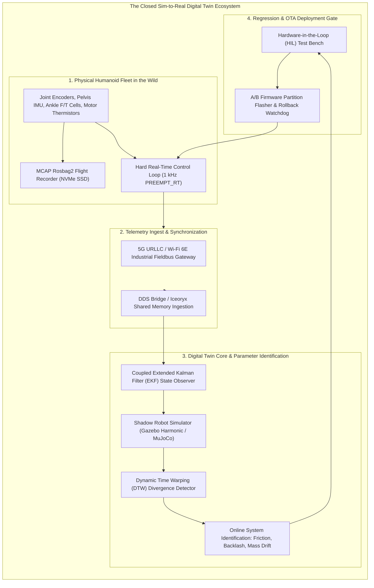
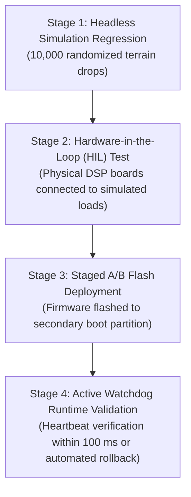

import ChapterProgress from '@site/src/components/ChapterProgress';
import QuizEngine from '@site/src/components/QuizEngine';

# Closing the Sim-to-Real Data Loop

A digital twin is not a static artifact authored once and left untouched; it is an active, bidirectional computational shadow that continuously evolves alongside physical hardware. If the physical robot’s joint gearboxes wear down, if actuator winding temperatures increase stator resistance, or if foot rubber treads abrade, a static simulation will rapidly drift from physical reality.

Closing the **Sim-to-Real Data Loop** requires continuous bidirectional telemetry: physical joint encoders, load cells, and IMUs stream data back to a **Shadow Digital Twin**, which uses Bayesian state estimation and online parameter identification to adapt simulation dynamics. In return, verified control policies are rolled out safely to physical fleets via automated Over-the-Air (OTA) pipelines.



---

## 1. Taxonomy of Sim-to-Real Discrepancies

Discrepancies between simulation and physical humanoids fall into four distinct physical categories:

| Discrepancy Category | Physical Root Cause | Mathematical Phenomenon | Mitigation in Digital Twin |
| :--- | :--- | :--- | :--- |
| **Actuator Latency & Back-EMF** | Inverter PWM switching dead-time; CAN-FD communication delays ($1.5\text{ ms}$) | Phase lag between commanded and measured joint torque: $\tau(t) = \tau_{\text{cmd}}(t - T_d)$ | Actuator transfer function with explicit delay buffer in simulation |
| **Gearbox Compliance & Backlash** | Harmonic drive flexspline torsional compliance; planetary backlash | Hysteresis deadband: $\Delta \theta = \pm 0.002\text{ rad}$ | Bi-directional spring-damper joint compliance modeling |
| **Thermal Stator Degradation** | High motor current heats copper windings to $85^\circ\text{C}$, increasing resistance $R(T)$ | Torque constant degradation: $K_t(T) = K_{t,0}(1 - \alpha \Delta T)$ | Thermal dynamic observer derating maximum torque in twin |
| **Foot Sole Contact Abrasion** | Rubber sole tread wears smooth over 200 operating hours | Friction coefficient drops from $\mu = 0.85$ down to $\mu = 0.52$ | Ground-truth friction estimation updated from ankle F/T shear ratios |

---

## 2. Mathematical State Estimation: Extended Kalman Filter (EKF) Synchronization

To track the physical robot's internal states in real time, the digital twin runs an **Extended Kalman Filter (EKF)** combining forward physics simulation with live telemetry.

Let the non-linear multi-body state vector be $\mathbf{x} = [\mathbf{q}^T, \dot{\mathbf{q}}^T, \mathbf{b}_\omega^T, \mathbf{b}_a^T]^T \in \mathbb{R}^{2n + 12}$. The discrete state transition and measurement equations are:

$$
\mathbf{x}_k = \mathbf{f}(\mathbf{x}_{k-1}, \mathbf{u}_{k-1}) + \mathbf{w}_{k-1}, \quad \mathbf{w}_{k-1} \sim \mathcal{N}(\mathbf{0}, \mathbf{Q}_k)
$$

$$
\mathbf{z}_k = \mathbf{h}(\mathbf{x}_k) + \mathbf{v}_k, \quad \mathbf{v}_k \sim \mathcal{N}(\mathbf{0}, \mathbf{R}_k)
$$

### EKF Prediction Step (Physics Step)
The state and error covariance are propagated forward using the multi-body equations of motion:

$$
\hat{\mathbf{x}}_k^- = \mathbf{f}(\hat{\mathbf{x}}_{k-1}, \mathbf{u}_{k-1})
$$

$$
\mathbf{P}_k^- = \mathbf{F}_{k-1} \mathbf{P}_{k-1} \mathbf{F}_{k-1}^T + \mathbf{Q}_k
$$

where $\mathbf{F}_{k-1} = \left. \frac{\partial \mathbf{f}}{\partial \mathbf{x}} \right|_{\hat{\mathbf{x}}_{k-1}, \mathbf{u}_{k-1}}$ is the continuous-to-discrete state Jacobian evaluated via multi-body spatial auto-differentiation.

### EKF Correction Step (Telemetry Fusion)
When physical telemetry $\mathbf{z}_k^{\text{real}}$ (joint encoder positions, IMU attitude, sole wrenches) arrives over the network:

$$
\mathbf{K}_k = \mathbf{P}_k^- \mathbf{H}_k^T \left( \mathbf{H}_k \mathbf{P}_k^- \mathbf{H}_k^T + \mathbf{R}_k \right)^{-1}
$$

$$
\hat{\mathbf{x}}_k = \hat{\mathbf{x}}_k^- + \mathbf{K}_k \left( \mathbf{z}_k^{\text{real}} - \mathbf{h}(\hat{\mathbf{x}}_k^-) \right)
$$

$$
\mathbf{P}_k = \left( \mathbf{I} - \mathbf{K}_k \mathbf{H}_k \right) \mathbf{P}_k^-
$$

---

## 3. Real-Time Tracking Divergence Detection via Dynamic Time Warping

When a physical humanoid trips or suffers an actuator stall, the physical trajectory diverges from the digital twin. Because network jitter can cause momentary phase shifts, simple Euclidean point-wise error yields false alarms.

The digital twin employs **Dynamic Time Warping (DTW)** across sliding windows of length $N = 100$ steps ($100\text{ ms}$):

$$
D(i, j) = d\left(\mathbf{q}_i^{\text{real}}, \mathbf{q}_j^{\text{sim}}\right) + \min\left( D(i-1, j), D(i, j-1), D(i-1, j-1) \right)
$$

The normalized warping alignment cost is:

$$
\mathcal{C}_{\text{DTW}} = \frac{1}{2N} D(N, N)
$$

If $\mathcal{C}_{\text{DTW}} > \epsilon_{\text{threshold}} = 0.08\text{ rad}$, an automated safety interlock triggers: the physical controller enters emergency damping mode, and the flight recorder freezes the preceding 10 seconds of telemetry for forensic audit.

---

## 4. Hardware Infrastructure Breakdown

| Subsystem | Hardware Spec / Standard | Function in Sim-to-Real Loop | Failsafe / Redundancy |
| :--- | :--- | :--- | :--- |
| **Industrial 5G Field Gateway** | Quectel RG500Q (3GPP Rel-16 URLLC) | Sustained $>500\text{ Mbps}$ telemetry; $<8\text{ ms}$ round-trip latency | Active dual-SIM failover to local Wi-Fi 6E mesh |
| **Black-Box Flight Recorder** | Kioxia Industrial NVMe SSD (PCIe 4.0) | Streams uncompressed 1 kHz joint/IMU logs in MCAP format | Power-Loss Protection (PLP) tantalum capacitors |
| **OTA Microcontroller Flasher** | SWD / JTAG over Ethernet Bridge | Programs joint DSPs and real-time controller firmware | Dual A/B flash partitions with hardware watchdog rollback |
| **HIL Simulation Rig** | Dual Speedgoat Real-Time Target Machines | Emulates 32 BLDC inverter PWM and CAN-FD fieldbuses | Optical isolation on all fieldbus channels |

---

## 5. Complete Runnable Python Script: Real-Time Shadow Robot Synchronizer

The following complete ROS 2 Python node implements a live shadow robot synchronizer, comparing physical joint states with digital twin states and calculating real-time tracking divergence:

```python
#!/usr/bin/env python3
"""
shadow_robot_synchronizer.py: Real-time shadow robot node synchronizing 
real humanoid telemetry with digital twin and detecting tracking divergence.
"""
from typing import Any
import numpy as np
import rclpy
from rclpy.node import Node
from sensor_msgs.msg import JointState

class ShadowRobotSynchronizer(Node):
    def __init__(self):
        super().__init__('shadow_robot_synchronizer')
        
        # Subscriptions to physical hardware and digital twin topics
        self.real_sub = self.create_subscription(
            JointState, '/humanoid/real/joint_states', self.real_callback, 10
        )
        self.sim_sub = self.create_subscription(
            JointState, '/humanoid/sim/joint_states', self.sim_callback, 10
        )
        
        self.real_positions: np.ndarray | None = None
        self.sim_positions: np.ndarray | None = None
        self.divergence_threshold_rad: float = 0.08  # ~4.5 degrees threshold
        self.tracking_errors: list[float] = []

        self.get_logger().info("Shadow Robot Synchronizer online. Monitoring Real-to-Sim parity...")

    def real_callback(self, msg: JointState) -> None:
        self.real_positions = np.array(msg.position, dtype=np.float64)
        self.evaluate_parity()

    def sim_callback(self, msg: JointState) -> None:
        self.sim_positions = np.array(msg.position, dtype=np.float64)
        self.evaluate_parity()

    def evaluate_parity(self) -> None:
        if self.real_positions is None or self.sim_positions is None:
            return

        if len(self.real_positions) != len(self.sim_positions):
            self.get_logger().error(
                f"Dimension mismatch! Real joints: {len(self.real_positions)}, Sim joints: {len(self.sim_positions)}"
            )
            return

        # Compute Euclidean norm of joint position discrepancy
        error = float(np.linalg.norm(self.real_positions - self.sim_positions))
        self.tracking_errors.append(error)

        if error > self.divergence_threshold_rad:
            self.get_logger().error(
                f"CRITICAL PARITY VIOLATION! Tracking Divergence: {error:.4f} rad > Limit: {self.divergence_threshold_rad:.4f} rad"
            )
            # In production: Trigger safety watchdog or disengage high-level policy

        if len(self.tracking_errors) % 1000 == 0:
            avg_err = float(np.mean(self.tracking_errors[-1000:]))
            self.get_logger().info(f"[TELEMETRY] Last 1000-step Mean Tracking Error: {avg_err:.5f} rad")

def main(args: list[str] | None = None) -> None:
    rclpy.init(args=args)
    node = ShadowRobotSynchronizer()
    try:
        rclpy.spin(node)
    except KeyboardInterrupt:
        node.get_logger().info("Stopping shadow robot synchronizer.")
    finally:
        node.destroy_node()
        rclpy.shutdown()

if __name__ == '__main__':
    main()
```

---

## 6. Safe Over-the-Air (OTA) Deployment Protocol

Before any new neural network policy or walking gait controller is deployed from the digital twin to physical humanoid hardware, it must clear a four-stage certification pipeline:



1. **Stage 1 (Headless Simulation Regression)**: The policy executes 10,000 episodes across randomized friction ($\mu \in [0.4, 1.2]$) and external push impulses without falling.
2. **Stage 2 (HIL Verification)**: The binary executes on the physical embedded computer with real motor inverters connected to virtual dynamometer loads.
3. **Stage 3 (Staged A/B Flash Deployment)**: The payload is written to flash partition B while the robot runs on partition A.
4. **Stage 4 (Active Watchdog Validation)**: Upon reboot into partition B, the controller must confirm valid joint states and complete a 5-second balance test. If any communication frame drops or an emergency stop occurs, the hardware watchdog pulls the reset line, instantly booting back into the certified partition A.

---

## 7. Research Foundations & Seminal Literature

1. **Hwangbo, J., Lee, J., Dosovitskiy, A., Bellicoso, D., Tsounis, V., Schmitt, J., & Hutter, M.** (2019). *Learning agile and dynamic motor skills for legged robots*. Science Robotics, 4(26), eaau5872.
2. **Tan, J., Zhang, T., Coumans, E., Iscen, A., Bai, Y., Hafner, D., Bohez, S., & Vanhoucke, V.** (2018). *Sim-to-Real: Learning Agile Locomotion for Quadruped Robots*. In Proceedings of Robotics: Science and Systems (RSS).
3. **International Organization for Standardization.** (2021). *ISO 23247-1: Digital twin framework for manufacturing — Part 1: Overview and general principles*. ISO Standard.
4. **Kumar, V., Todorov, E., & Levine, S.** (2016). *Optimal control with learned local models: Application to dexterous manipulation*. In 2016 IEEE International Conference on Robotics and Automation (ICRA) (pp. 378-383).

---

<ChapterProgress chapterId="2-10-digital-twin-data-loop" moduleId="module2" totalChapters={10} />

## Chapter Mastery Check

<QuizEngine
  quizId="quiz-2-10"
  title="Module 2.10 Mastery Check: Closing the Sim-to-Real Data Loop"
  moduleId="module2"
  passThreshold={70}
  questions={[
    {
      id: "q1",
      question: "Why is Dynamic Time Warping (DTW) superior to simple point-wise Euclidean distance for detecting real-to-sim trajectory divergence?",
      options: [
        "DTW ignores all spatial dimensions",
        "DTW aligns time-series sequences that may have slight phase or timing offsets due to network packet transport latency, preventing false alarms while accurately flagging structural divergence",
        "DTW requires no computational processing",
        "Point-wise Euclidean distance only works in 2D"
      ],
      correctIndex: 1,
      explanation: "Real telemetry frequently incurs minor variable transport latency (jitter). Point-wise Euclidean subtraction penalizes pure phase shifts as massive errors. DTW non-linearly warps the time dimension to align trajectories, detecting true dynamic divergence."
    },
    {
      id: "q2",
      question: "In the Extended Kalman Filter (EKF) state synchronization pipeline, what is the role of the measurement innovation residual z_k^real - h(x_k^-)?",
      options: [
        "It measures the battery charge level",
        "It quantifies the discrepancy between the actual physical sensor measurement and what the digital twin predicted, driving state corrections scaled by the Kalman gain K_k",
        "It resets the robot's operating system",
        "It measures ambient air pressure"
      ],
      correctIndex: 1,
      explanation: "The innovation residual z_k - h(x_k^-) compares real physical sensor telemetry against the simulator's predicted observation. Multiplying this residual by the optimal Kalman gain K_k updates the simulation state toward physical reality."
    },
    {
      id: "q3",
      question: "What is the primary safety purpose of utilizing dual A/B firmware partitions during Over-the-Air (OTA) controller deployment on physical humanoids?",
      options: [
        "To store twice as many video recordings",
        "To allow instantaneous, fail-safe rollback to the previously certified controller partition if the newly deployed controller fails health checks or watchdog heartbeats",
        "To run two operating systems simultaneously",
        "To bypass safety regulatory certifications"
      ],
      correctIndex: 1,
      explanation: "A/B partitioning guarantees that if a newly flashed firmware or control policy experiences a crash, assertion failure, or watchdog timeout upon boot, the bootloader automatically reverts to the proven partition A, preventing a bricked or uncontrolled robot."
    }
  ]}
/>
