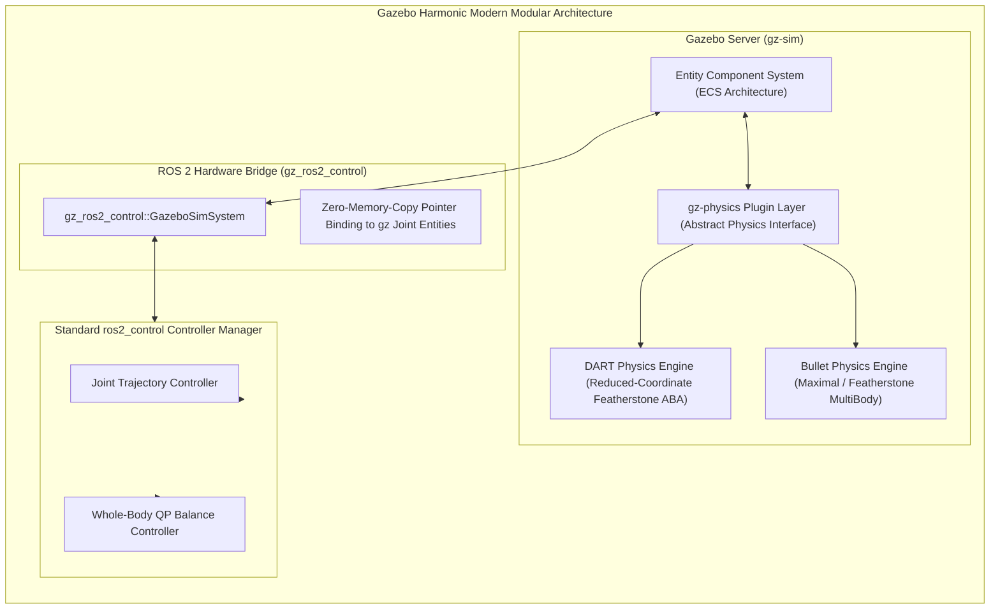
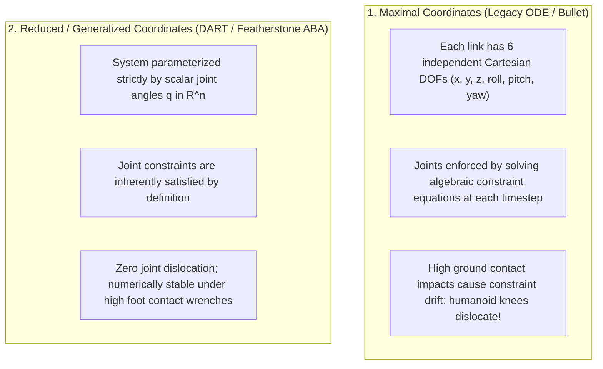
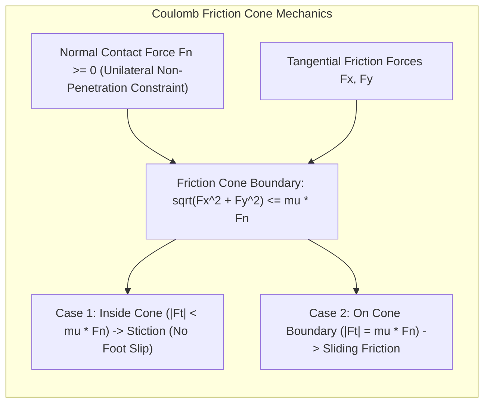

# Physics Engines & Gazebo Harmonic Architecture

Simulating a 70 kg bipedal humanoid walking across ground requires solving complex nonlinear equations of motion and non-smooth contact mechanics at high numerical frequencies. 

Modern robotics simulation has transitioned from legacy Gazebo Classic to **Gazebo Harmonic** (formerly Ignition Gazebo), featuring a modular C++ plugin architecture and integration with state-of-the-art physics solvers including **DART (Dynamic Animation and Robotics Toolkit)** and **Bullet Featherstone**.



---

## 1. Maximal Coordinates vs. Reduced Coordinates

The choice of mathematical formulation inside the physics engine dictates whether your humanoid walks smoothly or violently explodes due to numerical instability:



### Why DART is Preferred for Humanoids
Gazebo Harmonic defaults to **DART** for articulated bipedal robotics:
- Uses **Featherstone’s Articulated Body Algorithm (ABA)** to compute forward dynamics in `O(N)` computational complexity (where `N` is the number of links), compared to classical `O(N^3)` matrix inversion.
- Guarantees strict joint kinematic integrity without artificial joint spring-damper stabilization tricks.

---

## 2. Contact Dynamics: Coulomb Friction Cones & LCP Solvers

When the sole of a humanoid foot strikes the floor, the physics engine must prevent interpenetration while calculating tangential friction forces. This is modeled through the **Coulomb Friction Cone**:

```text
|F_tangential| <= mu * F_normal
```

where `mu` is the static friction coefficient (typically 0.6 to 0.8 for rubber soles on concrete).



### The Linear Complementarity Problem (LCP)
Contact mechanics cannot be solved with smooth differential equations because contact is inherently non-smooth:

```text
1. When foot is above ground: z_foot > 0  ==>  F_normal = 0
2. When foot touches ground:  z_foot = 0  ==>  F_normal >= 0
3. Complementarity condition: z_foot >= 0, F_normal >= 0, and (z_foot * F_normal) = 0
```

Gazebo Harmonic uses **Projected Gauss-Seidel (PGS)** or **Dantzig algorithms** to solve this Linear Complementarity Problem at every simulation step (typically 1 kHz, or `dt = 0.001 s`).

---

## 3. Integrating `gz_ros2_control` with Gazebo Harmonic

To control a humanoid model inside Gazebo Harmonic using standard ROS 2 controllers, the robot's URDF/SDF description incorporates the `gz_ros2_control` system architecture:

```xml
<ros2_control name="GazeboSimSystem" type="system">
  <hardware>
    <plugin>gz_ros2_control/GazeboSimSystem</plugin>
  </hardware>

  <!-- Left Ankle Pitch Joint -->
  <joint name="left_ankle_pitch_joint">
    <command_interface name="effort">
      <param name="min">-150.0</param>
      <param name="max">150.0</param>
    </command_interface>
    <state_interface name="position"/>
    <state_interface name="velocity"/>
    <state_interface name="effort"/>
  </joint>

  <!-- Left Ankle Roll Joint -->
  <joint name="left_ankle_roll_joint">
    <command_interface name="effort">
      <param name="min">-80.0</param>
      <param name="max">80.0</param>
    </command_interface>
    <state_interface name="position"/>
    <state_interface name="velocity"/>
    <state_interface name="effort"/>
  </joint>
</ros2_control>

<gazebo>
  <plugin filename="gz_ros2_control-system" name="gz_ros2_control::GazeboSimSystem">
    <parameters>$(find humanoid_bringup)/config/humanoid_controllers.yaml</parameters>
  </plugin>
</gazebo>
```

---

## 4. Contact Solvers: LCP and Projected Gauss-Seidel in DART

In Gazebo Harmonic, rigid-body contact dynamics are solved as a **Linear Complementarity Problem (LCP)**:

```text
w = A * lambda + b >= 0,    lambda >= 0,    lambda^T * w = 0
```

where:
- `lambda` are unilateral contact forces and frictional impulses.
- `w` represents relative contact separation velocities.
- `lambda^T * w = 0` enforces that normal contact force can only be non-zero when the bodies are touching (`w = 0`).

DART utilizes **Projected Gauss-Seidel (PGS)** and Dantzig direct pivoting solvers. For bipedal balance with foot contacts, setting `iters = 50` in the physics configuration guarantees convergence and prevents foot penetration artifacts.

In the next chapter, we simulate real-world physical sensors: **IMUs, Force-Torque Cells, LiDAR, and Depth Optics**.
