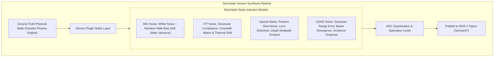
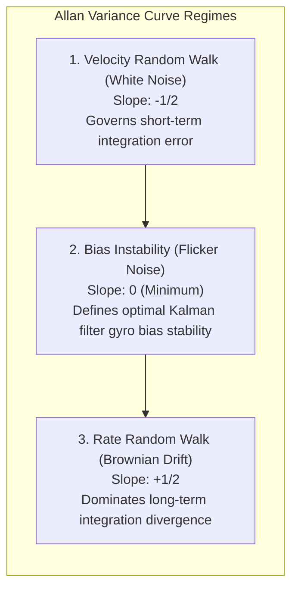

# Sensor Simulation & Stochastic Noise Modeling

A simulation with mathematically perfect sensors is the fastest path to catastrophic failure in the real world. Real-world sensors suffer from **high-frequency Gaussian noise, slow temperature-induced bias drift, quantization errors, rolling shutter distortion, and optical absorption dropouts**.

If an Extended Kalman Filter (EKF) or Visual SLAM system is tuned on noise-free synthetic data, it will immediately diverge when deployed onto physical humanoid hardware. In Gazebo Harmonic, we model these stochastic phenomena through rigorous physics-based sensor plugins.



---

## 1. 6-Axis Tactical IMU Noise Modeling

The inertial measurement unit mounted at the humanoid's pelvis is the primary source of truth for attitude estimation and vertical balance. 

### The Continuous-Time Stochastic IMU Model
The measured linear acceleration `a_meas(t)` and angular velocity `omega_meas(t)` are modeled as:

```text
a_meas(t)     = a_true(t)     + b_a(t) + eta_a(t)
omega_meas(t) = omega_true(t) + b_w(t) + eta_w(t)
```

where:
- **`eta_a(t)` &sim; `N(0, sigma_a^2)`**: Zero-mean Gaussian white noise representing thermal noise in the MEMS capacitive sensing fingers.
- **`b_a(t)`**: Slow dynamic bias drift governed by Brownian motion (random walk):

```text
d/dt [ b_a(t) ] = eta_ba(t),   eta_ba(t) ~ N(0, sigma_ba^2)
```

In Gazebo Harmonic SDF, this is configured via the `<noise>` block:

```xml
<sensor name="pelvis_imu" type="imu">
  <always_on>true</always_on>
  <update_rate>1000</update_rate>
  <imu>
    <angular_velocity>
      <x>
        <noise type="gaussian">
          <mean>0.0</mean>
          <stddev>0.0002</stddev>      <!-- Rate noise density (rad/s/sqrt(Hz)) -->
          <bias_mean>0.00001</bias_mean>
          <bias_stddev>0.000008</bias_stddev> <!-- Random walk instability -->
        </noise>
      </x>
    </angular_velocity>
    <linear_acceleration>
      <z>
        <noise type="gaussian">
          <mean>0.0</mean>
          <stddev>0.017</stddev>       <!-- Accel noise density (m/s^2/sqrt(Hz)) -->
          <bias_mean>0.001</bias_mean>
          <bias_stddev>0.0005</bias_stddev>
        </noise>
      </z>
    </linear_acceleration>
  </imu>
</sensor>
```

---

## 2. 6-Axis Foot Force-Torque Sensor Simulation

Humanoid bipedal balance depends on measuring ground reaction wrenches at each ankle to compute the **Zero-Moment Point (ZMP)**:

```text
Wrench = [Fx, Fy, Fz, Tx, Ty, Tz]^T
```

In physical hardware, 6-axis load cells (e.g., ATI Mini58 or Bota Systems SensONE) are compliant spring-mass systems. In Gazebo Harmonic, we insert a compliant joint link between the lower shank and the foot sole, equipped with a `ft_sensor` plugin that reports reaction forces and contact moments.

---

## 3. Depth Camera & 3D LiDAR Optical Simulation

Modern humanoids utilize solid-state or spinning LiDARs (e.g., Livox Mid-360) and stereo depth cameras (e.g., Intel RealSense D435i):

| Optical Modality | Physical Phenomenon Simulated in Digital Twin | Failure Modes Modeled |
| :--- | :--- | :--- |
| **Stereo Depth Optics** | Binocular disparity matching using active infrared speckle projection | Specular reflections on polished floors; transparent glass absorption; flying pixels at sharp depth discontinuities. |
| **3D Solid-State LiDAR** | GPU-accelerated ray tracing calculating time-of-flight distance | Beam divergence spot size; grazing-angle dropouts; low-albedo black rubber absorption. |

---

## 4. Allan Variance & Stochastic IMU Noise Modeling

To achieve zero sim-to-real gap in state estimation, IMU noise cannot be simulated as simple white Gaussian noise. Tactical IMUs (e.g., ADIS16470 / ICM-42688-P) exhibit three distinct stochastic regimes characterized by the **Allan Variance** curve `sigma^2(tau)`:



In the digital twin, the discrete-time sensor state `omega_meas(k)` updates according to:

```text
omega_meas(k) = omega_true(k) + b_gyro(k) + w_gyro(k)
b_gyro(k+1) = b_gyro(k) + w_bias(k) * dt
```

where `w_gyro ~ N(0, sigma_w^2 / dt)` and `w_bias ~ N(0, sigma_b^2 * dt)`. This accurately forces the humanoid state estimator to continuously track and estimate gyro bias drift online.

In the next chapter, we connect high-fidelity rendering engines: **Unity HDRP, Photorealism, and the ROS-TCP-Connector**.
