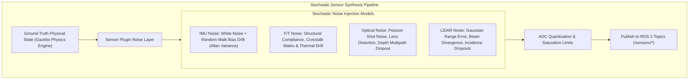
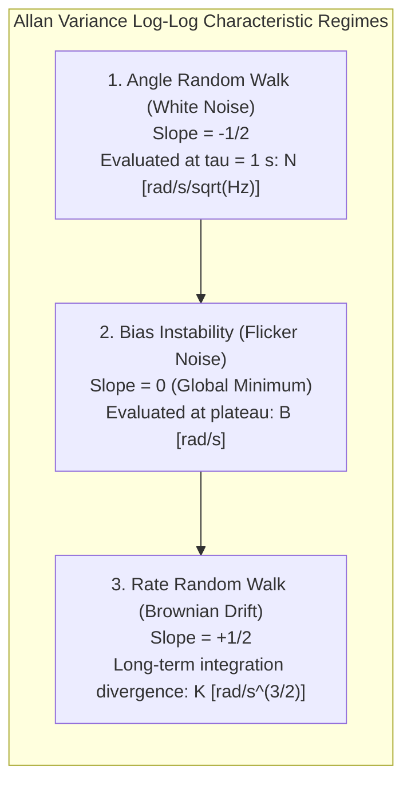

import ChapterProgress from '@site/src/components/ChapterProgress';
import QuizEngine from '@site/src/components/QuizEngine';

# Sensor Simulation & Stochastic Noise Modeling

A robotic simulation configured with mathematically pristine, noise-free sensors is the most direct path to catastrophic failure during physical Sim-to-Real transfer. Real-world sensors are subject to **high-frequency thermal white noise, temperature-dependent non-stationary bias drift, 1/f flicker noise, optical beam divergence, surface reflectivity dropouts, and structural strain gauge cross-talk**.

If an Extended Kalman Filter (EKF), Unscented Kalman Filter (UKF), or Visual-Inertial Odometry (VIO) estimator is calibrated against noise-free synthetic telemetry, its covariance matrices will collapse, causing the physical humanoid's state estimation to immediately diverge upon deployment.



---

## 1. 6-Axis Tactical MEMS IMU Error Modeling

The primary reference for humanoid vertical attitude estimation, angular momentum balance, and high-frequency disturbance rejection is the inertial measurement unit (IMU) rigidly mounted at the pelvis.

### Continuous-Time Stochastic IMU Equations

The continuous-time stochastic error model for a 3-axis gyroscope and a 3-axis accelerometer is formulated as:

$$
\tilde{\boldsymbol{\omega}}(t) = \boldsymbol{\omega}(t) + \mathbf{b}_\omega(t) + \boldsymbol{\eta}_\omega(t)
$$

$$
\dot{\mathbf{b}}_\omega(t) = \boldsymbol{\eta}_{b\omega}(t)
$$

$$
\tilde{\mathbf{a}}(t) = \mathbf{R}^T(t)\left(\mathbf{a}(t) - \mathbf{g}\right) + \mathbf{b}_a(t) + \boldsymbol{\eta}_a(t)
$$

$$
\dot{\mathbf{b}}_a(t) = \boldsymbol{\eta}_{ba}(t)
$$

where:
- $\boldsymbol{\omega}(t), \mathbf{a}(t) \in \mathbb{R}^3$ are true angular velocity and linear acceleration in the body frame $\mathcal{B}$.
- $\mathbf{R}(t) \in SO(3)$ is the rotation matrix mapping the body frame to the inertial world frame $\mathcal{W}$, and $\mathbf{g} = [0, 0, -9.80665]^T\text{ m/s}^2$ is gravitational acceleration.
- $\boldsymbol{\eta}_\omega(t) \sim \mathcal{N}(\mathbf{0}, \sigma_{\omega}^2 \mathbf{I})$ and $\boldsymbol{\eta}_a(t) \sim \mathcal{N}(\mathbf{0}, \sigma_a^2 \mathbf{I})$ represent zero-mean Gaussian white noise (Angle Random Walk and Velocity Random Walk).
- $\mathbf{b}_\omega(t), \mathbf{b}_a(t)$ represent dynamic bias instability governed by Brownian motion (Rate Random Walk), driven by white noise processes $\boldsymbol{\eta}_{b\omega} \sim \mathcal{N}(\mathbf{0}, \sigma_{b\omega}^2 \mathbf{I})$ and $\boldsymbol{\eta}_{ba} \sim \mathcal{N}(\mathbf{0}, \sigma_{ba}^2 \mathbf{I})$.

---

## 2. Mathematical Formulation of Allan Variance

To avoid arbitrary tuning of noise values in simulation, sensor parameters are derived experimentally from real hardware using the **Allan Variance** metric.

Let a stationary IMU record an angular rate signal sequence $y_k$ at sampling period $\Delta t$ over a duration $T = N \cdot \Delta t$. For an averaging cluster time $\tau = m \cdot \Delta t$, the cluster average is:

$$
\bar{y}_k(m) = \frac{1}{m} \sum_{i=0}^{m-1} y_{k+i}
$$

The **Allan Variance** $\sigma_A^2(\tau)$ is computed as half the mean squared difference between adjacent cluster averages:

$$
\sigma_A^2(\tau) = \frac{1}{2(N - 2m)} \sum_{k=1}^{N - 2m} \left( \bar{y}_{k+m}(m) - \bar{y}_k(m) \right)^2
$$

The log-log plot of Allan Deviation $\sigma_A(\tau) = \sqrt{\sigma_A^2(\tau)}$ decomposes sensor noise into distinct physical regimes:



In discrete-time simulation loops with step size $\Delta t$, the discrete noise variances scale according to:

$$
\sigma_{\text{discrete\_white}} = \frac{N}{\sqrt{\Delta t}}, \quad \sigma_{\text{discrete\_walk}} = K \sqrt{\Delta t}
$$

---

## 3. Stereo Camera Depth Noise & Optical Dispersion

Stereo depth sensors (e.g., Intel RealSense D435i / Stereolabs ZED 2i) compute Cartesian depth $z$ via triangulation from horizontal disparity $d$:

$$
z = \frac{f \cdot b}{d}
$$

where $f$ is focal length (pixels), $b$ is stereo baseline distance (meters), and $d = x_{\text{left}} - x_{\text{right}}$ is disparity (pixels).

By propagating subpixel disparity matching error $\sigma_d \approx 0.1\text{ to }0.25\text{ pixels}$ through the derivative $\frac{\partial z}{\partial d} = -\frac{f \cdot b}{d^2} = -\frac{z^2}{f \cdot b}$, the depth estimation variance increases quadratically with distance:

$$
\sigma_z = \left| \frac{\partial z}{\partial d} \right| \sigma_d = \frac{z^2}{f \cdot b} \sigma_d
$$

This quadratic error growth explains why humanoid footstep planners cannot rely on distant stereo point clouds for centimeter-precision terrain foothold selection without continuous multi-frame Bayesian filtering.

---

## 4. Foot Force-Torque Sensor Structural Cross-Talk

Bipedal stability controllers compute the Zero-Moment Point (ZMP) from ground reaction wrenches measured at the ankle soles:

$$
\mathbf{w}_{\text{meas}} = \begin{bmatrix} F_x & F_y & F_z & M_x & M_y & M_z \end{bmatrix}^T
$$

In physical multi-axis strain gauge transducers (e.g., ATI Gamma or Bota SensONE), physical shear strain leaks into axial strain channels due to mechanical machining tolerances. The simulated sensor must apply a $6 \times 6$ cross-talk coupling matrix $\mathbf{C}$:

$$
\tilde{\mathbf{w}} = \mathbf{C}_{6 \times 6} \mathbf{w}_{\text{true}} + \mathbf{b}_{\text{thermal}}(T) + \boldsymbol{\eta}_{\text{ft}}
$$

$$
\mathbf{C} = \begin{bmatrix}
1.000 & c_{12} & c_{13} & c_{14} & c_{15} & c_{16} \\
c_{21} & 1.000 & c_{23} & c_{24} & c_{25} & c_{26} \\
c_{31} & c_{32} & 1.000 & c_{34} & c_{35} & c_{36} \\
c_{41} & c_{42} & c_{43} & 1.000 & c_{45} & c_{46} \\
c_{51} & c_{52} & c_{53} & c_{54} & 1.000 & c_{56} \\
c_{61} & c_{62} & c_{63} & c_{64} & c_{65} & 1.000
\end{bmatrix}
$$

where cross-talk coefficients $|c_{ij}| \le 0.015$ inject realistic multi-axis coupling into ankle state estimation.

---

## 5. Physical Sensor Hardware Breakdown

| Physical Sensor Model | Sensor Category | Hardware Specifications | Simulation Emulation Parameters |
| :--- | :--- | :--- | :--- |
| **Analog Devices ADIS16497** | Tactical 6-Axis MEMS IMU | In-run bias stability: $0.8^\circ/\text{hr}$; Accel noise density: $3.2\,\mu\text{g}/\sqrt{\text{Hz}}$ | Gazebo `<noise>` block with calibrated Allan variance params |
| **Livox Mid-360** | 3D Non-Repetitive LiDAR | Range precision: $2\text{ cm}$; Beam divergence: $0.28^\circ \times 0.03^\circ$; $100\text{k pts/s}$ | GPU ray-tracing plugin with incidence dropout probability $P(\theta)$ |
| **ATI Gamma 6-Axis F/T** | Foot Sole Load Cell | Max payload: $130\text{ N}\cdot\text{m} / 400\text{ N}$; Cross-talk $\le 1.5\%$; Drift: $0.05\text{ N}/^\circ\text{C}$ | Force-torque compliance plugin with calibration matrix $\mathbf{C}_{6 \times 6}$ |
| **Intel RealSense D435i** | Active IR Stereo Depth | Baseline: $50\text{ mm}$; Resolution: $1280 \times 720$; Subpixel disparity $\sigma_d = 0.15\text{ px}$ | Quadratic depth error model $\sigma_z = \frac{z^2}{fb}\sigma_d$ with IR speckle noise |

---

## 6. Runnable Code: Calibrated Stochastic Noise Synthesizer

The following production Python module synthesizes calibrated IMU stochastic noise (Angle Random Walk + Bias Instability) and LiDAR incidence dropouts:

```python
#!/usr/bin/env python3
"""
sensor_noise_synthesizer.py: Calibrated stochastic noise generator 
injecting Allan variance IMU noise and LiDAR dropouts into ground-truth states.
"""
from dataclasses import dataclass
import numpy as np

@dataclass
class IMUAllanParameters:
    gyro_white_noise: float = 0.0002       # N: rad/s/sqrt(Hz)
    gyro_bias_instability: float = 1e-5     # B: rad/s
    accel_white_noise: float = 0.017       # m/s^2/sqrt(Hz)
    accel_bias_instability: float = 0.001  # m/s^2

class IMUNoiseModel:
    def __init__(self, params: IMUAllanParameters, dt: float = 0.001):
        self.dt = dt
        self.params = params
        # Discrete white noise standard deviations
        self.gyro_white_std = params.gyro_white_noise / np.sqrt(dt)
        self.accel_white_std = params.accel_white_noise / np.sqrt(dt)
        # Discrete random walk standard deviations
        self.gyro_walk_std = params.gyro_bias_instability * np.sqrt(dt)
        self.accel_walk_std = params.accel_bias_instability * np.sqrt(dt)
        
        self.gyro_bias = np.zeros(3)
        self.accel_bias = np.zeros(3)

    def corrupt_imu(self, true_omega: np.ndarray, true_accel: np.ndarray) -> tuple[np.ndarray, np.ndarray]:
        # 1. Update random-walk biases
        self.gyro_bias += np.random.normal(0.0, self.gyro_walk_std, size=3)
        self.accel_bias += np.random.normal(0.0, self.accel_walk_std, size=3)
        
        # 2. Add high-frequency white noise
        noisy_omega = true_omega + self.gyro_bias + np.random.normal(0.0, self.gyro_white_std, size=3)
        noisy_accel = true_accel + self.accel_bias + np.random.normal(0.0, self.accel_white_std, size=3)
        
        return noisy_omega, noisy_accel

class LiDARNoiseModel:
    def __init__(self, range_sigma: float = 0.02, beam_divergence_rad: float = 0.004):
        self.range_sigma = range_sigma
        self.beam_divergence = beam_divergence_rad

    def simulate_scans(self, true_ranges: np.ndarray, incident_angles_deg: np.ndarray) -> np.ndarray:
        """
        Applies range Gaussian noise and surface grazing-angle dropout.
        Points at high incidence angles (>75 deg) suffer severe return loss.
        """
        # Calculate diffuse Lambertian return probability
        cos_inc = np.maximum(0.0, np.cos(np.radians(incident_angles_deg)))
        dropout_probability = 1.0 - (cos_inc ** 1.5)
        
        random_rolls = np.random.uniform(0.0, 1.0, size=true_ranges.shape)
        valid_returns = random_rolls > dropout_probability
        
        # Add range uncertainty
        measured_ranges = true_ranges + np.random.normal(0.0, self.range_sigma, size=true_ranges.shape)
        measured_ranges[~valid_returns] = np.nan
        return measured_ranges

if __name__ == "__main__":
    imu_sim = IMUNoiseModel(IMUAllanParameters(), dt=0.001)
    lidar_sim = LiDARNoiseModel()

    true_w = np.array([0.02, -0.01, 0.005])
    true_a = np.array([0.01, 0.03, 9.80665])
    
    noisy_w, noisy_a = imu_sim.corrupt_imu(true_w, true_a)
    print(f"True Angular Velocity:    {true_w}")
    print(f"Corrupted Measurement:    {noisy_w}")
    print(f"True Linear Acceleration: {true_a}")
    print(f"Corrupted Measurement:    {noisy_a}")
```

---

## 7. Research Foundations & Seminal Literature

1. **Woodman, O. J.** (2007). *An introduction to inertial navigation*. University of Cambridge Computer Laboratory, Technical Report UCAM-CL-TR-696.
2. **El-Sheimy, N., Hou, H., & Niu, X.** (2008). *Analysis and modeling of MEMS IMU noise using Allan variance*. IEEE Transactions on Instrumentation and Measurement, 57(1), 140-149.
3. **Nguyen, C. V., Izadi, S., & Lovell, D.** (2012). *Modeling Kinect sensor noise for depth-based 3D reconstruction*. In 2012 IEEE International Conference on Robotics and Biomimetics (ROBIO) (pp. 1279-1284).
4. **Forster, C., Carlone, L., Dellaert, F., & Scaramuzza, D.** (2017). *On-Manifold Preintegration for Real-Time Visual-Inertial Odometry*. IEEE Transactions on Robotics, 33(1), 1-21.

---

<ChapterProgress chapterId="2-3-sensor-simulation" moduleId="module2" totalChapters={10} />

## Chapter Mastery Check

<QuizEngine
  quizId="quiz-2-3"
  title="Module 2.3 Mastery Check: Sensor Simulation & Stochastic Noise"
  moduleId="module2"
  passThreshold={70}
  questions={[
    {
      id: "q1",
      question: "On an Allan Deviation log-log plot, what physical noise process is indicated by a region with a slope of -1/2?",
      options: [
        "Rate Random Walk (Brownian drift)",
        "Bias Instability (flicker noise)",
        "Angle Random Walk (white Gaussian noise)",
        "Sinusoidal mechanical vibration"
      ],
      correctIndex: 2,
      explanation: "A slope of -1/2 on an Allan Deviation curve corresponds directly to Angle Random Walk (ARW) for gyroscopes (or Velocity Random Walk for accelerometers), caused by high-frequency white thermal noise."
    },
    {
      id: "q2",
      question: "Why does the error variance in stereo camera depth estimation grow with the square of the distance (sigma_z proportional to z^2)?",
      options: [
        "Photons lose energy over distance",
        "The mathematical relationship between depth and disparity is hyperbolic (z = fb/d), making the first derivative dz/dd proportional to -z^2",
        "Disparity matching algorithms execute fewer iterations for far objects",
        "Camera lens chromatic aberration doubles every meter"
      ],
      correctIndex: 1,
      explanation: "Because z = fb/d, differentiating depth with respect to disparity yields |dz/dd| = fb/d^2 = z^2 / (fb). Thus, a fixed subpixel disparity error sigma_d produces a depth error that scales quadratically with distance z."
    },
    {
      id: "q3",
      question: "In foot-mounted 6-axis Force-Torque sensors, why must the digital twin model a non-identity cross-talk matrix C_6x6?",
      options: [
        "To invert the robot's gravity vector",
        "Because physical load cell elastic structures experience multi-axis mechanical strain leakage, where horizontal shear forces register false axial force signals",
        "To convert analog millivolts into CAN-FD frames",
        "To synchronize the sensor with the Gazebo physics clock"
      ],
      correctIndex: 1,
      explanation: "Physical strain gauge multi-axis transducers suffer from mechanical cross-talk (typically 1% to 2%): when heavy shear forces occur during foot push-off, tiny structural deflections couple into vertical and torsional measurement channels."
    }
  ]}
/>
