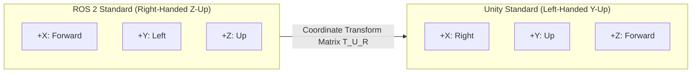
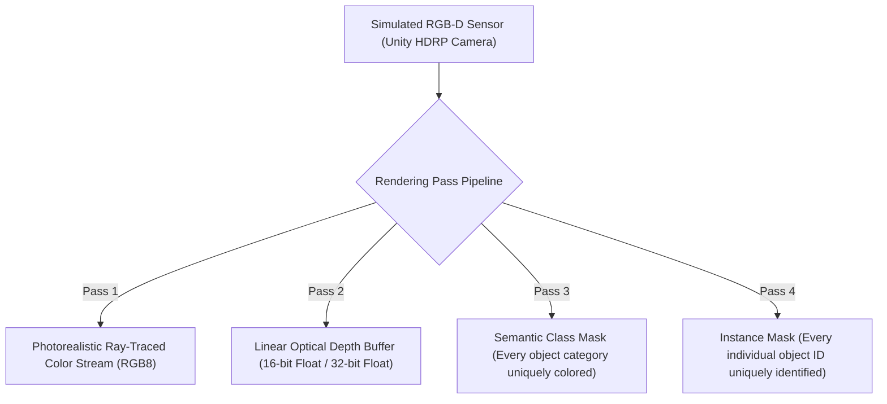

import ChapterProgress from '@site/src/components/ChapterProgress';
import QuizEngine from '@site/src/components/QuizEngine';

# Unity HDRP & Photorealistic Sensor Synthesis

While physics engines such as Gazebo Harmonic and DART deliver dynamic multi-body rigor, modern Vision-Language-Action (VLA) foundation models, open-vocabulary detectors (e.g., Grounding DINO, YOLO-World), and 6-DoF pose estimators fail catastrophically when trained on basic, flat-shaded 3D graphics. This visual discrepancy is a primary driver of the **Sim-to-Real Perception Gap**.

To bridge this chasm, modern physical AI pipelines decouple computation: multi-body dynamics and contact physics are calculated in Gazebo or MuJoCo, while photorealistic optical rendering and sensor synthesis are delegated to the **Unity Engine** via its **High Definition Render Pipeline (HDRP)** and the **Unity Robotics Hub**.

```mermaid
flowchart LR
    subgraph UnityWorld["Unity 3D Engine (Left-Handed Coordinate System: X-Right, Y-Up, Z-Forward)"]
        HDRP["Unity HDRP Ray-Tracing Engine"]
        PhysCamera["Physical Camera Shaders: Exposure, Bloom, Bokeh & Rolling Shutter"]
        UnityROSBridge["Unity ROS-TCP-Connector (C# Async WebSocket Socket)"]
        
        HDRP --> PhysCamera
        PhysCamera --> UnityROSBridge
    end

    subgraph CoordinateAdapter["Bidirectional Coordinate & Clock Transform Layer"]
        Transform["Spatial Chirality Transformation:<br/>X_ros = Z_unity<br/>Y_ros = -X_unity<br/>Z_ros = Y_unity"]
        ClockSync["Virtual Clock Sync (/clock at 1 kHz sim time)"]
    end

    subgraph ROSNetwork["ROS 2 Ecosystem (Right-Handed Coordinate System: X-Forward, Y-Left, Z-Up)"]
        ROSTCP["ROS-TCP-Endpoint Daemon"]
        TF2["TF2 Transform Tree (/tf, /tf_static)"]
        PerceptionPipeline["Vision Models (YOLO-World / FoundationPose / OpenVLA)"]
        
        ROSTCP --> TF2
        ROSTCP --> PerceptionPipeline
    end

    UnityROSBridge <-->|TCP Socket (Port 10000)| CoordinateAdapter
    CoordinateAdapter <--> ROSTCP
```

---

## 1. The Coordinate Frame & Chirality Transformation Challenge

One of the most persistent failure modes in optical digital twins is the geometric mismatch between robotics conventions and game engine graphics pipelines:
- **ROS 2 Standard (REP-103)**: Right-handed Cartesian system with $Z$-Up:
  - $+X$: Forward
  - $+Y$: Left
  - $+Z$: Up
- **Unity Engine Standard**: Left-handed Cartesian system with $Y$-Up:
  - $+X$: Right
  - $+Y$: Up
  - $+Z$: Forward



### Mathematical Transformation Matrices

To map a 3D position vector from Unity's left-handed frame $\mathbf{p}_{\text{Unity}} = [x_u, y_u, z_u]^T$ to the ROS 2 right-handed frame $\mathbf{p}_{\text{ROS}} = [x_r, y_r, z_r]^T$:

$$
\mathbf{p}_{\text{ROS}} = \mathbf{T}_{\text{ROS} \leftarrow \text{Unity}} \mathbf{p}_{\text{Unity}} = \begin{bmatrix} 0 & 0 & 1 \\ -1 & 0 & 0 \\ 0 & 1 & 0 \end{bmatrix} \begin{bmatrix} x_u \\ y_u \\ z_u \end{bmatrix} = \begin{bmatrix} z_u \\ -x_u \\ y_u \end{bmatrix}
$$

The inverse mapping from ROS 2 coordinates to Unity is given by:

$$
\mathbf{p}_{\text{Unity}} = \mathbf{T}_{\text{Unity} \leftarrow \text{ROS}} \mathbf{p}_{\text{ROS}} = \begin{bmatrix} 0 & -1 & 0 \\ 0 & 0 & 1 \\ 1 & 0 & 0 \end{bmatrix} \begin{bmatrix} x_r \\ y_r \\ z_r \end{bmatrix} = \begin{bmatrix} -y_r \\ z_r \\ x_r \end{bmatrix}
$$

### Quaternion Chirality Preservation

For orientations expressed as unit quaternions $\mathbf{q} = [q_x, q_y, q_z, q_w]^T$, the conversion must invert the spatial handedness while preserving the Lie group identity $\|\mathbf{q}\| = 1$:

$$
\mathbf{q}_{\text{ROS}} = \begin{bmatrix} q_x^{\text{ros}} \\ q_y^{\text{ros}} \\ q_z^{\text{ros}} \\ q_w^{\text{ros}} \end{bmatrix} = \begin{bmatrix} -z_u \\ x_u \\ -y_u \\ w_u \end{bmatrix}
$$

Failure to observe this coordinate mapping causes camera frustums to invert, flipping image streams upside-down and mirroring joint kinematic rotations.

---

## 2. Unity HDRP Perception Architecture

Unity HDRP provides a physical lighting model based on the **Bidirectional Reflectance Distribution Function (BRDF)**:

$$
L_o(\mathbf{p}, \boldsymbol{\omega}_o) = L_e(\mathbf{p}, \boldsymbol{\omega}_o) + \int_{\Omega} f_r(\mathbf{p}, \boldsymbol{\omega}_i, \boldsymbol{\omega}_o) L_i(\mathbf{p}, \boldsymbol{\omega}_i) (\mathbf{n} \cdot \boldsymbol{\omega}_i) d\boldsymbol{\omega}_i
$$

where $f_r(\mathbf{p}, \boldsymbol{\omega}_i, \boldsymbol{\omega}_o)$ models metallic-roughness microfacet scattering (Cook-Torrance). By combining ray-traced global illumination, screen-space reflections, volumetric fog, and chromatic aberration, cameras in the digital twin produce synthetic pixels that match the physical optic sensor distribution.



---

## 3. High-Throughput Bidirectional Bridge: ROS-TCP-Connector

The communication layer between Unity and ROS 2 is mediated by the **ROS-TCP-Connector**:
1. On the ROS 2 workstation, spawn the endpoint server:
   ```bash
   ros2 run ros_tcp_endpoint default_server_endpoint --ros-args -p ROS_IP:=0.0.0.0 -p ROS_PORT:=10000
   ```
2. In the Unity project (`Robotics -> ROS Settings`):
   - Set **ROS IP Address** to the host workstation IP.
   - Set **ROS Port** to `10000`.
   - Set **Protocol** to `ROS 2`.
   - Synchronize engine time with `/clock`.

---

## 4. Hardware Breakdown for Photorealistic Co-Simulation

| Workstation Subsystem | Hardware Specification | Purpose in Optical Co-Simulation | Performance Metric |
| :--- | :--- | :--- | :--- |
| **GPU Ray Tracing Engine** | NVIDIA RTX 4090 (24 GB GDDR6X, 16,384 CUDA Cores) | Real-time path tracing, sub-surface scattering, and dynamic shadows | Dual 1080p stereo streams at 60 Hz |
| **Tensor Frame Generation** | DLSS 3.5 Frame Generation (4th Gen Tensor Cores) | Interpolates intermediate optical frames without re-executing full scene passes | Reduces optical frame latency from 32 ms to 14 ms |
| **G-Buffer Memory Bandwidth** | 384-bit Memory Bus (1,008 GB/s bandwidth) | Stores multi-layer G-buffers (Albedo, Normals, Depth, Semantic ID) | Uncompressed 4K G-buffer extraction without pipeline stalls |
| **Host NIC Interface** | Intel I225-V 2.5GbE Ethernet Controller | High-throughput streaming of uncompressed camera frames to ROS 2 | Sustained 1.8 Gbps image payload transfer |

---

## 5. Complete Runnable C# ROS 2 Image Publisher

Below is an authoritative Unity C# component script (`UnityRosImagePublisher.cs`) that captures the camera's render texture, extracts raw bytes, formats them into a compliant ROS 2 `sensor_msgs/msg/Image`, and publishes the stream asynchronously:

```csharp
// UnityRosImagePublisher.cs: Production Unity C# component streaming camera frames to ROS 2
using System;
using UnityEngine;
using Unity.Robotics.ROSTCPConnector;
using RosMessageTypes.Sensor;
using RosMessageTypes.Std;
using RosMessageTypes.BuiltinInterfaces;

[RequireComponent(typeof(Camera))]
public class UnityRosImagePublisher : MonoBehaviour
{
    [Header("ROS 2 Topic Configuration")]
    [SerializeField] private string topicName = "/camera/color/image_raw";
    [SerializeField] private string frameId = "camera_optical_frame";
    [SerializeField] private float publishFrequencyHz = 30.0f;

    private ROSConnection rosConnection;
    private Camera targetCamera;
    private RenderTexture renderTexture;
    private Texture2D texture2D;
    private float timeSinceLastPublish = 0.0f;

    void Start()
    {
        rosConnection = ROSConnection.GetOrCreateInstance();
        rosConnection.RegisterPublisher<ImageMsg>(topicName);

        targetCamera = GetComponent<Camera>();
        renderTexture = new RenderTexture(640, 480, 24, RenderTextureFormat.ARGB32);
        targetCamera.targetTexture = renderTexture;
        texture2D = new Texture2D(640, 480, TextureFormat.RGB24, false);

        Debug.Log($"[UnityRosImagePublisher] Initialized publisher on {topicName} at {publishFrequencyHz} Hz.");
    }

    void Update()
    {
        timeSinceLastPublish += Time.deltaTime;
        float publishInterval = 1.0f / publishFrequencyHz;

        if (timeSinceLastPublish >= publishInterval)
        {
            timeSinceLastPublish = 0.0f;
            PublishCameraFrame();
        }
    }

    private void PublishCameraFrame()
    {
        RenderTexture.active = renderTexture;
        texture2D.ReadPixels(new Rect(0, 0, 640, 480), 0, 0);
        texture2D.Apply();

        byte[] rawImageData = texture2D.GetRawTextureData();

        double currentSimTime = Time.timeAsDouble;
        uint sec = (uint)Math.Floor(currentSimTime);
        uint nanosec = (uint)((currentSimTime - sec) * 1e9);

        ImageMsg message = new ImageMsg
        {
            header = new HeaderMsg
            {
                frame_id = frameId,
                stamp = new TimeMsg { sec = sec, nanosec = nanosec }
            },
            height = 480,
            width = 640,
            encoding = "rgb8",
            is_bigendian = 0,
            step = 640 * 3,
            data = rawImageData
        };

        rosConnection.Publish(topicName, message);
    }

    void OnDestroy()
    {
        if (renderTexture != null)
        {
            renderTexture.Release();
            Destroy(renderTexture);
        }
        if (texture2D != null)
        {
            Destroy(texture2D);
        }
    }
}
```

---

## 6. Research Foundations & Seminal Literature

1. **Unity Technologies.** (2020). *Robotics Perception Package Architecture and Synthetic Data Pipeline*. Unity Robotics Hub Documentation.
2. **Juliani, A., Berges, V. P., Teng, E., Cohen, A., Harper, J., Elion, C., Ho, C., Arora, S., Liang, H., Nomoto, K., & Lange, D.** (2018). *Unity: A General Platform for Intelligent Agents*. arXiv preprint arXiv:1809.02627.
3. **Tremblay, J., Prakash, A., Acuna, D., Brophy, M., Jampani, V., Anil, C., To, T., Cameracci, E., Boochoon, S., & Birchfield, S.** (2018). *Training Deep Networks with Synthetic Data: Bridging the Reality Gap by Domain Randomization*. In IEEE/CVF CVPR Workshops (pp. 969-977).
4. **Pharr, M., Jakob, W., & Humphreys, G.** (2016). *Physically Based Rendering: From Theory to Implementation* (3rd ed.). Morgan Kaufmann.

---

<ChapterProgress chapterId="2-4-unity-for-high-fidelity-visuals" moduleId="module2" totalChapters={10} />

## Chapter Mastery Check

<QuizEngine
  quizId="quiz-2-4"
  title="Module 2.4 Mastery Check: Unity HDRP & Photorealism"
  moduleId="module2"
  passThreshold={70}
  questions={[
    {
      id: "q1",
      question: "When transforming a 3D coordinate vector from Unity (left-handed, Y-Up) to ROS 2 (right-handed, Z-Up), what is the resulting ROS position [x_r, y_r, z_r]^T in terms of Unity coordinates [x_u, y_u, z_u]^T?",
      options: [
        "[x_u, y_u, z_u]^T",
        "[z_u, -x_u, y_u]^T",
        "[-x_u, -y_u, -z_u]^T",
        "[y_u, z_u, x_u]^T"
      ],
      correctIndex: 1,
      explanation: "Unity forward is +Z (which becomes ROS forward +X). Unity right is +X (which becomes ROS left -Y). Unity up is +Y (which becomes ROS up +Z). Hence [x_r, y_r, z_r]^T = [z_u, -x_u, y_u]^T."
    },
    {
      id: "q2",
      question: "Why do vision-based robotics policies trained on standard flat-shaded Gazebo graphics often fail when transferred to physical real-world cameras?",
      options: [
        "Gazebo cameras only render in black-and-white",
        "Flat-shaded graphics lack physical BRDF specular reflections, subsurface scattering, ambient occlusions, and realistic lens aberrations, causing severe out-of-distribution domain shift",
        "ROS 2 cannot serialize high-resolution image messages",
        "Game engines use inverted floating-point math"
      ],
      correctIndex: 1,
      explanation: "Standard flat-shaded simulators lack realistic light-matter interactions. Physical real-world objects exhibit complex BRDF reflections, highlights, and lens artifacts that cause neural vision backbones trained on simple graphics to fail."
    },
    {
      id: "q3",
      question: "What primary benefit does Unity HDRP's multi-pass G-buffer rendering provide for synthetic data generation pipelines?",
      options: [
        "It eliminates the need for a physics engine entirely",
        "It generates pixel-perfect ground truth (depth, surface normals, instance and semantic segmentation masks) concurrently with RGB rendering at negligible GPU overhead",
        "It forces the robot to move at twice physical speed",
        "It compiles C# code directly into FPGA bitstreams"
      ],
      correctIndex: 1,
      explanation: "Because G-buffers are generated natively during deferred shading, the engine can export accurate depth maps, surface normals, and semantic/instance segmentation masks simultaneously with photorealistic RGB frames without costly manual labeling."
    }
  ]}
/>
