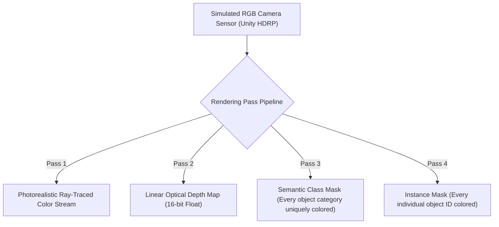

# Unity HDRP & Photorealistic Sensor Synthesis

While Gazebo Harmonic provides robust multi-body dynamics, modern vision-language-action foundation models and perception networks fail when trained on basic, flat-shaded 3D graphics. This visual discrepancy is a primary driver of the **Sim-to-Real Perception Gap**.

To bridge this gap, modern robotics co-simulates physics in Gazebo (or DART/MuJoCo) while delegating optical rendering and sensor synthesis to the **Unity Engine** via its **High Definition Render Pipeline (HDRP)** and the **Unity Robotics Hub**.

```mermaid
flowchart LR
    subgraph UnityWorld["Unity 3D Engine (Left-Handed Coordinate System: X-Right, Y-Up, Z-Forward)"]
        HDRP["Unity HDRP Ray-Tracing Engine"]
        PhysCamera["Simulated Fisheye / Rolling Shutter Camera Sensors"]
        UnityROSBridge["Unity ROS-TCP-Connector (C# Async Sockets)"]
        
        HDRP --> PhysCamera
        PhysCamera --> UnityROSBridge
    end

    subgraph CoordinateAdapter["Bidirectional Coordinate & Clock Transform"]
        Transform["Coordinate Transformation:<br/>X_ros = Z_unity<br/>Y_ros = -X_unity<br/>Z_ros = Y_unity"]
        ClockSync["Virtual Clock Sync (/clock at 1 kHz)"]
    end

    subgraph ROSNetwork["ROS 2 Ecosystem (Right-Handed Coordinate System: X-Forward, Y-Left, Z-Up)"]
        ROSTCP["ROS-TCP-Endpoint (Python / C++)"]
        TF2["TF2 Transform Tree (/tf, /tf_static)"]
        PerceptionPipeline["Vision Models (YOLO-World / FoundationPose / OpenVLA)"]
        
        ROSTCP --> TF2
        ROSTCP --> PerceptionPipeline
    end

    UnityROSBridge <-->|TCP Socket Stream (Port 10000)| CoordinateAdapter
    CoordinateAdapter <--> ROSTCP
```

---

## 1. The Coordinate Frame Transformation Challenge

One of the most insidious bugs in robotic graphics co-simulation is the mathematical mismatch between coordinate conventions:
- **ROS 2 Standard (REP-103)**: Right-handed Cartesian system:
  - $+X$: Forward
  - $+Y$: Left
  - $+Z$: Up
- **Unity Engine Standard**: Left-handed Cartesian system:
  - $+X$: Right
  - $+Y$: Up
  - $+Z$: Forward

### The Transformation Matrix
To convert a position vector `p_unity = [x_u, y_u, z_u]^T` to the ROS 2 frame `p_ros = [x_r, y_r, z_r]^T`:

```text
| x_r |   |  0   0   1 | | x_u |
| y_r | = | -1   0   0 | | y_u |
| z_r |   |  0   1   0 | | z_u |
```

For orientations (quaternions `q = [x, y, z, w]`), the inversion must preserve the chirality of rotations:

```text
q_ros = [-z_u, x_u, -y_u, w_u]
```

The Unity-Robotics-Hub handles these transformations automatically when using the `ROSGeometry` utility class.

---

## 2. Setting Up the ROS-TCP-Connector

The communication backbone between Unity and ROS 2 is the **ROS-TCP-Connector**:
1. On the ROS 2 workstation, launch the server endpoint:
   ```bash
   ros2 run ros_tcp_endpoint default_server_endpoint --ros-args -p ROS_IP:=0.0.0.0 -p ROS_PORT:=10000
   ```
2. Inside Unity, configure the `Robotics -> ROS Settings` panel:
   - **ROS IP Address**: The IP address of the ROS 2 host machine.
   - **ROS Port**: `10000`.
   - **Protocol**: `ROS 2`.
   - **Time Scale**: Synchronized with `/clock`.

---

## 3. Synthetic Perception & Semantic Segmentation Rendering

In Unity HDRP, custom camera shaders allow generating **ground-truth pixel annotations** at zero computational cost:



Because annotations are rendered directly by the GPU graphics pipeline, thousands of training images with pixel-perfect labels can be generated every minute to train perception models without manual human labeling.

In the next chapter, we synthesize these tools into a comprehensive hands-on lab: **Building and Simulating a Complete Bipedal Humanoid Model**.
