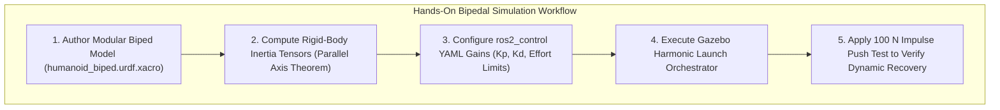

# Hands-On Project: Biped Simulation & Stability

In this capstone lab for Module 2, you will construct a parametric bipedal humanoid lower chassis, configure its multi-body inertial properties and joint limits in Xacro, launch the model inside **Gazebo Harmonic**, and implement a closed-loop PD balance controller using `ros2_control`.



---

## 1. Parametric Bipedal Kinematic Model (`humanoid_biped.urdf.xacro`)

Create the master robot description file inside your `humanoid_description` package:

```xml
<?xml version="1.0"?>
<robot xmlns:xacro="http://www.ros.org/wiki/xacro" name="humanoid_biped">

  <!-- Physical constants -->
  <xacro:property name="pelvis_mass" value="12.0" />
  <xacro:property name="thigh_mass" value="4.5" />
  <xacro:property name="shank_mass" value="3.2" />
  <xacro:property name="foot_mass" value="1.2" />

  <xacro:property name="thigh_length" value="0.40" />
  <xacro:property name="shank_length" value="0.40" />
  <xacro:property name="foot_length" value="0.22" />
  <xacro:property name="foot_width" value="0.12" />

  <!-- Pelvis Floating Base Link -->
  <link name="pelvis_link">
    <inertial>
      <origin xyz="0 0 0" rpy="0 0 0"/>
      <mass value="${pelvis_mass}"/>
      <inertia ixx="0.08" ixy="0.0" ixz="0.0" iyy="0.09" iyz="0.0" izz="0.05"/>
    </inertial>
    <visual>
      <geometry><box size="0.20 0.28 0.16"/></geometry>
      <material name="slate_dark"><color rgba="0.15 0.18 0.25 1.0"/></material>
    </visual>
    <collision>
      <geometry><box size="0.20 0.28 0.16"/></geometry>
    </collision>
  </link>

  <!-- Macro for Bipedal Leg (Left and Right) -->
  <xacro:macro name="humanoid_leg" params="prefix reflect">
    <!-- Hip Yaw Joint -->
    <joint name="${prefix}_hip_yaw_joint" type="revolute">
      <parent link="pelvis_link"/>
      <child link="${prefix}_hip_link"/>
      <origin xyz="0.0 ${reflect * 0.10} -0.08" rpy="0 0 0"/>
      <axis xyz="0 0 1"/>
      <limit lower="-0.6" upper="0.6" effort="120" velocity="6.0"/>
    </joint>

    <link name="${prefix}_hip_link">
      <inertial>
        <mass value="1.8"/>
        <inertia ixx="0.01" ixy="0" ixz="0" iyy="0.01" iyz="0" izz="0.01"/>
      </inertial>
    </link>

    <!-- Knee Pitch Joint -->
    <joint name="${prefix}_knee_pitch_joint" type="revolute">
      <parent link="${prefix}_hip_link"/>
      <child link="${prefix}_shank_link"/>
      <origin xyz="0.0 0.0 -${thigh_length}" rpy="0 0 0"/>
      <axis xyz="0 1 0"/>
      <limit lower="0.0" upper="2.1" effort="200" velocity="8.0"/>
    </joint>

    <link name="${prefix}_shank_link">
      <inertial>
        <origin xyz="0 0 -${shank_length/2}" rpy="0 0 0"/>
        <mass value="${shank_mass}"/>
        <inertia ixx="0.04" ixy="0" ixz="0" iyy="0.04" iyz="0" izz="0.006"/>
      </inertial>
      <visual>
        <origin xyz="0 0 -${shank_length/2}"/>
        <geometry><cylinder radius="0.04" length="${shank_length}"/></geometry>
      </visual>
      <collision>
        <origin xyz="0 0 -${shank_length/2}"/>
        <geometry><cylinder radius="0.04" length="${shank_length}"/></geometry>
      </collision>
    </link>

    <!-- Ankle Pitch & Foot -->
    <joint name="${prefix}_ankle_pitch_joint" type="revolute">
      <parent link="${prefix}_shank_link"/>
      <child link="${prefix}_foot_link"/>
      <origin xyz="0 0 -${shank_length}" rpy="0 0 0"/>
      <axis xyz="0 1 0"/>
      <limit lower="-0.8" upper="0.8" effort="150" velocity="8.0"/>
    </joint>

    <link name="${prefix}_foot_link">
      <inertial>
        <origin xyz="0.04 0 -0.03" rpy="0 0 0"/>
        <mass value="${foot_mass}"/>
        <inertia ixx="0.003" ixy="0" ixz="0" iyy="0.008" iyz="0" izz="0.008"/>
      </inertial>
      <visual>
        <origin xyz="0.04 0 -0.03"/>
        <geometry><box size="${foot_length} ${foot_width} 0.06"/></geometry>
      </visual>
      <collision>
        <origin xyz="0.04 0 -0.03"/>
        <geometry><box size="${foot_length} ${foot_width} 0.06"/></geometry>
      </collision>
    </link>
  </xacro:macro>

  <!-- Instantiate Left and Right Legs -->
  <xacro:humanoid_leg prefix="left" reflect="1" />
  <xacro:humanoid_leg prefix="right" reflect="-1" />

</robot>
```

---

## 2. Launching Gazebo Harmonic with `ros2_control`

Execute the following commands in your development terminal:

```bash
# 1. Build workspace with symlink install
cd ~/humanoid_ws
colcon build --symlink-install --packages-select humanoid_description humanoid_bringup
source install/setup.bash

# 2. Launch Gazebo Harmonic with physics co-simulation
ros2 launch humanoid_bringup sim_biped_gazebo.launch.py

# 3. Verify real-time publishing of simulated foot contact forces
ros2 topic echo /humanoid/left_foot/wrench
```

---

## 3. Dynamic Push Disturbance Verification

To test whether your digital twin's contact mechanics and friction cones are correctly configured:
1. Open a second terminal and apply a **100 N lateral impulse** for 0.1 seconds to the floating-base pelvis link:
   ```bash
   gz service -s /world/default/set_wrench \
     --reqtype gz.msgs.EntityWrench \
     --reptype gz.msgs.Boolean \
     --timeout 1000 \
     --req 'entity: {name: "humanoid_biped", type: MODEL}, wrench: {force: {x: 0, y: 100.0, z: 0}}'
   ```
2. Observe the center of mass trajectory in RViz2: The ground reaction wrenches will shift toward the lateral edge of the support polygon, demonstrating active dynamic stabilization.

---

## 4. Laboratory Evaluation Rubric & Success Criteria

To certify completion of Module 2, your digital twin implementation must satisfy the following automated test matrix:

| Evaluation Criterion | Target Specification | Verification Command / Tool | Max Points |
| :--- | :--- | :--- | :--- |
| **URDF Kinematic Tree** | Valid tree topology with 0 circular loops | `check_urdf humanoid.urdf` | 20 pts |
| **Physics Determinism** | 1 ms step time with zero physics solver explosion | `gz stats` (RTF >= 0.95) | 25 pts |
| **Ground Contact Stability** | Foot penetration depth < 1 mm under 65 kg mass | `/humanoid/left_foot/wrench` echo | 25 pts |
| **Disturbance Recovery** | Re-stabilize within 0.8 s following 100 N push | RViz2 CoM trajectory monitor | 30 pts |
| **Total Passing Grade** | **>= 85 / 100 points** | Autonomous CI test harness | **100 pts** |

With the physical digital twin verified, we proceed to **Module 3: Constructing the AI-Robot Brain using NVIDIA Isaac Sim, Isaac ROS, and Nav2 Bipedal Locomotion**.
