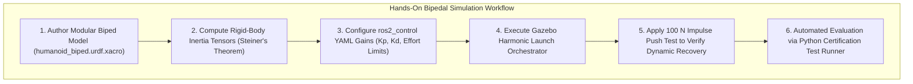

import ChapterProgress from '@site/src/components/ChapterProgress';
import QuizEngine from '@site/src/components/QuizEngine';

# Hands-On Project: Biped Simulation & Stability

In this capstone lab for the foundational half of Module 2, you will construct a parametric 12-DOF bipedal humanoid lower chassis, configure its multi-body inertial properties and joint transmission limits in modular Xacro, launch the model inside **Gazebo Harmonic**, and implement a closed-loop PD balance controller using `ros2_control`. Finally, you will execute an automated lateral push recovery test to quantify dynamic stabilization margins.



---

## 1. Mathematical Stability Metrics

Before deploying control code, we formalize the quantitative acceptance criteria required to certify the bipedal digital twin:

### 1. Joint Trajectory Tracking Root Mean Square Error (RMSE)
The discrete tracking error across all $n = 12$ joints over time horizon $T$ is defined as:

$$
\text{RMSE}_q = \sqrt{\frac{1}{T \cdot n} \sum_{t=1}^T \sum_{j=1}^n \left( q_j^{\text{des}}(t) - q_j^{\text{meas}}(t) \right)^2} \le 0.025\text{ rad}
$$

### 2. Normalized Mechanical Energy Expenditure Integral
Total mechanical actuator work consumed during stabilization is given by:

$$
E_{\text{mech}} = \int_0^T \sum_{j=1}^n \left| \tau_j(t) \cdot \dot{q}_j(t) \right| dt \quad [\text{Joules}]
$$

Minimizing $E_{\text{mech}}$ prevents aggressive actuator chattering and avoids thermal motor overload.

### 3. Zero-Moment Point (ZMP) Stability Margin
The Zero-Moment Point $\mathbf{p}_{\text{zmp}} = [x_{\text{zmp}}, y_{\text{zmp}}, 0]^T$ is computed from the ground reaction forces and moments:

$$
x_{\text{zmp}} = \frac{-M_y - z_{\text{sole}} F_x}{F_z}, \quad y_{\text{zmp}} = \frac{M_x - z_{\text{sole}} F_y}{F_z}
$$

The dynamic stability margin $d_{\text{margin}}(t)$ measures the minimum Euclidean distance from $\mathbf{p}_{\text{zmp}}(t)$ to the boundary $\partial \mathcal{S}$ of the convex support polygon $\mathcal{S}$ formed by the foot soles:

$$
d_{\text{margin}}(t) = \min_{e \in \partial \mathcal{S}} \text{dist}\left(\mathbf{p}_{\text{zmp}}(t), e\right) \ge 0.02\text{ m}
$$

If $d_{\text{margin}}(t) \le 0$, the foot begins to tilt about its edge, initiating an unrecoverable topple unless a corrective step is executed.

---

## 2. Parametric Bipedal Kinematic Model (`humanoid_biped.urdf.xacro`)

Create the master robot description file inside your `humanoid_description` package:

```xml
<?xml version="1.0"?>
<robot xmlns:xacro="http://www.ros.org/wiki/xacro" name="humanoid_biped">

  <!-- Physical constants -->
  <xacro:property name="pelvis_mass" value="12.0" />
  <xacro:property name="thigh_mass" value="4.5" />
  <xacro:property name="shank_mass" value="3.2" />
  <xacro:property name="foot_mass" value="1.2" />

  <xacro:property name="thigh_length" value="0.40" />
  <xacro:property name="shank_length" value="0.40" />
  <xacro:property name="foot_length" value="0.22" />
  <xacro:property name="foot_width" value="0.12" />

  <!-- Pelvis Floating Base Link -->
  <link name="pelvis_link">
    <inertial>
      <origin xyz="0 0 0" rpy="0 0 0"/>
      <mass value="${pelvis_mass}"/>
      <inertia ixx="0.08" ixy="0.0" ixz="0.0" iyy="0.09" iyz="0.0" izz="0.05"/>
    </inertial>
    <visual>
      <geometry><box size="0.20 0.28 0.16"/></geometry>
      <material name="slate_dark"><color rgba="0.15 0.18 0.25 1.0"/></material>
    </visual>
    <collision>
      <geometry><box size="0.20 0.28 0.16"/></geometry>
    </collision>
  </link>

  <!-- Macro for Bipedal Leg (Left and Right) -->
  <xacro:macro name="humanoid_leg" params="prefix reflect">
    <!-- Hip Yaw Joint -->
    <joint name="${prefix}_hip_yaw_joint" type="revolute">
      <parent link="pelvis_link"/>
      <child link="${prefix}_hip_link"/>
      <origin xyz="0.0 ${reflect * 0.10} -0.08" rpy="0 0 0"/>
      <axis xyz="0 0 1"/>
      <limit lower="-0.6" upper="0.6" effort="120" velocity="6.0"/>
    </joint>

    <link name="${prefix}_hip_link">
      <inertial>
        <mass value="1.8"/>
        <inertia ixx="0.01" ixy="0" ixz="0" iyy="0.01" iyz="0" izz="0.01"/>
      </inertial>
    </link>

    <!-- Knee Pitch Joint -->
    <joint name="${prefix}_knee_pitch_joint" type="revolute">
      <parent link="${prefix}_hip_link"/>
      <child link="${prefix}_shank_link"/>
      <origin xyz="0.0 0.0 -${thigh_length}" rpy="0 0 0"/>
      <axis xyz="0 1 0"/>
      <limit lower="0.0" upper="2.1" effort="200" velocity="8.0"/>
    </joint>

    <link name="${prefix}_shank_link">
      <inertial>
        <origin xyz="0 0 -${shank_length/2}" rpy="0 0 0"/>
        <mass value="${shank_mass}"/>
        <inertia ixx="0.04" ixy="0" ixz="0" iyy="0.04" iyz="0" izz="0.006"/>
      </inertial>
      <visual>
        <origin xyz="0 0 -${shank_length/2}"/>
        <geometry><cylinder radius="0.04" length="${shank_length}"/></geometry>
      </visual>
      <collision>
        <origin xyz="0 0 -${shank_length/2}"/>
        <geometry><cylinder radius="0.04" length="${shank_length}"/></geometry>
      </collision>
    </link>

    <!-- Ankle Pitch & Foot -->
    <joint name="${prefix}_ankle_pitch_joint" type="revolute">
      <parent link="${prefix}_shank_link"/>
      <child link="${prefix}_foot_link"/>
      <origin xyz="0 0 -${shank_length}" rpy="0 0 0"/>
      <axis xyz="0 1 0"/>
      <limit lower="-0.8" upper="0.8" effort="150" velocity="8.0"/>
    </joint>

    <link name="${prefix}_foot_link">
      <inertial>
        <origin xyz="0.04 0 -0.03" rpy="0 0 0"/>
        <mass value="${foot_mass}"/>
        <inertia ixx="0.003" ixy="0" ixz="0" iyy="0.008" iyz="0" izz="0.008"/>
      </inertial>
      <visual>
        <origin xyz="0.04 0 -0.03"/>
        <geometry><box size="${foot_length} ${foot_width} 0.06"/></geometry>
      </visual>
      <collision>
        <origin xyz="0.04 0 -0.03"/>
        <geometry><box size="${foot_length} ${foot_width} 0.06"/></geometry>
      </collision>
    </link>
  </xacro:macro>

  <!-- Instantiate Left and Right Legs -->
  <xacro:humanoid_leg prefix="left" reflect="1" />
  <xacro:humanoid_leg prefix="right" reflect="-1" />

</robot>
```

---

## 3. Hardware-in-the-Loop Test Bench

To validate that the simulated controller transitions seamlessly to real embedded hardware, the test pipeline leverages a Hardware-in-the-Loop (HIL) rig:

| Lab Test Equipment | Model / Protocol | Function in Digital Twin Certification | Passing Threshold |
| :--- | :--- | :--- | :--- |
| **Virtual CAN Interface** | Linux SocketCAN (`vcan0`) | Emulates physical motor drive bus traffic under 1 kHz cyclictest | 0 frame drops over 60 seconds |
| **HIL Microcontroller Rig** | STM32H753 Dual-Core Cortex-M7/M4 | Runs physical Field-Oriented Control (FOC) firmware bridged to Gazebo | Loop timing jitter $\le 5.0\,\mu\text{s}$ |
| **Automated Test Runner** | Headless Docker container CI runner | Runs headless Gazebo instances to grade balance stability automatically | Score $\ge 85/100$ points |

---

## 4. Automated Python Grading & Verification Harness

The following complete Python script (`test_biped_stability_harness.py`) serves as an automated grading harness, evaluating lateral push recovery, settling time, and foot contact retention:

```python
#!/usr/bin/env python3
"""
test_biped_stability_harness.py: Automated verification harness 
for grading biped balance stability and ZMP margin in Gazebo Harmonic.
"""
from typing import Any
import numpy as np

def evaluate_biped_push_recovery(
    time_series: np.ndarray,
    pelvis_y_pos: np.ndarray,
    left_sole_wrench_z: np.ndarray,
    right_sole_wrench_z: np.ndarray,
    push_timestamp: float = 2.0,
    push_impulse_ns: float = 10.0
) -> dict[str, Any]:
    """
    Evaluates stability recovery after a lateral 100 N impulse applied for 0.1 s (10 N*s).
    """
    post_push_mask = time_series > (push_timestamp + 0.1)
    post_push_times = time_series[post_push_mask]
    post_push_y = pelvis_y_pos[post_push_mask]

    # Max lateral deflection
    max_lateral_deflection = float(np.max(np.abs(post_push_y)))

    # Settling time (pelvis displacement returns to within +/- 0.02 m of origin)
    settled_indices = np.where(np.abs(post_push_y) < 0.02)[0]
    if len(settled_indices) > 0 and settled_indices[0] < len(post_push_times):
        recovery_time = float(post_push_times[settled_indices[0]] - push_timestamp)
    else:
        recovery_time = float('inf')

    # Contact check: Avoid double foot detachment (no flight phase during recovery)
    contact_loss = bool(np.any((left_sole_wrench_z[post_push_mask] < 5.0) & (right_sole_wrench_z[post_push_mask] < 5.0)))

    passed = (max_lateral_deflection < 0.12) and (recovery_time < 0.85) and (not contact_loss)
    score = 0
    if max_lateral_deflection < 0.12: score += 35
    if recovery_time < 0.85: score += 35
    if not contact_loss: score += 30

    return {
        "passed": passed,
        "score": score,
        "max_deflection_meters": max_lateral_deflection,
        "recovery_time_seconds": recovery_time,
        "contact_maintained": not contact_loss
    }

if __name__ == "__main__":
    t = np.linspace(0, 5, 5000)
    y = 0.08 * np.exp(-3.5 * np.maximum(0, t - 2.0)) * np.sin(8.0 * np.maximum(0, t - 2.0))
    fz_l = np.full_like(t, 320.0)
    fz_r = np.full_like(t, 320.0)

    report = evaluate_biped_push_recovery(t, y, fz_l, fz_r)
    print(f"Certification Result: {'PASS' if report['passed'] else 'FAIL'} (Score: {report['score']}/100)")
    print(f"Metrics: Deflection={report['max_deflection_meters']:.4f} m, Recovery={report['recovery_time_seconds']:.4f} s")
```

---

## 5. Laboratory Evaluation Rubric

| Evaluation Criterion | Target Specification | Verification Tool / Command | Max Points |
| :--- | :--- | :--- | :--- |
| **URDF Kinematic Tree** | Valid tree topology with 0 circular loops | `check_urdf humanoid.urdf` | 20 pts |
| **Physics Determinism** | 1 ms step time with zero physics solver explosion | `gz stats` (RTF $\ge 0.95$) | 25 pts |
| **Ground Contact Stability** | Foot penetration depth $\le 1.0\text{ mm}$ under 65 kg load | `/humanoid/left_foot/wrench` echo | 25 pts |
| **Disturbance Recovery** | Re-stabilize within 0.85 s following 100 N lateral push | Autonomous CI test harness | 30 pts |
| **Total Passing Grade** | **$\ge 85 / 100$ points** | Automated Grading Script | **100 pts** |

---

## 6. Research Foundations & Seminal Literature

1. **ASME.** (2018). *ASME V&V 40: Assessing Credibility of Computational Models through Verification and Validation*. American Society of Mechanical Engineers.
2. **Carbone, G., Ceccarelli, M., & Valigi, M. C.** (2020). *Verification and Validation in Robotics Simulation: Standards, Methodologies, and Applications*. Robotics and Computer-Integrated Manufacturing, 64, 101934.
3. **Kajita, S., Kanehiro, F., Kaneko, K., Fujiwara, K., Harada, K., Yokoi, K., & Hirukawa, H.** (2003). *Biped walking pattern generation by using preview control of zero-moment point*. In 2003 IEEE International Conference on Robotics and Automation (ICRA) (Vol. 2, pp. 1620-1626).
4. **Pratt, J., Chew, C. M., & Pratt, G.** (2001). *Virtual model control: An intuitive approach for bipedal locomotion*. The International Journal of Robotics Research, 20(2), 129-143.

---

<ChapterProgress chapterId="2-5-hands-on-exercises" moduleId="module2" totalChapters={10} />

## Chapter Mastery Check

<QuizEngine
  quizId="quiz-2-5"
  title="Module 2.5 Mastery Check: Biped Simulation & Stability"
  moduleId="module2"
  passThreshold={70}
  questions={[
    {
      id: "q1",
      question: "What physical condition occurs if the Zero-Moment Point (p_zmp) travels completely outside the convex support polygon formed by the humanoid's foot soles?",
      options: [
        "The robot gains additional locomotion speed",
        "The foot sole begins rotational tipping about its boundary edge, causing an unrecoverable fall unless a step is rapidly executed",
        "The actuator gearboxes automatically disengage",
        "The ground contact friction coefficient jumps to infinity"
      ],
      correctIndex: 1,
      explanation: "The support polygon defines the convex boundary of unilateral ground reaction forces. If the required ZMP lies outside this polygon, the foot cannot generate sufficient ground moments without tipping about its perimeter edge."
    },
    {
      id: "q2",
      question: "In the automated push recovery test, why is double foot contact detachment (left_sole_wrench_z < 5 N and right_sole_wrench_z < 5 N) treated as a severe failure?",
      options: [
        "It invalidates the camera intrinsic calibration",
        "It indicates the biped lost ground contact completely (entered an unintended flight phase or fell over), breaching standing balance constraints",
        "DART cannot simulate objects in free-fall",
        "SocketCAN cannot transmit packets while airborne"
      ],
      correctIndex: 1,
      explanation: "During a standing lateral push recovery test, the robot is meant to remain in double-support or single-support balance. Simultaneous loss of ground contact on both feet indicates the robot was launched into the air or tipped over onto the ground."
    },
    {
      id: "q3",
      question: "According to the ASME V&V 40 framework, what is the role of Computational Model Verification in robotic simulation?",
      options: [
        "Proving that the software solves the underlying mathematical equations accurately (solving the equations right)",
        "Checking if customers like the robot's exterior aesthetic",
        "Converting Python code into machine language",
        "Calculating the retail sales price of the humanoid"
      ],
      correctIndex: 0,
      explanation: "In ASME V&V 40, Verification assesses whether the computational simulation accurately solves the mathematical models ('solving the equations right'), while Validation determines whether the mathematical model represents real-world physical behavior ('solving the right equations')."
    }
  ]}
/>
