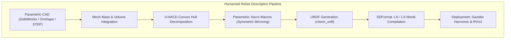
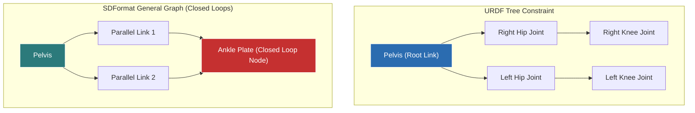

import ChapterProgress from '@site/src/components/ChapterProgress';
import QuizEngine from '@site/src/components/QuizEngine';

# Robot Description Formats: URDF, SDF & Xacro Mastery

In modern embodied AI engineering, a humanoid robot's description file is the single source of truth connecting mechanical CAD models to physics simulators, state estimators, motion planning frameworks, and whole-body balance controllers. A single typographical error in a joint axis, an unphysical negative inertia tensor value, or a mislocated center of mass will induce catastrophic numerical instability across simulation and physical hardware alike.

This chapter provides a comprehensive, graduate-level mastery of **Universal Robot Description Format (URDF)**, **Simulation Description Format (SDFormat 1.8+)**, and **Xacro (XML Macros)** for high-degree-of-freedom (28+ DOF) humanoid robots.



---

## 1. URDF vs. SDFormat: Architectural Comparison

Roboticists often confuse URDF and SDFormat. While URDF is the historical standard for ROS kinematic trees, SDFormat is designed for multi-body simulation:

| Architectural Feature | URDF (Unified Robot Description Format) | SDFormat 1.8+ (Simulation Description Format) |
| :--- | :--- | :--- |
| **Kinematic Topology** | Strictly tree-structured Directed Acyclic Graph (DAG); **cannot** model closed kinematic loops | Arbitrary graph topology; fully supports **closed kinematic loops** (e.g., parallel four-bar ankle linkages) |
| **World & Environment** | Single isolated robot mechanism; no native world or physics definitions | Full simulation world: lighting, atmosphere, multiple interacting robots, physics engines |
| **Sensor Plugins** | Ad-hoc ROS extension tags (`<gazebo>` wrappers) | Natively standardized sensor entities (`<sensor>`, `<camera>`, `<lidar>`, `<imu>`) |
| **Model Composition** | Requires external pre-processors (Xacro) | Native model nesting (`<include>`, `<model>`) and coordinate re-basing |
| **Degrees of Freedom** | Single DOF per joint (revolute, continuous, prismatic) | Multi-DOF joints (universal, ball-and-socket, screw, planar) |



---

## 2. Spatial Rigid-Body Dynamics & Inertia Tensors

Every rigid link $i$ in a multi-body robot possesses mass $m$, a Center of Mass (CoM) position vector $\mathbf{c} \in \mathbb{R}^3$, and a symmetric $3 \times 3$ Spatial Inertia Tensor $\mathbf{I} \in \mathbb{R}^{3 \times 3}$.

The continuous mass moment integral over the link volume $V$ with spatial mass density $\rho(\mathbf{r})$ is:

$$
\mathbf{I} = \int_V \rho(\mathbf{r}) \left( (\mathbf{r}^T \mathbf{r})\mathbf{I}_{3 \times 3} - \mathbf{r}\mathbf{r}^T \right) dV = \begin{bmatrix} I_{xx} & I_{xy} & I_{xz} \\ I_{xy} & I_{yy} & I_{yz} \\ I_{xz} & I_{yz} & I_{zz} \end{bmatrix}
$$

where the diagonal components (moments of inertia) and off-diagonal components (products of inertia) are:

$$
I_{xx} = \int_V \rho(\mathbf{r})(y^2 + z^2) dV, \quad I_{yy} = \int_V \rho(\mathbf{r})(x^2 + z^2) dV, \quad I_{zz} = \int_V \rho(\mathbf{r})(x^2 + y^2) dV
$$

$$
I_{xy} = -\int_V \rho(\mathbf{r})xy \, dV, \quad I_{xz} = -\int_V \rho(\mathbf{r})xz \, dV, \quad I_{yz} = -\int_V \rho(\mathbf{r})yz \, dV
$$

---

## 3. Mathematical Formulation of the Parallel Axis Theorem (Steiner's Theorem)

In CAD software, inertia tensors are initially evaluated relative to the CAD model's part origin $\mathcal{O}_{\text{CAD}}$. To export the link to URDF, the inertia must be transformed to the link's **Center of Mass (CoM)** frame $\mathcal{C}$.

The general 3D **Parallel Axis Theorem (Steiner's Theorem)** expresses the relationship between the inertia tensor at the origin $\mathbf{I}_{\text{origin}}$ and the central inertia tensor $\mathbf{I}_{\text{cm}}$:

$$
\mathbf{I}_{\text{origin}} = \mathbf{I}_{\text{cm}} + m \left( (\mathbf{d}^T \mathbf{d})\mathbf{I}_{3 \times 3} - \mathbf{d}\mathbf{d}^T \right)
$$

where $\mathbf{d} = [x_d, y_d, z_d]^T = \mathbf{p}_{\text{cm}} - \mathbf{p}_{\text{origin}}$ is the translation displacement vector. In explicit matrix notation:

$$
\mathbf{I}_{\text{origin}} = \mathbf{I}_{\text{cm}} + m \begin{bmatrix} y_d^2 + z_d^2 & -x_d y_d & -x_d z_d \\ -x_d y_d & x_d^2 + z_d^2 & -y_d z_d \\ -x_d z_d & -y_d z_d & x_d^2 + y_d^2 \end{bmatrix}
$$

Rearranging to solve for the central inertia tensor required by URDF/SDF:

$$
\mathbf{I}_{\text{cm}} = \mathbf{I}_{\text{origin}} - m \left( (\mathbf{d}^T \mathbf{d})\mathbf{I}_{3 \times 3} - \mathbf{d}\mathbf{d}^T \right)
$$

---

## 4. Physical Realizability Constraints & Triangle Inequalities

Physics engines will suffer immediate numerical breakdown if an author inputs a mathematically valid matrix that violates physical realizability. For any real 3D physical body, the inertia tensor must satisfy two inviolable criteria:

### 1. Strict Positive Definiteness
All eigenvalues $\lambda_1, \lambda_2, \lambda_3$ of $\mathbf{I}_{\text{cm}}$ must be strictly positive:

$$
\mathbf{I}_{\text{cm}} \succ 0 \iff \lambda_i > 0 \quad \forall i \in \{1, 2, 3\}
$$

### 2. The Triangle Inequality on Principal Moments
Because mass moments are integrals of squared distance coordinates ($x^2, y^2, z^2 \ge 0$), the principal moments of inertia $\lambda_1 \le \lambda_2 \le \lambda_3$ must satisfy the triangle inequalities:

$$
\lambda_1 + \lambda_2 \ge \lambda_3
$$

$$
\lambda_2 + \lambda_3 \ge \lambda_1
$$

$$
\lambda_1 + \lambda_3 \ge \lambda_2
$$

If $\lambda_1 + \lambda_2 < \lambda_3$, the tensor implies negative physical mass along one coordinate axis, causing Featherstone's articulated body sweep to divide by zero or yield negative kinetic energy.

---

## 5. Structural Materials & Hardware Breakdown

When engineering a humanoid digital twin, link masses and inertias should reflect actual structural alloys and composite fabrication methods:

| Humanoid Link Subsystem | Primary Material | Density ($\rho$) | Young's Modulus ($E$) | Inertial Characteristic |
| :--- | :--- | :--- | :--- | :--- |
| **Pelvis Primary Chassis** | 7075-T6 Billet Aluminum | $2810\text{ kg/m}^3$ | $71.7\text{ GPa}$ | Symmetric across sagittal plane ($I_{xy} \approx 0, I_{yz} \approx 0$) |
| **Femur / Thigh Spars** | High-Modulus Carbon Fiber | $1550\text{ kg/m}^3$ | $230.0\text{ GPa}$ | Anisotropic along longitudinal axis ($I_{zz} \ll I_{xx} \approx I_{yy}$) |
| **BLDC Motor Stator & Rotor** | Electrical Silicon Steel / NdFeB | $7600\text{ kg/m}^3$ | $200.0\text{ GPa}$ | Cylindrically symmetric about joint rotation vector |
| **Foot Sole Traction Tread** | Molded Polyurethane (Shore 60A) | $1200\text{ kg/m}^3$ | $0.05\text{ GPa}$ | High surface compliance; thin planar plate ($I_{zz} \approx I_{xx} + I_{yy}$) |

---

## 6. Modular Parametric Xacro Architecture

Below is a production-grade modular Xacro macro illustrating symmetric leg parameterization with transmission gear ratio definitions:

```xml
<?xml version="1.0"?>
<robot xmlns:xacro="http://www.ros.org/wiki/xacro">

  <!-- Reusable Modular Humanoid Leg Macro -->
  <xacro:macro name="humanoid_leg_module" params="side reflect parent_link *origin">
    
    <!-- Hip Roll Joint -->
    <joint name="${side}_hip_roll_joint" type="revolute">
      <xacro:insert_block name="origin"/>
      <parent link="${parent_link}"/>
      <child link="${side}_hip_roll_link"/>
      <axis xyz="1 0 0"/>
      <limit lower="-0.35" upper="0.55" effort="180.0" velocity="6.28"/>
      <dynamics damping="0.5" friction="0.1"/>
    </joint>

    <link name="${side}_hip_roll_link">
      <inertial>
        <origin xyz="0.0 ${reflect * 0.02} -0.04" rpy="0 0 0"/>
        <mass value="2.45"/>
        <inertia ixx="0.0082" ixy="${reflect * 0.0001}" ixz="0.0"
                 iyy="0.0075" iyz="0.0002" izz="0.0041"/>
      </inertial>
      <visual>
        <geometry><mesh filename="package://humanoid_description/meshes/hip_roll.dae"/></geometry>
      </visual>
      <collision>
        <geometry><mesh filename="package://humanoid_description/meshes/collision/hip_roll_vhacd.obj"/></geometry>
      </collision>
    </link>

    <!-- Transmission Interface for ros2_control -->
    <transmission name="${side}_hip_roll_trans">
      <type>transmission_interface/SimpleTransmission</type>
      <joint name="${side}_hip_roll_joint">
        <hardwareInterface>hardware_interface/EffortJointInterface</hardwareInterface>
      </joint>
      <actuator name="${side}_hip_roll_motor">
        <mechanicalReduction>50.0</mechanicalReduction>
      </actuator>
    </transmission>

  </xacro:macro>
</robot>
```

---

## 7. Convex Collision Decomposition via V-HACD

Directly loading high-poly CAD surface meshes (e.g., 200,000 triangular facets) into collision pipelines stalls physics solvers. Simulators require **Convex Hulls**. 

Using **Volumetric Hierarchical Approximate Convex Decomposition (V-HACD)**, concave mechanical parts are partitioned into an optimal union of convex shapes:

$$
\mathcal{P} \approx \bigcup_{k=1}^K \mathcal{C}_k, \quad \mathcal{C}_k = \text{Conv}(\mathcal{V}_k)
$$

This reduces collision detection from $\mathcal{O}(F_1 \cdot F_2)$ general polygon intersection down to $\mathcal{O}(1)$ via the Gilbert-Johnson-Keerthi (GJK) algorithm.

---

## 8. Runnable Code: Automated Inertia Matrix Physical Feasibility Validator

The following production Python script analyzes humanoid link inertia tensors, verifies strict positive-definiteness, and checks the triangle inequality:

```python
#!/usr/bin/env python3
"""
validate_inertia_tensor.py: Verifies physical consistency, positive definiteness,
and triangle inequalities for humanoid link inertia matrices.
"""
from typing import Any
import numpy as np

def validate_link_inertia(
    link_name: str,
    mass: float,
    ixx: float,
    iyy: float,
    izz: float,
    ixy: float = 0.0,
    ixz: float = 0.0,
    iyz: float = 0.0
) -> dict[str, Any]:
    """
    Validates mass and inertia tensor against physical laws.
    """
    errors: list[str] = []
    
    if mass <= 0.0:
        errors.append(f"Non-positive mass: {mass} kg")

    I = np.array([
        [ixx, ixy, ixz],
        [ixy, iyy, iyz],
        [ixz, iyz, izz]
    ], dtype=np.float64)

    # Check symmetry
    if not np.allclose(I, I.T, atol=1e-8):
        errors.append("Inertia matrix is asymmetric")

    # Eigenvalue decomposition
    eigenvalues = np.linalg.eigvalsh(I)
    
    # 1. Positive definiteness
    if np.any(eigenvalues <= 0.0):
        errors.append(f"Inertia matrix not positive-definite! Eigenvalues: {eigenvalues}")

    # 2. Triangle inequality on principal moments
    l1, l2, l3 = np.sort(eigenvalues)
    if (l1 + l2 < l3 - 1e-7):
        errors.append(
            f"Triangle inequality violated: l1 ({l1:.5f}) + l2 ({l2:.5f}) = {l1+l2:.5f} < l3 ({l3:.5f})"
        )

    is_valid = len(errors) == 0
    return {
        "link_name": link_name,
        "is_valid": is_valid,
        "mass": mass,
        "principal_moments": eigenvalues.tolist(),
        "errors": errors
    }

if __name__ == "__main__":
    test_links = [
        ("thigh_link_valid", 4.5, 0.045, 0.045, 0.008, 0.0, 0.0, 0.0),
        ("unphysical_flat_sheet", 2.0, 0.010, 0.020, 0.050, 0.0, 0.0, 0.0),
    ]

    for name, m, ixx, iyy, izz, ixy, ixz, iyz in test_links:
        res = validate_link_inertia(name, m, ixx, iyy, izz, ixy, ixz, iyz)
        status = "PASSED" if res["is_valid"] else "FAILED"
        print(f"[{status}] Link '{res['link_name']}':")
        print(f"  Principal Moments: {res['principal_moments']}")
        if not res["is_valid"]:
            for err in res["errors"]:
                print(f"  -> Error: {err}")
```

---

## 9. Research Foundations & Open Standards

1. **Siciliano, B., & Khatib, O.** (Eds.). (2016). *Springer Handbook of Robotics* (2nd ed.). Springer International Publishing.
2. **Open Robotics.** (2022). *SDFormat Specification Version 1.8 & 1.9*. Open Source Robotics Foundation. http://sdformat.org/spec
3. **Mamou, K., & Ghorbel, F.** (2009). *A Simple and Efficient Approach for 3D Mesh Approximate Convex Decomposition*. In 2009 16th IEEE International Conference on Image Processing (ICIP) (pp. 3501-3504).
4. **Featherstone, R.** (2008). *Rigid Body Dynamics Algorithms*. Springer Science & Business Media.

---

<ChapterProgress chapterId="2-6-urdf-and-sdf-mastery" moduleId="module2" totalChapters={10} />

## Chapter Mastery Check

<QuizEngine
  quizId="quiz-2-6"
  title="Module 2.6 Mastery Check: URDF, SDF & Xacro Mastery"
  moduleId="module2"
  passThreshold={70}
  questions={[
    {
      id: "q1",
      question: "Why can standard URDF not natively describe closed kinematic loops such as parallel four-bar ankle linkages?",
      options: [
        "URDF parser does not support XML attributes",
        "URDF enforces a strict tree-structured Directed Acyclic Graph (DAG) where every link except the root must have exactly one parent link",
        "XML files cannot define floating-point joint limits",
        "ROS 2 does not support parallel actuators"
      ],
      correctIndex: 1,
      explanation: "URDF strictly requires a single tree kinematic topology where each link has a single parent. Modeling closed loops requires SDFormat or specialized virtual joints with constraint solvers."
    },
    {
      id: "q2",
      question: "If the principal moments of inertia for a proposed robot link are lambda_1 = 0.010, lambda_2 = 0.020, and lambda_3 = 0.050 kg*m^2, why will a physics simulator fail?",
      options: [
        "The moments are too large for floating-point 32-bit storage",
        "The values violate the physical triangle inequality (lambda_1 + lambda_2 < lambda_3), implying impossible negative physical mass distribution",
        "The inertia tensor is not diagonal",
        "The center of mass is located at the origin"
      ],
      correctIndex: 1,
      explanation: "For any real 3D physical body, the sum of any two principal moments must be greater than or equal to the third (lambda_1 + lambda_2 >= lambda_3). Here, 0.010 + 0.020 = 0.030 < 0.050, which violates basic physics and destabilizes dynamic solvers."
    },
    {
      id: "q3",
      question: "What is the primary computational benefit of applying V-HACD (Volumetric Hierarchical Approximate Convex Decomposition) to CAD collision meshes?",
      options: [
        "It increases the visual aesthetic in RViz",
        "It decomposes complex concave meshes into a union of convex hulls, enabling O(1) GJK contact distance queries instead of costly O(F1 * F2) polygon checks",
        "It automatically computes motor gear ratios",
        "It eliminates the need for mass properties"
      ],
      correctIndex: 1,
      explanation: "Collision checking between general non-convex polygon meshes scales with the product of triangular facets O(F1 * F2). Decomposing meshes into convex hulls allows physics engines to execute lightning-fast O(1) GJK/EPA collision checks."
    }
  ]}
/>
